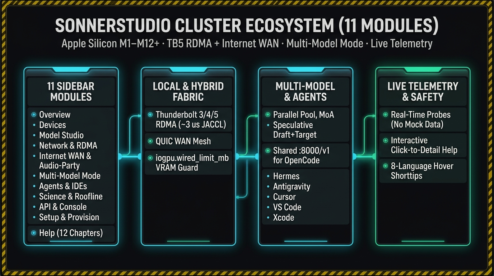
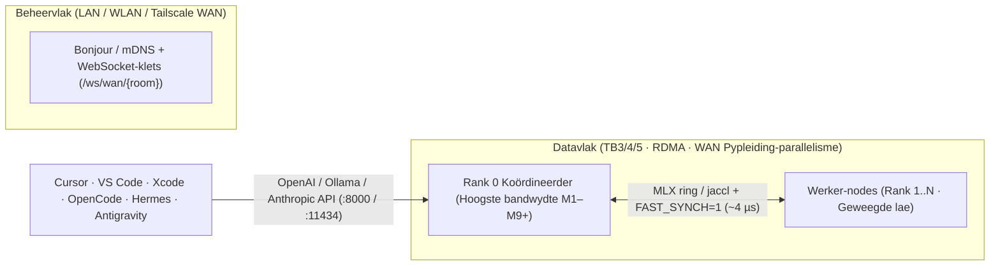
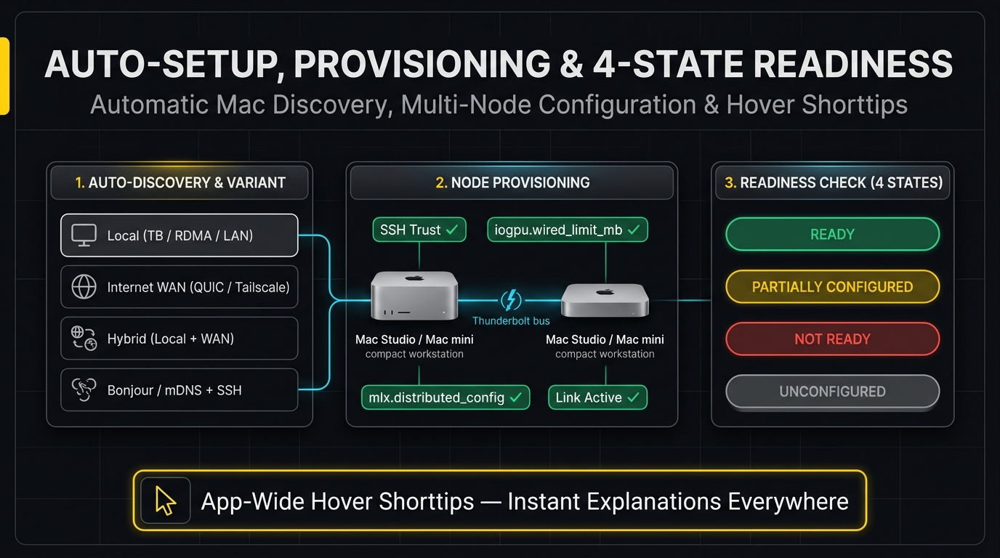

<div align="center">

# ☀️ SonnerStudio Cluster-Case-Companion (SS-CCC)

   **[English](README.md)** ·    **[Deutsch](README.de.md)** ·    **[Français](README.fr.md)** ·    **[Español](README.es.md)**<br/>
  **[Português](README.pt.md)** ·  **[Русский](README.ru.md)** ·  **[日本語](README.ja.md)** ·  **[中文](README.zh.md)**<br/>
  **[Nederlands](README.nl.md)** ·   **[Afrikaans](README.af.md)** ·  **[Polski](README.pl.md)** ·  **[Čeština](README.cs.md)**<br/>
 **[Slovenčina](README.sk.md)** ·  **[Magyar](README.hu.md)** ·  **[한국어](README.ko.md)** ·  **[हिन्दी](README.hi.md)** ·    **[தமிழ்](README.ta.md)**
<br/><a href="https://hits.sh/github.com/SonnerStudio/SonnerStudio-Cluster-Case-Companion/"></a>

*Inheemse macOS Apple Silicon-klusterbestuurder & verspreide MLX-inferensie-ateljee*

<table>
  <tr>
    <td align="center">
      <br/>
      <sub><b>Klustermodus (52 GB Gedeelde Poel · 2 Nodes)</b></sub>
    </td>
    <td align="center">
      <br/>
      <sub><b>Alleenstaande Modus (16 GB Plaaslik · 1 Node)</b></sub>
    </td>
  </tr>
</table>

</div>

---

## 🧭 Oorsig

**SonnerStudio Cluster-Case-Companion (SS-CCC)** verenig die geheue en rekenkrag van enige **Apple Silicon-Macs (M1–M9+)** — van 'n enkele Mac mini of MacBook Pro tot multi-Mac **Thunderbolt 3/4/5 & RDMA**-lessenaars of **wêreldwye internet-WAN-klusters (2–256+ Macs)** — met direkte **MLX**, **oMLX**, **Ollama** en **llama.cpp**-integrasie.

<div align="center">
  
</div>

---

## 🌐 Wêreldwye internetkluster, regstreekse klets & wetenskaplike Roofline

<table>
  <tr>
    <td align="center" width="50%">
      <br/>
      <sub><b>Wêreldwye internetkluster & deelnemerklets</b><br/>Tailscale · WireGuard · libp2p QUIC · DERP · <code>/status</code> · <code>/layers</code> · <code>/ping</code></sub>
    </td>
    <td align="center" width="50%">
      <br/>
      <sub><b>Wetenskaplike Roofline & energie-ontledings</b><br/>Log-Log Roofline · GPipe Bubble · <code>J/token</code> · <code>p50/p95/p99</code> · CSV/JSON/BibTeX</sub>
    </td>
  </tr>
</table>

---

## 🏗️ Hibriede argitektuur (Beheervlak, Thunderbolt & WAN)



---

## 🌐 Internetkluster WAN-bandwydte & deurvloei-monitor


Binne **Internetkluster & Klets** meet SS-CCC voortdurend werklike WAN-skakelprestasie (`netstat`, `ping`, `networkQuality`) — en volg **Aflaai / Oplaai Mbps**, **WAN-RTT-vertraging (ms)**, **jitter**, **pakkieverlies** en **tekensinkronisasie-doeltreffendheid** — direk gekoppel aan verspreide `tok/s` oor vennootnodes.

---

## ✨ Sleutelvermoëns

- **Universele Apple Silicon-klustering (M1–M9+):** Kombineer enige **Mac mini, MacBook Air/Pro, iMac, Mac Studio of Mac Pro** oor **M1 tot M6** en toekomstige **M7, M8, M9+**-geslagte. Die node met hoogste geheuebandwydte word outomaties **Rank 0 (Koördineerder)** met veilige `iogpu.wired_limit_mb`-macOS-reserwes.
- **Volledige stelsel- & sensortelemetrie:** Lees `sysctl`, `sw_vers`, `system_profiler`, `ibv_devices`, `ipconfig`, `ioreg` en `ProcessInfo.thermalState` — en vertoon **CPU P/E-kerns, GPU-kerns, Neural Engine (16/32 ANE-kerns), NVMe SSD-kapasiteit, termiese toestand en kragverbruik** langs mekaar.
- **Alle Thunderbolt-klasse (TB3 / TB4 / TB5) & RDMA:** Onderhandel dinamies paarsgewyse skakelspoed oor M1–M9+ (`TB3/USB4: 26–32 Gbps`, `TB4: 30–37 Gbps`, `TB5: 65–80 Gbps`, `TB5 RDMA: 75–110 Gbps`) met `MLX_METAL_FAST_SYNCH=1` (45× vinniger GPU/CPU-sinkronisasie).
- **Regstreekse Modelwerkwinkel & looptydgereedheid:** Ontdek werklike geïnstalleerde/lopende modelle vanaf **oMLX**, **Ollama**, **llama.cpp**, plaaslike `.gguf`-lêers en `~/.cache/huggingface/hub`, met geheuegeweegde laagverdeling en KV-kaskwantisering (`FP16 / 8-bit / 4-bit`).
- **6× 1-kliek agent- & IDE-integrasies:** Onmiddellike opstelling-uitvoer vir **OpenCode**, **Hermes Agent**, **Google Antigravity**, **Cursor**, **Visual Studio Code** en **Apple Xcode**.
- **Wêreldwye internet-WAN-kluster & deelnemerklets (`/ws/wan/{room_id}`):** Verbind Macs wêreldwyd in verspreide klusters oor versleutelde tonnels (Tailscale / WireGuard, libp2p / DERP P2P of handmatige eindpunt) met ingeboude intydse klets.
- **6-oortjie Wetenskap- & WAN-laboratorium + geskiedenisopname:** Wissel naatloos tussen **Plaaslik (TB/RDMA)**, **Internet WAN** en **Sy-aan-sy-vergelyking** oor **Roofline**, **WAN-topologie & skaal**, **Geheue & KV**, **Energie, CO₂ & koste**, **Proewe & uitvoer** (`CI₉₅`, `CV%`, `CSV / JSON / LaTeX / BibTeX`) en **Geskiedenisopname**.
- **GitHub-beheerde programopdaterings & outomatiese weergawe-CI:** Gaan `version.json`, GitHub Releases en `commits/main`-SHA outomaties na tydens aanskakeling en elke 30 minute (`⌘U`), met 1-kliek `git pull` + herbou + herbegin.
- **SonnerStudio Geel (`#FFD400`), 17-taal handleiding, Shorttips & Kieslysbalk-diensmodus (`⌘⇧M`):** Volledige koppelvlak, **toep-wye muis-Shorttips**, **interaktiewe 12-hoofstuk-hulp** in **17 tale** (`EN..TA`), **25/25 outomatiese toetse** en **minimaliseer na die boonste kieslysbalk** vir stille IDE- & agentbediening.

### 🖥️ Programmodules in 'n oogopslag (al 11 sybalk-oortjies)


| Sybalk-oortjie | Doel |
| :--- | :--- |
| **1. Kluster-oorsig** | Regstreekse geheuepoelstaaf, aktiewe M1–M12+-topologie, TB/RDMA-deurvloei & **4-staat Opstelling- & Gereedheidskaart** |
| **2. Toestelle & Vergelyking** | Voeg M1–M12+ Macs by of verwyder hulle, ondersoek CPU/GPU/ANE/SSD/hitte/krag in reële tyd |
| **3. Modelwerkwinkel** | Regstreekse modelontdekking (oMLX / Ollama / llama.cpp / GGUF), gereedheidstoets, proporsionele lae, ANE-Split & 3-vlak KV-kas |
| **4. Netwerk & Direkte Geheue** | Wissel tussen Auto-Hibried / TB-Alleen / LAN / RDMA, `FAST_SYNCH=1`, Ring vs. JACCL Vol-Maas TP & TB3/4/5-klasse |
| **5. Internetkluster & Klets** | Koppel plaaslike TB/RDMA-Macs met wêreldwye WAN-eweknieë (QUIC/Iroh 0-RTT, Tailscale), monitor **WAN-bandwydte** & Oudio-Party |
| **6. Multi-Model-Modus (MMM)** | Kombineer verskeie modelle oor **Plaaslik**, **Internet-WAN** of **Hibried** vir **gelyktydige multi-IDE-gebruik** (`:8000/v1`) |
| **7. Agente & Omgewings** | 1-kliek opstelling & kopieerbare konfigurasies (inkl. **MCP Registry JSON** & **A2A Agent Card**) vir 6 IDE's & agente |
| **8. Navorsing & Werkverrigting** | 6-oortjie navorsingslaboratorium met werklike SSE/ICMP, direkte MMM-evaluering, Roofline, `N=1..128`, `J/tok` / `CO₂` & geskiedenis |
| **9. API & Konsole** | Toets OpenAI (`/v1/chat/completions`, `/v1/responses` + MCP) & Ollama (`/api/tags`), ondersoek **A2A Agent Cards** |
| **10. Opstelling & Voorbereiding** | Ontdek plaaslike TB/LAN-Macs, WAN-eweknieë of hibriede klusters outomaties; ontplooi SSH-vertroue & `wired_limit` en verifieer **Gereedheid** |
| **11. Hulp & Handleiding** | Deursoekbare **12-hoofstuk-handleiding in 17 tale** (`⌘?`) met interaktiewe detaildiagramme en gloei-aksente |

---

## 🛠️ Bou vanaf bronkode (belangrik voor eerste aanskakeling)

> [!NOTE]
> Hierdie bewaarplek bevat slegs die **Swift-bronkode** van SS-CCC (geen vooraf saamgestelde `.app`-binêre lêer word hier gestuur nie). Kompileer die kode eers plaaslik op jou Apple Silicon-Mac.

### Voorvereistes
- Enige Apple Silicon-Mac (**M1–M6+**) met **macOS 14.0 of nuwer**
- **Xcode Command Line Tools** (bevat `swiftc` en die macOS-SDK):
  ```bash
  xcode-select --install
  ```

### Stap vir stap: vanaf bewaarplek na lopende toepassing
```bash
# 1. Kloon die bewaarplek
git clone https://github.com/SonnerStudio/SonnerStudio-Cluster-Case-Companion.git
cd SonnerStudio-Cluster-Case-Companion

# 2. Maak die bou- en laaisskrip uitvoerbaar (een keer)
chmod +x scripts/run_ssccc.sh

# 3. Kompileer alle Swift-bronne na /tmp/SSCCCApp en begin die toepassing
./scripts/run_ssccc.sh
```
*(Opsioneel: bou direk via Swift Package Manager met `cd app && swift build -c release`.)*

---

## 🚀 Vinnige begin

```bash
# 1. Begin die inheemse SwiftUI Studio-toepassing
"./scripts/run_ssccc.sh"

# 2. (Opsioneel) Begin die Python/FastAPI-deurgang
cd core && uv sync --extra dev
PYTHONPATH=".." uv run uvicorn core.api.gateway:app --host 0.0.0.0 --port 8000

# 3. Stel Thunderbolt punt-tot-punt IP-adresse op
./scripts/setup_tb_network.sh studio   # 10.99.1.1
./scripts/setup_tb_network.sh mini     # 10.99.1.2
```

---

## 📖 Operasionele gids: plaaslike & hibriede klusteropstelling, modellaai & berekening

### 1. Opstel van die plaaslike kluster (Thunderbolt 3/4/5 & LAN)
1. **Fisiese verbinding:** Verbind Macs direk met **Thunderbolt 3/4/5-kabels** (punt-tot-punt, ketting of ring) en/of **10GbE Ethernet**.
2. **Ken punt-tot-punt IP's toe:** Voer `./scripts/setup_tb_network.sh studio` (`10.99.1.1`) op die hoof-Mac en `./scripts/setup_tb_network.sh mini` (`10.99.1.2`) op werkers uit.
3. **Opsionele RDMA (macOS 26.2+ op TB5):** Aktiveer Apple se lae-vertraging RDMA met `rdma_ctl enable` sodat `JACCL` **`~3 µs`** bereik.
4. **Outomatiese rangtoekenning:** Voeg alle Macs by onder **Toestelle & Vergelyking**. `MemoryWeightedPlanner` wys outomaties **Rank 0 (Koördineerder)** aan die vinnigste bandwydte toe.

### 2. Opstel van 'n hibriede klusternetwerk (Plaaslik + Internet WAN)
1. **Plaaslike hoëspoedkern (Vlak 1):** Hou jou plaaslike TB/LAN-ring aktief (`10.99.1.x` / `192.168.x.x`).
2. **WAN-koördineerderkamer (Vlak 2):** Begin in **Internetkluster & Klets** 'n WAN-kamer (`/ws/wan/{room_id}` op poort `8000`).
3. **Sluit afgeleë werkers aan:** Macs wêreldwyd sluit aan via die **Kamerkode + aansluitingsbewys**.
4. **Tweevlak-roetering:** SS-CCC hou hoëfrekwensie-lae op die plaaslike ring en stuur oorblywende stadiums na WAN-werkers met mikro-bondeling (`M ≥ 4`).

### 3. Wie laai die model, hoeveel modelle pas & versoekvloei
- **Wie laai wat?**
  - **Koördineerder (Rank 0):** Gasheer die API-deurgang (`:8000`), doen tokenisering en hou **altyd Embeddings en LM-Head** plus sy proporsionele lae.
  - **Werkers (Rank 1..N):** Elke werker laai **slegs sy toegewese laagsnit `[start_layer .. end_layer)`** uit plaaslike kas—geen vermorste RAM nie.
- **Hoeveel modelle kan gelyktydig gelaai word?**
  - **Verspreide klustermodus (`mlx.distributed` / `JACCL`):** **1 groot verdeelde model** oor die hele klustergeheue.
  - **Multi-model-bediening (`oMLX` / `Ollama` / MMM):** Solank `Σ (Gewigte_i + KV_i) ≤ Totaal_Bruikbare_VRAM_GB`, bly **verskeie modelle tegelyk aktief**.
- **End-tot-end uitvoervloei:**
  1. **Peiling & skakelkeuse:** Bespeur RAM, bandwydte en koppelvlakke (`TB5 RDMA > TB > 10GbE > WLAN > WAN`).
  2. **Snyplan:** `MemoryWeightedPlanner` skryf `hostfile.json` met `iogpu.wired_limit_mb`-beskerming.
  3. **API-ingang:** Agente/IDE's stuur versoeke na `http://127.0.0.1:8000/v1/chat/completions`.
  4. **Voorvul-fase (`TTFT`):** Rank 0 bed die opdrag in en stuur aktiverings deur die pypleiding.
  5. **Dekodeer-fase (`TPOT` & `tok/s`):** Tekens word gegenereer met `--kv-bits 4` en `MLX_METAL_FAST_SYNCH=1`.
  6. **SSE-stroom & telemetrie:** Rank 0 stroom tekens en stoor `tok/s`, `TTFT`, `TPOT` en `J/tok`.

### 4. Teoretiese groottebepaling & werkverrigtingsdata oor scenario's

> **Analitiese skattingsreëls:**
> - **Geheuevoetspoor:** `VRAM_GB ≈ Params_B × (Bits / 8) × 1.15 + KV_Cache_GB`
> - **Teoretiese dekodeerperk:** `tok/s ≈ (Effective_Bandwidth_GB/s / Active_Weights_GB) × (1 − Comm_Overhead)`

| Gebruikscenario | Topologie & bruikbare poel | Model & kwantisering | Teoretiese `TTFT` (2k) | Teoretiese dekodering (`tok/s`) | Energie & primêre bottelnek |
| :--- | :--- | :--- | :--- | :--- | :--- |
| **1. Solo Werkstasie (Edge Dev)** | 1× Mac mini M4 (16 GB, `12 GB` bruikbaar, `120 GB/s`) | `Qwen2.5-14B` (`4-bit`, ~8,8 GB) | `~1,8 – 2,6 s` | **`11 – 14 tok/s`** (`~75 ms/tok`) | `~1,7 J/tok` · Geheuebandwydte |
| **2. Enkele Pro Studio (Vinnige kodering)** | 1× Mac Studio M4 Max (64 GB, `58 GB`, `546 GB/s`) | `Llama-3.3-70B` (`4-bit`, ~40 GB) | `~1,1 – 1,7 s` | **`12 – 14 tok/s`** (`~74 ms/tok`) | `~3,8 J/tok` · Geheuebandwydte |
| **3. Plaaslike 2-node TB5 RDMA-ring** | 2× M4 Max 64 GB (`116 GB`, `~1.092 GB/s`, `~3 µs`) | `Qwen2.5-Coder-72B` (`8-bit`, ~78 GB) | `~1,4 – 2,0 s` | **`12 – 14 tok/s`** (`~76 ms/tok`) | `~7,5 J/tok` · Minimale RDMA-oorhoof |
| **4. Navorsingslab 4-node Ultra-ring** | 4× M3 Ultra 256 GB (`992 GB`, `~3,27 TB/s`, TB5 RDMA) | `DeepSeek-V3 671B MoE` (`4-bit`, ~385 GB) | `~2,2 – 3,5 s` | **`38 – 55 tok/s`** (`~20 ms/tok`) | `~5,2 J/tok` · Aktiewe MoE-kenners |
| **5. Hibriede Kantoor-LAN + Tuis-WAN** | 2× Plaaslik TB4 + 2× WAN (`192 GB`, `35 ms` RTT) | `Llama-3.1-405B` (`3/4-bit`, ~170 GB) | `~6 – 11 s` | **`2,2 – 4,5 tok/s`** (`~280 ms/tok`) | `~28 J/tok` · WAN RTT (`M=8` help) |
| **6. Wêreldwye gemeenskap-WAN-swerm** | 16+ Macs wêreldwyd (`1,5+ TB`, `60–120 ms` RTT) | `671B–1T+` Frontier (`4/8-bit`) | `~12 – 25 s` | **`1,2 – 3,0 tok/s`** (`~500 ms/tok`) | WAN-vertraging (bondeling skaal) |

---

## 📚 Geselekteerde dokumentasie (ingebou in die toep se Hulpsentrum)

### 1. Universele Apple Silicon M-reeks-klustering (M1–M12+)
SS-CCC ondersteun **elke Mac met 'n Apple Silicon M-verwerker** (**M1–M6** en oop **M7–M12+**) oor **Mac mini, MacBook Air/Pro, iMac, Mac Studio en Mac Pro**.

| Mac / Skyffamilie | Geheuebandwydte | Thunderbolt & RDMA | Aanbevole macOS-reserwe |
| :--- | :--- | :--- | :--- |
| **M1 / M2** (Base) | 68 – 100 GB/s | TB 3 / USB4 (26–32 Gbps) | **4 GB** (≤ 24 GB RAM) |
| **M3 / M4** (Base) | 100 – 120 GB/s | TB 4 (30–37 Gbps) | **4 GB** (≤ 24 GB RAM) |
| **M5 / M6** (Base, M6 2nm) | **153 – 170 GB/s** (`M6`: 153 GB/s @ 16 GB, 170 GB/s @ 24–32 GB) | TB 4 / TB 5 (`80/120 Gbps`) | **4 GB** (≤ 32 GB RAM) |
| **M1–M3 Pro** | 150 – 200 GB/s | TB 4 (30–37 Gbps) | **4 – 6 GB** |
| **M4 / M5 Pro** | 273 – 307+ GB/s | TB 5 (`80/120 Gbps` hupstoot) | **4 – 6 GB** |
| **M1–M3 Max** | 400 GB/s | TB 4 (30–37 Gbps) | **6 GB** (32–64 GB RAM) |
| **M4 Max** | **410 – 546 GB/s** (LPDDR5X-8533) | TB 5 + RDMA (`~3 µs`) | **6 GB** (32–128 GB RAM) |
| **M5 Max** | **460 – 614 GB/s** (32/40-kern GPU) | TB 5 + RDMA (`~3 µs` JACCL) | **6 GB** (36–128 GB RAM) |
| **M1–M2 Ultra / M3 Ultra** | **800 – 819 GB/s** (UltraFusion) | TB 4 / TB 5 RDMA (JACCL) | **8 GB** (≥ 96 GB RAM) |
| **M5 Ultra** | **1,2 TB/s** (~1 228 GB/s, tot 512 GB RAM, 80-kern GPU) | TB 5 RDMA (`JACCL`) | **8 GB** (96–512 GB RAM) |

> [!NOTE]
> **M6-beskikbaarheid:** Apple het die 2nm **M6** basisskyfie in Sep/Okt 2026 bekendgestel; **M6 Pro, Max en Ultra** is in November 2026 nog nie vrygestel nie. SS-CCC herken toekomstige M6 Pro/Max/Ultra en M7–M12+ outomaties.

### 2. Thunderbolt 5 RDMA (`JACCL`) & geheueveiligheid


- **macOS RDMA oor Thunderbolt 5:** Met `rdma_ctl enable` en `JACCL` daal vertraging van `~300 µs` na **`~3 µs`** met **`3,5–3,8 GB/s`** tensor-deurvloei.
- **Moet nooit 100% RAM toewys nie:** SS-CCC dwing `iogpu.wired_limit_mb`-reserwes af.
- **Proporsionele laagsnit:** Elke Mac ontvang lae volgens bruikbare geheue (`Layers_i = TotalLayers × Usable_i / TotalUsable`).
- **KV-kas & vinnige Metal-sink:** Gebruik `--kv-bits 4` en `MLX_METAL_FAST_SYNCH=1` vir **45×** vinniger Metal-sinkronisasie.

---

## 🔄 GitHub-beheerde programopdaterings & outomatiese weergawe-CI


SS-CCC sluit 'n geïntegreerde **GitHub-gedrewe opdateringspyplyn** in sodat elke installasie op datum bly:

1. **Multi-bron GitHub-weergawe-oplossing:**
   - `raw.githubusercontent.com/.../main/version.json` (regstreekse vrystellingsmanifes)
   - `api.github.com/repos/.../releases/latest` (amptelike GitHub Releases)
   - `api.github.com/repos/.../commits/main` (nuutste `HEAD` kort-SHA)
2. **In-toep opdateringsvenster (`UpdatePromptSheet`) & 1-kliek herbou:**
   - Wanneer 'n nuwer weergawe of SHA bespeur word, brand die **Opdatering-pil** (`⌘U`).
   - **Bronkode-installasies:** Voer `git pull` + herbou uit met 'n 1-kliek **Herbegin toep nou**-knoppie.
   - **Verpakte `.app`-bundels:** Maak die aflaai in Safari oop.
3. **Outomatiese CI-weergaweverhoging (`.github/workflows/auto-version-control.yml`):**
   - Elke push na `main` voer `scripts/bump_version.py` en al 25 toetse uit en werk die `vX.Y.Z`-etiket by.

---

## 🧠 Multi-Model-Modus (MMM) — Verenigde orkestrasie & multi-IDE-gebruik


Die **Multi-Model-Modus (MMM)** verenig **verskeie KI-modelle gelyktydig** oor **Plaaslik**, **Internet-WAN** of **Hibried**, met `iogpu.wired_limit_mb`-beskerming.

### 4 Orkestrasiestrategieë
1. **Parallelle Multi-Model-Poel:** Hou verskeie gespesialiseerde modelle gelyktydig in VRAM beskikbaar.
2. **Mixture-of-Agents (MoA):** Stuur dieselfde opdrag parallel na spesialiste en sintetiseer via 'n `Aggregator`.
3. **Spekulatiewe dekodering (Draft + Target):** Koppel 'n vinnige `Draft`-model aan 'n groot `Target`-model vir $1,6\times$–$2,3\times$ spoed.
4. **Sekwensiële modelpyplyn:** Ketting modelle as fases (*Beplanner → Kodeerder → Beoordelaar*).

### ⚙️ 1-kliek Auto-Opstelling & regstreekse redigeerder agterna


Jy kan enige tyd gleuwe opstel en aanpas:
- **1-kliek Auto-Opstelling-profiele:** Kies **Coding & IDE Swarm**, **Consensus & Audit**, **Turbo (Draft + Target)** en **Fase-pyplyn**.
- **Volledige aanpassing agterna:** Herrangskik fases, dupliseer replikas, skakel gleuwe aan/af of wysig URL (`:8000/v1`, `:11434/v1`).
- **VRAM-Fit-optimeerder & stoor:** Sny oortollige gleuwe met 1 kliek en stoor as JSON.

### Gedeelde Multi-IDE- & Agent-verbruik (`:8000/v1`)
Verskeie IDE's (**Cursor**, **VS Code**, **Xcode**, **OpenCode**, **Hermes Agent**, **Antigravity**) kan gelyktydig koppel op `:8000/v1`.

### Werklike MMM-gebruiksgevalle
- **Multi-IDE-ontwikkeling:** Draai Cursor, OpenCode en Hermes gelyktydig sonder herlaai-stilstaan.
- **Spekulatiewe turbo:** Gebruik 'n 16 GB Mac mini as Draft en Mac Studio as Target.
- **MoA-kode-hersiening:** Kombineer kode-, wiskunde- en aggregatormodel.
- **Hibriede spesialisasie:** Plaaslike outovoltooiing via TB en swaar take via WAN.
- **Outomatiese CI-pyplyne:** *Argitektuur → Implementering → Sekuriteit*.
- **Wetenskaplike benchmarking:** Elke MMM-lopie stuur maatstawwe na `Navorsing & Werkverrigting`.

---

## 🎙️ Kluster Oudio-Party & regstreekse WAN-samewerking


- **Konsole-styl stemkoördinering:** Langs teksklets met inheemse `AVAudioEngine` (`16 kHz PCM16`) oor `/ws/wan-audio`.
- **Taktiese beheer:** Wissel **Push-to-Talk** en **Oop mikrofoon**, demp, klankmeters en deelnemer-rolle.
- **Intydse kamersink (`/ws/wan/{room_id}`):** Sinkroniseer `SSCCC-WAN-…`-uitnodigings en hibriede gebeure.

---

## 🏆 Wêreldwye + plaaslike hibriede superkluster-rekordpoging


**Kan 'n gedesentraliseerde koalisie van Apple Silicon-Macs meeding met 'n datasentrum-superrekenaar?**  
Ons nooi universiteite, navorsingslab's en ontwikkelaars wêreldwyd uit vir 'n amptelike **SS-CCC Hibriede Rekordpoging**.

### 🔬 Wetenskaplike begronding & wiskundige skaalmodel

1. **Tweevlak-hiërargiese topologie (Vlak-0 TB-eilande + Vlak-1 WAN-ruggraat):**
   - Plat WAN-klusters ly as elke laagoorgang die internet kruis ($H_{\text{WAN}} = N - 1$).
   - Met **Hibriede Brug** bly opeenvolgende lae plaaslik (`~0,07 ms`) en gaan slegs eilandoorgange oor WAN.
2. **Amortisering van WAN RTT via kritiese mikro-bondeling ($B^*$) & kompressie:**
   - Pypleidingdoeltreffendheid volg die GPipe-borrelwet:
     $$\Phi_{\text{bubble}} = \frac{N - 1}{M + N - 1}, \qquad B^* = \left\lceil \frac{T_{\text{RTT,WAN}} + T_{\text{tx}}}{T_{\text{comp}}(B=1)} \right\rceil$$
   - Groter mikro-bondels $M \to B^*$ verberg RTT terwyl **FP8 / INT4 / Top-K** (*Petals / SWARM*) oorhoof onder $1\%$ hou.
3. **Gestandaardiseerde herhaalbare rekordprotokol ($T = 0,0$):**
   1. **Vorm Vlak-0-eilande:** Koppel plaaslike Macs via Thunderbolt (`MLX_METAL_FAST_SYNCH=1`).
   2. **Brug & koördineer:** Deel `SSCCC-WAN-…` en stem laagsnitte af via Oudio-Party.
   3. **Voer proewe uit:** Kies `N = 20` proewe (`temperature = 0.0`, `TTFT ≤ 2500 ms`, `TPOT ≤ 100 ms/tok`).
   4. **Argiveer verifikasie:** Voer **JSON Manifest**, **CSV-log** en **LaTeX-tabel** uit.


### 🥇 Amptelike rekordkategorieë
- **Grootste gedeelde geheuepoel:** Hoogste bruikbare VRAM (`GB` / `TB`).
- **Meeste gelyktydige gekoppelde Macs ($N$):** Grootste aktiewe maas (`32–256+`).
- **Hoogste interkontinentale Goodput:** Maksimum `tokens/s` binne SLO oor $\ge 2$ kontinente.
- **Beste energiedoeltreffendheid:** Laagste `J/token` en `EDP` vir `70B+`.

---

## 🎯 Gebruiksgevalle & vir wie SS-CCC gebou is


| Gebruikersgroep | Werklike gebruik met SS-CCC |
| :--- | :--- |
| **KI-stelselnavorsers** | Ontleed Roofline-limiete, *Petals/SWARM*, *DiLoCo* en voer `CI₉₅` + `LaTeX`/`BibTeX` uit. |
| **Universiteite & onderriglab's** | Voeg studente-MacBooks en lab-Mac mini's saam in 'n gedeelde 70B–405B+-kluster. |
| **Sagteware-ateljees & agente** | Bedien OpenCode, Hermes, Antigravity, Cursor, VS Code en Xcode plaaslik sonder wolkkoste. |
| **Privaatheid-eerste regs & medies** | Hou data 100% op die perseel of binne WireGuard/Tailscale-tonnels. |
| **Wêreldwye hackathons** | Rig vinnig grensoverschrijdende superklusters op met stemkoördinering. |
| **Groen-KI & volhoubaarheid** | Vergelyk `J/token`, `EDP` en streeks `gCO₂eq/1M tekens`. |

---

## 📁 Bewaarplekstruktuur

```text
├── app/Sources/
│   ├── SSCCCApp.swift              # Hoofvenster, MenuBarExtra-agtergronddiens, opdateringspil
│   ├── Models/
│   │   ├── ClusterModels.swift     # M1–M12+-afleiding, WAN/Navorsing/Geskiedenis & Vrystellingsmodelle
│   │   └── Localization.swift      # Volledige 17-taal UI- & hulpwoordeboek (EN..TA)
│   ├── ViewModels/
│   │   └── ClusterViewModel.swift  # Hardeware-ondersoek, modelontdekking, WAN/Oudio-Party & GitHub-opdateerder
│   └── Views/                      # 12 modulêre SwiftUI-aansigte + Theme.swift (11 oortjies, gevaarstrepe & Shorttips)
├── core/                           # Python FastAPI-deurgang, WebSocket WAN/Oudio & MLX-sny
├── scripts/
│   ├── run_ssccc.sh                # Kompileer & begin die macOS-toepassing
│   ├── bump_version.py             # Sinkroniseer version.json & ClusterModels.swift met Git
│   ├── setup_tb_network.sh         # Konfigureer 10.99.1.x Thunderbolt-brug
│   └── setup_wired_limit.sh        # Pas veilige iogpu.wired_limit_mb-beperkings toe
├── tests/                          # 25-deel globale verifikasietoetsreeks (Swift + Python)
├── .github/workflows/              # Outomatiese CI-weergawe-beheer & etikettering
└── version.json                    # GitHub-aangebied opdateringsmanifes
```

---

## 🚀 2026 SOTA-argitektuuropgradering (Fase 11)

- **TB5 RDMA Tensor-parallelisme & QUIC / Iroh WAN:** Wissel tussen **Pypleiding-ring** en **JACCL Vol-Maas TP**, `rdma_ctl enable` & **QUIC / Iroh P2P (0-RTT)**.
- **ANE-Split & 3-vlak KV-kas / CacheGen:** Skuif voorvulling na die Apple Neural Engine (`EDP ×1,42`, `-31,5%` krag) met `3,6×`-kompressie.
- **Volgende-gen MMM:** **EAGLE-3**, **Tree-MoA Vroeë-Uitgang** & **Ares** aanpasbare roeteerder.
- **Moderne agentstandaarde:** **OpenAI `/v1/responses`**, **MCP Registry JSON** & **A2A Agent Cards**.
- **Termiese & koolstofbewuste skedulering:** Vermy outomaties oorverhitte nodes en verkies energie-doeltreffendheid.

### 🛠️ Fase 12: Outomatiese Kluster-opstelling, Gereedheid & Shorttips



- **11de Sybalk-kategorie (`Opstelling & Voorbereiding`):** Ontdek plaaslike Macs en WAN-eweknieë outomaties.
- **4-Staat Gereedheidsiklus:** Rapporteer **Gereed**, **Nie gereed**, **Gedeeltelik opgestel** of **Onopgestel** in al 17 tale.
- **Toep-wye Shorttips:** Wys nuttige wenke as `.help` en **Solaris Shorttip-banier**.
- **Interaktiewe hulp & regstreekse data:** Al 12 hoofstukke maak detailkaarte oop met lewendige data buite simulasie.

### 🛰️ Minimaliseer na Kieslysbalk (Agtergronddiens vir Agente & IDE's, ⌘⇧M)

- **Naatlose skuif na die boonste macOS-kieslysbalk:** Klik die venster se geel minimaliseerknoppie, druk **`⌘⇧M`** of gebruik **Na Kieslysbalk** in die kopbalk — SS-CCC skuif na langs **Ollama** en ander agtergronddienste (`.accessory`-modus).
- **Lewendige aanwysers in die kieslysbalk:** Vertoon dadelik **Gereedheidsstatus**, **Poel- & bruikbare RAM (GB)**, **Aktiewe nodes**, **Gelaaide model & lae**, **Looptyd** en **MMM-gleuwe**.
- **1-kliek eindpunte & gekoppelde IDE's:** Kopieer **`http://127.0.0.1:8000/v1`** (OpenAI/MMM) of **`http://127.0.0.1:11434`** (Ollama) met een kliek vir Cursor, OpenCode, Hermes, Antigravity, VS Code en Xcode.
- **Onmiddellike herstel:** Maak die volledige venster enige tyd weer oop vanaf die kieslysbalk (`⌘⇧M`) of wissel outo-minimaliseer.

---

## 🚧 Ontwikkelingstatus & Bydraes

> [!IMPORTANT]
> **SS-CCC v1.6+ loop volledig en is met `25/25` geautomatiseerde toetse geverifieer.**
> **Reeds geïmplementeer:** Engelse begintaal met **volledige 17-taal-lokalisering (`EN..TA`) oor alle 11 aansigte**, **CPU-, GPU- & Neural Engine (ANE)-uitlezing**, **Kieslysbalk-agtergronddiens (`⌘⇧M`)**, **besoekerteller in alle 17 README's**, oop M1–M12+ hardeware-probing, 6-oortjie Wetenskaplab, Oudio-Party en GitHub-opdateerder.

Ontwikkelaars, navorsers en Apple Silicon-gebruikers word hartlik uitgenooi om **by te dra**:
- **Toets op jou hardeware:** Deel jou M1–M12+ deurvoer- en RDMA-bevindinge.
- **Sluit aan by die hibriede rekordpoging:** Deel jou JSON/CSV/LaTeX-manifeste.
- **Dien Pull Requests in:** Verbeterings aan SwiftUI, MLX of vertalings is altyd welkom!

---

## 📄 Lisensie

Gepubliseer onder die [MIT-lisensie](LICENSE.md).
