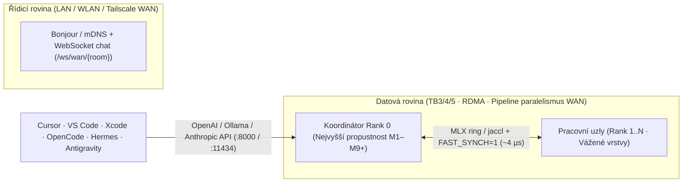
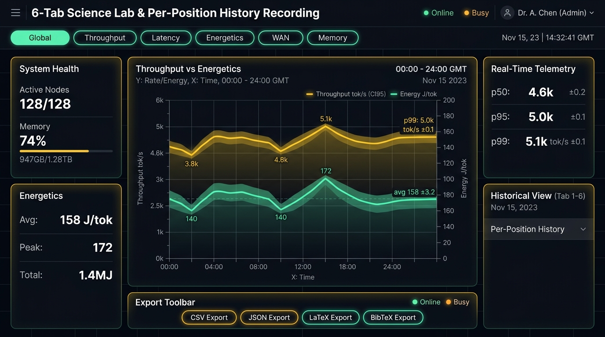

<div align="center">

# ☀️ SonnerStudio Cluster-Case-Companion (SS-CCC)

   **[English](README.md)** ·    **[Deutsch](README.de.md)** ·    **[Français](README.fr.md)** ·    **[Español](README.es.md)**<br/>
  **[Português](README.pt.md)** ·  **[Русский](README.ru.md)** ·  **[日本語](README.ja.md)** ·  **[中文](README.zh.md)**<br/>
  **[Nederlands](README.nl.md)** ·   **[Afrikaans](README.af.md)** ·  **[Polski](README.pl.md)** ·  **[Čeština](README.cs.md)**<br/>
 **[Slovenčina](README.sk.md)** ·  **[Magyar](README.hu.md)** ·  **[한국어](README.ko.md)** ·  **[हिन्दी](README.hi.md)** ·    **[தமிழ்](README.ta.md)**
<br/><a href="https://hits.sh/github.com/SonnerStudio/SonnerStudio-Cluster-Case-Companion/"></a>

*Nativní správce clusterů Apple Silicon pro macOS a studio distribuované inference MLX*

<table>
  <tr>
    <td align="center">
      <br/>
      <sub><b>Režim clusteru (52 GB sdílené paměti · 2 uzly)</b></sub>
    </td>
    <td align="center">
      <br/>
      <sub><b>Samostatný režim (16 GB lokálně · 1 uzel)</b></sub>
    </td>
  </tr>
</table>

</div>

---

## 🧭 Přehled

**SonnerStudio Cluster-Case-Companion (SS-CCC)** sjednocuje paměť a výpočetní výkon libovolných **Maců s čipy Apple Silicon (M1–M9+)** — od jediného Macu mini nebo MacBooku Pro přes lokální sestavy **Thunderbolt 3/4/5 a RDMA** až po **globální internetové WAN clustery (2–256+ Maců)** — s nativní integrací **MLX**, **oMLX**, **Ollama** a **llama.cpp**.

<div align="center">
  
</div>

---

## 🌐 Globální internetový cluster, živý chat a vědecký Roofline

<table>
  <tr>
    <td align="center" width="50%">
      <br/>
      <sub><b>Globální internetový cluster a chat účastníků</b><br/>Tailscale · WireGuard · libp2p QUIC · DERP · <code>/status</code> · <code>/layers</code> · <code>/ping</code></sub>
    </td>
    <td align="center" width="50%">
      <br/>
      <sub><b>Vědecký Roofline a energetická analýza</b><br/>Log-Log Roofline · GPipe Bubble · <code>J/token</code> · <code>p50/p95/p99</code> · CSV/JSON/BibTeX</sub>
    </td>
  </tr>
</table>

---

## 🏗️ Hybridní architektura (Řídicí rovina, Thunderbolt a WAN)



---

## 🌐 Monitor šířky pásma a propustnosti WAN internetového clusteru


V modulu **Internetový cluster a chat** SS-CCC nepřetržitě sleduje skutečný výkon linky WAN (`netstat`, `ping`, `networkQuality`) — měří **stahování / odesílání v Mbps**, **latenci WAN RTT (ms)**, **jitter**, **ztrátu paketů** a **efektivitu synchronizace tokenů**.

---

## ✨ Klíčové schopnosti

- **Univerzální clustering Apple Silicon (M1–M9+):** Propojte jakýkoli **Mac mini, MacBook Air/Pro, iMac, Mac Studio nebo Mac Pro** napříč generacemi **M1 až M6** i budoucími **M7, M8, M9+**. Uzel s nejvyšší propustností paměti se automaticky stává **Rank 0 (Koordinátor)** s ochranou `iogpu.wired_limit_mb`.
- **Kompletní telemetrie systému a senzorů:** Čte `sysctl`, `sw_vers`, `system_profiler`, `ibv_devices`, `ipconfig`, `ioreg` a `ProcessInfo.thermalState` — zobrazuje **CPU P/E jádra, GPU jádra, Neural Engine (16/32 jader ANE), kapacitu NVMe SSD, teplotní stav a příkon** přehledně vedle sebe.
- **Všechny třídy Thunderbolt (TB3 / TB4 / TB5) a RDMA:** Dynamicky sjednává párové rychlosti (`TB3/USB4: 26–32 Gbps`, `TB4: 30–37 Gbps`, `TB5: 65–80 Gbps`, `TB5 RDMA: 75–110 Gbps`) s `MLX_METAL_FAST_SYNCH=1` (45× rychlejší synchronizace GPU/CPU).
- **Živá Dílna modelů a kontrola připravenosti:** Vyhledává reálně nainstalované/běžící modely v **oMLX**, **Ollama**, **llama.cpp**, místních souborech `.gguf` a `~/.cache/huggingface/hub` včetně paměťově váženého dělení vrstev a kvantizace KV-cache (`FP16 / 8-bit / 4-bit`).
- **6× integrace agentů a IDE jedním kliknutím:** Okamžitý export konfigurací pro **OpenCode**, **Hermes Agent**, **Google Antigravity**, **Cursor**, **Visual Studio Code** a **Apple Xcode**.
- **Globální WAN cluster a chat účastníků (`/ws/wan/{room_id}`):** Spojte Macy po celém světě do distribuovaného clusteru přes šifrované tunely (Tailscale / WireGuard, libp2p / DERP P2P nebo ruční koncový bod).
- **6-záložková vědecká laboratoř a záznam historie:** Přepínejte mezi **Lokálním (TB/RDMA)**, **Internetovým WAN** a **Přímým srovnáním** na 6 kartách: **Roofline a úzké hrdlo**, **Topologie a škálování WAN**, **Paměť a KV**, **Energie, CO₂ a náklady**, **Pokusy, statistika a export** (`CI₉₅`, `CV%`, `CSV / JSON / LaTeX / BibTeX`) a **Záznam historie**.
- **Aktualizace řízené přes GitHub a automatické CI verzování:** Kontroluje `version.json`, GitHub Releases a SHA `commits/main` při spuštění i každých 30 minut (`⌘U`), s aktualizací jedním kliknutím a restartem.
- **Vzhled SonnerStudio Yellow (`#FFD400`), příručka v 17 jazycích, Shorttips a režim lišty nabídek (`⌘⇧M`):** Kompletní rozhraní v **17 jazycích** (`EN..TA`), kontextové nápovědy **Shorttips**, **12-kapitolová interaktivní příručka**, **25/25 testů** a **minimalizace do horní lišty nabídek** jako služba na pozadí pro agenty a IDE.

### 🖥️ Přehled modulů programu (všech 11 karet bočního panelu)


| Karta bočního panelu | Účel |
| :--- | :--- |
| **1. Přehled clusteru** | Živý ukazatel paměťového fondu, aktivní topologie M1–M12+, propustnost TB/RDMA a **4-stavová karta připravenosti** |
| **2. Zařízení a srovnání** | Přidávání/odebírání Maců M1–M12+, živá telemetrie CPU/GPU/ANE/SSD/teploty/příkonu a srovnání |
| **3. Dílna modelů** | Živé vyhledávání modelů (oMLX / Ollama / llama.cpp / GGUF), kontrola runtime, rozdělení vrstev, ANE-Split a 3-vrstvá KV-cache |
| **4. Síť a přímá paměť** | Přepínání Auto-Hybrid / Pouze TB / LAN / RDMA, `FAST_SYNCH=1`, Pipeline Ring vs. JACCL Full-Mesh TP a třídy TB3/4/5 |
| **5. Internetový cluster a chat** | Propojení lokálních Maců TB/RDMA se vzdálenými WAN uzly (QUIC/Iroh 0-RTT, Tailscale), monitoring **WAN pásma** a Audio-Party |
| **6. Více-modelový režim (MMM)** | Kombinace více modelů lokálně, přes WAN nebo hybridně se **současným sdílením pro více IDE** (`:8000/v1`) |
| **7. Agenti a prostředí IDE** | Nastavení 1 kliknutím a kopírovatelné soubory (vč. **MCP Registry JSON** a **A2A Agent Card**) pro 6 IDE a agentů |
| **8. Věda a Roofline** | 6-kartová výzkumná laboratoř s reálným SSE a ICMP RTT, vyhodnocením MMM, Roofline, `N=1..128`, `J/tok` / `CO₂` a historií |
| **9. API a konzole** | Testování koncových bodů OpenAI (`/v1/chat/completions`, `/v1/responses` + MCP), Ollama (`/api/tags`) a **A2A Agent Cards** |
| **10. Nastavení a nasazení** | Automatické vyhledání TB/LAN Maců i WAN uzlů, nastavení SSH / `wired_limit` a ověření **Provozní připravenosti** |
| **11. Nápověda a příručka** | Prohledávatelná **12-kapitolová příručka v 17 jazycích** (`⌘?`) s interaktivními schématy |

---

## 🛠️ Sestavení ze zdrojového kódu (důležité před prvním spuštěním)

> [!NOTE]
> Tento repozitář obsahuje **zdrojový kód Swift** aplikace SS-CCC (neobsahuje předkompilovaný binární balík `.app`). Před spuštěním kód zkompilujte přímo na svém Macu Apple Silicon.

### Požadavky
- Libovolný Mac s Apple Silicon (**M1–M6+**) a systémem **macOS 14.0 nebo novějším**
- **Xcode Command Line Tools** (`swiftc` a macOS SDK):
  ```bash
  xcode-select --install
  ```

### Krok za krokem: od repozitáře ke spuštěné aplikaci
```bash
# 1. Naklonujte repozitář
git clone https://github.com/SonnerStudio/SonnerStudio-Cluster-Case-Companion.git
cd SonnerStudio-Cluster-Case-Companion

# 2. Nastavte spouštěcí oprávnění skriptu (jednou)
chmod +x scripts/run_ssccc.sh

# 3. Zkompilujte zdroje Swift do /tmp/SSCCCApp a spusťte aplikaci
./scripts/run_ssccc.sh
```
*(Volitelně lze sestavit přes Swift Package Manager pomocí `cd app && swift build -c release`.)*

---

## 🚀 Rychlý start

```bash
# 1. Spusťte nativní aplikaci SwiftUI Studio
"./scripts/run_ssccc.sh"

# 2. (Volitelně) Spusťte bránu Python/FastAPI
cd core && uv sync --extra dev
PYTHONPATH=".." uv run uvicorn core.api.gateway:app --host 0.0.0.0 --port 8000

# 3. Nakonfigurujte IP adresy bod-bod přes Thunderbolt
./scripts/setup_tb_network.sh studio   # 10.99.1.1
./scripts/setup_tb_network.sh mini     # 10.99.1.2
```

---

## 📖 Provozní příručka: lokální a hybridní cluster, načítání modelů a výpočty

### 1. Nastavení lokálního clusteru (Thunderbolt 3/4/5 a LAN)
1. **Fyzické propojení:** Propojte Macy kabely **Thunderbolt 3/4/5** (bod-bod, řetězově nebo do kruhu) a/nebo **10GbE Ethernetem**.
2. **Přiřazení IP adres:** Spusťte `./scripts/setup_tb_network.sh studio` (`10.99.1.1`) na hlavním Macu a `./scripts/setup_tb_network.sh mini` (`10.99.1.2`) na pracovních uzlech.
3. **Volitelné RDMA (macOS 26.2+ na TB5):** Povolte nízkolatenční RDMA příkazem `rdma_ctl enable`, čímž `JACCL` dosáhne **`~3 µs`** místo `~300 µs`.
4. **Automatické přiřazení rolí:** Přidejte všechny Macy v **Zařízení a srovnání**. Plánovač `MemoryWeightedPlanner` automaticky určí **Rank 0 (Koordinátor)**.

### 2. Nastavení hybridní sítě (Lokálně + Internet WAN současně)
1. **Lokální rychlé jádro (Vrstva 1):** Ponechte aktivní lokální kruh Thunderbolt/LAN pro citlivé vrstvy.
2. **Místnost koordinátora WAN (Vrstva 2):** V modulu **Internetový cluster a chat** otevřete místnost WAN (`/ws/wan/{room_id}` na portu `8000`).
3. **Připojení vzdálených uzlů:** Macy odkudkoli na internetu se připojí přes **Kód místnosti a token**.
4. **Dvouvrstvé hybridní směrování:** Vysokofrekvenční vrstvy zůstávají na TB/LAN, další stupně běží přes WAN s mikro-dávkováním (`M ≥ 4`).

### 3. Kdo načítá model, kolik modelů se vejde a tok požadavku
- **Kdo co načítá?**
  - **Koordinátor (Rank 0):** Hostuje API bránu (`:8000`), tokenizuje a **vždy drží Embeddings a LM-Head** plus svůj podíl vrstev.
  - **Pracovní uzly (Rank 1..N):** Každý uzel načte **pouze svůj přidělený výsek vrstev `[start_layer .. end_layer)`** — žádná zbytečná spotřeba RAM.
- **Kolik modelů lze načíst současně?**
  - **Distribuovaný režim clusteru (`mlx.distributed` / `JACCL`):** **1 velký rozdělený model** napříč celou sdílenou pamětí.
  - **Více-modelový režim (`oMLX` / `Ollama` / MMM):** Dokud platí `Σ (Váhy_i + KV_i) ≤ Použitelný_VRAM_GB`, běží **více modelů souběžně**.
- **End-to-end tok zpracování:**
  1. **Průzkum a volba linky:** Zjistí RAM, šířku pásma a rozhraní (`TB5 RDMA > TB > 10GbE > WLAN > WAN`).
  2. **Plán dělení:** `MemoryWeightedPlanner` zapíše `hostfile.json` při zachování limitu `iogpu.wired_limit_mb`.
  3. **Vstup API:** Agenti a IDE odesílají požadavky na `http://127.0.0.1:8000/v1/chat/completions`.
  4. **Fáze Prefill (`TTFT`):** Rank 0 vytvoří embeddingy a předá aktivace potrubím.
  5. **Fáze Decode (`TPOT` a `tok/s`):** Tokeny se generují s `--kv-bits 4` a `MLX_METAL_FAST_SYNCH=1`.
  6. **Streamování SSE a telemetrie:** Rank 0 odesílá tokeny a ukládá `tok/s`, `TTFT`, `TPOT` a `J/tok`.

### 4. Teoretické dimenzování a výkonnostní přehled

> **Analytická pravidla odhadu:**
> - **Paměťová stopa:** `VRAM_GB ≈ Params_B × (Bits / 8) × 1.15 + KV_Cache_GB`
> - **Teoretický limit dekódování:** `tok/s ≈ (Effective_Bandwidth_GB/s / Active_Weights_GB) × (1 − Comm_Overhead)`

| Scénář použití | Topologie a využitelný fond | Model a kvantizace | Teoretické `TTFT` (2k) | Teoretické dekódování (`tok/s`) | Energie a hlavní limit |
| :--- | :--- | :--- | :--- | :--- | :--- |
| **1. Samostatná stanice (Edge Dev)** | 1× Mac mini M4 (16 GB, `12 GB`, `120 GB/s`) | `Qwen2.5-14B` (`4-bit`, ~8,8 GB) | `~1,8 – 2,6 s` | **`11 – 14 tok/s`** (`~75 ms/tok`) | `~1,7 J/tok` · Propustnost paměti |
| **2. Jeden Pro Studio (Rychlé kódování)** | 1× Mac Studio M4 Max (64 GB, `58 GB`, `546 GB/s`) | `Llama-3.3-70B` (`4-bit`, ~40 GB) | `~1,1 – 1,7 s` | **`12 – 14 tok/s`** (`~74 ms/tok`) | `~3,8 J/tok` · Propustnost paměti |
| **3. Lokální kruh 2× TB5 RDMA** | 2× M4 Max 64 GB (`116 GB`, `~1092 GB/s`, `~3 µs`) | `Qwen2.5-Coder-72B` (`8-bit`, ~78 GB) | `~1,4 – 2,0 s` | **`12 – 14 tok/s`** (`~76 ms/tok`) | `~7,5 J/tok` · Zanedbatelná režie RDMA |
| **4. Laboratoř 4× Ultra TB5 RDMA** | 4× M3 Ultra 256 GB (`992 GB`, `~3,27 TB/s`, TB5 RDMA) | `DeepSeek-V3 671B MoE` (`4-bit`, ~385 GB) | `~2,2 – 3,5 s` | **`38 – 55 tok/s`** (`~20 ms/tok`) | `~5,2 J/tok` · Aktivní experti MoE |
| **5. Hybrid Kancelář LAN + Domov WAN** | 2× TB4 + 2× WAN (`192 GB`, `35 ms` RTT) | `Llama-3.1-405B` (`3/4-bit`, ~170 GB) | `~6 – 11 s` | **`2,2 – 4,5 tok/s`** (`~280 ms/tok`) | `~28 J/tok` · WAN RTT (`M=8`) |
| **6. Globální komunitní roj WAN** | 16+ Maců po světě (`1,5+ TB`, `60–120 ms` RTT) | `671B–1T+` Frontier (`4/8-bit`) | `~12 – 25 s` | **`1,2 – 3,0 tok/s`** (`~500 ms/tok`) | Latence WAN (dávkování škáluje) |

---

## 📚 Vybraná dokumentace (vestavěná v centru nápovědy aplikace)

### 1. Univerzální clustering řady Apple Silicon M (M1–M12+)
SS-CCC podporuje **každý Mac s procesorem Apple Silicon M** (**M1–M6** i budoucí **M7–M12+**) napříč modely **Mac mini, MacBook Air/Pro, iMac, Mac Studio a Mac Pro**.

| Rodina Mac / čipu | Propustnost paměti | Thunderbolt a RDMA | Doporučená rezerva macOS |
| :--- | :--- | :--- | :--- |
| **M1 / M2** (Base) | 68 – 100 GB/s | TB 3 / USB4 (26–32 Gbps) | **4 GB** (≤ 24 GB RAM) |
| **M3 / M4** (Base) | 100 – 120 GB/s | TB 4 (30–37 Gbps) | **4 GB** (≤ 24 GB RAM) |
| **M5 / M6** (Base, M6 2nm) | **153 – 170 GB/s** (`M6`: 153 GB/s @ 16 GB, 170 GB/s @ 24–32 GB) | TB 4 / TB 5 (`80/120 Gbps`) | **4 GB** (≤ 32 GB RAM) |
| **M1–M3 Pro** | 150 – 200 GB/s | TB 4 (30–37 Gbps) | **4 – 6 GB** |
| **M4 / M5 Pro** | 273 – 307+ GB/s | TB 5 (`80/120 Gbps` boost) | **4 – 6 GB** |
| **M1–M3 Max** | 400 GB/s | TB 4 (30–37 Gbps) | **6 GB** (32–64 GB RAM) |
| **M4 Max** | **410 – 546 GB/s** (LPDDR5X-8533) | TB 5 + RDMA (`~3 µs`) | **6 GB** (32–128 GB RAM) |
| **M5 Max** | **460 – 614 GB/s** (32/40jádrové GPU) | TB 5 + RDMA (`~3 µs` JACCL) | **6 GB** (36–128 GB RAM) |
| **M1–M2 Ultra / M3 Ultra** | **800 – 819 GB/s** (UltraFusion) | TB 4 / TB 5 RDMA (JACCL) | **8 GB** (≥ 96 GB RAM) |
| **M5 Ultra** | **1,2 TB/s** (~1 228 GB/s, až 512 GB RAM, 80jádrové GPU) | TB 5 RDMA (`JACCL`) | **8 GB** (96–512 GB RAM) |

> [!NOTE]
> **Dostupnost čipů M6:** Apple vydal základní 2nm čip **M6** v září/říjnu 2026; **M6 Pro, Max a Ultra** zatím v listopadu 2026 nebyly uvedeny. SS-CCC automaticky rozpozná i všechny nadcházející čipy M6–M12+.

### 2. Thunderbolt 5 RDMA (`JACCL`) a ochrana paměti


- **macOS RDMA přes Thunderbolt 5:** S `rdma_ctl enable` a backendem `JACCL` klesne latence z `~300 µs` na **`~3 µs`** při propustnosti **`3,5–3,8 GB/s`**.
- **Nikdy nepřidělujte 100 % RAM:** SS-CCC hlídá rezervu `iogpu.wired_limit_mb` pro stabilitu macOS.
- **Proporcionální dělení vrstev:** Každý Mac obdrží vrstvy úměrně použitelné paměti.
- **KV-cache a rychlá synchronizace Metal:** `--kv-bits 4` a `MLX_METAL_FAST_SYNCH=1` zrychlují synchronizaci **45×**.

---

## 🔄 Aktualizace z GitHubu a automatické CI verzování


SS-CCC obsahuje vestavěný **aktualizační systém napojený na GitHub**, takže každá instalace zůstává aktuální:

1. **Vícezdrojové ověření verze na GitHubu:**
   - `raw.githubusercontent.com/.../main/version.json` (živý manifest vydání)
   - `api.github.com/repos/.../releases/latest` (oficiální vydání GitHub)
   - `api.github.com/repos/.../commits/main` (nejnovější krátké SHA větve `main`)
2. **Okno aktualizace v aplikaci (`UpdatePromptSheet`) a přestavba 1 kliknutím:**
   - Jakmile je zjištěna novější verze nebo SHA, rozsvítí se **pilulka Aktualizace** (`⌘U`).
   - **Zdrojové instalace:** Spustí `git pull` + kompilaci a nabídne tlačítko **Restartovat aplikaci nyní**.
   - **Balíčky `.app`:** Otevře stažení v Safari.
3. **Automatické zvyšování verze CI (`.github/workflows/auto-version-control.yml`):**
   - Každý push do `main` spustí `scripts/bump_version.py`, všech 25 testů a aktualizuje tag `vX.Y.Z`.

---

## 🧠 Více-modelový režim (MMM) — Jednotná orchestrace a sdílení pro více IDE


**Více-modelový režim (MMM)** spojuje více AI modelů najednou v **Lokálním**, **Internetovém WAN** nebo **Hybridním** clusteru s ochranou `iogpu.wired_limit_mb`.

### 4 Strategie orchestrace
1. **Paralelní fond modelů:** Udržuje více specializovaných modelů současně ve VRAM.
2. **Mixture-of-Agents (MoA):** Odesílá stejný prompt více specialistům a spojuje výsledek přes `Aggregator`.
3. **Spekulativní dekódování (Draft + Target):** Páruje rychlý `Draft` model s velkým `Target` modelem ($1,6\times$–$2,3\times$ zrychlení).
4. **Sekvenční modelové potrubí:** Řetězí modely do fází (*Plánovač → Programátor → Kontrolor*).

### ⚙️ Auto-nastavení jedním kliknutím a živý editor slotů


Sloty lze kdykoli upravovat i dodatečně:
- **Profily Auto-Setup:** Zvolte **Coding & IDE Swarm**, **Consensus & Audit**, **Turbo (Draft + Target)** nebo **Fázové potrubí**.
- **Dodatečné úpravy:** Měňte pořadí, duplikujte repliky, vypínejte sloty a upravujte URL (`:8000/v1`, `:11434/v1`).
- **VRAM-Fit optimalizátor a ukládání:** Jedním kliknutím ořeže nadbytečné sloty a exportuje JSON.

### Sdílené využití více IDE a agentů (`:8000/v1`)
Více IDE (**Cursor**, **VS Code**, **Xcode**, **OpenCode**, **Hermes Agent**, **Antigravity**) může cluster využívat souběžně přes `:8000/v1`.

### Praktické scénáře MMM
- **Více IDE současně:** Cursor, OpenCode i Hermes běží naráz bez přenačítání modelů.
- **Spekulativní turbo:** 16 GB Mac mini jako Draft a Mac Studio jako Target 70B+.
- **MoA revize kódu:** Spojení programovacího, matematického a agregačního modelu.
- **Hybridní specializace:** Rychlé našeptávání lokálně po TB, náročné úlohy 405B přes WAN.
- **Automatizované CI linky:** *Architektura → Implementace → Bezpečnostní audit*.
- **Vědecké benchmarky:** Každý běh MMM automaticky zapisuje výsledky do `Věda a Roofline`.

---

## 🎙️ Cluster Audio-Party a živá spolupráce přes WAN


- **Hlasová koordinace ve stylu konzole:** Vestavěná vedle textového chatu pomocí nativního `AVAudioEngine` (`16 kHz PCM16`) přes `/ws/wan-audio`.
- **Taktické ovládání:** Přepínač **Push-to-Talk** / **Otevřený mikrofon**, ztlumení, indikátory hlasitosti a role uzlů.
- **Synchronizace místnosti (`/ws/wan/{room_id}`):** Synchronizuje pozvánky `SSCCC-WAN-…` a telemetrii chatu.

---

## 🏆 Pokus o rekord hybridního superclusteru (Lokálně + Globální WAN)


**Dokáže decentralizovaná koalice Maců Apple Silicon konkurovat superpočítači v datovém centru?**  
Zveme univerzity, AI laboratoře a vývojáře po celém světě k oficiálnímu **pokusu o rekord SS-CCC** pomocí **Hybridního mostu**, **Audio-Party** a **6-kartové vědecké laboratoře**.

### 🔬 Vědecké zdůvodnění a matematický model škálování

1. **Dvouvrstvá hierarchická topologie (Ostrovy Tier-0 TB/RDMA + Páteř Tier-1 WAN):**
   - Ploché WAN clustery trpí, pokud každý přechod vrstvy jde přes internet ($H_{\text{WAN}} = N - 1$).
   - Díky **Hybridnímu mostu** zůstávají sousední vrstvy na TB (`~0,07 ms`), takže přes WAN jdou jen přechody mezi ostrovy.
2. **Amortizace WAN RTT pomocí kritického mikro-dávkování ($B^*$) a komprese:**
   - Účinnost potrubí se řídí GPipe bublinovým zákonem:
     $$\Phi_{\text{bubble}} = \frac{N - 1}{M + N - 1}, \qquad B^* = \left\lceil \frac{T_{\text{RTT,WAN}} + T_{\text{tx}}}{T_{\text{comp}}(B=1)} \right\rceil$$
   - Zvýšení $M \to B^*$ skryje mezikontinentální RTT a komprese **FP8 / INT4 / Top-K** (*Petals / SWARM*) drží režii pod $1\%$.
3. **Standardizovaný reprodukovatelný protokol ($T = 0,0$):**
   1. **Vytvořte ostrovy Tier-0:** Propojte lokální Macy přes Thunderbolt (`MLX_METAL_FAST_SYNCH=1`).
   2. **Propojte a koordinujte:** Sdílejte kód `SSCCC-WAN-…` a slaďte dělení v Audio-Party.
   3. **Proveďte měření:** Zvolte `N = 20` pokusů (`temperature = 0.0`, `TTFT ≤ 2500 ms`, `TPOT ≤ 100 ms/tok`).
   4. **Archivujte ověření:** Exportujte **JSON Manifest**, **CSV protokol** a **LaTeX tabulku** (`CI₉₅`, `CV%`, `J/token`, `EDP`, `gCO₂eq`).



### 🥇 Oficiální rekordní kategorie
- **Největší sdílený paměťový fond:** Nejvyšší použitelný VRAM (`GB` / `TB`).
- **Nejvíce současně propojených Maců ($N$):** Největší aktivní síť (`32–256+`).
- **Nejvyšší mezikontinentální Goodput:** Nejvíce `tokens/s` splňujících SLO napříč $\ge 2$ kontinenty.
- **Nejlepší energetická účinnost clusteru:** Nejnižší `J/token` a `EDP` pro model `70B+`.

---

## 🎯 Využití a pro koho je SS-CCC navržen


| Cílová skupina | Praktické využití s SS-CCC |
| :--- | :--- |
| **Výzkumníci AI systémů a ML** | Analýza Roofline limitů, komprese *Petals/SWARM*, *DiLoCo* a přímý export `CI₉₅` + `LaTeX`/`BibTeX`. |
| **Univerzity a výukové laboratoře** | Spojení studentských MacBooků a školních Maců mini do sdílených clusterů 70B–405B+. |
| **Vývojářská studia a agentní týmy** | Soukromé lokální modely pro OpenCode, Hermes, Antigravity, Cursor, VS Code a Xcode bez cloudových poplatků. |
| **Advokacie a zdravotnictví (Soukromí)** | Zpracování citlivých dat výhradně lokálně nebo v šifrovaných tunelech WireGuard/Tailscale. |
| **Globální open-source hackathony** | Rychlé sestavení mezinárodních superclusterů s hlasovou koordinací během minut. |
| **Audity Green-AI a udržitelnosti** | Měření `J/token`, `EDP` a `gCO₂eq/1M tokenů` oproti datovým centrům. |

---

## 📁 Struktura repozitáře

```text
├── app/Sources/
│   ├── SSCCCApp.swift              # Hlavní okno, služba MenuBarExtra na pozadí a dialog aktualizací
│   ├── Models/
│   │   ├── ClusterModels.swift     # Odvozování M1–M12+, modely WAN/Věda/Historie a vydání
│   │   └── Localization.swift      # Kompletní slovník UI a nápovědy v 17 jazycích (EN..TA)
│   ├── ViewModels/
│   │   └── ClusterViewModel.swift  # Sondy hardwaru, zjišťování modelů, WAN/Audio-Party a GitHub updater
│   └── Views/                      # 12 modulárních pohledů SwiftUI + Theme.swift (11 karet, výstražné pruhy a Shorttips)
├── core/                           # Brána Python FastAPI, relé WebSocket WAN/Audio a dělení MLX
├── scripts/
│   ├── run_ssccc.sh                # Zkompiluje a spustí aplikaci pro macOS
│   ├── bump_version.py             # Synchronizuje version.json a ClusterModels.swift s Gitem
│   ├── setup_tb_network.sh         # Konfiguruje Thunderbolt most 10.99.1.x
│   └── setup_wired_limit.sh        # Nastavuje bezpečné limity iogpu.wired_limit_mb
├── tests/                          # Sada 25 globálních ověřovacích testů (Swift + Python)
├── .github/workflows/              # Automatické CI řízení verzí a značkování
└── version.json                    # Manifest kontroly aktualizací hostovaný na GitHubu
```

---

## 🚀 Architektonický upgrade SOTA 2026 (Fáze 11)

- **TB5 RDMA Tensor Parallelism a QUIC / Iroh WAN:** Přepínání **Pipeline Ring** / **JACCL Full-Mesh TP**, testy `rdma_ctl enable` a **QUIC / Iroh P2P (0-RTT)**.
- **ANE-Split a 3-vrstvá KV-cache / CacheGen:** Přesun prefill fáze na Neural Engine (`EDP ×1,42`, `-31,5 %` výkonu) s `3,6×` kompresí.
- **MMM nové generace:** **EAGLE-3**, **Tree-MoA Early-Exit** a adaptivní směrovač **Ares**.
- **Moderní standardy agentů:** **OpenAI `/v1/responses`**, **MCP Server Registry JSON** a **A2A Agent Cards**.
- **Teplotně a uhlíkově vědomé plánování:** Automaticky odlehčuje přehřáté uzly.

### 🛠️ Fáze 12: Automatické nastavení clusteru, kontrola připravenosti a Shorttips


- **11. kategorie bočního panelu (`Nastavení a nasazení`):** Automaticky vyhledá lokální i WAN Macy a nastaví SSH.
- **4-stavový životní cyklus připravenosti:** Hlásí **Připraveno**, **Nepřipraveno**, **Částečně nastaveno** nebo **Nenastaveno** ve všech 17 jazycích.
- **Shorttips v celé aplikaci:** Stručné popisy při najetí myší v `.help` i **Solaris Shorttip Banner**.
- **Interaktivní nápověda a živá data:** Všech 12 kapitol otevírá schémata se 100% skutečnými daty mimo simulaci.

### 🛰️ Minimalizace do horní lišty nabídek (Služba na pozadí pro agenty a IDE, ⌘⇧M)

- **Plynulý přesun do horní lišty nabídek macOS:** Klikněte na žluté tlačítko minimalizace, stiskněte **`⌘⇧M`** nebo použijte tlačítko **Do lišty nabídek** v záhlaví — hlavní okno se skryje a SS-CCC tiše běží vedle **Ollamy** (režim `.accessory`).
- **Přehledné živé indikátory v liště:** Ikona a okno ihned ukazují **Stav připravenosti**, **Celkovou a využitelnou RAM (GB)**, **Aktivní uzly**, **Načtený model a vrstvy**, **Runtime** a **Aktivní MMM sloty**.
- **Kopírování endpointů 1 kliknutím a přehled IDE:** Zkopírujte **`http://127.0.0.1:8000/v1`** (OpenAI/MMM) nebo **`http://127.0.0.1:11434`** (Ollama) přímo z lišty pro Cursor, OpenCode, Hermes, Antigravity, VS Code a Xcode.
- **Okamžité obnovení okna:** Plné okno Studia lze kdykoli vrátit z lišty nabídek (`⌘⇧M`) nebo zapnout automatickou minimalizaci.

---

## 🚧 Stav vývoje a zapojení

> [!IMPORTANT]
> **SS-CCC v1.6+ je plně spustitelný a ověřený `25/25` automatizovanými testy.**
> **Již implementováno:** Výchozí start v angličtině s **kompletní lokalizací do 17 jazyků (`EN..TA`)**, **čtení jader CPU, GPU a Neural Engine (ANE)**, **režim služby na pozadí v liště nabídek (`⌘⇧M`)**, **počítadlo návštěvníků ve všech 17 README**, otevřená detekce M1–M12+, 6-kartová vědecká laboratoř, Audio-Party a GitHub updater.

Srdečně zveme vývojáře, výzkumníky a nadšence Apple Silicon ke **spolupráci na SS-CCC**:
- **Otestujte na svém hardwaru:** Sdílejte naměřený výkon a stabilitu RDMA/JACCL na svých Macích M1–M12+.
- **Přidejte se k rekordnímu pokusu:** Propojte lokální TB ostrovy s WAN uzly a zveřejněte JSON/CSV/LaTeX manifesty.
- **Posílejte Pull Requesty:** Vylepšení SwiftUI, MLX dělení, skriptů či překladů jsou vždy vítána!

---

## 📄 Licence

Publikováno pod [licencí MIT](LICENSE.md).
