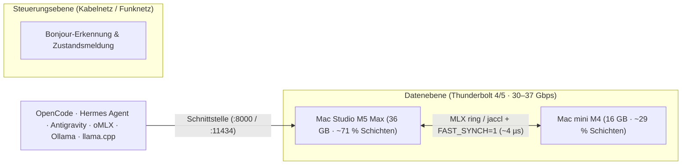

<div align="center">

# ☀️ SonnerStudio Verbund-Begleiter (SS-CCC)

**🇺🇸 🇬🇧 🇨🇦 [English](README.md)** · **🇩🇪 🇦🇹 🇨🇭 [Deutsch](README.de.md)** · **🇫🇷 🇧🇪 🇨🇭 [Français](README.fr.md)** · **🇪🇸 🇲🇽 🇦🇷 [Español](README.es.md)** · **🇵🇹 🇧🇷 [Português](README.pt.md)**

*Eigenständige macOS-Verbundverwaltung und verteilte MLX-Rechenoberfläche für Apple Silicon*

<table>
  <tr>
    <td align="center">
      <br/>
      <sub><b>Verbundbetrieb (52 GB Gesamtspeicher · 2 Rechner)</b></sub>
    </td>
    <td align="center">
      <br/>
      <sub><b>Einzelbetrieb (16 GB örtlich · 1 Rechner)</b></sub>
    </td>
  </tr>
</table>

</div>

---

## 🧭 Überblick

Der **SonnerStudio Verbund-Begleiter (SS-CCC)** koppelt den gemeinsamen Arbeitsspeicher mehrerer Apple-Silicon-Rechner — etwa eines **Mac Studio M5 Max (36 GB, Thunderbolt 5)** und eines **Mac mini M4 (16 GB, Thunderbolt 4)** — zu einem **52-GB-Rechenverbund (~42 GB nutzbar)** über **Thunderbolt (Brücke oder Direktspeicherzugriff)**, **Kabelnetz/Funknetz** oder im **Mischbetrieb**.

<div align="center">
  
</div>

---

## 🏗️ Aufbau (Steuerungsebene & Datenebene)



---

## ✨ Hauptfunktionen

- **Alle Apple-Silicon-Macs (M1–M6) im Verbund:** Kopple beliebige **Mac mini, MacBook Air/Pro, iMac, Mac Studio oder Mac Pro** von **M1 bis M6** (Basis, Pro, Max, Ultra). Der schnellste Rechner übernimmt selbsttätig **Rang 0 (Leitrechner)**; die Schutzgrenze `iogpu.wired_limit_mb` hält macOS jederzeit flüssig.
- **Vollständige Hardware- & Sensor-Auslesung:** Liest `sysctl`, `sw_vers`, `system_profiler`, `ibv_devices`, `ipconfig`, `ioreg` und `ProcessInfo.thermalState` aus — inklusive **CPU-Leistungs-/Effizienzkernen, GPU-Kernen, Neural Engine (16/32 ANE-Kerne), NVMe-SSD-Gesamt- und Freispeicher, Temperatur/Thermik sowie Leistungsaufnahme**.
- **Alle Thunderbolt-Klassen (TB3 / TB4 / TB5) & Direktspeicherzugriff:** Berechnet paarweise Übertragungsraten dynamisch (`TB3/USB4: 26–32 Gbps`, `TB4: 30–37 Gbps`, `TB5: 65–80 Gbps`, `TB5 RDMA: 75–110 Gbps`) samt `MLX_METAL_FAST_SYNCH=1` (45× schnellere GPU/CPU-Abstimmung).
- **Modell-Werkstatt & örtliche Dienste:** Gewichtete Schichtenverteilung auf beliebig viele Rechner, KV-Verdichtung (`FP16 / 8-Bit / 4-Bit`) sowie unmittelbare Anbindung an **oMLX**, **Ollama** und **llama.cpp**.
- **6× Ein-Klick-Einrichtung für Agenten & Werkzeuge:** Sofortige Einrichtung für **OpenCode**, **Hermes Agent**, **Google Antigravity**, **Cursor**, **Visual Studio Code** und **Apple Xcode**.
- **SonnerStudio-Gelb (`#FFD400`) & fünfsprachiges Handbuch:** Vollständige Oberfläche samt durchsuchbarer Hilfe (`⌘?`) auf **Deutsch, Englisch, Französisch, Spanisch und Portugiesisch**.

### 🖥️ Die acht Programmbereiche im Überblick

| Menüpunkt | Aufgabe & Inhalt |
| :--- | :--- |
| **1. Verbund-Übersicht** | Gesamtspeicher-Balken, aktive M1–M6-Topologie und paarweise Thunderbolt-/RDMA-Übertragungsraten |
| **2. Geräte & Vergleich** | Beliebige M1–M6-Macs hinzufügen/entfernen, CPU/GPU/ANE/SSD/Thermik/Strom auslesen und vergleichen |
| **3. Modell-Werkstatt** | MLX-Modelle wählen, anteilige Schichtenverteilung prüfen, KV-Speicher regeln, oMLX / Ollama / llama.cpp starten |
| **4. Netzwerk & Direktspeicher** | Mischbetrieb / TB / LAN / RDMA umschalten, `FAST_SYNCH=1` setzen und TB3/TB4/TB5-Klassen einsehen |
| **5. Agenten & Werkzeuge** | Ein-Klick-Einrichtung für OpenCode, Hermes Agent, Antigravity, Cursor, VS Code und Xcode |
| **6. Forschung & Grenzkurve** | Interaktives Log-Log-Grenzkurvendiagramm (`P = min(β·I, π)`), Knickpunkte, GPipe-Blasenformel, TTFT/TPOT, `J/Token`-Energiebilanz, reproduzierbare Messreihen (`T=0,0`, `p50/p95/p99`) und CSV/JSON/BibTeX-Ausgabe |
| **7. Schnittstelle & Konsole** | OpenAI- (`/v1`) & Ollama-Endpunkte (`/api/tags`) prüfen und Verbund-Anfragen direkt testen |
| **8. Hilfe & Handbuch** | Durchsuchbares Handbuch in fünf Sprachen (`⌘?`) zu Verbund, Speicherschutz, Netzwerk und Agenten |

---

## 🛠️ Aus dem Quelltext übersetzen (Wichtig vor dem ersten Start)

> [!NOTE]
> Dieses Verzeichnis enthält den **Quelltext** von SS-CCC (es liegt keine fertig gebaute Programmdatei bei). Um eine startfähige Anwendung zu erhalten, muss das Programm zuerst auf deinem Apple-Silicon-Mac **örtlich übersetzt (kompiliert)** werden.

### Voraussetzungen
- Ein Apple-Silicon-Mac (**M1–M6**) mit **macOS 14.0 oder neuer**
- **Xcode-Befehlszeilenwerkzeuge** (enthalten `swiftc` und das macOS-Entwicklungspaket):
  ```bash
  xcode-select --install
  ```

### Schritt für Schritt zur startfähigen App
```bash
# 1. Repository herunterladen und in den Ordner wechseln
git clone https://github.com/SonnerStudio/SonnerStudio-Cluster-Case-Companion.git
cd SonnerStudio-Cluster-Case-Companion

# 2. Start- und Übersetzungsskript einmalig ausführbar machen
chmod +x scripts/run_ssccc.sh

# 3. Alle Swift-Quelltexte nach /tmp/SSCCCApp übersetzen und Programm sofort starten
./scripts/run_ssccc.sh
```
*(Wahlweise lässt sich das Programm auch über Swift Package Manager bauen: `cd app && swift build -c release`.)*

---

## 🚀 Schnellstart

```bash
# 1. Native macOS-Oberfläche starten
"./scripts/run_ssccc.sh"

# 2. (Optional) Python/FastAPI-Dienst starten
cd core && uv sync --extra dev
PYTHONPATH=".." uv run uvicorn core.api.gateway:app --host 0.0.0.0 --port 8000

# 3. Feste Punkt-zu-Punkt-Thunderbolt-Adressen einrichten
./scripts/setup_tb_network.sh studio   # 10.99.1.1
./scripts/setup_tb_network.sh mini     # 10.99.1.2
```

---

## 📚 Ausgewählte Dokumentation (vollständig im Hilfe-Bereich der App)

### 1. Alle Apple Mac mit M-Prozessor im Verbund (M1–M6)
SS-CCC unterstützt **jeden Mac mit Apple-Silicon-Chip** (**M1, M2, M3, M4, M5, M6** — Basis, Pro, Max und Ultra) über alle Bauformen hinweg (**Mac mini, MacBook Air, MacBook Pro, iMac, Mac Studio und Mac Pro**). Unter **Geräte & Vergleich** lassen sich beliebig viele M-Macs zum Verbund hinzufügen; der Rechner mit dem höchsten Speicherdurchsatz übernimmt selbsttätig **Rang 0 (Leitrechner)**.

| Chip-Familie | Speicherdurchsatz | Thunderbolt | Empfohlene macOS-Schutzreserve |
| :--- | :--- | :--- | :--- |
| **M1 / M2** (Basis) | 68 – 100 GB/s | TB 3 / USB4 (26–32 Gbps) | **4 GB** (bis 24 GB RAM) |
| **M3 / M4** (Basis) | 100 – 120 GB/s | TB 4 (30–37 Gbps) | **4 GB** (bis 24 GB RAM) |
| **M5 / M6** (Basis) | 153 – 180 GB/s | TB 5 (65–80 Gbps) | **4 GB** (bis 24 GB RAM) |
| **M1–M3 Pro** | 150 – 200 GB/s | TB 4 (30–37 Gbps) | **4 – 6 GB** |
| **M4–M6 Pro** | 273 – 310 GB/s | TB 5 (65–80 Gbps) | **4 – 6 GB** |
| **M1–M3 Max** | 400 GB/s | TB 4 (30–37 Gbps) | **6 GB** (32–64 GB RAM) |
| **M4–M6 Max** | 460 – 580 GB/s | TB 5 (65–80 Gbps) | **6 GB** (32–64 GB RAM) |
| **M1–M2 Ultra** / **M3 Ultra** | 800 GB/s | TB 4 / TB 5 | **8 GB** (ab 96 GB RAM) |

### 2. Speicherschutz & Gewichtetes Schichten-Aufteilen
- **Niemals 100 % des RAM freigeben:** SS-CCC schützt den Betriebssystem-Anteil über `iogpu.wired_limit_mb`, damit macOS und WindowServer jederzeit flüssig bleiben.
- **Anteilige Schichtenverteilung:** Jeder Mac erhält genau den Anteil an Modellschichten, der seinem nutzbaren Speicher entspricht (`Schichten_i = Gesamtschichten × Nutzbar_i / GesamtNutzbar`).
- **KV-Verdichtung & schnelle GPU-Abstimmung:** `--kv-bits 4` + `--prefill-step-size 512` ermöglichen über 64k Zeichenblöcke, während `MLX_METAL_FAST_SYNCH=1` die Abstimmungszeit um Faktor **45×** (~180 µs → ~4 µs) senkt.

---

## 🚧 Entwicklungsstand & Mitmachen

> [!IMPORTANT]
> **SS-CCC ist bereits startfähig, befindet sich jedoch noch in der laufenden Entwicklung und Erprobung.**
> Die Programmoberfläche, die Hardware-Auslesung, die gewichtete Schichtenplanung sowie die Anbindung von Agenten und Laufzeiten funktionieren bereits; praxisnahe Langzeiterprobungen über verschiedene M1–M6-Gerätekombinationen, Thunderbolt-4/5-Brücken und RDMA/JACCL werden fortlaufend geprüft und verfeinert.

Wir laden Entwickler, Forschende und Apple-Silicon-Begeisterte herzlich dazu ein, **mitzuentwickeln und SS-CCC weiterzubringen**:
- **Auf eigener Hardware erproben:** Teste SS-CCC mit deinen M1–M6-Macs und teile Messwerte zu Durchsatz, Speicherverbrauch und Zuverlässigkeit.
- **Rückmeldungen & Vorschläge einbringen:** Eröffne auf GitHub einen Hinweis zu Fehlern, Besonderheiten oder neuen Ideen.
- **Änderungsvorschläge einreichen:** Verbesserungen an der SwiftUI-Oberfläche, der Python-/MLX-Aufteilung, den Thunderbolt-Skripten oder den Übersetzungen sind jederzeit willkommen!

---

## 📄 Lizenz

Veröffentlicht unter der [MIT-Lizenz](LICENSE.md).
