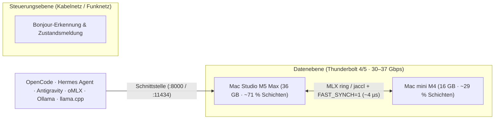

<div align="center">

# ☀️ SonnerStudio Verbund-Begleiter (SS-CCC)

**🇺🇸 🇬🇧 🇨🇦 [English](README.md)** · **🇩🇪 🇦🇹 🇨🇭 [Deutsch](README.de.md)** · **🇫🇷 🇧🇪 🇨🇭 [Français](README.fr.md)** · **🇪🇸 🇲🇽 🇦🇷 [Español](README.es.md)** · **🇵🇹 🇧🇷 [Português](README.pt.md)**

*Eigenständige macOS-Verbundverwaltung und verteilte MLX-Rechenoberfläche für Apple Silicon*


</div>

---

## 🧭 Überblick

Der **SonnerStudio Verbund-Begleiter (SS-CCC)** koppelt den gemeinsamen Arbeitsspeicher mehrerer Apple-Silicon-Rechner — etwa eines **Mac Studio M5 Max (36 GB, Thunderbolt 5)** und eines **Mac mini M4 (16 GB, Thunderbolt 4)** — zu einem **52-GB-Rechenverbund (~42 GB nutzbar)** über **Thunderbolt (Brücke oder Direktspeicherzugriff)**, **Kabelnetz/Funknetz** oder im **Mischbetrieb**.

<div align="center">
  
</div>

---

## 🏗️ Aufbau (Steuerungsebene & Datenebene)



---

## ✨ Hauptfunktionen

- **52-GB-Speicherkopplung für ungleiche Rechner:** Speichergewichtete Schichtenverteilung (`~71 %` der Schichten samt Einbettung und Ausgabekopf auf dem M5 Max mit `460 GB/s`, `~29 %` auf dem M4 mit `120 GB/s`) mit sicherer `iogpu.wired_limit_mb`-Begrenzung.
- **Native macOS-Oberfläche (*Solaris-Telemetrie-Labor*):**
  - **Verbund-Übersicht & Gerätevergleich:** Direkte Auslesung (`sysctl`, `sw_vers`, `ibv_devices`, `ipconfig`) mit Balkenvergleich.
  - **Modell-Werkstatt:** Anteilige Schichtenaufteilung, KV-Speicher-Verkleinerung (`FP16 / 8-Bit / 4-Bit`) sowie direkte Anbindung an **oMLX**, **Ollama** und **llama.cpp**.
  - **Agenten & Entwicklungsumgebungen (Ein-Klick-Einrichtung):** Sofortige Einrichtung für **OpenCode**, **Hermes Agent** und **Google Antigravity**.
  - **Mehrsprachige Oberfläche:** Sprachumschalter im linken Seitenmenü (Deutsch, Englisch, Französisch, Spanisch, Portugiesisch).

---

## 🛠️ Aus dem Quelltext übersetzen (Wichtig vor dem ersten Start)

> [!NOTE]
> Dieses Verzeichnis enthält den **Quelltext** von SS-CCC (es liegt keine fertig gebaute Programmdatei bei). Um eine startfähige Anwendung zu erhalten, muss das Programm zuerst auf deinem Apple-Silicon-Mac **örtlich übersetzt (kompiliert)** werden.

### Voraussetzungen
- Ein Apple-Silicon-Mac (**M1–M6**) mit **macOS 14.0 oder neuer**
- **Xcode-Befehlszeilenwerkzeuge** (enthalten `swiftc` und das macOS-Entwicklungspaket):
  ```bash
  xcode-select --install
  ```

### Schritt für Schritt zur startfähigen App
```bash
# 1. Repository herunterladen und in den Ordner wechseln
git clone https://github.com/SonnerStudio/SonnerStudio-Cluster-Case-Companion.git
cd SonnerStudio-Cluster-Case-Companion

# 2. Start- und Übersetzungsskript einmalig ausführbar machen
chmod +x scripts/run_ssccc.sh

# 3. Alle Swift-Quelltexte nach /tmp/SSCCCApp übersetzen und Programm sofort starten
./scripts/run_ssccc.sh
```
*(Wahlweise lässt sich das Programm auch über Swift Package Manager bauen: `cd app && swift build -c release`.)*

---

## 🚀 Schnellstart

```bash
# 1. Native macOS-Oberfläche starten
"./scripts/run_ssccc.sh"

# 2. (Optional) Python/FastAPI-Dienst starten
cd core && uv sync --extra dev
PYTHONPATH=".." uv run uvicorn core.api.gateway:app --host 0.0.0.0 --port 8000

# 3. Feste Punkt-zu-Punkt-Thunderbolt-Adressen einrichten
./scripts/setup_tb_network.sh studio   # 10.99.1.1
./scripts/setup_tb_network.sh mini     # 10.99.1.2
```

---

## 📚 Ausgewählte Dokumentation (vollständig im Hilfe-Bereich der App)

### 1. Alle Apple Mac mit M-Prozessor im Verbund (M1–M6)
SS-CCC unterstützt **jeden Mac mit Apple-Silicon-Chip** (**M1, M2, M3, M4, M5, M6** — Basis, Pro, Max und Ultra) über alle Bauformen hinweg (**Mac mini, MacBook Air, MacBook Pro, iMac, Mac Studio und Mac Pro**). Unter **Geräte & Vergleich** lassen sich beliebig viele M-Macs zum Verbund hinzufügen; der Rechner mit dem höchsten Speicherdurchsatz übernimmt selbsttätig **Rang 0 (Leitrechner)**.

| Chip-Familie | Speicherdurchsatz | Thunderbolt | Empfohlene macOS-Schutzreserve |
| :--- | :--- | :--- | :--- |
| **M1 / M2 / M3** (Basis) | 68 – 100 GB/s | TB 4 | **4 GB** (bis 24 GB RAM) |
| **M4 / M5 / M6** (Basis) | 120 – 180 GB/s | TB 4 / TB 5 | **4 GB** (bis 24 GB RAM) |
| **M1–M6 Pro** | 150 – 273 GB/s | TB 4 / TB 5 | **4 – 6 GB** |
| **M1–M6 Max** | 400 – 546 GB/s | TB 4 / TB 5 | **6 GB** (32–64 GB RAM) |
| **M1–M3 Ultra** | 800 GB/s | TB 4 | **8 GB** (ab 96 GB RAM) |

### 2. Speicherschutz & Gewichtetes Schichten-Aufteilen
- **Niemals 100 % des RAM freigeben:** SS-CCC schützt den Betriebssystem-Anteil über `iogpu.wired_limit_mb`, damit macOS und WindowServer jederzeit flüssig bleiben.
- **Anteilige Schichtenverteilung:** Jeder Mac erhält genau den Anteil an Modellschichten, der seinem nutzbaren Speicher entspricht (`Schichten_i = Gesamtschichten × Nutzbar_i / GesamtNutzbar`).
- **KV-Verdichtung & schnelle GPU-Abstimmung:** `--kv-bits 4` + `--prefill-step-size 512` ermöglichen über 64k Zeichenblöcke, während `MLX_METAL_FAST_SYNCH=1` die Abstimmungszeit um Faktor **45×** (~180 µs → ~4 µs) senkt.

---

## 📄 Lizenz

Veröffentlicht unter der [MIT-Lizenz](LICENSE.md).
