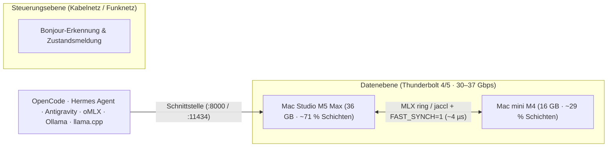

<div align="center">

# ☀️ SonnerStudio Verbund-Begleiter (SS-CCC)

**🇺🇸 🇬🇧 🇨🇦 [English](README.md)** · **🇩🇪 🇦🇹 🇨🇭 [Deutsch](README.de.md)** · **🇫🇷 🇧🇪 🇨🇭 [Français](README.fr.md)** · **🇪🇸 🇲🇽 🇦🇷 [Español](README.es.md)** · **🇵🇹 🇧🇷 [Português](README.pt.md)**

*Eigenständige macOS-Verbundverwaltung und verteilte MLX-Rechenoberfläche für Apple Silicon*


</div>

---

## 🧭 Überblick

Der **SonnerStudio Verbund-Begleiter (SS-CCC)** koppelt den gemeinsamen Arbeitsspeicher mehrerer Apple-Silicon-Rechner — etwa eines **Mac Studio M5 Max (36 GB, Thunderbolt 5)** und eines **Mac mini M4 (16 GB, Thunderbolt 4)** — zu einem **52-GB-Rechenverbund (~42 GB nutzbar)** über **Thunderbolt (Brücke oder Direktspeicherzugriff)**, **Kabelnetz/Funknetz** oder im **Mischbetrieb**.

<div align="center">
  
</div>

---

## 🏗️ Aufbau (Steuerungsebene & Datenebene)



---

## ✨ Hauptfunktionen

- **52-GB-Speicherkopplung für ungleiche Rechner:** Speichergewichtete Schichtenverteilung (`~71 %` der Schichten samt Einbettung und Ausgabekopf auf dem M5 Max mit `460 GB/s`, `~29 %` auf dem M4 mit `120 GB/s`) mit sicherer `iogpu.wired_limit_mb`-Begrenzung.
- **Native macOS-Oberfläche (*Solaris-Telemetrie-Labor*):**
  - **Verbund-Übersicht & Gerätevergleich:** Direkte Auslesung (`sysctl`, `sw_vers`, `ibv_devices`, `ipconfig`) mit Balkenvergleich.
  - **Modell-Werkstatt:** Anteilige Schichtenaufteilung, KV-Speicher-Verkleinerung (`FP16 / 8-Bit / 4-Bit`) sowie direkte Anbindung an **oMLX**, **Ollama** und **llama.cpp**.
  - **Agenten & Entwicklungsumgebungen (Ein-Klick-Einrichtung):** Sofortige Einrichtung für **OpenCode**, **Hermes Agent** und **Google Antigravity**.
  - **Mehrsprachige Oberfläche:** Sprachumschalter im linken Seitenmenü (Deutsch, Englisch, Französisch, Spanisch, Portugiesisch).

---

## 🚀 Schnellstart

```bash
# 1. Native macOS-Oberfläche starten
"./scripts/run_ssccc.sh"

# 2. (Optional) Python/FastAPI-Dienst starten
cd core && uv sync --extra dev
PYTHONPATH=".." uv run uvicorn core.api.gateway:app --host 0.0.0.0 --port 8000

# 3. Feste Punkt-zu-Punkt-Thunderbolt-Adressen einrichten
./scripts/setup_tb_network.sh studio   # 10.99.1.1
./scripts/setup_tb_network.sh mini     # 10.99.1.2
```

---

## 📄 Lizenz

Veröffentlicht unter der [MIT-Lizenz](LICENSE.md).
