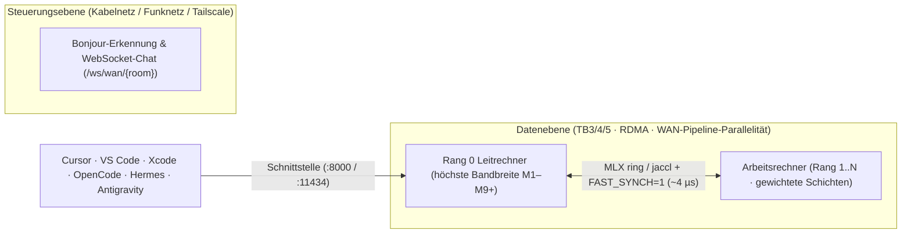

<div align="center">

# ☀️ SonnerStudio Verbund-Begleiter (SS-CCC)

   **[English](README.md)** ·    **[Deutsch](README.de.md)** ·    **[Français](README.fr.md)** ·    **[Español](README.es.md)** ·   **[Português](README.pt.md)** ·  **[Русский](README.ru.md)** ·  **[日本語](README.ja.md)** ·  **[中文](README.zh.md)**

*Eigenständige macOS-Verbundverwaltung und verteilte MLX-Rechenoberfläche für Apple Silicon*

<table>
  <tr>
    <td align="center">
      <br/>
      <sub><b>Verbundbetrieb (52 GB Gesamtspeicher · 2 Rechner)</b></sub>
    </td>
    <td align="center">
      <br/>
      <sub><b>Einzelbetrieb (16 GB örtlich · 1 Rechner)</b></sub>
    </td>
  </tr>
</table>

</div>

---

## 🧭 Überblick

Der **SonnerStudio Verbund-Begleiter (SS-CCC)** koppelt den gemeinsamen Arbeitsspeicher beliebiger **Apple-Silicon-Macs (M1–M9+)** — vom einzelnen Mac mini oder MacBook Pro über örtliche **Thunderbolt-3/4/5- & RDMA-Verbünde** bis hin zu **weltweiten Internet-Verbünden (2–256+ Macs)** — mit unmittelbarer Anbindung an **MLX**, **oMLX**, **Ollama** und **llama.cpp**.

<div align="center">
  
</div>

---

## 🌐 Weltweiter Internet-Verbund, Teilnehmer-Chat & Forschung

<table>
  <tr>
    <td align="center" width="50%">
      <br/>
      <sub><b>Internet-Verbund & Teilnehmer-Chat</b><br/>Tailscale · WireGuard · libp2p QUIC · DERP · <code>/status</code> · <code>/layers</code> · <code>/ping</code></sub>
    </td>
    <td align="center" width="50%">
      <br/>
      <sub><b>Forschung, Grenzkurve & Energiebilanz</b><br/>Log-Log-Grenzkurve · GPipe-Blase · <code>J/Token</code> · <code>p50/p95/p99</code> · CSV/JSON/BibTeX</sub>
    </td>
  </tr>
</table>

---

## 🏗️ Aufbau (Steuerungsebene, Thunderbolt & Internet-Verbund)



---

## ✨ Hauptfunktionen

- **Alle Apple-Silicon-Macs (M1–M9+) im Verbund:** Kopple beliebige **Mac mini, MacBook Air/Pro, iMac, Mac Studio oder Mac Pro** von **M1 bis M6** sowie künftige **M7-, M8-, M9+-Generationen** (Basis, Pro, Max, Ultra). Der schnellste Rechner übernimmt selbsttätig **Rang 0 (Leitrechner)**; die Schutzgrenze `iogpu.wired_limit_mb` hält macOS jederzeit flüssig.
- **Vollständige Hardware- & Sensor-Auslesung:** Liest `sysctl`, `sw_vers`, `system_profiler`, `ibv_devices`, `ipconfig`, `ioreg` und `ProcessInfo.thermalState` aus — inklusive **CPU-Leistungs-/Effizienzkernen, GPU-Kernen, Neural Engine (16/32 ANE-Kerne), NVMe-SSD-Gesamt- und Freispeicher, Temperatur/Thermik sowie Leistungsaufnahme**.
- **Alle Thunderbolt-Klassen (TB3 / TB4 / TB5) & Direktspeicherzugriff:** Berechnet paarweise Übertragungsraten dynamisch (`TB3/USB4: 26–32 Gbps`, `TB4: 30–37 Gbps`, `TB5: 65–80 Gbps`, `TB5 RDMA: 75–110 Gbps`) samt `MLX_METAL_FAST_SYNCH=1` (45× schnellere GPU/CPU-Abstimmung).
- **Echte Modell-Erkennung & Dienstprüfung:** Liest vorhandene und laufende Modelle unmittelbar aus **oMLX**, **Ollama**, **llama.cpp**, örtlichen `.gguf`-Dateien sowie `~/.cache/huggingface/hub` ein (keine Platzhalter-Profile bei leerem Stand, sondern direkte Laufzeitprüfung & kopierbare Einrichtungsbefehle), samt gewichteter Schichtenverteilung und KV-Verdichtung (`FP16 / 8-Bit / 4-Bit`).
- **6× Ein-Klick-Einrichtung für Agenten & Werkzeuge:** Sofortige Einrichtung für **OpenCode**, **Hermes Agent**, **Google Antigravity**, **Cursor**, **Visual Studio Code** und **Apple Xcode**.
- **Weltweiter Netzverbund (Internet-WAN) & Teilnehmer-Gespräch (`/ws/wan/{room_id}`):** Verbinde beliebige Apple-Silicon-Macs über verschlüsselte Tunnel (Tailscale/WireGuard, P2P-Weiterleitung über libp2p/DERP oder manuellen Endpunkt) zu großen weltweiten Rechnerverbünden samt Echtzeit-Teilnehmergespräch.
- **Sechs-Reiter-Forschungslabor (Lokal & Internet-WAN) + Verlaufsaufzeichnung:** Wechsel nahtlos zwischen **Lokal (TB/RDMA)**, **Internet-WAN** und **Direktvergleich** in sechs Fachbereichen: **Grenzkurve & Engpass** (effektive Netz-Decke, kritische Batch-Größe $B^*$), **WAN-Netz & Skalierung** ($N=1\dots128$ Kurven, *Petals/SWARM*-Aktivierungs-Kompression, Nachzügler-Simulation, *DiLoCo* vs. DDP), **Speicher & KV-Analyse**, **Energie, CO₂ & Kosten** (`J/Token`, `EDP`, Strommix `gCO₂eq/kWh`), **Messreihen & Ausgabe** (`CI₉₅`, `CV%`, `Goodput%`, `CSV / JSON / LaTeX / 8-Quellen-BibTeX`) sowie **Verlaufsaufzeichnung** (Einzel-Position oder Global, Auto-Aufzeichnung, Trendgrafik & CSV-Export).
- **GitHub-gesteuerte Updatefunktion & automatische Versionskontrolle:** Prüft beim Start sowie automatisch alle 30 Minuten (`⌘U` oder Versions-Pill im Kopf) gegen `version.json`, GitHub Releases und den `main`-Commit-SHA. Zeigt bei Aktualisierungen direkt eine Update-Aufforderung mit Änderungsprotokoll, Ein-Klick-Aktualisierung (`git pull` + `swift build` + Neustart) oder Browser-Download — gestützt durch `scripts/bump_version.py` und `.github/workflows/auto-version-control.yml`.
- **SonnerStudio-Gelb (`#FFD400`), fünfsprachiges Handbuch & Prüfsammlung (`tests/`):** Vollständige Oberfläche samt durchsuchbarem 9-Kapitel-Handbuch (`⌘?`) auf **Deutsch, Englisch, Französisch, Spanisch und Portugiesisch**, abgesichert durch `tests/test_global_suite.py` (`python3 -m unittest discover -s tests -v`).

### 🖥️ Die neun Programmbereiche im Überblick


| Menüpunkt | Aufgabe & Inhalt |
| :--- | :--- |
| **1. Verbund-Übersicht** | Gesamtspeicher-Balken, aktive M1–M9+-Topologie und paarweise Thunderbolt-/RDMA-Übertragungsraten |
| **2. Geräte & Vergleich** | Beliebige M1–M9+-Macs hinzufügen/entfernen, CPU/GPU/ANE/SSD/Thermik/Strom auslesen und vergleichen |
| **3. Modell-Werkstatt** | Echte Modelle aus oMLX / Ollama / llama.cpp einlesen, Dienstbereitschaft prüfen, anteilige Schichtenverteilung & KV-Speicher regeln |
| **4. Netzwerk & Direktspeicher** | Mischbetrieb / TB / LAN / RDMA umschalten, `FAST_SYNCH=1` setzen und TB3/TB4/TB5-Klassen einsehen |
| **5. Weltweiter Verbund, Audio-Party & Gespräch** | Lokale TB/RDMA-Macs per Hybrid-Brücke mit weltweiten WAN-Macs koppeln, **Internetbandbreite & WAN-Datendurchsatz** (`netstat`, ICMP-Ping/Jitter, `networkQuality -c`, Cluster-Effizienz) live überwachen und per Audio-Party & Gespräch (`/ws/wan-audio`, `/ws/wan`) abstimmen |
| **6. Multi-Model-Mode (MMM)** | Mehrere Modelle im **Lokalen Cluster**, **Internet-Cluster** oder **Hybrid (Lokal + Internet)** als *Parallel-Pool*, *Mixture-of-Agents*, *Speculative Decoding* oder *Pipeline* zusammenführen — inkl. gleichzeitiger Leistungsentnahme durch mehrere IDEs & Agent-Harnesses (`:8000/v1`) |
| **7. Agenten & Werkzeuge** | Ein-Klick-Einrichtung für OpenCode, Hermes Agent, Antigravity, Cursor, VS Code und Xcode |
| **8. Forschung & Grenzkurve** | 6-Reiter-Forschungslabor mit **echtem SSE-Token-Streaming & ICMP-RTT** im Echtbetrieb (klar markierte Simulation im Sim-Modus), **direkter Multi-Model-Mode (MMM)-Auswertung** (Speedup, kombinierte `tok/s`, VRAM & Multi-IDE-Last), Log-Log-Grenzkurve, `N=1..128`, *Petals/SWARM* & *DiLoCo*, KV-Speicher, `J/Token` / `EDP` / `CO₂`, `CI₉₅`, `CSV / JSON / LaTeX / BibTeX` und **Verlaufsaufzeichnung** |
| **9. Schnittstelle & Konsole** | OpenAI- (`/v1`) & Ollama-Endpunkte (`/api/tags`) prüfen und Verbund-Anfragen direkt testen |
| **10. Hilfe & Handbuch** | Durchsuchbares 12-Kapitel-Handbuch in 8 Sprachen (`⌘?`) zu M1–M12+-Verbund, Speicherschutz, WAN-Kopplung, Audio-Party, MMM, Forschungslabor und Agenten |

---

## 🛠️ Aus dem Quelltext übersetzen (Wichtig vor dem ersten Start)

> [!NOTE]
> Dieses Verzeichnis enthält den **Quelltext** von SS-CCC (es liegt keine fertig gebaute Programmdatei bei). Um eine startfähige Anwendung zu erhalten, muss das Programm zuerst auf deinem Apple-Silicon-Mac **örtlich übersetzt (kompiliert)** werden.

### Voraussetzungen
- Ein Apple-Silicon-Mac (**M1–M6**) mit **macOS 14.0 oder neuer**
- **Xcode-Befehlszeilenwerkzeuge** (enthalten `swiftc` und das macOS-Entwicklungspaket):
  ```bash
  xcode-select --install
  ```

### Schritt für Schritt zur startfähigen App
```bash
# 1. Repository herunterladen und in den Ordner wechseln
git clone https://github.com/SonnerStudio/SonnerStudio-Cluster-Case-Companion.git
cd SonnerStudio-Cluster-Case-Companion

# 2. Start- und Übersetzungsskript einmalig ausführbar machen
chmod +x scripts/run_ssccc.sh

# 3. Alle Swift-Quelltexte nach /tmp/SSCCCApp übersetzen und Programm sofort starten
./scripts/run_ssccc.sh
```
*(Wahlweise lässt sich das Programm auch über Swift Package Manager bauen: `cd app && swift build -c release`.)*

---

## 🚀 Schnellstart

```bash
# 1. Native macOS-Oberfläche starten
"./scripts/run_ssccc.sh"

# 2. (Optional) Python/FastAPI-Dienst starten
cd core && uv sync --extra dev
PYTHONPATH=".." uv run uvicorn core.api.gateway:app --host 0.0.0.0 --port 8000

# 3. Feste Punkt-zu-Punkt-Thunderbolt-Adressen einrichten
./scripts/setup_tb_network.sh studio   # 10.99.1.1
./scripts/setup_tb_network.sh mini     # 10.99.1.2
```

---

## 📖 Anwendungsanleitung: Lokaler & Hybrid-Verbund (Lokal + Internet), Modell-Laden & Theoretische Berechnungsdaten

### 1. Einrichtung des lokalen Clusters (Thunderbolt 3/4/5 & LAN)
1. **Physische Verkabelung:** Verbinde die Macs direkt über **Thunderbolt-3/4/5-Kabel** (Punkt-zu-Punkt, Daisy-Chain oder Ring) und/oder **10GbE-Ethernet**.
2. **Feste Punkt-zu-Punkt-IPs vergeben:** Führe `./scripts/setup_tb_network.sh studio` (`10.99.1.1`) auf dem Leitrechner sowie `./scripts/setup_tb_network.sh mini` (`10.99.1.2`, usw.) auf den Worker-Macs aus — alternativ direkt im Reiter **Netzwerk & Direktspeicher**.
3. **Optional RDMA aktivieren (ab macOS 26.2 auf TB5):** Mit `rdma_ctl enable` nutzt Apples `JACCL`-Backend (`mlx.distributed`) direkten Speicherzugriff mit **`~3 µs`** Latenz statt `~300 µs` über TCP/IP.
4. **Automatische Rang-Zuweisung:** Füge alle beteiligten Macs unter **Geräte & Vergleich** hinzu. Der `MemoryWeightedPlanner` vergibt automatisch **Rang 0 (Leitrechner / Coordinator)** an den Mac mit dem höchsten Speicherdurchsatz (bei Gleichstand größter nutzbarer Speicher); alle weiteren werden **Rang 1..N (Worker)**.

### 2. Einrichtung des Hybrid-Clusternetzwerks (Lokal + Internet-WAN gleichzeitig)
1. **Lokaler Hochgeschwindigkeits-Kern (Ebene 1):** Dein lokaler Thunderbolt-/LAN-Ring (`10.99.1.x` / `192.168.x.x`) bleibt für latenzkritische Tensor- und Pipeline-Schritte aktiv.
2. **WAN-Koordinator-Raum starten (Ebene 2):** Im Reiter **Internet-Verbund & Chat** eröffnest du einen WAN-Raum (`/ws/wan/{room_id}` auf Port `8000`, erreichbar über Tailscale, WireGuard, Cloudflare Tunnel oder Reverse-Proxy).
3. **Entfernte Macs verbinden:** Weltweite Teilnehmer treten per **Raum-Code + Join-Token** als **WAN-Worker** bei.
4. **Zweistufiges Hybrid-Routing:** SS-CCC belässt hochfrequente Schichten auf dem lokalen TB-/LAN-Ring (`3–180 µs`) und lagert Überhang-Schichten auf WAN-Worker (`15–120 ms` RTT) aus, wobei Mikro-Batches (`M ≥ 4`) die Internet-Laufzeit kaschieren.

### 3. Wer lädt das Modell, wie viele Modelle passen parallel und wie läuft eine Anfrage ab?
- **Wer lädt das Modell?**
  - **Leitrechner (Rang 0):** Stellt das OpenAI/Anthropic/Ollama-Gateway (`:8000`) bereit, übernimmt Tokenisierung sowie **immer Embeddings und LM-Head (`has_embeddings=True`, `has_lm_head=True`)** plus seinen anteiligen Schichtenblock (`Schichten_i = Gesamtschichten × Nutzbar_i / GesamtNutzbar`).
  - **Worker (Rang 1..N):** Jeder Worker lädt **ausschließlich die ihm zugewiesenen Safetensors-/Layer-Slices `[start_layer .. end_layer)`** aus seinem lokalen HuggingFace-, oMLX- oder Ollama-Cache (`~/.cache/huggingface`, `~/.ollama/models`, `~/Models`) — kein Rechner verschwendet RAM für Schichten anderer Knoten.
- **Wie viele Modelle können gleichzeitig geladen werden?**
  - **Verteilter Cluster-Modus (`mlx.distributed` / `JACCL`):** Standardmäßig **1 großes, aufgeteiltes Modell gleichzeitig** über den gesamten Cluster-Speicherpool. Ein Modellwechsel erfolgt per schnellem Hot-Swap.
  - **Multi-Modell-Betrieb (`oMLX` / `Ollama` / Einzelknoten-Mix):** Solange `Σ (Modellgewichte_i + KV_Cache_i) ≤ Gesamt_Nutzbarer_VRAM_GB` gilt (abzüglich 4–8 GB macOS-Schutzreserve via `iogpu.wired_limit_mb`), können **mehrere Modelle parallel** geladen bleiben — z. B. ein **32B-Coder-Modell + 8B-Schnellmodell + 1,5B-Embedding-Modell** über `oMLX`-Paged-KV-Cache oder `OLLAMA_MAX_LOADED_MODELS`.
- **Ablauf & Struktur einer Anfrage (End-to-End):**
  1. **Hardware-Probe & Link-Wahl:** Erfasst RAM, Bandbreite und Interfaces (`TB5 RDMA > TB Bridge > 10GbE > WLAN > WAN`).
  2. **Sharding-Plan:** `MemoryWeightedPlanner` erzeugt `hostfile.json` und Schichtgrenzen unter Einhaltung von `iogpu.wired_limit_mb`.
  3. **API-Eingang:** IDEs/Agenten (Antigravity, OpenCode, Cursor, Hermes) senden Requests an `http://127.0.0.1:8000/v1/chat/completions` (oder `/v1/messages`, `/api/chat`).
  4. **Prefill-Phase (Rechenlimitiert → `TTFT`):** Rang 0 bettet den Prompt (`S_prompt`) ein, berechnet seine Schichten und reicht Aktivierungen durch die Pipeline (`Rang 0 → 1 → ... → N → Rang 0`).
  5. **Decode-Phase (Bandbreitenlimitiert → `TPOT` & `tok/s`):** Token-für-Token-Generierung mit `--kv-bits 4` (75 % KV-Ersparnis) und `MLX_METAL_FAST_SYNCH=1`.
  6. **SSE-Streaming & Telemetrie:** Rang 0 streamt die Antwort an den Client und protokolliert `tok/s`, `TTFT`, `TPOT`, `J/tok` sowie `p50/p95/p99` im Wissenschaftslabor.

### 4. Theoretische Dimensionierungs- & Leistungsdaten für verschiedene Anwendungsfälle

> **Analytische Faustformeln:**
> - **Speicherbedarf:** `VRAM_GB ≈ Parameter_B × (Bits / 8) × 1,15 + KV_Cache_GB`
> - **Theoretisches Decode-Limit:** `tok/s ≈ (Effektive_Bandbreite_GB/s / Aktive_Gewichte_GB) × (1 − Kommunikationsverlust)`

| Anwendungsfall / Szenario | Topologie & Nutzbarer Pool | Typisches Modell & Quantisierung | Theoretische `TTFT` (2k Prompt) | Theoretischer Durchsatz (`tok/s` / `TPOT`) | Energie & Hauptengpass |
| :--- | :--- | :--- | :--- | :--- | :--- |
| **1. Einzelplatz (Edge Dev)** | 1× Mac mini M4 (16 GB, `12 GB` nutzbar, `120 GB/s`) | `Qwen2.5-14B` (`4-Bit`, ~8,8 GB) | `~1,8 – 2,6 s` | **`11 – 14 tok/s`** (`~75 ms/tok`) | `~1,7 J/tok` · Speicherbandbreite |
| **2. Einzelner Pro-Studio (Schnell-Coding)** | 1× Mac Studio M4 Max (64 GB, `58 GB` nutzbar, `546 GB/s`) | `Llama-3.3-70B` (`4-Bit`, ~40 GB) | `~1,1 – 1,7 s` | **`12 – 14 tok/s`** (`~74 ms/tok`) | `~3,8 J/tok` · Speicherbandbreite |
| **3. Lokaler 2-Knoten-TB5-RDMA-Ring** | 2× M4 Max 64 GB (`116 GB` nutzbar, `~1.092 GB/s` ges., `~3 µs` JACCL) | `Qwen2.5-Coder-72B` (`8-Bit`, ~78 GB) | `~1,4 – 2,0 s` | **`12 – 14 tok/s`** (`~76 ms/tok`) | `~7,5 J/tok` · Minimaler RDMA-Overhead |
| **4. Forschungslabor 4-Knoten-Ultra-Ring** | 4× M3 Ultra 256 GB (`992 GB` nutzbar, `~3,27 TB/s` ges., TB5 RDMA) | `DeepSeek-V3 671B MoE` (`4-Bit`, ~385 GB, ~37B aktiv) | `~2,2 – 3,5 s` | **`38 – 55 tok/s`** (`~20 ms/tok`) | `~5,2 J/tok` · MoE-Aktivexperten-BW |
| **5. Hybrid Büro-LAN + Home-Office WAN** | 2× Lokal TB4/10GbE + 2× WAN (`192 GB` nutzbar, `35 ms` WAN-RTT) | `Llama-3.1-405B` (`3/4-Bit`, ~170 GB) | `~6 – 11 s` | **`2,2 – 4,5 tok/s`** (`~280 ms/tok`) | `~28 J/tok` · WAN-RTT (`M=8` hilft) |
| **6. Weltweiter Community-WAN-Schwarm** | 16+ Macs weltweit (`1,5+ TB` nutzbar, `60–120 ms` WAN-RTT) | `671B–1T+` Frontier (`4/8-Bit`) | `~12 – 25 s` | **`1,2 – 3,0 tok/s`** (`~500 ms/tok`) | WAN-Latenz (Batching skaliert) |

---

## 📚 Ausgewählte Dokumentation (vollständig im Hilfe-Bereich der App)

### 1. Alle Apple Mac mit M-Prozessor im Verbund (M1–M12+)
SS-CCC unterstützt **jeden Mac mit Apple-Silicon-Chip** (**M1–M6** sowie zukunftssicher **M7–M12+** — Basis, Pro, Max und Ultra) über alle Bauformen hinweg (**Mac mini, MacBook Air, MacBook Pro, iMac, Mac Studio und Mac Pro**). Unter **Geräte & Vergleich** lassen sich beliebig viele M-Macs zum Verbund hinzufügen; der Rechner mit dem höchsten Speicherdurchsatz übernimmt selbsttätig **Rang 0 (Leitrechner)**.

| Chip-Familie | Speicherdurchsatz | Thunderbolt & RDMA | Empfohlene macOS-Schutzreserve |
| :--- | :--- | :--- | :--- |
| **M1 / M2** (Basis) | 68 – 100 GB/s | TB 3 / USB4 (26–32 Gbps) | **4 GB** (bis 24 GB RAM) |
| **M3 / M4** (Basis) | 100 – 120 GB/s | TB 4 (30–37 Gbps) | **4 GB** (bis 24 GB RAM) |
| **M5 / M6+** (Basis) | 153 – 180+ GB/s | TB 5 (80 Gbps/Richtung, 160 Gbps bidir.) | **4 GB** (bis 24 GB RAM) |
| **M1–M3 Pro** | 150 – 200 GB/s | TB 4 (30–37 Gbps) | **4 – 6 GB** |
| **M4–M6+ Pro** | 273 – 310+ GB/s | TB 5 (80–120 Gbps Boost) | **4 – 6 GB** |
| **M1–M3 Max** | 400 GB/s | TB 4 (30–37 Gbps) | **6 GB** (32–64 GB RAM) |
| **M4 Max** | **410 – 546 GB/s** (LPDDR5X-8533) | TB 5 + RDMA (`~3 µs` Latenz) | **6 GB** (32–64 GB RAM) |
| **M1–M2 Ultra / M3 Ultra** | **800 – 819 GB/s** (UltraFusion) | TB 4 / TB 5 RDMA (JACCL) | **8 GB** (ab 96 GB RAM) |

### 2. Thunderbolt-5-RDMA (`JACCL`) & Speicherschutz


- **macOS RDMA über Thunderbolt 5:** Mit `rdma_ctl enable` (ab macOS 26.2) und Apples `JACCL`-Backend (`mlx.distributed`) sinkt die Knoten-zu-Knoten-Latenz von `~300 µs` (TCP/IP) auf **`~3 µs`** bei **`3,5–3,8 GB/s`** dauerhaftem Tensor-Durchsatz über Punkt-zu-Punkt-Kabel.
- **Niemals 100 % des RAM freigeben:** SS-CCC schützt den Betriebssystem-Anteil über `iogpu.wired_limit_mb`, damit macOS und WindowServer jederzeit flüssig bleiben.
- **Anteilige Schichtenverteilung:** Jeder Mac erhält genau den Anteil an Modellschichten, der seinem nutzbaren Speicher entspricht (`Schichten_i = Gesamtschichten × Nutzbar_i / GesamtNutzbar`).
- **KV-Verdichtung & schnelle GPU-Abstimmung:** `--kv-bits 4` + `--prefill-step-size 512` ermöglichen über 64k Zeichenblöcke, während `MLX_METAL_FAST_SYNCH=1` die Abstimmungszeit um Faktor **45×** (`~180 µs → ~4 µs`) senkt.

---

## 🔄 GitHub-gesteuerte Updatefunktion & automatische Versionskontrolle


SS-CCC verfügt über eine integrierte, **über GitHub gesteuerte Update- und Versionskontroll-Pipeline**, damit jede Installation automatisch auf dem neuesten Stand bleibt:

1. **Dreistufige GitHub-Versionsprüfung:**
   - Beim Programmstart (nach `1,2 s`) sowie automatisch alle **30 Minuten** über `startAutomaticUpdateMonitor()` fragt `ClusterViewModel` drei GitHub-Quellen ab:
     - `raw.githubusercontent.com/.../main/version.json` (zentrales Manifest mit `version`, `build`, `commit_sha`, `mandatory` und `notes`)
     - `api.github.com/repos/.../releases/latest` (offizielle GitHub Releases inkl. `.dmg`/`.zip`-Downloads)
     - `api.github.com/repos/.../commits/main` (aktueller `HEAD`-Kurz-SHA)
2. **Update-Aufforderung im Programm (`UpdatePromptSheet`) & Ein-Klick-Neuaufbau:**
   - Sobald eine höhere Version (`compareVersions`), höhere Build-Nummer oder ein neuerer `main`-Commit-SHA vorliegt, leuchtet oben im Fenster die **Update-Pill** auf und öffnet den **Update-Dialog** (`⌘U`).
   - **Quelltext-Installationen:** Führt `git pull --ff-only origin main` + `swift build` direkt aus der App aus und startet SS-CCC per Klick auf **App jetzt neu starten** (`scripts/run_ssccc.sh`) neu.
   - **Eigenständige `.app`-Pakete:** Öffnet direkt das aktuelle GitHub Release im Browser.
3. **Automatische CI-Versionskontrolle (`.github/workflows/auto-version-control.yml`):**
   - Jeder Push auf `main` startet auf GitHub automatisch `scripts/bump_version.py --part patch --sync-git`, synchronisiert `version.json` mit `AppReleaseMetadata` in `ClusterModels.swift`, führt alle 14 Tests aus, committet `[skip ci] chore(release): auto-bump ...` und setzt das passende Git-Tag `vX.Y.Z`.

---

---

## 🧠 Multi-Model-Mode (MMM) — Verbund-Orchestrierung & Multi-IDE-Leistungsentnahme


Der **Multi-Model-Mode (MMM)** (10. Seitenmenüpunkt) führt die Rechen- und Speicherleistung **mehrerer KI-Modelle gleichzeitig** im **Lokalen Cluster** (Thunderbolt / RDMA), im **Internet-Cluster** (Tailscale / WireGuard / libp2p QUIC) oder im gekoppelten **Hybrid-Verbund (Lokal + Internet)** zusammen — inklusive `iogpu.wired_limit_mb`-VRAM-Schutz, Echtzeit-SSE-Ausführung und direkter Übernahme in **Forschung & Leistung**.

### 4 Orchestrierungs-Strategien
1. **Paralleler Multi-Modell-Pool:** Hält mehrere spezialisierte Modelle gleichzeitig in getrennten VRAM-Budgets (lokal & WAN) für parallele Anfragen ohne Modell-Reload bereit.
2. **Mixture-of-Agents (MoA):** Sendet denselben Prompt parallel an mehrere Spezialisten-Modelle und führt die Stärken über einen `Aggregator`-Slot zu einer hochwertigeren Antwort zusammen.
3. **Speculative Decoding (Draft + Target):** Kombiniert ein schnelles lokales `Draft`-Modell (z. B. Mac mini M4) mit einem großen `Target`-Modell auf dem TB5- oder Hybrid-Verbund für bis zu $1{,}6\times$–$2{,}3\times$ höhere Decode-Raten.
4. **Sequenzielle Modell-Pipeline:** Verkettet Modelle als spezialisierte Stufen (*Planer → Coder → Reviewer*) über lokale Niedriglatenz-Knoten und speicherstarke WAN-Peers.

### Gemeinsame Leistungsentnahme durch mehrere IDEs & Agent-Harnesses (`:8000/v1`)
Mehrere IDEs und Agent-Harnesses (**Cursor**, **VS Code**, **Xcode**, **OpenCode**, **Hermes Agent**, **Google Antigravity**) können **gleichzeitig** über das OpenAI-kompatible Gateway Leistung aus dem zusammengeführten Verbund entnehmen (`exportMultiIdeMmmGatewayConfig()`) — inklusive Live-Berechnung der verfügbaren Rate pro aktivem Client (`tok/s` je IDE/Harness).

### Konkrete Anwendungsfälle (Use Cases)
- **Paralleles Multi-IDE- & Multi-Agent-Coding:** Cursor, OpenCode und Hermes Agent arbeiten gleichzeitig auf demselben lokalen oder hybriden Verbund ohne Wartezeiten durch Modell-Neuladen.
- **Speculative-Decoding-Turbo auf heterogenen Macs:** Ein 16-GB-Mac-mini erzeugt blitzschnell Draft-Token, während ein Mac Studio oder WAN-Verbund ein 70B+-Target-Modell parallel verifiziert.
- **Mixture-of-Agents (MoA) für Architektur & Code-Reviews:** Kombination aus Coder-, Reasoning- und Aggregator-Modell reduziert Halluzinationen und steigert die Antwortqualität messbar.
- **Hybride Lokal+WAN-Aufgabenteilung:** Latenzkritische Autocomplete- und Draft-Modelle laufen lokal über Thunderbolt, während schwere Reasoning- oder 405B-Stufen auf entfernte WAN-Peers ausgelagert werden.
- **Automatisierte Multi-Stage-Pipelines:** Sequenzielle Abarbeitung von *Planung → Implementierung → Sicherheits-Audit* über dedizierte Modell-Slots.
- **Wissenschaftlicher Ensemble-Benchmark:** Jeder MMM-Lauf überträgt kombinierte `tok/s`, Speedup-Faktor, VRAM-Effizienz und Multi-IDE-Last direkt in **Forschung & Leistung** (`recordScienceHistoryFromMMM`).

---

## 🎙️ Verbund-Audio-Party & Echtzeit-Zusammenarbeit


- **Sprachchat im Konsolen-Stil:** Direkt neben dem Text-Chat nutzt die **Audio-Party** Apples `AVAudioEngine` (`16 kHz PCM16`) über den eigenen WebSocket-Endpunkt `/ws/wan-audio`.
- **Steuerung für verteilte Teams:** Umschaltbar zwischen **Push-to-Talk** und **Open-Mic** mit Rauschunterdrückung, **Stumm / Taub**-Schaltern, Live-Pegelanzeige und Knoten-Rollen (`Rang-0-Gateway`, `WAN-Worker`).
- **Raum-Synchronisation (`/ws/wan/{room_id}`):** Verteilt `SSCCC-WAN-…`-Einladungen, Hybrid-Kopplungsereignisse und Telemetrie-Nachrichten in Echtzeit.

---

## 🏆 Aufruf zum Weltrekord-Versuch: Lokaler + Weltweiter Hybrid-Hochleistungsverbund


**Kann ein weltweiter Verbund aus vernetzten Apple-Silicon-Macs es mit einem Rechenzentrum aufnehmen?**  
Wir rufen Hochschulen, Forschungsgruppen, Entwickler-Gemeinschaften und Apple-Silicon-Begeisterte weltweit dazu auf, gemeinsam einen offiziellen **SS-CCC Hybrid-Rekordversuch** zu organisieren: Schaltet so viele **örtliche Thunderbolt-3/4/5/RDMA-Verbünde** wie möglich über die **Hybrid-Brücke („Lokal + Internet koppeln“)** gleichzeitig mit **weltweiten Internet-Macs** zu einem riesigen Hochleistungsverbund zusammen — koordiniert über **Cluster Audio-Party** und vermessen im **5-Reiter-Forschungslabor**.

### 🔬 Wissenschaftliche Grundlage & Skalierungs-Modell

1. **Zweistufige Verbund-Topologie (Stufe-0-TB/RDMA-Inseln + Stufe-1-WAN-Rückgrat):**
   - Ein flacher Internet-Verbund verliert stark an Tempo, sobald jeder einzelne Schichten-Übergang über das Internet läuft ($H_{\text{WAN}} = N - 1$).
   - Über die **Hybrid-Brücke** von SS-CCC bleiben aufeinanderfolgende Modellschichten auf den schnellen örtlichen Thunderbolt-Inseln (`~0,07 ms` Latenz, `30–110 Gbps`), während Internet-Übergänge gezielt auf wenige **Insel-zu-Insel-Übergaben** ($H_{\text{WAN}} \ll N_{\text{gesamt}}$) über den jeweiligen **Rang-0-Leitrechner** beschränkt werden.
2. **Verdeckung der Internet-Laufzeit durch kritische Batch-Größe ($B^*$) & Aktivierungs-Kompression:**
   - Der Verbund-Wirkungsgrad folgt der GPipe-Blasenformel:
     $$\Phi_{\text{Blase}} = \frac{N - 1}{M + N - 1}, \qquad B^* = \left\lceil \frac{T_{\text{RTT,WAN}} + T_{\text{Transfer}}}{T_{\text{Rechnung}}(B=1)} \right\rceil$$
   - Steigert man die Mikro-Batch-Tiefe $M$ in Richtung $B^*$, verschwindet die Internet-Laufzeit hinter parallel berechneten Anfragen; gleichzeitig senkt die **FP8-/INT4-/Top-K-Kompression** (*Petals / SWARM*) die Nutzlast pro Übergabe ($B \cdot d_{\text{Modell}}$) auf unter $1\%$ typischer Uplink-Leitungen.
3. **Standardisiertes, reproduzierbares Rekord-Protokoll ($T = 0,0$):**
   1. **Örtliche Inseln aufbauen:** Lokale M1–M9+-Macs per Thunderbolt 3/4/5 verbinden (`MLX_METAL_FAST_SYNCH=1`).
   2. **Koppeln & Abstimmen:** **„Lokal + Internet koppeln“** aktivieren, die Raum-Kennung `SSCCC-WAN-…` teilen und der **Cluster Audio-Party** beitreten (`Opus 16 kbps`, $<0,02\%$ WAN-Anteil).
   3. **Messreihe fahren:** Im Bereich **Forschung & Grenzkurve** auf **Internet-WAN** umschalten, `N = 20` Messläufe (`1` Aufwärmlauf verworfen, `T = 0,0`) starten und SLO-Ziele (`TTFT ≤ 2500 ms`, `TPOT ≤ 100 ms/tok`) prüfen.
   4. **Nachweis sichern:** **JSON-Manifest**, **CSV-Messreihe** und **LaTeX-Tabelle (`booktabs`)** samt `hardware_fingerprint`, `TTFT/TPOT (p50/p95/p99 ± CI₉₅)`, `CV%`, `Goodput%`, `J/Token`, `EDP` und `gCO₂eq/1M Token` veröffentlichen.


### 🥇 Offizielle Rekord-Kategorien
- **Größter gemeinsamer Arbeitsspeicher:** Höchster nutzbarer Gesamtspeicher (`GB` / `TB`) über gekoppelte Lokal- und WAN-Macs.
- **Meiste gleichzeitig gekoppelte Macs ($N$):** Größter aktiver Verbund (`32–256+` Rechner) mit gültiger `N = 20`-Messreihe.
- **Höchster Kontinent-übergreifender Hybrid-Goodput:** Maximale `Token/s` innerhalb der SLO-Grenzen über $\ge 2$ Kontinente.
- **Beste Energie-Effizienz:** Niedrigste `Joule/Token` und kleinstes `EDP (J·s)` bei einem Modell der `70B+`-Klasse.

---

## 🎯 Anwendungsfälle & Zielgruppen


| Anwendergruppe | Konkreter Einsatz mit SS-CCC |
| :--- | :--- |
| **KI-Systemforschung & Wissenschaft** | Untersuchung von Lokal- vs. WAN-Grenzkurven ($P = \min(\beta \cdot I, \pi_{\text{eff}})$), *Petals/SWARM*-Kompression, *DiLoCo* vs. DDP sowie direkter Export von `CI₉₅` + `LaTeX`/`BibTeX` für Fachartikel. |
| **Hochschulen & Lehrstühle** | Kopplung vorhandener MacBooks und Labor-Mac-minis über Campus-LAN und Heim-WAN zu einem gemeinsamen `70B–405B+`-Lehrverbund samt **Audio-Party**-Abstimmung. |
| **Software-Studios & Agenten-Teams** | Betrieb eigener, cloud-kostenfreier Sprachmodelle für **OpenCode**, **Hermes Agent**, **Antigravity**, **Cursor**, **VS Code** und **Xcode** auf vorhandenen Büro-Macs. |
| **Datenschutz-kritische Branchen (Recht, Medizin)** | Verarbeitung vertraulicher Daten ausschließlich im Hausnetz oder in verschlüsselten **WireGuard-/Tailscale-Tunneln** ohne jede Drittanbieter-Schnittstelle. |
| **Weltweite Open-Source-Hackathons** | Ad-hoc-Aufbau länderübergreifender Schwärme in wenigen Minuten, koordiniert über Raum-Gespräch und **Audio-Party** im Konsolen-Stil. |
| **Nachhaltigkeits- & Energie-Bilanzen (Green-AI)** | Vergleich von `J/Token`, `EDP` und regionalen `gCO₂eq/1M Token` (Wasserkraft Norwegen vs. EU/US-Strommix) gegenüber Rechenzentrums-GPUs. |

---

## 📁 Repository-Aufbau

```text
├── app/Sources/
│   ├── SSCCCApp.swift              # Hauptfenster, Header-Update-Pill & UpdatePromptSheet
│   ├── Models/
│   │   ├── ClusterModels.swift     # M1–M12+-Chip-Ableitung, WAN-/Forschungs-/Verlaufs- & Update-Modelle
│   │   └── Localization.swift      # Vollständige 8-Sprachen-Oberfläche & Handbuch (EN/DE/FR/ES/PT/RU/JA/ZH)
│   ├── ViewModels/
│   │   └── ClusterViewModel.swift  # Hardware-Auslesung, Modell-Erkennung, WAN/Audio-Party & GitHub-Updater
│   └── Views/                      # 9 modulare SwiftUI-Ansichten (inkl. 6-Reiter-Forschungslabor & Hilfe)
├── core/                           # Python-FastAPI-Gateway, WebSocket-WAN-/Audio-Relais & MLX-Aufteilung
├── scripts/
│   ├── run_ssccc.sh                # Baut und startet die macOS-Anwendung
│   ├── bump_version.py             # Synchronisiert version.json & ClusterModels.swift mit Git
│   ├── setup_tb_network.sh         # Richtet das 10.99.1.x-Thunderbolt-Netz ein
│   └── setup_wired_limit.sh        # Setzt sichere iogpu.wired_limit_mb-Grenzen
├── tests/                          # 14-teilige globale Prüfsammlung (Swift + Python)
├── .github/workflows/              # Automatische CI-Versionskontrolle & Tagging
└── version.json                    # Über GitHub gesteuerte Update-Steuerdatei
```

---

## 🚧 Entwicklungsstand & Mitmachen

> [!IMPORTANT]
> **SS-CCC (ab v1.6) ist vollständig startfähig und durch `14/14` automatisierte Tests abgesichert; Langzeiterprobungen auf vielfältigen Mehrrechner-Verbünden laufen fort.**
> **Bereits umgesetzt und geprüft:** Englische Startsprache mit 8-Sprachen-Umschaltung (`EN/DE/FR/ES/PT/RU/JA/ZH`), **3-Reiter-Cluster-Übersicht** (**Lokaler Cluster**, **Internet-Cluster** mit regionalen & lokalen Teilverbünden sowie **Lokal + Internet**-Hybridansicht), **gelb-schwarze Industrie-Warnstreifen (`HazardStripesBar` / `IndustrialHazardBanner`)** in 6 Kernansichten, zukunftssichere M1–M12+-Hardware-Auslesung, Live-Modell-Erkennung (oMLX / Ollama / llama.cpp / GGUF), 6-Reiter-Forschungslabor mit Einzel-Positions- & Global-Verlaufsaufzeichnung, Hybrid-Kopplung Lokal ↔ Internet-WAN, `AVAudioEngine`-Audio-Party, 9-Kapitel-Handbuch sowie GitHub-gesteuerte Updatefunktion mit automatischer CI-Versionskontrolle. Weitere reale Langzeitmessungen über gemischte TB4/TB5/RDMA-(JACCL)-Verbünde werden laufend ergänzt.

Wir laden Entwickler, Forschende und Apple-Silicon-Begeisterte herzlich dazu ein, **mitzuentwickeln und SS-CCC weiterzubringen**:
- **Auf eigener Hardware erproben:** Teste SS-CCC mit deinen M1–M12+-Macs und teile Messwerte zu Durchsatz, Speicherverbrauch und RDMA/JACCL-Stabilität.
- **Am Hybrid-Rekordversuch teilnehmen:** Kopple lokale TB-Inseln mit WAN-Teilnehmern und veröffentliche deine exportierten JSON-/CSV-/LaTeX-Nachweise.
- **Änderungsvorschläge einreichen:** Verbesserungen an der SwiftUI-Oberfläche, der Python-/MLX-Aufteilung, den Thunderbolt-Skripten oder den Übersetzungen sind jederzeit willkommen!

---

## 📄 Lizenz

Veröffentlicht unter der [MIT-Lizenz](LICENSE.md).
