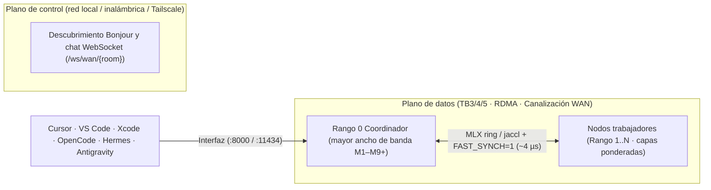

<div align="center">

# ☀️ Asistente de conjunto SonnerStudio (SS-CCC)

**🇺🇸 🇬🇧 🇨🇦 [English](README.md)** · **🇩🇪 🇦🇹 🇨🇭 [Deutsch](README.de.md)** · **🇫🇷 🇧🇪 🇨🇭 [Français](README.fr.md)** · **🇪🇸 🇲🇽 🇦🇷 [Español](README.es.md)** · **🇵🇹 🇧🇷 [Português](README.pt.md)** · **🇷🇺 [Русский](README.ru.md)** · **🇯🇵 [日本語](README.ja.md)** · **🇨🇳 [中文](README.zh.md)**

*Gestor nativo para macOS de conjuntos Apple Silicon y taller de inferencia distribuida MLX*

<table>
  <tr>
    <td align="center">
      <br/>
      <sub><b>Modo Conjunto (52 GB unificados · 2 equipos)</b></sub>
    </td>
    <td align="center">
      <br/>
      <sub><b>Modo Individual (16 GB local · 1 equipo)</b></sub>
    </td>
  </tr>
</table>

</div>

---

## 🧭 Resumen

El **Asistente de conjunto SonnerStudio (SS-CCC)** une la memoria unificada de cualquier equipo **Apple Silicon (M1–M9+)** — desde un Mac mini o MacBook Pro hasta agrupaciones locales **Thunderbolt 3/4/5 y RDMA** o **redes mundiales por Internet (2–256+ Mac)** — con enlace directo a **MLX**, **oMLX**, **Ollama** y **llama.cpp**.

<div align="center">
  
</div>

---

## 🌐 Red Internet mundial, chat de participantes y análisis científico

<table>
  <tr>
    <td align="center" width="50%">
      <br/>
      <sub><b>Red Internet y chat de participantes</b><br/>Tailscale · WireGuard · libp2p QUIC · DERP · <code>/status</code> · <code>/layers</code> · <code>/ping</code></sub>
    </td>
    <td align="center" width="50%">
      <br/>
      <sub><b>Análisis Roofline y balance energético</b><br/>Curva log-log · Burbuja GPipe · <code>J/token</code> · <code>p50/p95/p99</code> · CSV/JSON/BibTeX</sub>
    </td>
  </tr>
</table>

---

## 🏗️ Arquitectura híbrida (control, Thunderbolt e Internet)



---

## ✨ Funciones principales

- **Unión universal Apple Silicon (M1 – M9+):** Conecta libremente varios Mac (Mac mini, MacBook Air/Pro, iMac, Mac Studio, Mac Pro) de las generaciones M1 a M6 y futuras **M7, M8, M9+** en una agrupación común con cálculo automático del ancho de banda de memoria.
- **Telemetría completa de equipo y sensores:** Lectura directa mediante `sysctl`, `sw_vers`, `system_profiler`, `ioreg`, `pmset` e `ibv_devices`: núcleos CPU (P/E), núcleos GPU, núcleos del motor neuronal (16 / 32 núcleos ANE), espacio SSD total/libre, estado térmico, temperatura de batería (`°C`) y consumo eléctrico (`W`).
- **Clases Thunderbolt 3 / 4 / 5 y RDMA:** Detección y clasificación automáticas para chips M1–M9+ (TB3 `40 Gbps`, TB4 `40 Gbps`, TB5 `80/120 Gbps`, además de RDMA sobre Thunderbolt 5), con plano de control LAN/Wi-Fi separado y plano de datos Thunderbolt aislado.
- **Reparto ponderado de capas y protección `iogpu.wired_limit_mb`:** Distribución proporcional según el ancho de banda de memoria de cada nodo activo, manteniendo una reserva segura del sistema para macOS.
- **Detección real de modelos (oMLX, Ollama y llama.cpp):** Lectura directa de los modelos disponibles en **oMLX**, **Ollama**, **llama.cpp**, archivos `.gguf` locales y caché MLX (sin perfiles ficticios cuando está vacío, mostrando comprobación de estado y órdenes copiables).
- **Agrupación global por Internet (WAN) y mensajería entre participantes (`/ws/wan/{room_id}`):** Conecta equipos Mac con Apple Silicon en todo el mundo mediante túnel cifrado (Tailscale/WireGuard, retransmisión P2P libp2p/DERP o punto manual) en grandes agrupaciones distribuidas con sala de conversación en tiempo real.
- **Laboratorio científico de 6 pestañas (Local y WAN) e historial:** Alterna entre **Local (TB/RDMA)**, **Internet WAN** y **Comparación directa** en seis áreas: **Límite y cuello de botella** (techo de red efectivo, lote crítico $B^*$), **Topología WAN y escala** ($N=1\dots128$, compresión *Petals/SWARM*, rezagados, *DiLoCo* frente a DDP), **Memoria y caché KV**, **Energía, CO₂ y coste** (`J/token`, `EDP`, `gCO₂eq/kWh`), **Ensayos, estadística y exportación** (`IC₉₅`, `CV%`, `Goodput%`, `CSV / JSON / LaTeX / BibTeX`) e **Historial** (grabación por posición individual o global, gráfico de tendencia y CSV).
- **Actualizaciones desde GitHub y control automático de versiones:** Comprueba `version.json`, *GitHub Releases* y el SHA de `commits/main` al iniciar y cada 30 minutos (`⌘U`). Muestra un aviso de actualización con `git pull` + `swift build` + reinicio en un clic o descarga desde GitHub, respaldado por `scripts/bump_version.py` y `.github/workflows/auto-version-control.yml`.
- **Agentes y entornos en un clic:** Configuración inmediata para **OpenCode**, **Hermes Agent**, **Google Antigravity**, **Cursor**, **Visual Studio Code** y **Xcode**.
- **Modo de simulación conmutable, tema amarillo SonnerStudio (`#FFD400`) y pruebas globales (`tests/`):** La simulación de demostración permanece en la barra lateral; el conjunto se verifica con `tests/test_global_suite.py` (`python3 -m unittest discover -s tests -v`).
- **Interfaz multilingüe y centro de ayuda integrado:** Cambio inmediato entre inglés, alemán, francés, español y portugués, además de un centro de ayuda con búsqueda directa dentro de la aplicación.

### 🖥️ Las nueve áreas del programa de un vistazo


| Área | Contenido y función |
| :--- | :--- |
| **1. Resumen de agrupación** | Memoria conjunta, nodos activos, velocidad del enlace de datos, topología visual y barra de asignación `iogpu.wired_limit_mb`. |
| **2. Equipos y comparación** | Telemetría en directo de cada Mac (CPU, GPU, ANE, RAM, ancho de banda, SSD, temperatura, potencia) y adición de Mac M1–M9+. |
| **3. Taller de modelos** | Lectura real de modelos (oMLX, Ollama, llama.cpp, GGUF), estado de servicios, reparto de capas y caché KV. |
| **4. Red y RDMA** | Matriz de clases Thunderbolt 3/4/5 para M1–M9+, estado RDMA y enrutamiento del puente LAN/Thunderbolt. |
| **5. Agrupación Internet, Audio-Party y mensajería** | Acoplar Mac TB/RDMA locales con nodos WAN globales, coordinar con Audio-Party (estilo consola) y chat (`/ws/wan-audio`, `/ws/wan`). |
| **6. Agentes y entornos** | Configuración en un clic para **OpenCode**, **Hermes Agent**, **Antigravity**, **Cursor**, **Visual Studio Code** y **Xcode**. |
| **7. Ciencia y Roofline** | Laboratorio de 6 pestañas (Local y WAN): curva `P = min(β·I, π_eff)`, escala `N=1..128`, *Petals/SWARM* y *DiLoCo*, ecuación KV, `J/token` / `EDP` / `CO₂`, `IC₉₅` y `Goodput%`, exportación `CSV / JSON / LaTeX / BibTeX` e **Historial** por posición/global |
| **8. API y consola** | Puntos de acceso compatibles con OpenAI / Ollama / oMLX, registro de actividad y órdenes de arranque listas para copiar. |
| **9. Ayuda y documentación** | Manual integrado de 9 capítulos en 5 idiomas (`⌘?`) con búsqueda de texto completo y guía paso a paso. |

---

## 🛠️ Compilar desde el código fuente (antes del primer uso)

> [!NOTE]
> Este repositorio contiene el **código fuente en Swift** de SS-CCC (no se incluye un programa ya compilado). Para obtener una versión ejecutable, primero debes **compilar el código localmente en tu Mac con Apple Silicon**.

### Requisitos previos
- Un Mac con Apple Silicon (**M1–M6**) y **macOS 14.0 o posterior**
- **Herramientas de línea de comandos de Xcode** (incluyen `swiftc` y el SDK de macOS):
  ```bash
  xcode-select --install
  ```

### Paso a paso hasta el programa ejecutable
```bash
# 1. Clonar el repositorio y entrar en la carpeta
git clone https://github.com/SonnerStudio/SonnerStudio-Cluster-Case-Companion.git
cd SonnerStudio-Cluster-Case-Companion

# 2. Dar permisos de ejecución al guion de compilación y arranque
chmod +x scripts/run_ssccc.sh

# 3. Compilar los archivos Swift en /tmp/SSCCCApp y abrir el programa
./scripts/run_ssccc.sh
```
*(Opcional: también se puede compilar con Swift Package Manager mediante `cd app && swift build -c release`.)*

---

## 🚀 Inicio rápido

```bash
"./scripts/run_ssccc.sh"
```

---

## 📖 Guía operativa: Configuración local e híbrida (Local + Internet), carga de modelos y datos teóricos

### 1. Configuración del clúster local (Thunderbolt 3/4/5 y LAN)
1. **Conexión física:** Conecta tus Mac directamente mediante cables **Thunderbolt 3/4/5** (punto a punto, anillo o malla) y/o **Ethernet 10GbE**.
2. **Asignar IP punto a punto:** Ejecuta `./scripts/setup_tb_network.sh studio` (`10.99.1.1`) en el Mac principal y `./scripts/setup_tb_network.sh mini` (`10.99.1.2`, etc.) en los trabajadores, o configúralos en **Red y memoria directa**.
3. **RDMA opcional (macOS 26.2+ en TB5):** Activa `rdma_ctl enable` para que `JACCL` (`mlx.distributed`) alcance **`~3 µs`** de latencia entre nodos frente a `~300 µs` con TCP/IP.
4. **Asignación automática de rangos:** Añade todos los Mac en **Equipos y comparación**. `MemoryWeightedPlanner` asigna automáticamente el **rango 0 (coordinador)** al Mac con mayor ancho de banda de memoria, y los **rangos 1..N (trabajadores)** al resto.

### 2. Configuración de la red híbrida (Local + Internet WAN simultáneamente)
1. **Núcleo local rápido (Nivel 1):** El anillo local Thunderbolt/LAN (`10.99.1.x` / `192.168.x.x`) permanece activo para las capas sensibles a la latencia.
2. **Sala coordinadora WAN (Nivel 2):** En **Red Internet y chat**, crea una sala WAN (`/ws/wan/{room_id}` en el puerto `8000`, expuesta mediante Tailscale, WireGuard, Cloudflare Tunnel o proxy inverso).
3. **Unir nodos remotos:** Los Mac en cualquier lugar del mundo se conectan con el **Código de sala + Token de acceso**.
4. **Enrutamiento híbrido de dos niveles:** SS-CCC mantiene las capas de alta frecuencia en el anillo local (`3–180 µs`) y envía las etapas excedentes a los trabajadores WAN (`15–120 ms` RTT) usando micro-lotes (`M ≥ 4`).

### 3. ¿Quién carga el modelo, cuántos modelos caben y cuál es el flujo de ejecución?
- **¿Quién carga qué?**
  - **Coordinador (Rango 0):** Aloja la pasarela API (`:8000`), tokeniza, **mantiene siempre los Embeddings y el cabezal LM (`has_embeddings=True`, `has_lm_head=True`)** además de su parte proporcional de capas (`Capas_i = Total × Utilizable_i / TotalUtilizable`).
  - **Trabajadores (Rangos 1..N):** Cada nodo carga **únicamente su segmento Safetensors/capas `[start_layer .. end_layer)`** desde su caché local de HuggingFace/oMLX/Ollama (`~/.cache/huggingface`, `~/.ollama/models`, `~/Models`).
- **¿Cuántos modelos pueden cargarse a la vez?**
  - **Modo distribuido (`mlx.distributed` / `JACCL`):** **1 gran modelo fragmentado a la vez** sobre todo el pool de memoria (cambio rápido mediante hot-swap).
  - **Modo multimodelo (`oMLX` / `Ollama` / nodos heterogéneos):** Mientras `Σ (Pesos_i + Caché_KV_i) ≤ VRAM_Utilizable_Total_GB` (tras reservar 4–8 GB por Mac con `iogpu.wired_limit_mb`), pueden coexistir **múltiples modelos en paralelo** (p. ej., **programador 32B + enrutador rápido 8B + embeddings 1,5B**).
- **Flujo y estructura de una petición:**
  1. **Sondeo y selección de enlace** (`TB5 RDMA > TB Bridge > 10GbE > WLAN > WAN`).
  2. **Plan de particionado** (`hostfile.json` y límites `iogpu.wired_limit_mb`).
  3. **Entrada API** (`http://127.0.0.1:8000/v1/chat/completions`, `/v1/messages`, `/api/chat`).
  4. **Fase Prefill (`TTFT`):** Rango 0 procesa el prompt y envía activaciones por la tubería (`Rango 0 → 1 → ... → N → Rango 0`).
  5. **Fase Decode (`TPOT` y `tok/s`):** Generación token a token con `--kv-bits 4` y `MLX_METAL_FAST_SYNCH=1`.
  6. **Streaming SSE y telemetría** en **Ciencia y rendimiento** (`tok/s`, `J/tok`, `p50/p95/p99`).

### 4. Datos teóricos de dimensionamiento y rendimiento por caso de uso

> **Fórmulas de estimación analítica:**
> - **Memoria requerida:** `VRAM_GB ≈ Parámetros_B × (Bits / 8) × 1,15 + Caché_KV_GB`
> - **Techo teórico Decode:** `tok/s ≈ (Ancho_Banda_Efectivo_GB/s / Pesos_Activos_GB) × (1 − Sobrecarga_Comm)`

| Caso de uso | Topología y Pool utilizable | Modelo típico y cuantización | `TTFT` teórico (2k prompt) | Caudal teórico (`tok/s` / `TPOT`) | Energía y cuello de botella |
| :--- | :--- | :--- | :--- | :--- | :--- |
| **1. Estación individual (Edge Dev)** | 1× Mac mini M4 (16 GB, `12 GB` útiles, `120 GB/s`) | `Qwen2.5-14B` (`4 bits`, ~8,8 GB) | `~1,8 – 2,6 s` | **`11 – 14 tok/s`** (`~75 ms/tok`) | `~1,7 J/tok` · Ancho de banda |
| **2. Studio Pro individual (Código rápido)** | 1× Mac Studio M4 Max (64 GB, `58 GB` útiles, `546 GB/s`) | `Llama-3.3-70B` (`4 bits`, ~40 GB) | `~1,1 – 1,7 s` | **`12 – 14 tok/s`** (`~74 ms/tok`) | `~3,8 J/tok` · Ancho de banda |
| **3. Anillo local 2 nodos TB5 RDMA** | 2× M4 Max 64 GB (`116 GB` útiles, `~1.092 GB/s` agg., `~3 µs` JACCL) | `Qwen2.5-Coder-72B` (`8 bits`, ~78 GB) | `~1,4 – 2,0 s` | **`12 – 14 tok/s`** (`~76 ms/tok`) | `~7,5 J/tok` · Sobrecarga RDMA mínima |
| **4. Lab 4 nodos Ultra TB5 RDMA** | 4× M3 Ultra 256 GB (`992 GB` útiles, `~3,27 TB/s` agg.) | `DeepSeek-V3 671B MoE` (`4 bits`, ~385 GB, ~37B activos) | `~2,2 – 3,5 s` | **`38 – 55 tok/s`** (`~20 ms/tok`) | `~5,2 J/tok` · BW expertos activos MoE |
| **5. Híbrido Oficina LAN + Casa WAN** | 2× TB4/10GbE + 2× WAN (`192 GB` útiles, `35 ms` RTT WAN) | `Llama-3.1-405B` (`3/4 bits`, ~170 GB) | `~6 – 11 s` | **`2,2 – 4,5 tok/s`** (`~280 ms/tok`) | `~28 J/tok` · Latencia WAN (`M=8` ayuda) |
| **6. Enjambre comunitario global WAN** | 16+ Mac globales (`1,5+ TB` útiles, `60–120 ms` RTT WAN) | `671B–1T+` Frontier (`4/8 bits`) | `~12 – 25 s` | **`1,2 – 3,0 tok/s`** (`~500 ms/tok`) | Latencia WAN (el batching escala) |

---

## 📚 Documentación seleccionada (incluida en la ayuda del programa)

### 1. Todos los Mac con procesador M en conjunto (M1–M6)
SS-CCC admite **cualquier Mac con procesador Apple Silicon** (**M1, M2, M3, M4, M5, M6** — Base, Pro, Max y Ultra): **Mac mini, MacBook Air, MacBook Pro, iMac, Mac Studio y Mac Pro**. En **Equipos y comparación** puedes añadir tantos Mac como necesites; el equipo con mayor ancho de banda asume automáticamente el **rango 0 (coordinador)**.

| Familia de chip | Ancho de banda | Thunderbolt | Reserva recomendada para macOS |
| :--- | :--- | :--- | :--- |
| **M1 / M2** (Base) | 68 – 100 GB/s | TB 3 / USB4 (26–32 Gbps) | **4 GB** (≤ 24 GB RAM) |
| **M3 / M4** (Base) | 100 – 120 GB/s | TB 4 (30–37 Gbps) | **4 GB** (≤ 24 GB RAM) |
| **M5 / M6** (Base) | 153 – 180 GB/s | TB 5 (65–80 Gbps) | **4 GB** (≤ 24 GB RAM) |
| **M1–M3 Pro** | 150 – 200 GB/s | TB 4 (30–37 Gbps) | **4 – 6 GB** |
| **M4–M6+ Pro** | 273 – 310+ GB/s | TB 5 (80–120 Gbps boost) | **4 – 6 GB** |
| **M1–M3 Max** | 400 GB/s | TB 4 (30–37 Gbps) | **6 GB** (32–64 GB RAM) |
| **M4 Max** | **410 – 546 GB/s** (LPDDR5X-8533) | TB 5 + RDMA (`~3 µs` latencia) | **6 GB** (32–64 GB RAM) |
| **M1–M2 Ultra / M3 Ultra** | **800 – 819 GB/s** (UltraFusion) | TB 4 / TB 5 RDMA (JACCL) | **8 GB** (≥ 96 GB RAM) |

### 2. Thunderbolt 5 RDMA (`JACCL`), protección de memoria y reparto ponderado


- **RDMA en macOS sobre Thunderbolt 5:** Con `rdma_ctl enable` (macOS 26.2+) y el motor `JACCL` (`mlx.distributed`), la latencia entre nodos baja de `~300 µs` (TCP/IP) a **`~3 µs`** con **`3,5–3,8 GB/s`** de caudal sostenido.
- **Nunca asignar el 100 % de la RAM:** `iogpu.wired_limit_mb` protege la estabilidad de macOS y WindowServer.
- **Reparto proporcional de capas:** cada Mac recibe capas según su memoria utilizable (`Capas_i = Total × Utilizable_i / TotalUtilizable`).
- **Caché KV de 4 bits y sincronización rápida:** `--kv-bits 4` y `MLX_METAL_FAST_SYNCH=1` (45× más rápido, ~180 µs → ~4 µs).

---

## 🔄 Actualizaciones controladas desde GitHub y control automático de versiones


1. **Comprobación multifuente en GitHub:** Al iniciar (tras `1,2 s`) y cada **30 minutos** (`startAutomaticUpdateMonitor()`), `ClusterViewModel` consulta `main/version.json`, `releases/latest` y `commits/main` (SHA corto).
2. **Aviso en la aplicación (`UpdatePromptSheet`, `⌘U`):** Si detecta una versión, compilación o SHA más reciente, ofrece para instalaciones desde código `git pull --ff-only origin main` + `swift build` + reinicio en un clic (`scripts/run_ssccc.sh`), o descarga directa desde GitHub Releases.
3. **Automatización CI (`.github/workflows/auto-version-control.yml`):** Cada *push* a `main` ejecuta `scripts/bump_version.py --part patch --sync-git`, sincroniza `version.json` y `ClusterModels.swift`, pasa los 14 tests y etiqueta `vX.Y.Z`.

---

## 🎙️ Audio-Party de agrupación y colaboración WAN en directo


- **Voz en tiempo real (`AVAudioEngine`, 16 kHz PCM16):** Conectada a `/ws/wan-audio` junto al chat (`/ws/wan/{room_id}`), con modos **Pulsar para hablar / Micrófono abierto**, **Silenciar / Ensordecer**, medidor de nivel y roles (`Pasarela rango 0`, `Nodo WAN`).

---

## 🏆 Desafío de récord mundial: superordenador híbrido local + Internet


**¿Puede una coalición distribuida de equipos Mac con Apple Silicon competir con un centro de datos?**  
Invitamos a universidades, grupos de investigación y entusiastas de Apple Silicon a organizar un **intento oficial de récord con SS-CCC**: unid simultáneamente el mayor número posible de **agrupaciones locales Thunderbolt 3/4/5/RDMA** y **Mac conectados por Internet** mediante el **puente híbrido («Acoplar local + Internet»)**, la **Audio-Party** y el **laboratorio científico de 5 pestañas**.

### 🔬 Protocolo científico y modelado

1. **Topología jerárquica en dos niveles (islas locales TB/RDMA + red troncal WAN):**
   - El puente híbrido conserva las capas consecutivas dentro de cada isla Thunderbolt local (`~0,07 ms`, `30–110 Gbps`), limitando los saltos WAN a las pasarelas de rango 0 ($H_{\text{WAN}} \ll N_{\text{total}}$).
2. **Ocultación de latencia WAN ($B^*$) y compresión de activaciones:**
   - Con $\Phi_{\text{burbuja}} = \frac{N - 1}{M + N - 1}$ y el lote crítico $B^* = \lceil \frac{T_{\text{RTT,WAN}} + T_{\text{tx}}}{T_{\text{comp}}(B=1)} \rceil$, el uso de micro-lotes $M \to B^*$ junto con compresión **FP8 / INT4 / Top-K** (*Petals / SWARM*) mantiene el tráfico por debajo del $1\%$ del enlace ascendente.
3. **Protocolo reproducible ($T = 0,0$):** Activa el puente híbrido, únete a la **Audio-Party** (`Opus 16 kbps`, $<0,02\%$ del enlace), ejecuta `N = 20` ensayos (`T = 0,0`) en modo **Internet-WAN** y exporta el **manifiesto JSON**, **CSV** y la **tabla LaTeX (`booktabs`)** con `IC₉₅`, `Goodput%`, `J/token`, `EDP` y `gCO₂eq/1M tokens`.


### 🥇 Categorías de récord y casos de uso


- **Categorías:** mayor memoria unificada total (`TB`), mayor número de Mac acoplados simultáneamente ($N \ge 32\text{–}256+$), mayor caudal útil transcontinental y menor consumo (`J/token`).
- **Casos de uso:** investigación en sistemas de IA (curvas Roofline, *DiLoCo* frente a DDP, artículos LaTeX/BibTeX), laboratorios universitarios que unen portátiles y Mac mini, estudios de programación para **OpenCode / Cursor / Xcode** sin coste en la nube, entornos médicos o legales bajo túnel **WireGuard**, maratones globales coordinados por **Audio-Party** y auditorías **Green-AI**.

---

## 📁 Estructura del repositorio

```text
├── app/Sources/
│   ├── SSCCCApp.swift              # Ventana principal, aviso de actualización y UpdatePromptSheet
│   ├── Models/
│   │   ├── ClusterModels.swift     # Inferencia M1–M12+, modelos WAN/Ciencia/Historial y versiones
│   │   └── Localization.swift      # Diccionario completo en 8 idiomas (EN/DE/FR/ES/PT/RU/JA/ZH)
│   ├── ViewModels/
│   │   └── ClusterViewModel.swift  # Sondeo de hardware, modelos, Audio-Party WAN y actualizador GitHub
│   └── Views/                      # 9 vistas SwiftUI modulares + Theme.swift (Resumen de 3 pestañas, franjas de advertencia, lab. de 6 pestañas y ayuda)
├── core/                           # Pasarela Python FastAPI, relés WebSocket WAN/Audio y reparto MLX
├── scripts/
│   ├── run_ssccc.sh                # Compila e inicia la aplicación macOS
│   ├── bump_version.py             # Sincroniza version.json y ClusterModels.swift con Git
│   ├── setup_tb_network.sh         # Configura el puente Thunderbolt 10.99.1.x
│   └── setup_wired_limit.sh        # Aplica límites seguros de iogpu.wired_limit_mb
├── tests/                          # Conjunto de verificación global de 14 pruebas (Swift + Python)
├── .github/workflows/              # Control automático de versiones CI y etiquetado
└── version.json                    # Manifiesto de control de actualizaciones alojado en GitHub
```

---

## 🚧 Estado de desarrollo y colaboración

> [!IMPORTANT]
> **SS-CCC (v1.6+) es totalmente ejecutable y está verificado por `14/14` pruebas automatizadas; las pruebas de resistencia multinodo continúan.**
> **Ya implementado y comprobado:** idioma de inicio en inglés con 8 idiomas (`EN/DE/FR/ES/PT/RU/JA/ZH`), **resumen del clúster en 3 pestañas** (**Clúster local**, **Clúster de Internet** con subclústeres regionales/locales y vista híbrida **Local + Internet**), **franjas industriales de advertencia amarillo-negro (`HazardStripesBar` / `IndustrialHazardBanner`)** en 6 vistas, detección abierta M1–M12+, descubrimiento en vivo de modelos (oMLX / Ollama / llama.cpp / GGUF), laboratorio científico de 6 pestañas con historial por posición y global, puente híbrido Local ↔ Internet-WAN, Audio-Party con `AVAudioEngine`, manual de 9 capítulos y actualización automática desde GitHub + CI.

Animamos a desarrolladores, investigadores y entusiastas de Apple Silicon a **colaborar y seguir haciendo crecer SS-CCC**:
- **Probar en tu equipo:** Ejecuta SS-CCC en tus Mac M1–M12+ y comparte resultados de rendimiento, memoria y RDMA/JACCL.
- **Participar en el reto de récord:** Une islas TB locales con nodos WAN y publica tus manifiestos JSON/CSV/LaTeX.
- **Aportar mejoras:** ¡Cualquier mejora en SwiftUI, en el reparto MLX, en los guiones de Thunderbolt o en las traducciones es bienvenida!

---

## 📄 Licencia

Publicado bajo la [Licencia MIT](LICENSE.md).
