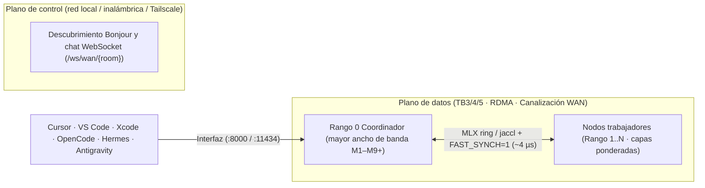

<div align="center">

# ☀️ Asistente de conjunto SonnerStudio (SS-CCC)

**🇺🇸 🇬🇧 🇨🇦 [English](README.md)** · **🇩🇪 🇦🇹 🇨🇭 [Deutsch](README.de.md)** · **🇫🇷 🇧🇪 🇨🇭 [Français](README.fr.md)** · **🇪🇸 🇲🇽 🇦🇷 [Español](README.es.md)** · **🇵🇹 🇧🇷 [Português](README.pt.md)**

*Gestor nativo para macOS de conjuntos Apple Silicon y taller de inferencia distribuida MLX*

<table>
  <tr>
    <td align="center">
      <br/>
      <sub><b>Modo Conjunto (52 GB unificados · 2 equipos)</b></sub>
    </td>
    <td align="center">
      <br/>
      <sub><b>Modo Individual (16 GB local · 1 equipo)</b></sub>
    </td>
  </tr>
</table>

</div>

---

## 🧭 Resumen

El **Asistente de conjunto SonnerStudio (SS-CCC)** une la memoria unificada de cualquier equipo **Apple Silicon (M1–M9+)** — desde un Mac mini o MacBook Pro hasta agrupaciones locales **Thunderbolt 3/4/5 y RDMA** o **redes mundiales por Internet (2–256+ Mac)** — con enlace directo a **MLX**, **oMLX**, **Ollama** y **llama.cpp**.

<div align="center">
  
</div>

---

## 🌐 Red Internet mundial, chat de participantes y análisis científico

<table>
  <tr>
    <td align="center" width="50%">
      <br/>
      <sub><b>Red Internet y chat de participantes</b><br/>Tailscale · WireGuard · libp2p QUIC · DERP · <code>/status</code> · <code>/layers</code> · <code>/ping</code></sub>
    </td>
    <td align="center" width="50%">
      <br/>
      <sub><b>Análisis Roofline y balance energético</b><br/>Curva log-log · Burbuja GPipe · <code>J/token</code> · <code>p50/p95/p99</code> · CSV/JSON/BibTeX</sub>
    </td>
  </tr>
</table>

---

## 🏗️ Arquitectura híbrida (control, Thunderbolt e Internet)



---

## ✨ Funciones principales

- **Unión universal Apple Silicon (M1 – M9+):** Conecta libremente varios Mac (Mac mini, MacBook Air/Pro, iMac, Mac Studio, Mac Pro) de las generaciones M1 a M6 y futuras **M7, M8, M9+** en una agrupación común con cálculo automático del ancho de banda de memoria.
- **Telemetría completa de equipo y sensores:** Lectura directa mediante `sysctl`, `sw_vers`, `system_profiler`, `ioreg`, `pmset` e `ibv_devices`: núcleos CPU (P/E), núcleos GPU, núcleos del motor neuronal (16 / 32 núcleos ANE), espacio SSD total/libre, estado térmico, temperatura de batería (`°C`) y consumo eléctrico (`W`).
- **Clases Thunderbolt 3 / 4 / 5 y RDMA:** Detección y clasificación automáticas para chips M1–M9+ (TB3 `40 Gbps`, TB4 `40 Gbps`, TB5 `80/120 Gbps`, además de RDMA sobre Thunderbolt 5), con plano de control LAN/Wi-Fi separado y plano de datos Thunderbolt aislado.
- **Reparto ponderado de capas y protección `iogpu.wired_limit_mb`:** Distribución proporcional según el ancho de banda de memoria de cada nodo activo, manteniendo una reserva segura del sistema para macOS.
- **Detección real de modelos (oMLX, Ollama y llama.cpp):** Lectura directa de los modelos disponibles en **oMLX**, **Ollama**, **llama.cpp**, archivos `.gguf` locales y caché MLX (sin perfiles ficticios cuando está vacío, mostrando comprobación de estado y órdenes copiables).
- **Agrupación global por Internet (WAN) y mensajería entre participantes (`/ws/wan/{room_id}`):** Conecta equipos Mac con Apple Silicon en todo el mundo mediante túnel cifrado (Tailscale/WireGuard, retransmisión P2P libp2p/DERP o punto manual) en grandes agrupaciones distribuidas con sala de conversación en tiempo real.
- **Laboratorio científico de 5 pestañas (Local y WAN):** Alterna entre **Local (TB/RDMA)**, **Internet WAN** y **Comparación directa** en cinco áreas: **Límite y cuello de botella** (techo de red efectivo, lote crítico $B^*$), **Topología WAN y escala** ($N=1\dots128$, compresión *Petals/SWARM*, rezagados, *DiLoCo* frente a DDP), **Memoria y caché KV**, **Energía, CO₂ y coste** (`J/token`, `EDP`, `gCO₂eq/kWh`) y **Ensayos, estadística y exportación** (`IC₉₅`, `CV%`, `Goodput%`, `CSV / JSON / LaTeX / BibTeX`).
- **Agentes y entornos en un clic:** Configuración inmediata para **OpenCode**, **Hermes Agent**, **Google Antigravity**, **Cursor**, **Visual Studio Code** y **Xcode**.
- **Modo de simulación conmutable, tema amarillo SonnerStudio (`#FFD400`) y pruebas globales (`tests/`):** La simulación de demostración permanece en la barra lateral; el conjunto se verifica con `tests/test_global_suite.py` (`python3 -m unittest discover -s tests -v`).
- **Interfaz multilingüe y centro de ayuda integrado:** Cambio inmediato entre inglés, alemán, francés, español y portugués, además de un centro de ayuda con búsqueda directa dentro de la aplicación.

### 🖥️ Las nueve áreas del programa de un vistazo

| Área | Contenido y función |
| :--- | :--- |
| **1. Resumen de agrupación** | Memoria conjunta, nodos activos, velocidad del enlace de datos, topología visual y barra de asignación `iogpu.wired_limit_mb`. |
| **2. Equipos y comparación** | Telemetría en directo de cada Mac (CPU, GPU, ANE, RAM, ancho de banda, SSD, temperatura, potencia) y adición de Mac M1–M9+. |
| **3. Taller de modelos** | Lectura real de modelos (oMLX, Ollama, llama.cpp, GGUF), estado de servicios, reparto de capas y caché KV. |
| **4. Red y RDMA** | Matriz de clases Thunderbolt 3/4/5 para M1–M9+, estado RDMA y enrutamiento del puente LAN/Thunderbolt. |
| **5. Agrupación Internet y mensajería** | Conectar Mac por el mundo con Tailscale/WireGuard/libp2p, compartir clave de sala y conversar en directo (`/ws/wan/{room_id}`). |
| **6. Agentes y entornos** | Configuración en un clic para **OpenCode**, **Hermes Agent**, **Antigravity**, **Cursor**, **Visual Studio Code** y **Xcode**. |
| **7. Ciencia y Roofline** | Laboratorio de 5 pestañas (Local y WAN): curva `P = min(β·I, π_eff)`, escala `N=1..128`, *Petals/SWARM* y *DiLoCo*, ecuación KV, `J/token` / `EDP` / `CO₂`, `IC₉₅` y `Goodput%`, exportación `CSV / JSON / LaTeX / BibTeX`. |
| **8. API y consola** | Puntos de acceso compatibles con OpenAI / Ollama / oMLX, registro de actividad y órdenes de arranque listas para copiar. |
| **9. Ayuda y documentación** | Manual integrado con búsqueda de texto completo, vista general de arquitectura y guía paso a paso. |

---

## 🛠️ Compilar desde el código fuente (antes del primer uso)

> [!NOTE]
> Este repositorio contiene el **código fuente en Swift** de SS-CCC (no se incluye un programa ya compilado). Para obtener una versión ejecutable, primero debes **compilar el código localmente en tu Mac con Apple Silicon**.

### Requisitos previos
- Un Mac con Apple Silicon (**M1–M6**) y **macOS 14.0 o posterior**
- **Herramientas de línea de comandos de Xcode** (incluyen `swiftc` y el SDK de macOS):
  ```bash
  xcode-select --install
  ```

### Paso a paso hasta el programa ejecutable
```bash
# 1. Clonar el repositorio y entrar en la carpeta
git clone https://github.com/SonnerStudio/SonnerStudio-Cluster-Case-Companion.git
cd SonnerStudio-Cluster-Case-Companion

# 2. Dar permisos de ejecución al guion de compilación y arranque
chmod +x scripts/run_ssccc.sh

# 3. Compilar los archivos Swift en /tmp/SSCCCApp y abrir el programa
./scripts/run_ssccc.sh
```
*(Opcional: también se puede compilar con Swift Package Manager mediante `cd app && swift build -c release`.)*

---

## 🚀 Inicio rápido

```bash
"./scripts/run_ssccc.sh"
```

---

## 📚 Documentación seleccionada (incluida en la ayuda del programa)

### 1. Todos los Mac con procesador M en conjunto (M1–M6)
SS-CCC admite **cualquier Mac con procesador Apple Silicon** (**M1, M2, M3, M4, M5, M6** — Base, Pro, Max y Ultra): **Mac mini, MacBook Air, MacBook Pro, iMac, Mac Studio y Mac Pro**. En **Equipos y comparación** puedes añadir tantos Mac como necesites; el equipo con mayor ancho de banda asume automáticamente el **rango 0 (coordinador)**.

| Familia de chip | Ancho de banda | Thunderbolt | Reserva recomendada para macOS |
| :--- | :--- | :--- | :--- |
| **M1 / M2** (Base) | 68 – 100 GB/s | TB 3 / USB4 (26–32 Gbps) | **4 GB** (≤ 24 GB RAM) |
| **M3 / M4** (Base) | 100 – 120 GB/s | TB 4 (30–37 Gbps) | **4 GB** (≤ 24 GB RAM) |
| **M5 / M6** (Base) | 153 – 180 GB/s | TB 5 (65–80 Gbps) | **4 GB** (≤ 24 GB RAM) |
| **M1–M3 Pro** | 150 – 200 GB/s | TB 4 (30–37 Gbps) | **4 – 6 GB** |
| **M4–M6 Pro** | 273 – 310 GB/s | TB 5 (65–80 Gbps) | **4 – 6 GB** |
| **M1–M3 Max** | 400 GB/s | TB 4 (30–37 Gbps) | **6 GB** (32–64 GB RAM) |
| **M4–M6 Max** | 460 – 580 GB/s | TB 5 (65–80 Gbps) | **6 GB** (32–64 GB RAM) |
| **M1–M2 Ultra** / **M3 Ultra** | 800 GB/s | TB 4 / TB 5 | **8 GB** (≥ 96 GB RAM) |

### 2. Protección de memoria y reparto ponderado
- **Nunca asignar el 100 % de la RAM:** `iogpu.wired_limit_mb` protege la estabilidad de macOS y WindowServer.
- **Reparto proporcional de capas:** cada Mac recibe capas según su memoria utilizable (`Capas_i = Total × Utilizable_i / TotalUtilizable`).
- **Caché KV de 4 bits y sincronización rápida:** `--kv-bits 4` y `MLX_METAL_FAST_SYNCH=1` (45× más rápido, ~180 µs → ~4 µs).

---

## 🚧 Estado de desarrollo y colaboración

> [!IMPORTANT]
> **SS-CCC ya se puede compilar y ejecutar, pero sigue en fase activa de desarrollo y pruebas.**
> La interfaz, la lectura del equipo, el reparto ponderado de capas y la conexión con agentes ya funcionan; las pruebas reales con distintas combinaciones de Mac M1–M6, puentes Thunderbolt 4/5 y RDMA/JACCL continúan perfeccionándose.

Animamos a desarrolladores, investigadores y entusiastas de Apple Silicon a **colaborar y seguir haciendo crecer SS-CCC**:
- **Probar en tu equipo:** Ejecuta SS-CCC en tus Mac M1–M6 y comparte resultados de rendimiento, memoria y estabilidad.
- **Enviar avisos e ideas:** Abre un aviso en GitHub para errores, casos concretos o nuevas propuestas.
- **Aportar mejoras:** ¡Cualquier mejora en SwiftUI, en el reparto MLX, en los guiones de Thunderbolt o en las traducciones es bienvenida!

---

## 📄 Licencia

Publicado bajo la [Licencia MIT](LICENSE.md).
