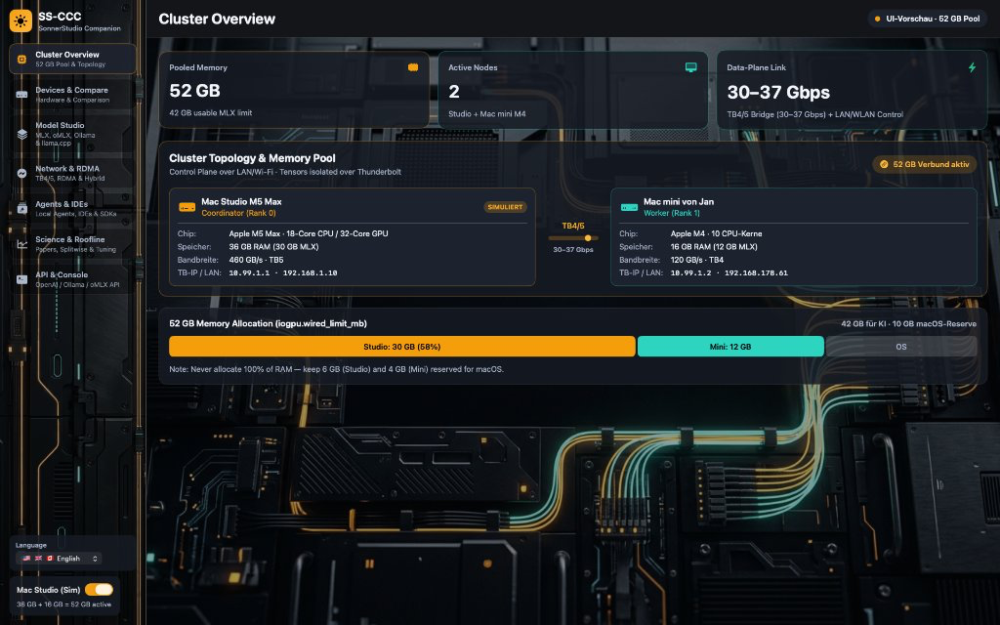
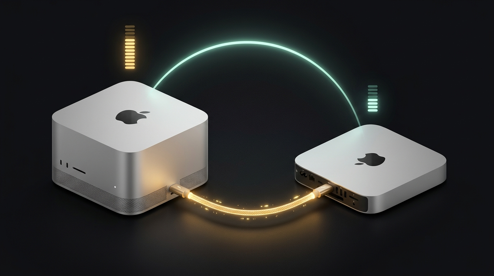
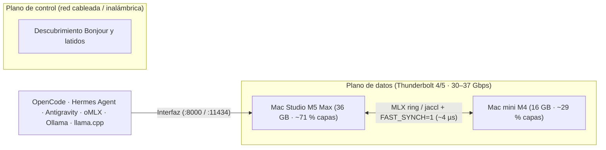

<div align="center">

# ☀️ Asistente de conjunto SonnerStudio (SS-CCC)

**🇺🇸 🇬🇧 🇨🇦 [English](README.md)** · **🇩🇪 🇦🇹 🇨🇭 [Deutsch](README.de.md)** · **🇫🇷 🇧🇪 🇨🇭 [Français](README.fr.md)** · **🇪🇸 🇲🇽 🇦🇷 [Español](README.es.md)** · **🇵🇹 🇧🇷 [Português](README.pt.md)**

*Gestor nativo para macOS de conjuntos Apple Silicon y taller de inferencia distribuida MLX*



</div>

---

## 🧭 Resumen

El **Asistente de conjunto SonnerStudio (SS-CCC)** une la memoria unificada de varios equipos Apple Silicon — por ejemplo, un **Mac Studio M5 Max (36 GB, Thunderbolt 5)** y un **Mac mini M4 (16 GB, Thunderbolt 4)** — en un **conjunto de 52 GB físicos (~42 GB útiles)** mediante **Thunderbolt (puente o acceso directo)**, **red cableada/inalámbrica** o modo **híbrido**.

<div align="center">
  
</div>

---

## 🏗️ Arquitectura híbrida (plano de control y plano de datos)



---

## ✨ Funciones principales

- **Unión heterogénea de 52 GB:** Reparto proporcional de capas (`~71 %` en el M5 Max a `460 GB/s`, `~29 %` en el M4 a `120 GB/s`) con protección segura de `iogpu.wired_limit_mb`.
- **Interfaz nativa macOS:**
  - **Resumen y comparación de equipos:** Lectura directa (`sysctl`, `sw_vers`, `ibv_devices`, `ipconfig`) con comparación visual.
  - **Taller de modelos:** Reparto de capas, compresión de caché KV (`FP16 / 8-bit / 4-bit`) y enlace directo con **oMLX**, **Ollama** y **llama.cpp**.
  - **Agentes y entornos (un clic):** Configuración directa para **OpenCode**, **Hermes Agent** y **Google Antigravity**.
  - **Interfaz multilingüe:** Selector de idioma en el menú lateral izquierdo.

---

## 🚀 Inicio rápido

```bash
"./scripts/run_ssccc.sh"
```

---

## 📄 Licencia

Publicado bajo la [Licencia MIT](LICENSE.md).
