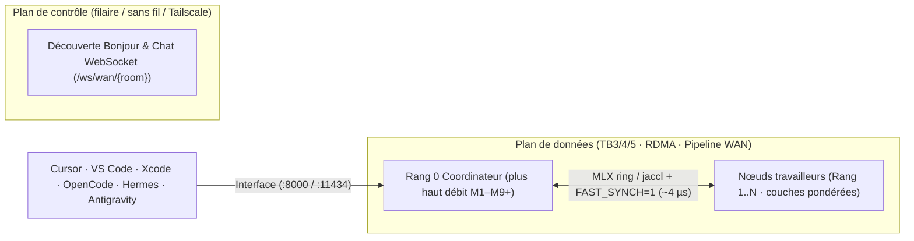

<div align="center">

# ☀️ Compagnon de grappe SonnerStudio (SS-CCC)

**🇺🇸 🇬🇧 🇨🇦 [English](README.md)** · **🇩🇪 🇦🇹 🇨🇭 [Deutsch](README.de.md)** · **🇫🇷 🇧🇪 🇨🇭 [Français](README.fr.md)** · **🇪🇸 🇲🇽 🇦🇷 [Español](README.es.md)** · **🇵🇹 🇧🇷 [Português](README.pt.md)**

*Gestionnaire natif macOS de grappe Apple Silicon et atelier d'inférence MLX répartie*

<table>
  <tr>
    <td align="center">
      <br/>
      <sub><b>Mode Grappe (52 Go unifiés · 2 nœuds)</b></sub>
    </td>
    <td align="center">
      <br/>
      <sub><b>Mode Autonome (16 Go local · 1 nœud)</b></sub>
    </td>
  </tr>
</table>

</div>

---

## 🧭 Présentation

Le **Compagnon de grappe SonnerStudio (SS-CCC)** réunit la mémoire unifiée de tout **Mac Apple Silicon (M1–M9+)** — d'un Mac mini ou MacBook Pro isolé jusqu'aux grappes locales **Thunderbolt 3/4/5 & RDMA** ou aux **grappes Internet mondiales (2–256+ Mac)** — avec prise en charge directe de **MLX**, **oMLX**, **Ollama** et **llama.cpp**.

<div align="center">
  
</div>

---

## 🌐 Grappe Internet mondiale, discussion & courbe scientifique

<table>
  <tr>
    <td align="center" width="50%">
      <br/>
      <sub><b>Grappe Internet & Discussion des participants</b><br/>Tailscale · WireGuard · libp2p QUIC · DERP · <code>/status</code> · <code>/layers</code> · <code>/ping</code></sub>
    </td>
    <td align="center" width="50%">
      <br/>
      <sub><b>Analyse Roofline & Bilan énergétique</b><br/>Courbe log-log · Bulle GPipe · <code>J/jeton</code> · <code>p50/p95/p99</code> · CSV/JSON/BibTeX</sub>
    </td>
  </tr>
</table>

---

## 🏗️ Architecture hybride (contrôle, Thunderbolt et Internet)



---

## ✨ Fonctionnalités principales

- **Couplage universel Apple Silicon (M1 – M9+) :** Réunit librement plusieurs Mac (Mac mini, MacBook Air/Pro, iMac, Mac Studio, Mac Pro) des générations M1 à M6 ainsi que les futures puces **M7, M8, M9+** dans une grappe commune avec calcul automatique de la bande passante mémoire.
- **Télémétrie matérielle et capteurs complets :** Lecture en direct via `sysctl`, `sw_vers`, `system_profiler`, `ioreg`, `pmset` et `ibv_devices` : cœurs CPU (P/E), cœurs GPU, cœurs du moteur neuronal (16 / 32 cœurs ANE), capacité totale/libre du SSD, niveau thermique, température de batterie (`°C`) et consommation électrique (`W`).
- **Classes Thunderbolt 3 / 4 / 5 et RDMA :** Détection et classement automatiques pour les puces M1–M9+ (TB3 `40 Gbit/s`, TB4 `40 Gbit/s`, TB5 `80/120 Gbit/s` ainsi que RDMA via Thunderbolt 5), avec plan de contrôle LAN/Wi-Fi séparé et plan de données Thunderbolt isolé.
- **Répartition pondérée des couches et protection `iogpu.wired_limit_mb` :** Découpage proportionnel des couches selon la bande passante mémoire de chaque nœud actif tout en préservant une réserve système sûre pour macOS.
- **Détection réelle des modèles (oMLX, Ollama et llama.cpp) :** Lecture directe des modèles disponibles sur **oMLX**, **Ollama**, **llama.cpp**, `.gguf` locaux et cache MLX (sans profils fictifs lorsque la liste est vide, avec vérification d'état et commandes d'installation copiables).
- **Grappe Internet mondiale (WAN) et messagerie des participants (`/ws/wan/{room_id}`) :** Reliez des Mac Apple Silicon à travers le monde via tunnel chiffré (Tailscale/WireGuard, relais P2P libp2p/DERP ou point manuel) en de vastes grappes distribuées avec messagerie en temps réel.
- **Laboratoire scientifique à 6 onglets (Local & WAN) et historique :** Basculez entre **Local (TB/RDMA)**, **Internet WAN** et **Comparaison directe** sur six volets : **Courbe & goulot** (plafond réseau effectif, lot critique $B^*$), **Topologie WAN et montée en charge** ($N=1\dots128$, compression *Petals/SWARM*, retards réseau, *DiLoCo* vs DDP), **Mémoire et cache KV**, **Énergie, CO₂ et coût** (`J/jeton`, `EDP`, `gCO₂eq/kWh`), **Essais, statistiques et export** (`IC₉₅`, `CV%`, `Goodput%`, `CSV / JSON / LaTeX / BibTeX`) et **Historique** (enregistrement par position ou global, graphique de tendance et export CSV).
- **Mises à jour pilotées par GitHub et contrôle automatique de version :** Vérifie `version.json`, les *GitHub Releases* et le SHA de `commits/main` au démarrage puis toutes les 30 minutes (`⌘U`). Affiche une invite de mise à jour intégrée avec `git pull` + `swift build` + relance en un clic ou téléchargement GitHub, appuyée par `scripts/bump_version.py` et `.github/workflows/auto-version-control.yml`.
- **Agents et environnements en un clic :** Configuration directe pour **OpenCode**, **Hermes Agent**, **Google Antigravity**, **Cursor**, **Visual Studio Code** et **Xcode**.
- **Mode simulation commutable, thème jaune SonnerStudio (`#FFD400`) et suite de tests (`tests/`) :** Le nœud simulé de démonstration reste activable dans la barre latérale ; l'ensemble est vérifié par `tests/test_global_suite.py` (`python3 -m unittest discover -s tests -v`).
- **Interface multilingue et centre d'aide intégré :** Changement immédiat entre l'anglais, l'allemand, le français, l'espagnol et le portugais ainsi qu'un centre d'aide consultable par recherche directement dans l'application.

### 🖥️ Les neuf domaines du programme en un coup d'œil

| Domaine | Contenu et fonction |
| :--- | :--- |
| **1. Vue de la grappe** | Mémoire cumulée, nœuds actifs, vitesse du lien de données, topologie visuelle et barre de répartition `iogpu.wired_limit_mb`. |
| **2. Appareils et comparaison** | Télémétrie en direct de chaque Mac (CPU, GPU, ANE, RAM, bande passante, SSD, température, puissance) et ajout de Mac M1–M9+. |
| **3. Atelier de modèles** | Découverte réelle (oMLX, Ollama, llama.cpp, GGUF), vérification d'état, découpage des couches et réglage du cache KV. |
| **4. Réseau et RDMA** | Matrice des classes Thunderbolt 3/4/5 pour M1–M9+, état RDMA et routage du pont LAN/Thunderbolt. |
| **5. Grappe Internet, Audio-Party & messagerie** | Coupler les Mac TB/RDMA locaux au réseau WAN mondial, coordonner en Audio-Party (style console) et messagerie (`/ws/wan-audio`, `/ws/wan`). |
| **6. Agents et environnements** | Configuration en un clic pour **OpenCode**, **Hermes Agent**, **Antigravity**, **Cursor**, **Visual Studio Code** et **Xcode**. |
| **7. Science et Roofline** | Laboratoire 6 onglets (Local & WAN) : courbe `P = min(β·I, π_eff)`, montée `N=1..128`, *Petals/SWARM* & *DiLoCo*, équation KV, `J/jeton` / `EDP` / `CO₂`, `IC₉₅` & `Goodput%`, export `CSV / JSON / LaTeX / BibTeX` et **Historique** par position/global |
| **8. API et console** | Points de terminaison compatibles OpenAI / Ollama / oMLX, journal d'activité et commandes de démarrage prêtes à copier. |
| **9. Aide et documentation** | Manuel intégré à 9 chapitres en 5 langues (`⌘?`) avec recherche plein texte et guide pas à pas. |

---

## 🛠️ Compiler depuis le code source (à faire avant le premier lancement)

> [!NOTE]
> Ce dépôt contient le **code source Swift** de SS-CCC (aucun fichier exécutable précompilé n'est fourni). Pour obtenir une application prête à l'emploi, vous devez d'abord **compiler le programme localement sur votre Mac Apple Silicon**.

### Prérequis
- Un Mac Apple Silicon (**M1–M6**) sous **macOS 14.0 ou ultérieur**
- Les **outils en ligne de commande Xcode** (`swiftc` et le SDK macOS) :
  ```bash
  xcode-select --install
  ```

### Étape par étape vers l'application exécutable
```bash
# 1. Cloner le dépôt et ouvrir le dossier
git clone https://github.com/SonnerStudio/SonnerStudio-Cluster-Case-Companion.git
cd SonnerStudio-Cluster-Case-Companion

# 2. Rendre le script de compilation et de lancement exécutable
chmod +x scripts/run_ssccc.sh

# 3. Compiler les sources Swift vers /tmp/SSCCCApp et lancer l'application
./scripts/run_ssccc.sh
```
*(Optionnel : compilation via Swift Package Manager avec `cd app && swift build -c release`.)*

---

## 🚀 Démarrage rapide

```bash
"./scripts/run_ssccc.sh"
```

---

## 📚 Extraits de la documentation (intégrés dans l'aide de l'application)

### 1. Tous les Mac à puce Apple M en grappe (M1–M6)
SS-CCC prend en charge **chaque Mac équipé d'une puce Apple Silicon** (**M1, M2, M3, M4, M5, M6** — Base, Pro, Max et Ultra) : **Mac mini, MacBook Air, MacBook Pro, iMac, Mac Studio et Mac Pro**. Sous **Appareils et comparaison**, ajoutez autant de Mac que souhaité ; celui offrant le plus haut débit mémoire prend automatiquement le **rang 0 (maître)**.

| Famille de puces | Débit mémoire | Thunderbolt | Réserve macOS conseillée |
| :--- | :--- | :--- | :--- |
| **M1 / M2** (Base) | 68 – 100 Go/s | TB 3 / USB4 (26–32 Gbps) | **4 Go** (≤ 24 Go RAM) |
| **M3 / M4** (Base) | 100 – 120 Go/s | TB 4 (30–37 Gbps) | **4 Go** (≤ 24 Go RAM) |
| **M5 / M6** (Base) | 153 – 180 Go/s | TB 5 (65–80 Gbps) | **4 Go** (≤ 24 Go RAM) |
| **M1–M3 Pro** | 150 – 200 Go/s | TB 4 (30–37 Gbps) | **4 – 6 Go** |
| **M4–M6+ Pro** | 273 – 310+ Go/s | TB 5 (80–120 Gbps boost) | **4 – 6 Go** |
| **M1–M3 Max** | 400 Go/s | TB 4 (30–37 Gbps) | **6 Go** (32–64 Go RAM) |
| **M4 Max** | **410 – 546 Go/s** (LPDDR5X-8533) | TB 5 + RDMA (`~3 µs` latence) | **6 Go** (32–64 Go RAM) |
| **M1–M2 Ultra / M3 Ultra** | **800 – 819 Go/s** (UltraFusion) | TB 4 / TB 5 RDMA (JACCL) | **8 Go** (≥ 96 Go RAM) |

### 2. Thunderbolt 5 RDMA (`JACCL`), protection mémoire et répartition pondérée
- **RDMA macOS sur Thunderbolt 5 :** Avec `rdma_ctl enable` (macOS 26.2+) et le moteur `JACCL` (`mlx.distributed`), la latence inter-nœuds chute de `~300 µs` (TCP/IP) à **`~3 µs`** avec **`3,5–3,8 Go/s`** de débit tenseur soutenu.
- **Ne jamais allouer 100 % de la RAM :** `iogpu.wired_limit_mb` préserve la fluidité de macOS et de WindowServer.
- **Répartition proportionnelle des couches :** chaque Mac reçoit une part calculée sur sa mémoire utilisable (`Couches_i = Total × Utilisable_i / TotalUtilisable`).
- **Cache KV 4 bits & synchronisation rapide :** `--kv-bits 4` et `MLX_METAL_FAST_SYNCH=1` (45× plus rapide, ~180 µs → ~4 µs).

---

## 🔄 Mises à jour pilotées par GitHub et contrôle automatique de version

1. **Résolution GitHub multi-sources :** Au lancement (après `1,2 s`) puis toutes les **30 minutes** (`startAutomaticUpdateMonitor()`), `ClusterViewModel` interroge `main/version.json`, `releases/latest` et `commits/main` (SHA court).
2. **Invite de mise à jour (`UpdatePromptSheet`, `⌘U`) :** Lorsqu'une version, un numéro de compilation ou un SHA `main` plus récent est détecté, l'application propose pour les dépôts locaux `git pull --ff-only origin main` + `swift build` + relance en un clic (`scripts/run_ssccc.sh`), ou ouvre le téléchargement GitHub pour les paquets autonomes.
3. **Automatisation CI (`.github/workflows/auto-version-control.yml`) :** Chaque *push* sur `main` exécute `scripts/bump_version.py --part patch --sync-git`, synchronise `version.json` et `ClusterModels.swift`, lance les 12 tests et crée le tag `vX.Y.Z`.

---

## 🎙️ Audio-Party de grappe et collaboration WAN en direct

- **Audio temps réel (`AVAudioEngine`, 16 kHz PCM16) :** Relié au point `/ws/wan-audio` juste à côté du chat (`/ws/wan/{room_id}`), avec modes **Appuyer-pour-parler / Micro ouvert**, **Muet / Sourd**, vumètre et rôles de nœuds (`Passerelle rang 0`, `Nœud WAN`).

---

## 🏆 Appel au record mondial : supercalculateur hybride local + Internet


**Une coalition mondiale de Mac Apple Silicon peut-elle rivaliser avec un centre de calcul ?**  
Nous invitons les universités, laboratoires, studios et passionnés d'Apple Silicon à organiser un **record officiel SS-CCC** : reliez simultanément le plus grand nombre possible de **grappes locales Thunderbolt 3/4/5/RDMA** et de **Mac distants sur Internet** grâce au **pont hybride (« Coupler local + Internet »)**, à l'**Audio-Party** et au **laboratoire scientifique à 5 onglets**.

### 🔬 Protocole scientifique & modélisation

1. **Architecture hiérarchique à deux niveaux (îlots TB/RDMA locaux + dorsale WAN) :**
   - Le pont hybride maintient les couches consécutives sur les îlots Thunderbolt locaux (`~0,07 ms`, `30–110 Gbps`), ne sollicitant le réseau WAN que pour les transitions entre passerelles de rang 0 ($H_{\text{WAN}} \ll N_{\text{total}}$).
2. **Masquage de la latence WAN ($B^*$) & compression des activations :**
   - Selon le modèle GPipe $\Phi_{\text{bulle}} = \frac{N - 1}{M + N - 1}$ et le seuil critique $B^* = \lceil \frac{T_{\text{RTT,WAN}} + T_{\text{tx}}}{T_{\text{comp}}(B=1)} \rceil$, le micro-lotissement $M \to B^*$ associé à la compression **FP8 / INT4 / Top-K** (*Petals / SWARM*) maintient la charge vocale et tensorielle sous $1\%$ du débit montant.
3. **Protocole reproductible ($T = 0,0$) :** Activez le pont hybride, rejoignez l'**Audio-Party** (`Opus 16 kbps`, $<0,02\%$ du lien), lancez `N = 20` essais (`T = 0,0`) dans le laboratoire **Internet-WAN** et exportez le **manifeste JSON**, le **CSV** et le **tableau LaTeX (`booktabs`)** avec `CI₉₅`, `Goodput%`, `J/jeton`, `EDP` et `gCO₂eq/1M jetons`.

### 🥇 Catégories de record & cas d'usage
- **Catégories :** plus grande mémoire unifiée cumulée (`To`), plus grand nombre de Mac couplés ($N \ge 32\text{–}256+$), meilleur débit utile transcontinental et meilleure efficacité énergétique (`J/jeton`).
- **Cas d'usage :** recherche en systèmes d'IA (courbes Roofline, *DiLoCo* vs DDP, articles LaTeX/BibTeX), travaux pratiques universitaires sur parc mixte MacBook/Mac mini, studios logiciels alimentant **OpenCode / Cursor / Xcode** sans frais infonuagiques, secteurs juridiques/médicaux sous tunnel chiffré **WireGuard**, hackathons mondiaux en **Audio-Party** et audits **Green-AI**.

---

## 🚧 État d'avancement et contribution

> [!IMPORTANT]
> **SS-CCC (v1.6+) est pleinement exécutable et validé par `12/12` tests automatisés, tandis que les essais d'endurance multi-nœuds se poursuivent.**
> **Déjà opérationnel et vérifié :** langue de démarrage en anglais (avec 5 langues), détection évolutive M1–M12+, découverte de modèles en direct (oMLX / Ollama / llama.cpp / GGUF), laboratoire scientifique à 6 onglets avec historique par position et global, pont hybride Local ↔ Internet-WAN, Audio-Party `AVAudioEngine`, manuel à 9 chapitres et mise à jour automatique pilotée par GitHub + CI.

Nous encourageons vivement les développeurs, chercheurs et passionnés d'Apple Silicon à **participer au développement et à faire évoluer SS-CCC** :
- **Tester sur votre matériel :** Essayez SS-CCC sur vos Mac M1–M12+ et partagez vos mesures de débit, mémoire et RDMA/JACCL.
- **Participer au défi de record :** Coupler des îlots TB locaux et des pairs WAN et publier vos exports JSON/CSV/LaTeX.
- **Proposer des améliorations :** Toute contribution à l'interface SwiftUI, au découpage MLX, aux scripts Thunderbolt ou aux traductions est la bienvenue !

---

## 📄 Licence

Publié sous [Licence MIT](LICENSE.md).
