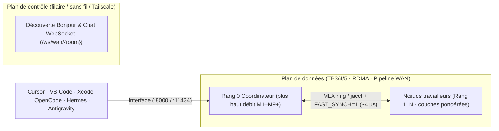
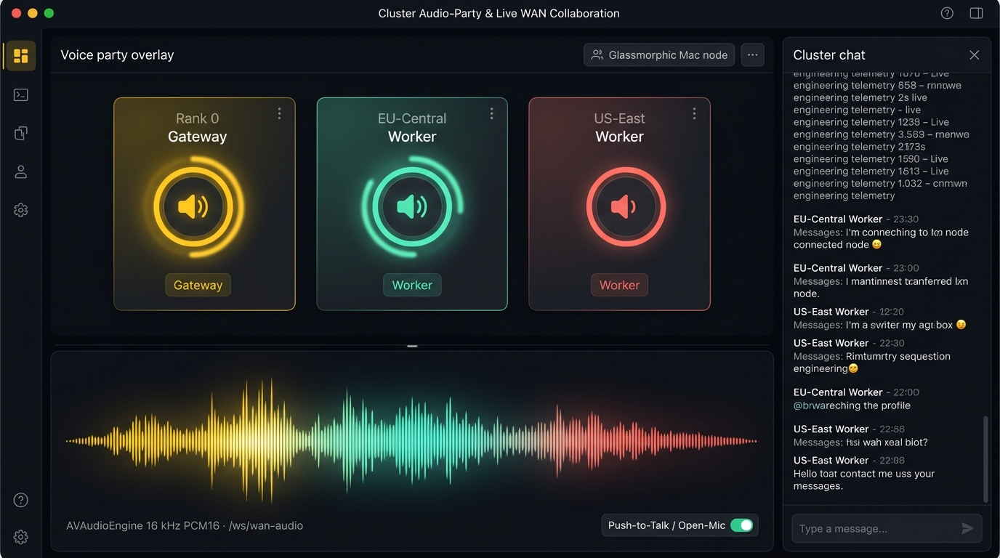

<div align="center">

# ☀️ Compagnon de grappe SonnerStudio (SS-CCC)

   **[English](README.md)** ·    **[Deutsch](README.de.md)** ·    **[Français](README.fr.md)** ·    **[Español](README.es.md)** ·   **[Português](README.pt.md)** ·  **[Русский](README.ru.md)** ·  **[日本語](README.ja.md)** ·  **[中文](README.zh.md)**

*Gestionnaire natif macOS de grappe Apple Silicon et atelier d'inférence MLX répartie*

<table>
  <tr>
    <td align="center">
      <br/>
      <sub><b>Mode Grappe (52 Go unifiés · 2 nœuds)</b></sub>
    </td>
    <td align="center">
      <br/>
      <sub><b>Mode Autonome (16 Go local · 1 nœud)</b></sub>
    </td>
  </tr>
</table>

</div>

---

## 🧭 Présentation

Le **Compagnon de grappe SonnerStudio (SS-CCC)** réunit la mémoire unifiée de tout **Mac Apple Silicon (M1–M9+)** — d'un Mac mini ou MacBook Pro isolé jusqu'aux grappes locales **Thunderbolt 3/4/5 & RDMA** ou aux **grappes Internet mondiales (2–256+ Mac)** — avec prise en charge directe de **MLX**, **oMLX**, **Ollama** et **llama.cpp**.

<div align="center">
  
</div>

---

## 🌐 Grappe Internet mondiale, discussion & courbe scientifique

<table>
  <tr>
    <td align="center" width="50%">
      <br/>
      <sub><b>Grappe Internet & Discussion des participants</b><br/>Tailscale · WireGuard · libp2p QUIC · DERP · <code>/status</code> · <code>/layers</code> · <code>/ping</code></sub>
    </td>
    <td align="center" width="50%">
      <br/>
      <sub><b>Analyse Roofline & Bilan énergétique</b><br/>Courbe log-log · Bulle GPipe · <code>J/jeton</code> · <code>p50/p95/p99</code> · CSV/JSON/BibTeX</sub>
    </td>
  </tr>
</table>

---

## 🏗️ Architecture hybride (contrôle, Thunderbolt et Internet)



---

## 🌐 Moniteur de bande passante et de débit WAN (Grappe Internet)


Dans **Grappe Internet & Discussion**, SS-CCC mesure en continu les performances réseau réelles (`netstat`, `ping`, `networkQuality`) — **débit descendant/montant (Mbps)**, **latence RTT WAN (ms)**, **gigue**, **perte de paquets** et **efficacité de synchronisation des tokens** — en reliant directement le débit WAN aux `tok/s` distribués.

---

## ✨ Fonctionnalités principales

- **Couplage universel Apple Silicon (M1 – M9+) :** Réunit librement plusieurs Mac (Mac mini, MacBook Air/Pro, iMac, Mac Studio, Mac Pro) des générations M1 à M6 ainsi que les futures puces **M7, M8, M9+** dans une grappe commune avec calcul automatique de la bande passante mémoire.
- **Télémétrie matérielle et capteurs complets :** Lecture en direct via `sysctl`, `sw_vers`, `system_profiler`, `ioreg`, `pmset` et `ibv_devices` : cœurs CPU (P/E), cœurs GPU, cœurs du moteur neuronal (16 / 32 cœurs ANE), capacité totale/libre du SSD, niveau thermique, température de batterie (`°C`) et consommation électrique (`W`).
- **Classes Thunderbolt 3 / 4 / 5 et RDMA :** Détection et classement automatiques pour les puces M1–M9+ (TB3 `40 Gbit/s`, TB4 `40 Gbit/s`, TB5 `80/120 Gbit/s` ainsi que RDMA via Thunderbolt 5), avec plan de contrôle LAN/Wi-Fi séparé et plan de données Thunderbolt isolé.
- **Répartition pondérée des couches et protection `iogpu.wired_limit_mb` :** Découpage proportionnel des couches selon la bande passante mémoire de chaque nœud actif tout en préservant une réserve système sûre pour macOS.
- **Détection réelle des modèles (oMLX, Ollama et llama.cpp) :** Lecture directe des modèles disponibles sur **oMLX**, **Ollama**, **llama.cpp**, `.gguf` locaux et cache MLX (sans profils fictifs lorsque la liste est vide, avec vérification d'état et commandes d'installation copiables).
- **Grappe Internet mondiale (WAN) et messagerie des participants (`/ws/wan/{room_id}`) :** Reliez des Mac Apple Silicon à travers le monde via tunnel chiffré (Tailscale/WireGuard, relais P2P libp2p/DERP ou point manuel) en de vastes grappes distribuées avec messagerie en temps réel.
- **Laboratoire scientifique à 6 onglets (Local & WAN) et historique :** Basculez entre **Local (TB/RDMA)**, **Internet WAN** et **Comparaison directe** sur six volets : **Courbe & goulot** (plafond réseau effectif, lot critique $B^*$), **Topologie WAN et montée en charge** ($N=1\dots128$, compression *Petals/SWARM*, retards réseau, *DiLoCo* vs DDP), **Mémoire et cache KV**, **Énergie, CO₂ et coût** (`J/jeton`, `EDP`, `gCO₂eq/kWh`), **Essais, statistiques et export** (`IC₉₅`, `CV%`, `Goodput%`, `CSV / JSON / LaTeX / BibTeX`) et **Historique** (enregistrement par position ou global, graphique de tendance et export CSV).
- **Mises à jour pilotées par GitHub et contrôle automatique de version :** Vérifie `version.json`, les *GitHub Releases* et le SHA de `commits/main` au démarrage puis toutes les 30 minutes (`⌘U`). Affiche une invite de mise à jour intégrée avec `git pull` + `swift build` + relance en un clic ou téléchargement GitHub, appuyée par `scripts/bump_version.py` et `.github/workflows/auto-version-control.yml`.
- **Agents et environnements en un clic :** Configuration directe pour **OpenCode**, **Hermes Agent**, **Google Antigravity**, **Cursor**, **Visual Studio Code** et **Xcode**.
- **Mode simulation commutable, thème jaune SonnerStudio (`#FFD400`) et suite de tests (`tests/`) :** Le nœud simulé de démonstration reste activable dans la barre latérale ; l'ensemble est vérifié par `tests/test_global_suite.py` (`python3 -m unittest discover -s tests -v`).
- **Interface multilingue et centre d'aide intégré :** Changement immédiat entre l'anglais, l'allemand, le français, l'espagnol et le portugais ainsi qu'un centre d'aide consultable par recherche directement dans l'application.

### 🖥️ Les neuf domaines du programme en un coup d'œil


| Domaine | Contenu et fonction |
| :--- | :--- |
| **1. Vue de la grappe** | Mémoire cumulée, nœuds actifs, vitesse du lien de données, topologie visuelle et barre de répartition `iogpu.wired_limit_mb`. |
| **2. Appareils et comparaison** | Télémétrie en direct de chaque Mac (CPU, GPU, ANE, RAM, bande passante, SSD, température, puissance) et ajout de Mac M1–M9+. |
| **3. Atelier de modèles** | Découverte réelle (oMLX, Ollama, llama.cpp, GGUF), vérification d'état, découpage des couches et réglage du cache KV. |
| **4. Réseau et RDMA** | Matrice des classes Thunderbolt 3/4/5 pour M1–M9+, état RDMA et routage du pont LAN/Thunderbolt. |
| **5. Grappe Internet, Audio-Party & messagerie** | Coupler les Mac TB/RDMA locaux au réseau WAN mondial, surveiller la **bande passante & le débit WAN** (`netstat`, ping/jitter, `networkQuality -c`) et coordonner en Audio-Party & messagerie (`/ws/wan-audio`, `/ws/wan`). |
| **6. Mode Multi-Modèles (MMM)** | Orchestrer plusieurs modèles sur grappe **Locale**, **Internet-WAN** ou **Hybride** (*Pool parallèle*, *Mixture-of-Agents*, *Speculative Decoding*, *Pipeline*) avec garde VRAM et consommation simultanée **Multi-IDE / Harnesses** (`:8000/v1`). |
| **7. Agents et environnements** | Configuration en un clic pour **OpenCode**, **Hermes Agent**, **Antigravity**, **Cursor**, **Visual Studio Code** et **Xcode**. |
| **8. Science et Roofline** | Laboratoire 6 onglets avec **streaming SSE réel & ping ICMP** en mode réel (simulation réaliste étiquetée), **évaluation directe du Mode Multi-Modèles (MMM)** (accélération, `tok/s` combinés, VRAM & charge multi-EDI), courbe Roofline, `N=1..128`, *Petals/SWARM* & *DiLoCo*, mémoire KV, `J/jeton` / `EDP` / `CO₂`, `IC₉₅`, export `CSV / JSON / LaTeX / BibTeX` et **Historique**. |
| **9. API et console** | Points de terminaison compatibles OpenAI / Ollama / oMLX, journal d'activité et commandes de démarrage prêtes à copier. |
| **10. Aide et documentation** | Manuel intégré à 12 chapitres en 8 langues (`⌘?`) avec recherche plein texte et guide pas à pas. |

---

## 🛠️ Compiler depuis le code source (à faire avant le premier lancement)

> [!NOTE]
> Ce dépôt contient le **code source Swift** de SS-CCC (aucun fichier exécutable précompilé n'est fourni). Pour obtenir une application prête à l'emploi, vous devez d'abord **compiler le programme localement sur votre Mac Apple Silicon**.

### Prérequis
- Un Mac Apple Silicon (**M1–M6**) sous **macOS 14.0 ou ultérieur**
- Les **outils en ligne de commande Xcode** (`swiftc` et le SDK macOS) :
  ```bash
  xcode-select --install
  ```

### Étape par étape vers l'application exécutable
```bash
# 1. Cloner le dépôt et ouvrir le dossier
git clone https://github.com/SonnerStudio/SonnerStudio-Cluster-Case-Companion.git
cd SonnerStudio-Cluster-Case-Companion

# 2. Rendre le script de compilation et de lancement exécutable
chmod +x scripts/run_ssccc.sh

# 3. Compiler les sources Swift vers /tmp/SSCCCApp et lancer l'application
./scripts/run_ssccc.sh
```
*(Optionnel : compilation via Swift Package Manager avec `cd app && swift build -c release`.)*

---

## 🚀 Démarrage rapide

```bash
"./scripts/run_ssccc.sh"
```

---

## 📖 Guide d'utilisation : Grappe locale & hybride (Local + Internet), chargement des modèles et données théoriques

### 1. Configuration de la grappe locale (Thunderbolt 3/4/5 & LAN)
1. **Câblage physique :** Reliez vos Mac en direct par câbles **Thunderbolt 3/4/5** (point-à-point, anneau ou maillage) et/ou **Ethernet 10GbE**.
2. **Adresses IP point-à-point :** Exécutez `./scripts/setup_tb_network.sh studio` (`10.99.1.1`) sur le Mac principal et `./scripts/setup_tb_network.sh mini` (`10.99.1.2`, etc.) sur les nœuds secondaires (ou configurez-les dans **Réseau et mémoire directe**).
3. **RDMA optionnel (macOS 26.2+ sur TB5) :** Activez `rdma_ctl enable` pour que `JACCL` (`mlx.distributed`) atteigne **`~3 µs`** de latence inter-nœuds contre `~300 µs` en TCP/IP.
4. **Attribution automatique des rangs :** Ajoutez vos Mac dans **Appareils et comparaison**. Le `MemoryWeightedPlanner` attribue automatiquement le **rang 0 (coordinateur)** au Mac offrant le plus haut débit mémoire, et les **rangs 1..N (workers)** aux autres.

### 2. Configuration du réseau hybride (Local + Internet WAN simultanément)
1. **Cœur local rapide (Niveau 1) :** L'anneau Thunderbolt/LAN local (`10.99.1.x` / `192.168.x.x`) reste actif pour les couches sensibles à la latence.
2. **Salon coordinateur WAN (Niveau 2) :** Dans **Grappe Internet et discussion**, ouvrez un salon (`/ws/wan/{room_id}` sur le port `8000`, exposé via Tailscale, WireGuard, Cloudflare Tunnel ou proxy inverse).
3. **Connexion des nœuds distants :** Les Mac distants rejoignent la grappe avec le **Code de salon + Jeton d'accès**.
4. **Routage hybride à deux niveaux :** SS-CCC garde les couches critiques sur l'anneau local (`3–180 µs`) et délègue le surplus aux nœuds WAN (`15–120 ms` RTT) avec micro-batching (`M ≥ 4`).

### 3. Qui charge le modèle, combien de modèles tiennent en mémoire et quel est le flux d'exécution ?
- **Qui charge quoi ?**
  - **Coordinateur (Rang 0) :** Héberge la passerelle API (`:8000`), effectue la tokenisation, **conserve toujours les Embeddings et la tête LM (`has_embeddings=True`, `has_lm_head=True`)** plus sa part proportionnelle de couches (`Couches_i = Total × Utilisable_i / TotalUtilisable`).
  - **Workers (Rangs 1..N) :** Chaque nœud ne charge **que sa tranche Safetensors/couches `[start_layer .. end_layer)`** depuis son cache local HuggingFace/oMLX/Ollama (`~/.cache/huggingface`, `~/.ollama/models`, `~/Models`).
- **Combien de modèles peuvent être chargés simultanément ?**
  - **Mode distribué (`mlx.distributed` / `JACCL`) :** **1 grand modèle réparti à la fois** sur l'ensemble du pool mémoire (changement rapide par hot-swap).
  - **Mode multi-modèles (`oMLX` / `Ollama` / nœuds hétérogènes) :** Tant que `Σ (Poids_i + Cache_KV_i) ≤ VRAM_Utilisable_Totale_Go` (après réserve macOS de 4–8 Go via `iogpu.wired_limit_mb`), **plusieurs modèles** restent résidents en parallèle (ex. : **codeur 32B + routeur rapide 8B + embeddings 1,5B**).
- **Flux et structure d'une requête :**
  1. **Détection & sélection du lien** (`TB5 RDMA > TB Bridge > 10GbE > WLAN > WAN`).
  2. **Plan de répartition** (`hostfile.json` et limites mémoire `iogpu.wired_limit_mb`).
  3. **Entrée API** (`http://127.0.0.1:8000/v1/chat/completions`, `/v1/messages`, `/api/chat`).
  4. **Phase Prefill (`TTFT`) :** Rang 0 encode le prompt puis traverse le pipeline (`Rang 0 → 1 → ... → N → Rang 0`).
  5. **Phase Decode (`TPOT` & `tok/s`) :** Génération jeton par jeton avec `--kv-bits 4` et `MLX_METAL_FAST_SYNCH=1`.
  6. **Streaming SSE & télémétrie** dans **Science et performance** (`tok/s`, `J/tok`, `p50/p95/p99`).

### 4. Données théoriques de dimensionnement et de performance par cas d'usage

> **Formules d'estimation analytique :**
> - **Mémoire requise :** `VRAM_Go ≈ Paramètres_B × (Bits / 8) × 1,15 + Cache_KV_Go`
> - **Plafond théorique Decode :** `tok/s ≈ (Bande_Passante_Effective_Go/s / Poids_Actifs_Go) × (1 − Surcoût_Comm)`

| Cas d'usage | Topologie & Pool utilisable | Modèle type & Quantification | `TTFT` théorique (2k prompt) | Débit théorique (`tok/s` / `TPOT`) | Énergie & goulot principal |
| :--- | :--- | :--- | :--- | :--- | :--- |
| **1. Poste individuel (Edge Dev)** | 1× Mac mini M4 (16 Go, `12 Go` util., `120 Go/s`) | `Qwen2.5-14B` (`4 bits`, ~8,8 Go) | `~1,8 – 2,6 s` | **`11 – 14 tok/s`** (`~75 ms/tok`) | `~1,7 J/tok` · Bande passante mémoire |
| **2. Studio Pro solo (Codage rapide)** | 1× Mac Studio M4 Max (64 Go, `58 Go` util., `546 Go/s`) | `Llama-3.3-70B` (`4 bits`, ~40 Go) | `~1,1 – 1,7 s` | **`12 – 14 tok/s`** (`~74 ms/tok`) | `~3,8 J/tok` · Bande passante mémoire |
| **3. Anneau local 2 nœuds TB5 RDMA** | 2× M4 Max 64 Go (`116 Go` util., `~1 092 Go/s` agg., `~3 µs` JACCL) | `Qwen2.5-Coder-72B` (`8 bits`, ~78 Go) | `~1,4 – 2,0 s` | **`12 – 14 tok/s`** (`~76 ms/tok`) | `~7,5 J/tok` · Surcoût RDMA négligeable |
| **4. Labo 4 nœuds Ultra TB5 RDMA** | 4× M3 Ultra 256 Go (`992 Go` util., `~3,27 To/s` agg.) | `DeepSeek-V3 671B MoE` (`4 bits`, ~385 Go, ~37B actifs) | `~2,2 – 3,5 s` | **`38 – 55 tok/s`** (`~20 ms/tok`) | `~5,2 J/tok` · Débit experts actifs MoE |
| **5. Hybride Bureau LAN + Domicile WAN** | 2× TB4/10GbE + 2× WAN (`192 Go` util., `35 ms` RTT WAN) | `Llama-3.1-405B` (`3/4 bits`, ~170 Go) | `~6 – 11 s` | **`2,2 – 4,5 tok/s`** (`~280 ms/tok`) | `~28 J/tok` · Latence WAN (`M=8` aide) |
| **6. Essaim communautaire mondial WAN** | 16+ Mac mondiaux (`1,5+ To` util., `60–120 ms` RTT WAN) | `671B–1T+` Frontier (`4/8 bits`) | `~12 – 25 s` | **`1,2 – 3,0 tok/s`** (`~500 ms/tok`) | Latence WAN (le batching compense) |

---

## 📚 Extraits de la documentation (intégrés dans l'aide de l'application)

### 1. Tous les Mac à puce Apple M en grappe (M1–M6)
SS-CCC prend en charge **chaque Mac équipé d'une puce Apple Silicon** (**M1, M2, M3, M4, M5, M6** — Base, Pro, Max et Ultra) : **Mac mini, MacBook Air, MacBook Pro, iMac, Mac Studio et Mac Pro**. Sous **Appareils et comparaison**, ajoutez autant de Mac que souhaité ; celui offrant le plus haut débit mémoire prend automatiquement le **rang 0 (maître)**.

| Famille de puces | Débit mémoire | Thunderbolt | Réserve macOS conseillée |
| :--- | :--- | :--- | :--- |
| **M1 / M2** (Base) | 68 – 100 Go/s | TB 3 / USB4 (26–32 Gbps) | **4 Go** (≤ 24 Go RAM) |
| **M3 / M4** (Base) | 100 – 120 Go/s | TB 4 (30–37 Gbps) | **4 Go** (≤ 24 Go RAM) |
| **M5 / M6** (Base) | 153 – 180 Go/s | TB 5 (65–80 Gbps) | **4 Go** (≤ 24 Go RAM) |
| **M1–M3 Pro** | 150 – 200 Go/s | TB 4 (30–37 Gbps) | **4 – 6 Go** |
| **M4–M6+ Pro** | 273 – 310+ Go/s | TB 5 (80–120 Gbps boost) | **4 – 6 Go** |
| **M1–M3 Max** | 400 Go/s | TB 4 (30–37 Gbps) | **6 Go** (32–64 Go RAM) |
| **M4 Max** | **410 – 546 Go/s** (LPDDR5X-8533) | TB 5 + RDMA (`~3 µs` latence) | **6 Go** (32–64 Go RAM) |
| **M1–M2 Ultra / M3 Ultra** | **800 – 819 Go/s** (UltraFusion) | TB 4 / TB 5 RDMA (JACCL) | **8 Go** (≥ 96 Go RAM) |

### 2. Thunderbolt 5 RDMA (`JACCL`), protection mémoire et répartition pondérée


- **RDMA macOS sur Thunderbolt 5 :** Avec `rdma_ctl enable` (macOS 26.2+) et le moteur `JACCL` (`mlx.distributed`), la latence inter-nœuds chute de `~300 µs` (TCP/IP) à **`~3 µs`** avec **`3,5–3,8 Go/s`** de débit tenseur soutenu.
- **Ne jamais allouer 100 % de la RAM :** `iogpu.wired_limit_mb` préserve la fluidité de macOS et de WindowServer.
- **Répartition proportionnelle des couches :** chaque Mac reçoit une part calculée sur sa mémoire utilisable (`Couches_i = Total × Utilisable_i / TotalUtilisable`).
- **Cache KV 4 bits & synchronisation rapide :** `--kv-bits 4` et `MLX_METAL_FAST_SYNCH=1` (45× plus rapide, ~180 µs → ~4 µs).

---

## 🔄 Mises à jour pilotées par GitHub et contrôle automatique de version


1. **Résolution GitHub multi-sources :** Au lancement (après `1,2 s`) puis toutes les **30 minutes** (`startAutomaticUpdateMonitor()`), `ClusterViewModel` interroge `main/version.json`, `releases/latest` et `commits/main` (SHA court).
2. **Invite de mise à jour (`UpdatePromptSheet`, `⌘U`) :** Lorsqu'une version, un numéro de compilation ou un SHA `main` plus récent est détecté, l'application propose pour les dépôts locaux `git pull --ff-only origin main` + `swift build` + relance en un clic (`scripts/run_ssccc.sh`), ou ouvre le téléchargement GitHub pour les paquets autonomes.
3. **Automatisation CI (`.github/workflows/auto-version-control.yml`) :** Chaque *push* sur `main` exécute `scripts/bump_version.py --part patch --sync-git`, synchronise `version.json` et `ClusterModels.swift`, lance les 14 tests et crée le tag `vX.Y.Z`.

---

---

## 🧠 Mode Multi-Modèles (MMM) — Orchestration inter-grappes & consommation Multi-EDI


Le **Mode Multi-Modèles (MMM)** (10ᵉ onglet du menu latéral) unifie la puissance de calcul et la mémoire de **plusieurs modèles d'IA simultanément** sur la grappe **Locale** (Thunderbolt / RDMA), la grappe **Internet WAN** (Tailscale / WireGuard / libp2p QUIC) ou en mode **Hybride (Local + Internet)** — avec protection VRAM `iogpu.wired_limit_mb`, exécution SSE en temps réel et intégration directe dans **Science et Roofline**.

### 4 stratégies d'orchestration
1. **Pool multi-modèles parallèle :** Maintient plusieurs modèles spécialisés en VRAM (locale et WAN) pour des requêtes simultanées sans rechargement.
2. **Mixture-of-Agents (MoA) :** Envoie la même invite en parallèle à plusieurs modèles spécialistes et synthétise une réponse consolidée via un modèle `Aggregator`.
3. **Speculative Decoding (Draft + Target) :** Associe un modèle `Draft` local rapide à un grand modèle `Target` sur la grappe pour accélérer le décodage ($1{,}6\times$–$2{,}3\times$).
4. **Pipeline séquentiel de modèles :** Chaîne les modèles par étapes (*Planificateur → Codeur → Réviseur*) entre nœuds locaux et pairs WAN.

### ⚙️ Configuration Automatique en 1 Clic & Éditeur Post-Configuration


Le déploiement de plusieurs modèles sur la grappe est automatisé et reste entièrement modifiable à tout moment :
- **Profils Auto-Setup en 1 Clic** : Choisissez **Coding & IDE Swarm**, **Consensus & Audit**, **Turbo (Draft + Target)** ou **Pipeline par Étapes**. MMM détecte automatiquement les nœuds cibles, la VRAM utilisable (`iogpu.wired_limit_mb`) et les modèles actifs.
- **Personnalisation Complète a posteriori** : Réordonnez les étapes (`Haut`/`Bas`), dupliquez des réplicas sur d'autres nœuds, activez/désactivez chaque slot ou modifiez à chaud le nom, l'ID du modèle, l'URL d'API (`:8000/v1`, `:11434/v1`) et le budget VRAM.
- **Optimiseur VRAM-Fit & Sauvegarde JSON** : Ajustez en un clic les slots actifs au budget VRAM disponible et sauvegardez/exportez votre configuration en JSON.

### Consommation simultanée Multi-EDI & Harnesses (`:8000/v1`)
Plusieurs EDI et harnais d'agents (**Cursor**, **VS Code**, **Xcode**, **OpenCode**, **Hermes Agent**, **Google Antigravity**) peuvent puiser simultanément dans la grappe unifiée (`exportMultiIdeMmmGatewayConfig()`) avec calcul en direct du débit par client (`tok/s`).

### Cas d'usage concrets
- **Développement Multi-EDI & Multi-Agents :** Utiliser Cursor, OpenCode et Hermes Agent en parallèle sur une même grappe sans recharger les modèles.
- **Turbo Speculative Decoding sur Mac hétérogènes :** Un Mac mini 16 Go génère les brouillons pendant qu'un Mac Studio ou le réseau WAN vérifie les jetons sur un modèle 70B+.
- **Revue de code & synthèse MoA :** Combiner un modèle code, un modèle raisonnement et un agrégateur pour éliminer les angles morts.
- **Répartition hybride Local + WAN :** Garder l'autocomplétion à faible latence sur Thunderbolt et déporter les étapes lourdes (405B) sur les pairs WAN.
- **Pipelines automatisés multi-étapes :** Enchaîner *Architecture → Implémentation → Audit de sécurité* sur des créneaux dédiés.
- **Évaluation scientifique directe :** Chaque exécution MMM alimente **Science et Roofline** (`recordScienceHistoryFromMMM`) en débit combiné, facteur d'accélération et efficacité VRAM.

---

## 🎙️ Audio-Party de grappe et collaboration WAN en direct



- **Audio temps réel (`AVAudioEngine`, 16 kHz PCM16) :** Relié au point `/ws/wan-audio` juste à côté du chat (`/ws/wan/{room_id}`), avec modes **Appuyer-pour-parler / Micro ouvert**, **Muet / Sourd**, vumètre et rôles de nœuds (`Passerelle rang 0`, `Nœud WAN`).

---

## 🏆 Appel au record mondial : supercalculateur hybride local + Internet


**Une coalition mondiale de Mac Apple Silicon peut-elle rivaliser avec un centre de calcul ?**  
Nous invitons les universités, laboratoires, studios et passionnés d'Apple Silicon à organiser un **record officiel SS-CCC** : reliez simultanément le plus grand nombre possible de **grappes locales Thunderbolt 3/4/5/RDMA** et de **Mac distants sur Internet** grâce au **pont hybride (« Coupler local + Internet »)**, à l'**Audio-Party** et au **laboratoire scientifique à 5 onglets**.

### 🔬 Protocole scientifique & modélisation

1. **Architecture hiérarchique à deux niveaux (îlots TB/RDMA locaux + dorsale WAN) :**
   - Le pont hybride maintient les couches consécutives sur les îlots Thunderbolt locaux (`~0,07 ms`, `30–110 Gbps`), ne sollicitant le réseau WAN que pour les transitions entre passerelles de rang 0 ($H_{\text{WAN}} \ll N_{\text{total}}$).
2. **Masquage de la latence WAN ($B^*$) & compression des activations :**
   - Selon le modèle GPipe $\Phi_{\text{bulle}} = \frac{N - 1}{M + N - 1}$ et le seuil critique $B^* = \lceil \frac{T_{\text{RTT,WAN}} + T_{\text{tx}}}{T_{\text{comp}}(B=1)} \rceil$, le micro-lotissement $M \to B^*$ associé à la compression **FP8 / INT4 / Top-K** (*Petals / SWARM*) maintient la charge vocale et tensorielle sous $1\%$ du débit montant.
3. **Protocole reproductible ($T = 0,0$) :** Activez le pont hybride, rejoignez l'**Audio-Party** (`Opus 16 kbps`, $<0,02\%$ du lien), lancez `N = 20` essais (`T = 0,0`) dans le laboratoire **Internet-WAN** et exportez le **manifeste JSON**, le **CSV** et le **tableau LaTeX (`booktabs`)** avec `CI₉₅`, `Goodput%`, `J/jeton`, `EDP` et `gCO₂eq/1M jetons`.


### 🥇 Catégories de record & cas d'usage


- **Catégories :** plus grande mémoire unifiée cumulée (`To`), plus grand nombre de Mac couplés ($N \ge 32\text{–}256+$), meilleur débit utile transcontinental et meilleure efficacité énergétique (`J/jeton`).
- **Cas d'usage :** recherche en systèmes d'IA (courbes Roofline, *DiLoCo* vs DDP, articles LaTeX/BibTeX), travaux pratiques universitaires sur parc mixte MacBook/Mac mini, studios logiciels alimentant **OpenCode / Cursor / Xcode** sans frais infonuagiques, secteurs juridiques/médicaux sous tunnel chiffré **WireGuard**, hackathons mondiaux en **Audio-Party** et audits **Green-AI**.

---

## 🚀 Mise à niveau d'architecture SOTA 2026 (Phase 11)

- **TB5 RDMA Tensor Parallelism & QUIC / Iroh WAN :** Basculez entre **Pipeline Ring** et **JACCL Full-Mesh TP** (`ClusterMeshTopology`), exécutez le pré-contrôle `rdma_ctl enable` + `bridge0`, exportez `mlx.distributed_config` en JSON et activez **QUIC / Iroh P2P (0-RTT Multiplex)** sans blocage TCP HoL.
- **Prefill/Decode Désagrégé (ANE-Split) & KV-Cache 3 Niveaux / CacheGen :** Déporte le *prefill* sur l'Apple Neural Engine (ANE) tout en gardant le *decode* sur MLX GPU (`EDP ×1,42`, `-31,5 %` d'énergie), avec compression **CacheGen (`3,6×`)** et télémétrie de taux de succès de préfixe.
- **MMM Next-Gen (EAGLE-3, Tree-MoA Early-Exit & Routeur Adaptatif) :** Fusion **EAGLE-3**, seuil de confiance **Tree-MoA Early-Exit** (`50–95 %`) et **Adaptive Confidence Escalation (Ares)** directement dans le Mode Multi-Modèles.
- **Standards Modernes d'Agents & Passerelles :** Aperçu et export **OpenAI `/v1/responses` + MCP**, **MCP Server Registry JSON** et **A2A Agent Card** (`/.well-known/agent.json`).
- **Ordonnancement Thermique & Éco-Responsable :** Dépriorise automatiquement les nœuds en état thermique `.serious`/`.critical` et privilégie l'efficacité énergétique.

---

## 📁 Structure du dépôt

```text
├── app/Sources/
│   ├── SSCCCApp.swift              # Fenêtre principale, pastille de mise à jour & UpdatePromptSheet
│   ├── Models/
│   │   ├── ClusterModels.swift     # Inférence M1–M12+, modèles WAN/Science/Historique & versions
│   │   └── Localization.swift      # Dictionnaire complet en 8 langues (EN/DE/FR/ES/PT/RU/JA/ZH)
│   ├── ViewModels/
│   │   └── ClusterViewModel.swift  # Sondes matérielles, modèles, Audio-Party WAN & mise à jour GitHub
│   └── Views/                      # 9 vues SwiftUI modulaires + Theme.swift (Vue d'ensemble 3 onglets, bandes d'avertissement, labo 6 onglets & aide)
├── core/                           # Passerelle Python FastAPI, relais WebSocket WAN/Audio & MLX
├── scripts/
│   ├── run_ssccc.sh                # Compile et lance l'application macOS
│   ├── bump_version.py             # Synchronise version.json & ClusterModels.swift avec Git
│   ├── setup_tb_network.sh         # Configure le pont Thunderbolt 10.99.1.x
│   └── setup_wired_limit.sh        # Applique des limites sûres iogpu.wired_limit_mb
├── tests/                          # Suite de vérification globale en 14 tests (Swift + Python)
├── .github/workflows/              # Contrôle automatique de version CI & étiquetage
└── version.json                    # Manifeste de contrôle des mises à jour hébergé sur GitHub
```

---

## 🚧 État d'avancement et contribution

> [!IMPORTANT]
> **SS-CCC (v1.6+) est pleinement exécutable et validé par `14/14` tests automatisés, tandis que les essais d'endurance multi-nœuds se poursuivent.**
> **Déjà opérationnel et vérifié :** langue de démarrage en anglais avec 8 langues (`EN/DE/FR/ES/PT/RU/JA/ZH`), **vue d'ensemble en 3 onglets** (**Grappe locale**, **Grappe Internet** avec sous-grappes régionales/locales et **Local + Internet** hybride), **bandes de signalisation industrielles jaune-noir (`HazardStripesBar` / `IndustrialHazardBanner`)** sur 6 vues, détection évolutive M1–M12+, découverte de modèles en direct (oMLX / Ollama / llama.cpp / GGUF), laboratoire scientifique à 6 onglets avec historique par position et global, pont hybride Local ↔ Internet-WAN, Audio-Party `AVAudioEngine`, manuel à 9 chapitres et mise à jour automatique pilotée par GitHub + CI.

Nous encourageons vivement les développeurs, chercheurs et passionnés d'Apple Silicon à **participer au développement et à faire évoluer SS-CCC** :
- **Tester sur votre matériel :** Essayez SS-CCC sur vos Mac M1–M12+ et partagez vos mesures de débit, mémoire et RDMA/JACCL.
- **Participer au défi de record :** Coupler des îlots TB locaux et des pairs WAN et publier vos exports JSON/CSV/LaTeX.
- **Proposer des améliorations :** Toute contribution à l'interface SwiftUI, au découpage MLX, aux scripts Thunderbolt ou aux traductions est la bienvenue !

---

## 📄 Licence

Publié sous [Licence MIT](LICENSE.md).
