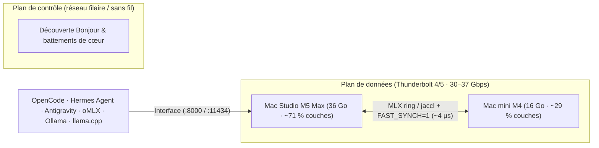

<div align="center">

# ☀️ Compagnon de grappe SonnerStudio (SS-CCC)

**🇺🇸 🇬🇧 🇨🇦 [English](README.md)** · **🇩🇪 🇦🇹 🇨🇭 [Deutsch](README.de.md)** · **🇫🇷 🇧🇪 🇨🇭 [Français](README.fr.md)** · **🇪🇸 🇲🇽 🇦🇷 [Español](README.es.md)** · **🇵🇹 🇧🇷 [Português](README.pt.md)**

*Gestionnaire natif macOS de grappe Apple Silicon et atelier d'inférence MLX répartie*


</div>

---

## 🧭 Présentation

Le **Compagnon de grappe SonnerStudio (SS-CCC)** associe la mémoire unifiée de plusieurs Mac Apple Silicon — par exemple un **Mac Studio M5 Max (36 Go, Thunderbolt 5)** et un **Mac mini M4 (16 Go, Thunderbolt 4)** — pour former une **grappe de 52 Go physiques (~42 Go exploitables)** par **Thunderbolt (pont ou accès direct mémoire)**, **réseau filaire/sans fil** ou en mode **hybride**.

<div align="center">
  
</div>

---

## 🏗️ Architecture hybride (plan de contrôle et plan de données)



---

## ✨ Fonctionnalités principales

- **Couplage mémoire hétérogène de 52 Go :** Répartition pondérée des couches (`~71 %` des couches sur le M5 Max à `460 Go/s`, `~29 %` sur le M4 à `120 Go/s`) avec protection `iogpu.wired_limit_mb`.
- **Interface native macOS :**
  - **Vue de la grappe et comparaison :** Lecture directe du matériel (`sysctl`, `sw_vers`, `ibv_devices`, `ipconfig`) avec barres comparatives.
  - **Atelier de modèles :** Découpage proportionnel, compression du cache KV (`FP16 / 8-bit / 4-bit`) et liaison directe avec **oMLX**, **Ollama** et **llama.cpp**.
  - **Agents et environnements (en un clic) :** Configuration immédiate pour **OpenCode**, **Hermes Agent** et **Google Antigravity**.
  - **Interface multilingue :** Sélecteur de langue intégré dans le menu latéral gauche.

---

## 🚀 Démarrage rapide

```bash
"./scripts/run_ssccc.sh"
```

---

## 📄 Licence

Publié sous [Licence MIT](LICENSE.md).
