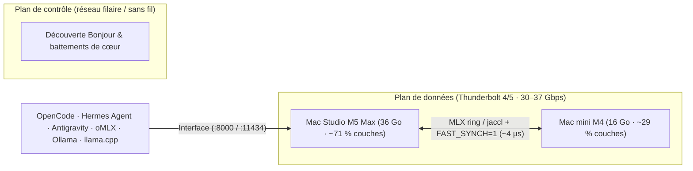

<div align="center">

# ☀️ Compagnon de grappe SonnerStudio (SS-CCC)

**🇺🇸 🇬🇧 🇨🇦 [English](README.md)** · **🇩🇪 🇦🇹 🇨🇭 [Deutsch](README.de.md)** · **🇫🇷 🇧🇪 🇨🇭 [Français](README.fr.md)** · **🇪🇸 🇲🇽 🇦🇷 [Español](README.es.md)** · **🇵🇹 🇧🇷 [Português](README.pt.md)**

*Gestionnaire natif macOS de grappe Apple Silicon et atelier d'inférence MLX répartie*

<table>
  <tr>
    <td align="center">
      <br/>
      <sub><b>Mode Grappe (52 Go unifiés · 2 nœuds)</b></sub>
    </td>
    <td align="center">
      <br/>
      <sub><b>Mode Autonome (16 Go local · 1 nœud)</b></sub>
    </td>
  </tr>
</table>

</div>

---

## 🧭 Présentation

Le **Compagnon de grappe SonnerStudio (SS-CCC)** associe la mémoire unifiée de plusieurs Mac Apple Silicon — par exemple un **Mac Studio M5 Max (36 Go, Thunderbolt 5)** et un **Mac mini M4 (16 Go, Thunderbolt 4)** — pour former une **grappe de 52 Go physiques (~42 Go exploitables)** par **Thunderbolt (pont ou accès direct mémoire)**, **réseau filaire/sans fil** ou en mode **hybride**.

<div align="center">
  
</div>

---

## 🏗️ Architecture hybride (plan de contrôle et plan de données)



---

## ✨ Fonctionnalités principales

- **Couplage universel Apple Silicon (M1 – M6) :** Réunit librement plusieurs Mac (Mac mini, MacBook Air/Pro, iMac, Mac Studio, Mac Pro) de la gamme M1 à M6 dans une grappe commune avec calcul automatique de la bande passante mémoire (`68 Go/s` à `819+ Go/s`).
- **Télémétrie matérielle et capteurs complets :** Lecture en direct via `sysctl`, `sw_vers`, `system_profiler`, `ioreg`, `pmset` et `ibv_devices` : cœurs CPU (P/E), cœurs GPU, cœurs du moteur neuronal (16 / 32 cœurs ANE), capacité totale/libre du SSD, niveau thermique, température de batterie (`°C`) et consommation électrique (`W`).
- **Classes Thunderbolt 3 / 4 / 5 et RDMA :** Détection et classement automatiques pour les puces M1–M6 (TB3 `40 Gbit/s`, TB4 `40 Gbit/s`, TB5 `80/120 Gbit/s` ainsi que RDMA via Thunderbolt 5), avec plan de contrôle LAN/Wi-Fi séparé et plan de données Thunderbolt isolé.
- **Répartition pondérée des couches et protection `iogpu.wired_limit_mb` :** Découpage proportionnel des couches selon la bande passante mémoire (ex. `~71 %` sur le M5 Max à `460 Go/s`, `~29 %` sur le M4 à `120 Go/s`) tout en préservant une réserve système sûre pour macOS.
- **Atelier de modèles (MLX, oMLX, Ollama et llama.cpp) :** Compression du cache KV (`FP16 / 8-bit / 4-bit`), choix des moteurs et réglage de la distribution des couches sur la grappe.
- **Agents et environnements en un clic :** Configuration directe pour **OpenCode**, **Hermes Agent**, **Google Antigravity**, **Cursor**, **Visual Studio Code** et **Xcode**.
- **Mode simulation commutable et thème jaune SonnerStudio (`#FFD400`) :** Le nœud simulé Mac Studio (M5 Max / 36 Go) peut être activé ou désactivé à tout moment depuis la barre latérale sans affecter la télémétrie réelle.
- **Interface multilingue et centre d'aide intégré :** Changement immédiat entre l'anglais, l'allemand, le français, l'espagnol et le portugais ainsi qu'un centre d'aide consultable par recherche directement dans l'application.

### 🖥️ Les huit domaines du programme en un coup d'œil

| Domaine | Contenu et fonction |
| :--- | :--- |
| **1. Vue de la grappe** | Mémoire cumulée, nœuds actifs, vitesse du lien de données, topologie visuelle et barre de répartition `iogpu.wired_limit_mb`. |
| **2. Appareils et comparaison** | Télémétrie en direct de chaque Mac (CPU, GPU, ANE, RAM, bande passante, SSD, température, puissance) et ajout de Mac M1–M6. |
| **3. Atelier de modèles** | Découpage proportionnel des couches, réglage du cache KV et liaison avec **oMLX**, **Ollama** et **llama.cpp**. |
| **4. Réseau et RDMA** | Matrice des classes Thunderbolt 3/4/5 pour M1–M6, état RDMA et routage du pont LAN/Thunderbolt. |
| **5. Agents et environnements** | Configuration en un clic pour **OpenCode**, **Hermes Agent**, **Antigravity**, **Cursor**, **Visual Studio Code** et **Xcode**. |
| **6. Science et Roofline** | Analyse arithmétique d'intensité, goulots d'étranglement mémoire/calcul et stratégie préremplissage-décodage. |
| **7. API et console** | Points de terminaison compatibles OpenAI / Ollama / oMLX, journal d'activité et commandes de démarrage prêtes à copier. |
| **8. Aide et documentation** | Manuel intégré avec recherche plein texte, vue d'ensemble architecturale et guide étape par étape. |

---

## 🛠️ Compiler depuis le code source (à faire avant le premier lancement)

> [!NOTE]
> Ce dépôt contient le **code source Swift** de SS-CCC (aucun fichier exécutable précompilé n'est fourni). Pour obtenir une application prête à l'emploi, vous devez d'abord **compiler le programme localement sur votre Mac Apple Silicon**.

### Prérequis
- Un Mac Apple Silicon (**M1–M6**) sous **macOS 14.0 ou ultérieur**
- Les **outils en ligne de commande Xcode** (`swiftc` et le SDK macOS) :
  ```bash
  xcode-select --install
  ```

### Étape par étape vers l'application exécutable
```bash
# 1. Cloner le dépôt et ouvrir le dossier
git clone https://github.com/SonnerStudio/SonnerStudio-Cluster-Case-Companion.git
cd SonnerStudio-Cluster-Case-Companion

# 2. Rendre le script de compilation et de lancement exécutable
chmod +x scripts/run_ssccc.sh

# 3. Compiler les sources Swift vers /tmp/SSCCCApp et lancer l'application
./scripts/run_ssccc.sh
```
*(Optionnel : compilation via Swift Package Manager avec `cd app && swift build -c release`.)*

---

## 🚀 Démarrage rapide

```bash
"./scripts/run_ssccc.sh"
```

---

## 📚 Extraits de la documentation (intégrés dans l'aide de l'application)

### 1. Tous les Mac à puce Apple M en grappe (M1–M6)
SS-CCC prend en charge **chaque Mac équipé d'une puce Apple Silicon** (**M1, M2, M3, M4, M5, M6** — Base, Pro, Max et Ultra) : **Mac mini, MacBook Air, MacBook Pro, iMac, Mac Studio et Mac Pro**. Sous **Appareils et comparaison**, ajoutez autant de Mac que souhaité ; celui offrant le plus haut débit mémoire prend automatiquement le **rang 0 (maître)**.

| Famille de puces | Débit mémoire | Thunderbolt | Réserve macOS conseillée |
| :--- | :--- | :--- | :--- |
| **M1 / M2** (Base) | 68 – 100 Go/s | TB 3 / USB4 (26–32 Gbps) | **4 Go** (≤ 24 Go RAM) |
| **M3 / M4** (Base) | 100 – 120 Go/s | TB 4 (30–37 Gbps) | **4 Go** (≤ 24 Go RAM) |
| **M5 / M6** (Base) | 153 – 180 Go/s | TB 5 (65–80 Gbps) | **4 Go** (≤ 24 Go RAM) |
| **M1–M3 Pro** | 150 – 200 Go/s | TB 4 (30–37 Gbps) | **4 – 6 Go** |
| **M4–M6 Pro** | 273 – 310 Go/s | TB 5 (65–80 Gbps) | **4 – 6 Go** |
| **M1–M3 Max** | 400 Go/s | TB 4 (30–37 Gbps) | **6 Go** (32–64 Go RAM) |
| **M4–M6 Max** | 460 – 580 Go/s | TB 5 (65–80 Gbps) | **6 Go** (32–64 Go RAM) |
| **M1–M2 Ultra** / **M3 Ultra** | 800 Go/s | TB 4 / TB 5 | **8 Go** (≥ 96 Go RAM) |

### 2. Protection mémoire et répartition pondérée
- **Ne jamais allouer 100 % de la RAM :** `iogpu.wired_limit_mb` préserve la fluidité de macOS et de WindowServer.
- **Répartition proportionnelle des couches :** chaque Mac reçoit une part calculée sur sa mémoire utilisable (`Couches_i = Total × Utilisable_i / TotalUtilisable`).
- **Cache KV 4 bits & synchronisation rapide :** `--kv-bits 4` et `MLX_METAL_FAST_SYNCH=1` (45× plus rapide, ~180 µs → ~4 µs).

---

## 🚧 État d'avancement et contribution

> [!IMPORTANT]
> **SS-CCC est déjà exécutable, mais reste en cours de développement et de mise à l'épreuve.**
> L'interface, la détection matérielle, le découpage pondéré des couches et la liaison avec les agents fonctionnent ; les essais poussés sur diverses combinaisons de Mac M1–M6, ponts Thunderbolt 4/5 et RDMA/JACCL se poursuivent activement.

Nous encourageons vivement les développeurs, chercheurs et passionnés d'Apple Silicon à **participer au développement et à faire évoluer SS-CCC** :
- **Tester sur votre matériel :** Essayez SS-CCC sur vos Mac M1–M6 et partagez vos mesures de débit et de mémoire.
- **Signaler et proposer :** Ouvrez un ticket sur GitHub pour tout bogue, cas particulier ou nouvelle idée.
- **Proposer des améliorations :** Toute contribution à l'interface SwiftUI, au découpage MLX, aux scripts Thunderbolt ou aux traductions est la bienvenue !

---

## 📄 Licence

Publié sous [Licence MIT](LICENSE.md).
