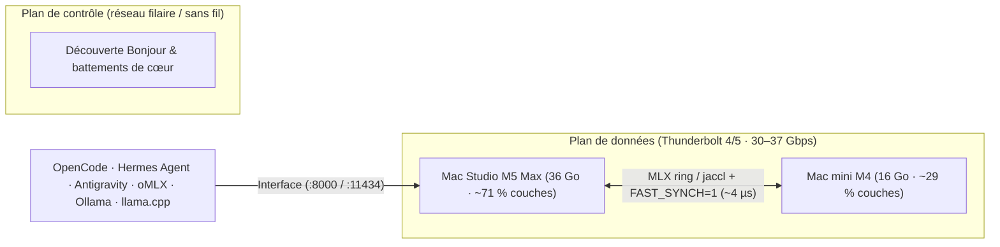

<div align="center">

# ☀️ Compagnon de grappe SonnerStudio (SS-CCC)

**🇺🇸 🇬🇧 🇨🇦 [English](README.md)** · **🇩🇪 🇦🇹 🇨🇭 [Deutsch](README.de.md)** · **🇫🇷 🇧🇪 🇨🇭 [Français](README.fr.md)** · **🇪🇸 🇲🇽 🇦🇷 [Español](README.es.md)** · **🇵🇹 🇧🇷 [Português](README.pt.md)**

*Gestionnaire natif macOS de grappe Apple Silicon et atelier d'inférence MLX répartie*


</div>

---

## 🧭 Présentation

Le **Compagnon de grappe SonnerStudio (SS-CCC)** associe la mémoire unifiée de plusieurs Mac Apple Silicon — par exemple un **Mac Studio M5 Max (36 Go, Thunderbolt 5)** et un **Mac mini M4 (16 Go, Thunderbolt 4)** — pour former une **grappe de 52 Go physiques (~42 Go exploitables)** par **Thunderbolt (pont ou accès direct mémoire)**, **réseau filaire/sans fil** ou en mode **hybride**.

<div align="center">
  
</div>

---

## 🏗️ Architecture hybride (plan de contrôle et plan de données)



---

## ✨ Fonctionnalités principales

- **Couplage mémoire hétérogène de 52 Go :** Répartition pondérée des couches (`~71 %` des couches sur le M5 Max à `460 Go/s`, `~29 %` sur le M4 à `120 Go/s`) avec protection `iogpu.wired_limit_mb`.
- **Interface native macOS :**
  - **Vue de la grappe et comparaison :** Lecture directe du matériel (`sysctl`, `sw_vers`, `ibv_devices`, `ipconfig`) avec barres comparatives.
  - **Atelier de modèles :** Découpage proportionnel, compression du cache KV (`FP16 / 8-bit / 4-bit`) et liaison directe avec **oMLX**, **Ollama** et **llama.cpp**.
  - **Agents et environnements (en un clic) :** Configuration immédiate pour **OpenCode**, **Hermes Agent** et **Google Antigravity**.
  - **Interface multilingue :** Sélecteur de langue intégré dans le menu latéral gauche.

---

## 🛠️ Compiler depuis le code source (à faire avant le premier lancement)

> [!NOTE]
> Ce dépôt contient le **code source Swift** de SS-CCC (aucun fichier exécutable précompilé n'est fourni). Pour obtenir une application prête à l'emploi, vous devez d'abord **compiler le programme localement sur votre Mac Apple Silicon**.

### Prérequis
- Un Mac Apple Silicon (**M1–M6**) sous **macOS 14.0 ou ultérieur**
- Les **outils en ligne de commande Xcode** (`swiftc` et le SDK macOS) :
  ```bash
  xcode-select --install
  ```

### Étape par étape vers l'application exécutable
```bash
# 1. Cloner le dépôt et ouvrir le dossier
git clone https://github.com/SonnerStudio/SonnerStudio-Cluster-Case-Companion.git
cd SonnerStudio-Cluster-Case-Companion

# 2. Rendre le script de compilation et de lancement exécutable
chmod +x scripts/run_ssccc.sh

# 3. Compiler les sources Swift vers /tmp/SSCCCApp et lancer l'application
./scripts/run_ssccc.sh
```
*(Optionnel : compilation via Swift Package Manager avec `cd app && swift build -c release`.)*

---

## 🚀 Démarrage rapide

```bash
"./scripts/run_ssccc.sh"
```

---

## 📚 Extraits de la documentation (intégrés dans l'aide de l'application)

### 1. Tous les Mac à puce Apple M en grappe (M1–M6)
SS-CCC prend en charge **chaque Mac équipé d'une puce Apple Silicon** (**M1, M2, M3, M4, M5, M6** — Base, Pro, Max et Ultra) : **Mac mini, MacBook Air, MacBook Pro, iMac, Mac Studio et Mac Pro**. Sous **Appareils et comparaison**, ajoutez autant de Mac que souhaité ; celui offrant le plus haut débit mémoire prend automatiquement le **rang 0 (maître)**.

| Famille de puces | Débit mémoire | Thunderbolt | Réserve macOS conseillée |
| :--- | :--- | :--- | :--- |
| **M1 / M2 / M3** (Base) | 68 – 100 Go/s | TB 4 | **4 Go** (≤ 24 Go RAM) |
| **M4 / M5 / M6** (Base) | 120 – 180 Go/s | TB 4 / TB 5 | **4 Go** (≤ 24 Go RAM) |
| **M1–M6 Pro** | 150 – 273 Go/s | TB 4 / TB 5 | **4 – 6 Go** |
| **M1–M6 Max** | 400 – 546 Go/s | TB 4 / TB 5 | **6 Go** (32–64 Go RAM) |
| **M1–M3 Ultra** | 800 Go/s | TB 4 | **8 Go** (≥ 96 Go RAM) |

### 2. Protection mémoire et répartition pondérée
- **Ne jamais allouer 100 % de la RAM :** `iogpu.wired_limit_mb` préserve la fluidité de macOS et de WindowServer.
- **Répartition proportionnelle des couches :** chaque Mac reçoit une part calculée sur sa mémoire utilisable (`Couches_i = Total × Utilisable_i / TotalUtilisable`).
- **Cache KV 4 bits & synchronisation rapide :** `--kv-bits 4` et `MLX_METAL_FAST_SYNCH=1` (45× plus rapide, ~180 µs → ~4 µs).

---

## 🚧 État d'avancement et contribution

> [!IMPORTANT]
> **SS-CCC est déjà exécutable, mais reste en cours de développement et de mise à l'épreuve.**
> L'interface, la détection matérielle, le découpage pondéré des couches et la liaison avec les agents fonctionnent ; les essais poussés sur diverses combinaisons de Mac M1–M6, ponts Thunderbolt 4/5 et RDMA/JACCL se poursuivent activement.

Nous encourageons vivement les développeurs, chercheurs et passionnés d'Apple Silicon à **participer au développement et à faire évoluer SS-CCC** :
- **Tester sur votre matériel :** Essayez SS-CCC sur vos Mac M1–M6 et partagez vos mesures de débit et de mémoire.
- **Signaler et proposer :** Ouvrez un ticket sur GitHub pour tout bogue, cas particulier ou nouvelle idée.
- **Proposer des améliorations :** Toute contribution à l'interface SwiftUI, au découpage MLX, aux scripts Thunderbolt ou aux traductions est la bienvenue !

---

## 📄 Licence

Publié sous [Licence MIT](LICENSE.md).
