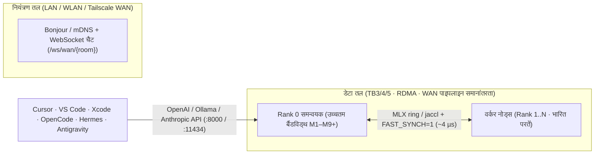

<div align="center">

# ☀️ SonnerStudio Cluster-Case-Companion (SS-CCC)

   **[English](README.md)** ·    **[Deutsch](README.de.md)** ·    **[Français](README.fr.md)** ·    **[Español](README.es.md)**<br/>
  **[Português](README.pt.md)** ·  **[Русский](README.ru.md)** ·  **[日本語](README.ja.md)** ·  **[中文](README.zh.md)**<br/>
  **[Nederlands](README.nl.md)** ·   **[Afrikaans](README.af.md)** ·  **[Polski](README.pl.md)** ·  **[Čeština](README.cs.md)**<br/>
 **[Slovenčina](README.sk.md)** ·  **[Magyar](README.hu.md)** ·  **[한국어](README.ko.md)** ·  **[हिन्दी](README.hi.md)** ·    **[தமிழ்](README.ta.md)**
<br/><a href="https://hits.sh/github.com/SonnerStudio/SonnerStudio-Cluster-Case-Companion/"></a><br/>
📖 **[प्रोजेक्ट Wiki](wiki/Home.md)** · 🌐 **[GitHub Wiki](https://github.com/SonnerStudio/SonnerStudio-Cluster-Case-Companion/wiki)** · 🤝 **[योगदान](CONTRIBUTING.md)** · 🛡️ **[सुरक्षा नीति](SECURITY.md)** · 📰 **[समाचार और LinkedIn](docs/PRESS_RELEASE.en.md)**

*नेटिव macOS Apple Silicon क्लस्टर प्रबंधक एवं वितरित MLX इनफ़रेंस स्टूडियो*

<table>
  <tr>
    <td align="center">
      <br/>
      <sub><b>क्लस्टर मोड (52 GB एकीकृत पूल · 2 नोड्स)</b></sub>
    </td>
    <td align="center">
      <br/>
      <sub><b>एकल मोड (16 GB स्थानीय · 1 नोड)</b></sub>
    </td>
  </tr>
</table>

</div>

---

## 🧭 अवलोकन

**SonnerStudio Cluster-Case-Companion (SS-CCC)** एकल Mac mini या MacBook Pro से लेकर बहु-Mac **Thunderbolt 3/4/5 और RDMA** सेटअप तथा **वैश्विक इंटरनेट WAN क्लस्टर (2–256+ Macs)** तक किसी भी **Apple Silicon Mac (M1–M9+)** की मेमोरी और कंप्यूट शक्ति को **MLX**, **oMLX**, **Ollama** और **llama.cpp** के साथ एकीकृत करता है।

<div align="center">
  
</div>

---

## 🌐 वैश्विक इंटरनेट क्लस्टर, लाइव चैट एवं वैज्ञानिक Roofline

<table>
  <tr>
    <td align="center" width="50%">
      <br/>
      <sub><b>वैश्विक इंटरनेट क्लस्टर एवं प्रतिभागी चैट</b><br/>Tailscale · WireGuard · libp2p QUIC · DERP · <code>/status</code> · <code>/layers</code> · <code>/ping</code></sub>
    </td>
    <td align="center" width="50%">
      <br/>
      <sub><b>वैज्ञानिक Roofline एवं ऊर्जा विश्लेषण</b><br/>Log-Log Roofline · GPipe Bubble · <code>J/token</code> · <code>p50/p95/p99</code> · CSV/JSON/BibTeX</sub>
    </td>
  </tr>
</table>

---

## 🏗️ हाइब्रिड आर्किटेक्चर (नियंत्रण तल, Thunderbolt एवं WAN)



---

## 🌐 इंटरनेट क्लस्टर WAN बैंडविड्थ और थ्रूपुट मॉनिटर


**इंटरनेट क्लस्टर और चैट** में SS-CCC वास्तविक WAN लिंक प्रदर्शन (`netstat`, `ping`, `networkQuality`) को लगातार मापता है — **डाउनलिंक / अपलिंक Mbps**, **WAN RTT विलंबता (ms)**, **जिटर**, **पैकेट लॉस** और **टोकन सिंक दक्षता** को ट्रैक करता है।

---

## ✨ प्रमुख क्षमताएँ

- **सार्वभौमिक Apple Silicon क्लस्टरिंग (M1–M9+):** **M1 से M6** और भविष्य की **M7–M12+** पीढ़ियों के किसी भी **Mac mini, MacBook Air/Pro, iMac, Mac Studio या Mac Pro** को जोड़ें। उच्चतम मेमोरी बैंडविड्थ वाला नोड स्वतः **Rank 0 (समन्वयक)** बनता है और सुरक्षित `iogpu.wired_limit_mb` सीमा लागू होती है।
- **संपूर्ण सिस्टम एवं सेंसर टेलीमेट्री:** `sysctl`, `sw_vers`, `system_profiler`, `ibv_devices`, `ipconfig`, `ioreg` और `ProcessInfo.thermalState` पढ़कर **CPU P/E कोर, GPU कोर, Neural Engine (16/32 ANE कोर), NVMe SSD, थर्मल स्थिति और बिजली खपत** एक साथ दिखाता है।
- **सभी Thunderbolt वर्ग (TB3 / TB4 / TB5) और RDMA:** M1–M9+ लिंक गति (`TB3/USB4: 26–32 Gbps`, `TB4: 30–37 Gbps`, `TB5: 65–80 Gbps`, `TB5 RDMA: 75–110 Gbps`) और `MLX_METAL_FAST_SYNCH=1` (45× तेज़ GPU/CPU सिंक) को स्वचालित रूप से संभालता है।
- **लाइव मॉडल कार्यशाला और रनटाइम तत्परता:** **oMLX**, **Ollama**, **llama.cpp**, स्थानीय `.gguf` फ़ाइलों और `~/.cache/huggingface/hub` से वास्तविक मॉडल खोजता है, मेमोरी-भारित परत विभाजन और KV-कैश क्वांटाइज़ेशन (`FP16 / 8-bit / 4-bit`) के साथ।
- **6× वन-क्लिक एजेंट और IDE एकीकरण:** **OpenCode**, **Hermes Agent**, **Google Antigravity**, **Cursor**, **Visual Studio Code** और **Apple Xcode** के लिए तुरंत कॉन्फ़िगरेशन निर्यात करें।
- **वैश्विक इंटरनेट WAN क्लस्टर और प्रतिभागी चैट (`/ws/wan/{room_id}`):** एन्क्रिप्टेड टनल (Tailscale / WireGuard, libp2p / DERP P2P या मैन्युअल एंडपॉइंट) द्वारा दुनिया भर के Macs को जोड़ें।
- **6-टैब विज्ञान प्रयोगशाला एवं इतिहास रिकॉर्डिंग:** **स्थानीय (TB/RDMA)**, **इंटरनेट WAN** और **आमने-सामने तुलना** के बीच स्विच करें — **Roofline**, **WAN टोपोलॉजी**, **मेमोरी एवं KV**, **ऊर्जा, CO₂ व लागत**, **परीक्षण व निर्यात** (`CI₉₅`, `CSV / JSON / LaTeX / BibTeX`) और **इतिहास रिकॉर्डिंग** के साथ।
- **GitHub-नियंत्रित प्रोग्राम अपडेट और स्वचालित CI संस्करण नियंत्रण:** स्टार्टअप पर और हर 30 मिनट में (`⌘U`) `version.json`, GitHub Releases व `commits/main` SHA जांचता है और 1-क्लिक रीबिल्ड + रीस्टार्ट प्रदान करता है।
- **SonnerStudio Yellow (`#FFD400`) UI, 17-भाषा पुस्तिका, Shorttips एवं मेनू बार सेवा मोड (`⌘⇧M`):** **17 भाषाओं** (`EN..TA`) में पूर्ण अनुवाद, ऐप-व्यापी **Shorttips**, **12-अध्याय इंटरैक्टिव सहायता**, **25/25 परीक्षण** और एजेंट्स/IDE के लिए **शीर्ष मेनू बार में मिनिमाइज़** सुविधा।

### 🖥️ एक नज़र में सभी 11 प्रोग्राम मॉड्यूल


| साइडबार टैब | उद्देश्य |
| :--- | :--- |
| **1. क्लस्टर अवलोकन** | लाइव मेमोरी पूल बार, सक्रिय M1–M12+ टोपोलॉजी, TB/RDMA गति और **4-स्तरीय तत्परता कार्ड** |
| **2. उपकरण एवं तुलना** | किसी भी M1–M12+ Mac को जोड़ें/हटाएँ, रीयल-टाइम CPU/GPU/ANE/SSD/थर्मल/पावर देखें और तुलना करें |
| **3. मॉडल कार्यशाला** | लाइव मॉडल खोज (oMLX / Ollama / llama.cpp / GGUF), रनटाइम जांच, आनुपातिक परतें, ANE-Split व 3-स्तरीय KV-कैश |
| **4. नेटवर्क और RDMA** | Auto-Hybrid / TB-Only / LAN / RDMA स्विच, `FAST_SYNCH=1`, Pipeline Ring बनाम JACCL Full-Mesh TP |
| **5. इंटरनेट क्लस्टर और चैट** | स्थानीय TB/RDMA को वैश्विक WAN साथियों (QUIC/Iroh 0-RTT, Tailscale) से जोड़ें, **WAN बैंडविड्थ** व Audio-Party देखें |
| **6. मल्टी-मॉडल मोड (MMM)** | **स्थानीय**, **WAN** या **हाइब्रिड** क्लस्टर पर एक साथ कई मॉडल चलाएँ और **मल्टी-IDE** को `:8000/v1` पर सेवा दें |
| **7. एजेंट और IDE** | 6 प्रमुख IDE व एजेंट्स के लिए 1-क्लिक सेटअप और कॉपी करने योग्य फ़ाइलें (**MCP Registry JSON** और **A2A Agent Card** सहित) |
| **8. विज्ञान और Roofline** | वास्तविक SSE और ICMP RTT आधारित 6-टैब शोध लैब, प्रत्यक्ष MMM मूल्यांकन, Roofline, `N=1..128`, `J/tok` / `CO₂` व इतिहास |
| **9. API और कंसोल** | OpenAI (`/v1/chat/completions`, `/v1/responses` + MCP), Ollama (`/api/tags`) और **A2A Agent Card** का लाइव परीक्षण |
| **10. सेटअप और प्रावधान** | स्थानीय TB/LAN व WAN Macs की स्वतः खोज, SSH ट्रस्ट व `wired_limit` सेटअप और **परिचालन तत्परता सत्यापन** |
| **11. सहायता और पुस्तिका** | खोज योग्य **12-अध्याय, 17-भाषा इंटरैक्टिव पुस्तिका** (`⌘?`) जिसमें विस्तृत चित्र और चमक हाइलाइट्स हैं |

---

## 🛠️ सोर्स से बिल्ड करें (पहले लॉन्च से पहले महत्वपूर्ण)

> [!NOTE]
> इस रिपॉज़िटरी में SS-CCC का **Swift सोर्स कोड** है (कोई पूर्व-संकलित `.app` बाइनरी यहाँ शामिल नहीं है)। चलाने के लिए पहले अपने Apple Silicon Mac पर स्थानीय रूप से संकलित करें।

### आवश्यकताएँ
- **macOS 14.0 या नया** चलाने वाला कोई भी Apple Silicon Mac (**M1–M6+**)
- **Xcode Command Line Tools** (जिसमें `swiftc` और macOS SDK शामिल हैं):
  ```bash
  xcode-select --install
  ```

### चरण-दर-चरण: रिपॉज़िटरी से चलने योग्य ऐप तक
```bash
# 1. रिपॉज़िटरी क्लोन करें
git clone https://github.com/SonnerStudio/SonnerStudio-Cluster-Case-Companion.git
cd SonnerStudio-Cluster-Case-Companion

# 2. बिल्ड एवं लॉन्च स्क्रिप्ट को निष्पादन योग्य बनाएँ (एक बार)
chmod +x scripts/run_ssccc.sh

# 3. सभी Swift स्रोतों को /tmp/SSCCCApp में संकलित करें और ऐप चलाएँ
./scripts/run_ssccc.sh
```
*(वैकल्पिक: आप `cd app && swift build -c release` के साथ Swift Package Manager से भी बिल्ड कर सकते हैं।)*

---

## 🚀 त्वरित प्रारंभ

```bash
# 1. नेटिव SwiftUI Studio ऐप लॉन्च करें
"./scripts/run_ssccc.sh"

# 2. (वैकल्पिक) Python/FastAPI गेटवे शुरू करें
cd core && uv sync --extra dev
PYTHONPATH=".." uv run uvicorn core.api.gateway:app --host 0.0.0.0 --port 8000

# 3. Thunderbolt पॉइंट-टू-पॉइंट IP कॉन्फ़िगर करें
./scripts/setup_tb_network.sh studio   # 10.99.1.1
./scripts/setup_tb_network.sh mini     # 10.99.1.2
```

---

## 📖 संचालन मार्गदर्शिका: स्थानीय और हाइब्रिड क्लस्टर सेटअप व मॉडल लोडिंग

### 1. स्थानीय क्लस्टर सेटअप (Thunderbolt 3/4/5 और LAN)
1. **भौतिक कनेक्शन:** अपने Macs को सीधे **Thunderbolt 3/4/5 केबल** और/या **10GbE ईथरनेट** से जोड़ें।
2. **IP असाइन करें:** मुख्य Mac पर `./scripts/setup_tb_network.sh studio` (`10.99.1.1`) और वर्कर Macs पर `mini` (`10.99.1.2`) चलाएँ।
3. **वैकल्पिक RDMA (TB5 पर macOS 26.2+):** `rdma_ctl enable` द्वारा लो-लेटेंसी RDMA सक्रिय करें ताकि `JACCL` **`~3 µs`** विलंबता प्राप्त करे।
4. **स्वचालित रैंक निर्धारण:** **उपकरण एवं तुलना** में सभी Macs जोड़ें; `MemoryWeightedPlanner` सबसे तेज़ Mac को स्वतः **Rank 0 (समन्वयक)** चुनता है।

### 2. हाइब्रिड क्लस्टर नेटवर्क सेटअप (स्थानीय + इंटरनेट WAN एक साथ)
1. **स्थानीय हाई-स्पीड कोर (टियर 1):** संवेदनशील परतों के लिए अपनी स्थानीय TB/LAN रिंग सक्रिय रखें।
2. **WAN समन्वयक कक्ष (टियर 2):** **इंटरनेट क्लस्टर और चैट** में WAN कक्ष (`/ws/wan/{room_id}`, पोर्ट `8000`) शुरू करें।
3. **रिमोट वर्कर्स जोड़ें:** दुनिया भर से Macs **रूम कोड + जॉइन टोकन** से जुड़ते हैं।
4. **दो-स्तरीय हाइब्रिड रूटिंग:** तेज़ परतें स्थानीय रिंग पर रहती हैं जबकि अतिरिक्त चरण माइक्रो-बैचिंग (`M ≥ 4`) के साथ WAN पर चलते हैं।

### 3. मॉडल कौन लोड करता है, कितने मॉडल फिट होते हैं और अनुरोध प्रवाह
- **कौन क्या लोड करता है?**
  - **समन्वयक (Rank 0):** API गेटवे (`:8000`) चलाता है, टोकनाइज़ करता है और **हमेशा Embeddings व LM-Head** तथा अपना परत हिस्सा रखता है।
  - **वर्कर्स (Rank 1..N):** प्रत्येक वर्कर स्थानीय कैश से **केवल अपनी आवंटित परत स्लाइस `[start_layer .. end_layer)`** पढ़ता है।
- **एक साथ कितने मॉडल लोड हो सकते हैं?**
  - **वितरित क्लस्टर मोड (`mlx.distributed` / `JACCL`):** संयुक्त मेमोरी पूल में **एक समय में 1 बड़ा विभाजित मॉडल**।
  - **मल्टी-मॉडल सर्विंग (`oMLX` / `Ollama` / MMM):** जब तक `Σ (Weights_i + KV_i) ≤ Total_Usable_VRAM_GB` हो, **कई मॉडल एक साथ** सक्रिय रहते हैं।
- **एंड-टू-एंड निष्पादन प्रवाह:**
  1. **जाँच एवं लिंक चयन:** RAM, बैंडविड्थ और इंटरफ़ेस (`TB5 RDMA > TB Bridge > 10GbE > WLAN > WAN`) पहचानता है।
  2. **शार्डिंग योजना:** `MemoryWeightedPlanner` `iogpu.wired_limit_mb` की रक्षा करते हुए `hostfile.json` लिखता है।
  3. **API प्रवेश:** एजेंट्स/IDE `http://127.0.0.1:8000/v1/chat/completions` पर अनुरोध भेजते हैं।
  4. **प्रीफ़िल चरण (`TTFT`):** Rank 0 प्रॉम्प्ट एम्बेड करता है और पाइपलाइन से आगे भेजता है।
  5. **डिकोड चरण (`TPOT` और `tok/s`):** `--kv-bits 4` व `MLX_METAL_FAST_SYNCH=1` के साथ टोकन बनते हैं।
  6. **SSE स्ट्रीमिंग व टेलीमेट्री:** Rank 0 टोकन स्ट्रीम करता है और `tok/s`, `TTFT`, `TPOT`, `J/tok` दर्ज करता है।

### 4. उपयोग परिदृश्यों में सैद्धांतिक आकार एवं प्रदर्शन डेटा

> **विश्लेषणात्मक अनुमान नियम:**
> - **मेमोरी उपयोग:** `VRAM_GB ≈ Params_B × (Bits / 8) × 1.15 + KV_Cache_GB`
> - **सैद्धांतिक डिकोड सीमा:** `tok/s ≈ (Effective_Bandwidth_GB/s / Active_Weights_GB) × (1 − Comm_Overhead)`

| उपयोग परिदृश्य | टोपोलॉजी और उपयोगी पूल | मॉडल व क्वांटाइज़ेशन | सैद्धांतिक `TTFT` (2k) | सैद्धांतिक डिकोड (`tok/s`) | ऊर्जा और मुख्य अवरोध |
| :--- | :--- | :--- | :--- | :--- | :--- |
| **1. एकल वर्कस्टेशन (Edge Dev)** | 1× Mac mini M4 (16 GB, `12 GB`, `120 GB/s`) | `Qwen2.5-14B` (`4-bit`, ~8.8 GB) | `~1.8 – 2.6 s` | **`11 – 14 tok/s`** (`~75 ms/tok`) | `~1.7 J/tok` · मेमोरी बैंडविड्थ |
| **2. एकल Pro Studio** | 1× Mac Studio M4 Max (64 GB, `58 GB`, `546 GB/s`) | `Llama-3.3-70B` (`4-bit`, ~40 GB) | `~1.1 – 1.7 s` | **`12 – 14 tok/s`** (`~74 ms/tok`) | `~3.8 J/tok` · मेमोरी बैंडविड्थ |
| **3. स्थानीय 2-नोड TB5 RDMA रिंग** | 2× M4 Max 64 GB (`116 GB`, `~1,092 GB/s`, `~3 µs`) | `Qwen2.5-Coder-72B` (`8-bit`, ~78 GB) | `~1.4 – 2.0 s` | **`12 – 14 tok/s`** (`~76 ms/tok`) | `~7.5 J/tok` · नगण्य RDMA ओवरहेड |
| **4. शोध लैब 4-नोड Ultra रिंग** | 4× M3 Ultra 256 GB (`992 GB`, `~3.27 TB/s`, TB5 RDMA) | `DeepSeek-V3 671B MoE` (`4-bit`, ~385 GB) | `~2.2 – 3.5 s` | **`38 – 55 tok/s`** (`~20 ms/tok`) | `~5.2 J/tok` · सक्रिय MoE विशेषज्ञ |
| **5. हाइब्रिड ऑफिस LAN + होम WAN** | 2× TB4 + 2× WAN (`192 GB`, `35 ms` RTT) | `Llama-3.1-405B` (`3/4-bit`, ~170 GB) | `~6 – 11 s` | **`2.2 – 4.5 tok/s`** (`~280 ms/tok`) | `~28 J/tok` · WAN RTT (`M=8`) |
| **6. वैश्विक सामुदायिक WAN झुंड** | दुनिया भर में 16+ Macs (`1.5+ TB`, `60–120 ms` RTT) | `671B–1T+` Frontier (`4/8-bit`) | `~12 – 25 s` | **`1.2 – 3.0 tok/s`** (`~500 ms/tok`) | WAN विलंबता (बैचिंग से स्केल) |

---

## 📚 चयनित दस्तावेज़ (ऐप के सहायता केंद्र में अंतर्निहित)

### 1. सार्वभौमिक Apple Silicon M-सीरीज़ क्लस्टरिंग (M1–M12+)
SS-CCC **Mac mini, MacBook Air/Pro, iMac, Mac Studio और Mac Pro** पर **M1–M6** तथा भविष्य की **M7–M12+** श्रृंखला के हर Mac का समर्थन करता है।

| Mac / चिप परिवार | मेमोरी बैंडविड्थ | Thunderbolt एवं RDMA | अनुशंसित macOS रिज़र्व |
| :--- | :--- | :--- | :--- |
| **M1 / M2** (Base) | 68 – 100 GB/s | TB 3 / USB4 (26–32 Gbps) | **4 GB** (≤ 24 GB RAM) |
| **M3 / M4** (Base) | 100 – 120 GB/s | TB 4 (30–37 Gbps) | **4 GB** (≤ 24 GB RAM) |
| **M5 / M6** (Base, M6 2nm) | **153 – 170 GB/s** (`M6`: 153 GB/s @ 16 GB, 170 GB/s @ 24–32 GB) | TB 4 / TB 5 (`80/120 Gbps`) | **4 GB** (≤ 32 GB RAM) |
| **M1–M3 Pro** | 150 – 200 GB/s | TB 4 (30–37 Gbps) | **4 – 6 GB** |
| **M4 / M5 Pro** | 273 – 307+ GB/s | TB 5 (`80/120 Gbps` बूस्ट) | **4 – 6 GB** |
| **M1–M3 Max** | 400 GB/s | TB 4 (30–37 Gbps) | **6 GB** (32–64 GB RAM) |
| **M4 Max** | **410 – 546 GB/s** (LPDDR5X-8533) | TB 5 + RDMA (`~3 µs`) | **6 GB** (32–128 GB RAM) |
| **M5 Max** | **460 – 614 GB/s** (32/40-कोर GPU) | TB 5 + RDMA (`~3 µs` JACCL) | **6 GB** (36–128 GB RAM) |
| **M1–M2 Ultra / M3 Ultra** | **800 – 819 GB/s** (UltraFusion) | TB 4 / TB 5 RDMA (JACCL) | **8 GB** (≥ 96 GB RAM) |
| **M5 Ultra** | **1.2 TB/s** (~1,228 GB/s, 512 GB RAM तक, 80-कोर GPU) | TB 5 RDMA (`JACCL`) | **8 GB** (96–512 GB RAM) |

> [!NOTE]
> **M6 उपलब्धता नोट:** Apple ने सितंबर/अक्टूबर 2026 में 2nm **M6** बेस चिप जारी की; **M6 Pro, Max और Ultra** नवंबर 2026 तक अभी जारी नहीं हुए हैं। SS-CCC सभी आगामी M6–M12+ चिप्स को स्वतः पहचानता है।

### 2. Thunderbolt 5 RDMA (`JACCL`) और मेमोरी सुरक्षा


- **Thunderbolt 5 पर macOS RDMA:** `rdma_ctl enable` और `JACCL` से नोड-टू-नोड विलंबता `~300 µs` से घटकर **`~3 µs`** हो जाती है।
- **100% RAM कभी आवंटित न करें:** SS-CCC macOS की स्थिरता हेतु `iogpu.wired_limit_mb` लागू करता है।
- **आनुपातिक परत विभाजन:** प्रत्येक Mac को उसकी उपयोगी मेमोरी के अनुपात में परतें मिलती हैं।
- **KV-कैश और तेज़ Metal सिंक:** `--kv-bits 4` और `MLX_METAL_FAST_SYNCH=1` सिंक को **45×** तेज़ करते हैं।

---

## 🔄 GitHub-नियंत्रित प्रोग्राम अपडेट और स्वचालित CI संस्करण नियंत्रण


SS-CCC में एकीकृत **GitHub अपडेट पाइपलाइन** शामिल है ताकि हर इंस्टॉलेशन अद्यतन रहे:

1. **बहु-स्रोत GitHub संस्करण जाँच:**
   - `raw.githubusercontent.com/.../main/version.json` (लाइव रिलीज़ मैनिफ़ेस्ट)
   - `api.github.com/repos/.../releases/latest` (आधिकारिक GitHub रिलीज़)
   - `api.github.com/repos/.../commits/main` (नवीनतम `main` कमिट SHA)
2. **इन-ऐप अपडेट प्रॉम्प्ट (`UpdatePromptSheet`) और 1-क्लिक रीबिल्ड:**
   - नया संस्करण मिलने पर शीर्ष बार में **अपडेट पिल** (`⌘U`) चमकती है।
   - **सोर्स इंस्टॉलेशन:** सीधे ऐप के भीतर `git pull` + बिल्ड चलाकर **अभी ऐप पुनः प्रारंभ करें** बटन देता है।
   - **पैकेज़्ड `.app`:** Safari में डाउनलोड खोलता है।
3. **स्वचालित CI संस्करण वृद्धि (`.github/workflows/auto-version-control.yml`):**
   - हर `main` पुश पर `scripts/bump_version.py` और सभी 25 परीक्षण चलते हैं तथा `vX.Y.Z` टैग अपडेट होता है।

---

## 🧠 मल्टी-मॉडल मोड (MMM) — क्रॉस-क्लस्टर ऑर्केस्ट्रेशन एवं मल्टी-IDE उपयोग


**मल्टी-मॉडल मोड (MMM)** **स्थानीय**, **इंटरनेट WAN** या **हाइब्रिड** क्लस्टर पर एक साथ कई AI मॉडल चलाता है।

### 4 ऑर्केस्ट्रेशन रणनीतियाँ
1. **समानांतर मल्टी-मॉडल पूल:** अलग VRAM सीमाओं में कई विशेषज्ञ मॉडल तैयार रखता है।
2. **Mixture-of-Agents (MoA):** समान प्रॉम्प्ट को विशेषज्ञों पर समानांतर चलाकर `Aggregator` से जोड़ता है।
3. **स्पेक्युलेटिव डिकोडिंग (Draft + Target):** तेज़ `Draft` को बड़े `Target` से जोड़कर $1.6\times$–$2.3\times$ गति बढ़ाता है।
4. **अनुक्रमिक मॉडल पाइपलाइन:** *योजनाकार → कोडर → समीक्षक* चरणों को जोड़ता है।

### ⚙️ 1-क्लिक ऑटो-सेटअप और लाइव स्लॉट संपादक


स्लॉट कभी भी बाद में बदले जा सकते हैं:
- **1-क्लिक ऑटो-सेटअप प्रोफ़ाइल:** **Coding & IDE Swarm**, **Consensus & Audit**, **Turbo**, या **Stage Pipeline** चुनें।
- **पूर्ण संपादन:** क्रम बदलें, कॉपी बनाएँ, स्लॉट टॉगल करें या URL (`:8000/v1`, `:11434/v1`) बदलें।
- **VRAM-Fit ऑप्टिमाइज़र:** 1 क्लिक में अतिरिक्त स्लॉट फिट करें और JSON में सहेजें।

### साझा मल्टी-IDE और एजेंट उपयोग (`:8000/v1`)
**Cursor**, **VS Code**, **Xcode**, **OpenCode**, **Hermes Agent** और **Antigravity** एक साथ `:8000/v1` का उपयोग कर सकते हैं।

### वास्तविक MMM उपयोग मामले
- **मल्टी-IDE विकास:** मॉडल रीलोड हुए बिना Cursor, OpenCode और Hermes साथ चलाएँ।
- **स्पेक्युलेटिव टर्बो:** 16 GB Mac mini को Draft और Mac Studio को 70B+ Target बनाएँ।
- **MoA कोड समीक्षा:** कोडिंग, गणित और एग्रीगेटर मॉडल जोड़ें।
- **हाइब्रिड विशेषज्ञता:** स्थानीय TB पर तेज़ ऑटोकंप्लीट और WAN पर भारी 405B कार्य।
- **स्वचालित CI पाइपलाइन:** *आर्किटेक्चर → कार्यान्वयन → सुरक्षा ऑडिट*।
- **वैज्ञानिक बेंचमार्किंग:** प्रत्येक MMM रन `विज्ञान और Roofline` में डेटा भेजता है।

---

## 🎙️ क्लस्टर Audio-Party एवं लाइव WAN सहयोग


- **कंसोल-शैली वॉइस समन्वय:** `/ws/wan-audio` पर नेटिव `AVAudioEngine` (`16 kHz PCM16`) के साथ लो-लेटेंसी वॉइस चैट।
- **रणनीतिक नियंत्रण:** **Push-to-Talk** / **ओपन माइक**, म्यूट, लेवल मीटर और प्रतिभागी भूमिकाएँ।
- **रीयल-टाइम रूम सिंक (`/ws/wan/{room_id}`):** `SSCCC-WAN-…` आमंत्रण और चैट टेलीमेट्री सिंक करता है।

---

## 🏆 वैश्विक + स्थानीय हाइब्रिड सुपरक्लस्टर रिकॉर्ड प्रयास


**क्या Apple Silicon Macs का विकेंद्रीकृत गठबंधन डेटासेंटर सुपरकंप्यूटर की बराबरी कर सकता है?**  
हम दुनिया भर के विश्वविद्यालयों, AI प्रयोगशालाओं और डेवलपर्स को आधिकारिक **SS-CCC हाइब्रिड रिकॉर्ड प्रयास** में आमंत्रित करते हैं।

### 🔬 वैज्ञानिक आधार एवं गणितीय स्केलिंग मॉडल

1. **दो-स्तरीय पदानुक्रमित टोपोलॉजी (टियर-0 TB/RDMA द्वीप + टियर-1 WAN बैकबोन):**
   - सपाट WAN क्लस्टर में हर परत इंटरनेट से गुजरने पर गति गिरती है ($H_{\text{WAN}} = N - 1$)।
   - **हाइब्रिड ब्रिज** से क्रमिक परतें स्थानीय TB (`~0.07 ms`) पर रहती हैं और केवल द्वीपों के बीच WAN उपयोग होता है।
2. **क्रिटिकल माइक्रो-बैचिंग ($B^*$) और संपीड़न से WAN RTT संतुलन:**
   - पाइपलाइन दक्षता GPipe बबल नियम का पालन करती है:
     $$\Phi_{\text{bubble}} = \frac{N - 1}{M + N - 1}, \qquad B^* = \left\lceil \frac{T_{\text{RTT,WAN}} + T_{\text{tx}}}{T_{\text{comp}}(B=1)} \right\rceil$$
   - $M \to B^*$ अंतर-महाद्वीपीय विलंबता छिपाता है और **FP8 / INT4 / Top-K** (*Petals / SWARM*) ओवरहेड को $1\%$ से कम रखता है।
3. **मानकीकृत पुनरुत्पादनीय रिकॉर्ड प्रोटोकॉल ($T = 0.0$):**
   1. **टियर-0 द्वीप बनाएँ:** स्थानीय Macs को Thunderbolt से जोड़ें (`MLX_METAL_FAST_SYNCH=1`)।
   2. **ब्रिज व समन्वय:** `SSCCC-WAN-…` साझा करें और Audio-Party से परत विभाजन तय करें।
   3. **परीक्षण चलाएँ:** `N = 20` परीक्षण (`temperature = 0.0`, `TTFT ≤ 2500 ms`, `TPOT ≤ 100 ms/tok`) चलाएँ।
   4. **सत्यापन सहेजें:** **JSON मैनिफ़ेस्ट**, **CSV लॉग** और **LaTeX तालिका** (`CI₉₅`, `CV%`, `J/token`, `EDP`, `gCO₂eq`) निर्यात करें।


### 🥇 आधिकारिक रिकॉर्ड श्रेणियाँ
- **सबसे बड़ा एकीकृत मेमोरी पूल:** उच्चतम उपयोगी VRAM (`GB` / `TB`)।
- **सर्वाधिक एक साथ जुड़े Macs ($N$):** `N = 20` पास करने वाला सबसे बड़ा सक्रिय जाल (`32–256+`)।
- **उच्चतम अंतर-महाद्वीपीय Goodput:** $\ge 2$ महाद्वीपों में SLO के भीतर अधिकतम `tokens/s`।
- **सर्वश्रेष्ठ क्लस्टर ऊर्जा दक्षता:** `70B+` मॉडल हेतु न्यूनतम `J/token` व `EDP`।

---

## 🎯 उपयोग के मामले और लक्षित उपयोगकर्ता


| उपयोगकर्ता समूह | SS-CCC के साथ व्यावहारिक उपयोग |
| :--- | :--- |
| **AI सिस्टम और ML शोधकर्ता** | Roofline सीमाएँ, *Petals/SWARM*, *DiLoCo* विश्लेषण और `CI₉₅` + `LaTeX`/`BibTeX` निर्यात। |
| **विश्वविद्यालय व शिक्षण लैब** | छात्रों के MacBooks व लैब Mac minis को 70B–405B+ क्लस्टर में जोड़ना। |
| **सॉफ़्टवेयर स्टूडियो और एजेंट टीमें** | OpenCode, Hermes, Antigravity, Cursor, VS Code और Xcode के लिए बिना क्लाउड शुल्क के निजी कोडिंग मॉडल। |
| **गोपनीयता-प्रथम कानूनी व चिकित्सा** | संवेदनशील डेटा पूरी तरह ऑन-प्रिमाइस या एन्क्रिप्टेड WireGuard/Tailscale टनल में। |
| **वैश्विक ओपन-सोर्स हैकाथॉन** | मिनटों में सीमा-पार सुपरक्लस्टर और वॉइस समन्वय। |
| **ग्रीन-AI व स्थिरता ऑडिट** | डेटासेंटर GPU के मुकाबले `J/token`, `EDP` व `gCO₂eq/1M tokens` मापना। |

---

## 📁 रिपॉज़िटरी संरचना

```text
├── app/Sources/
│   ├── SSCCCApp.swift              # मुख्य विंडो, MenuBarExtra पृष्ठभूमि सेवा, अपडेट पिल व शीट
│   ├── Models/
│   │   ├── ClusterModels.swift     # M1–M12+ अनुमान, WAN/विज्ञान/इतिहास और रिलीज़ मॉडल
│   │   └── Localization.swift      # संपूर्ण 17-भाषा UI एवं सहायता शब्दकोश (EN..TA)
│   ├── ViewModels/
│   │   └── ClusterViewModel.swift  # हार्डवेयर जांच, मॉडल खोज, WAN/Audio-Party एवं GitHub अपडेटर
│   └── Views/                      # 12 मॉड्यूलर SwiftUI व्यू + Theme.swift (11 टैब, चेतावनी धारियाँ व Shorttips)
├── app/Resources/                # Solaris Dock Icon (ssccc_app_icon.png / AppIcon.icns) & Assets
├── core/                           # Python FastAPI गेटवे, WebSocket WAN/Audio रिले व MLX शार्डिंग
├── scripts/
│   ├── run_ssccc.sh                # macOS ऐप को संकलित और लॉन्च करता है
│   ├── bump_version.py             # version.json व ClusterModels.swift को Git से सिंक करता है
│   ├── setup_tb_network.sh         # 10.99.1.x Thunderbolt ब्रिज कॉन्फ़िगर करता है
│   └── setup_wired_limit.sh        # सुरक्षित iogpu.wired_limit_mb सीमाएँ लागू करता है
├── tests/                          # 25-परीक्षण वैश्विक सत्यापन सूट (Swift + Python)
├── wiki/                           # Wiki (Home.md, _Sidebar.md, Architecture, MMM, MenuBar, Science, 17 Languages)
├── CONTRIBUTING.md                 # GitHub right-sidebar guide
├── SECURITY.md                     # Security & memory guard policy
├── CODE_OF_CONDUCT.md              # Community standards
├── .github/workflows/              # स्वचालित CI संस्करण नियंत्रण व टैगिंग
└── version.json                    # GitHub-होस्टेड अपडेट नियंत्रण मैनिफ़ेस्ट
```

---

## 🚀 2026 SOTA आर्किटेक्चर अपग्रेड (चरण 11)

- **TB5 RDMA Tensor Parallelism व QUIC / Iroh WAN:** **Pipeline Ring** / **JACCL Full-Mesh TP** स्विचिंग और **QUIC / Iroh P2P (0-RTT)**।
- **ANE-Split व 3-स्तरीय KV-कैश / CacheGen:** Neural Engine पर प्रीफ़िल (`EDP ×1.42`, `-31.5%` ऊर्जा) और `3.6×` संपीड़न।
- **नेक्स्ट-जेन MMM:** **EAGLE-3**, **Tree-MoA Early-Exit** और **Ares** अनुकूली राउटर।
- **आधुनिक एजेंट मानक:** **OpenAI `/v1/responses`**, **MCP Server Registry JSON** और **A2A Agent Card**।
- **थर्मल व कार्बन-सचेत शेड्यूलिंग:** गर्म नोड्स पर भार स्वतः कम करता है।

### 🛠️ चरण 12: क्लस्टर ऑटो-सेटअप, तत्परता जाँच और ऐप-व्यापी Shorttips


- **11वाँ साइडबार अनुभाग (`सेटअप और प्रावधान`):** स्थानीय व WAN Macs स्वतः खोजकर SSH/मेमोरी सुरक्षा सेट करता है।
- **4-स्तरीय तत्परता जीवनचक्र:** सभी 17 भाषाओं में **तैयार**, **तैयार नहीं**, **आंशिक कॉन्फ़िगर** या **कॉन्फ़िगर नहीं** दिखाता है।
- **ऐप-व्यापी होवर Shorttips:** `.help` और फ्लोटिंग **Solaris Shorttip बैनर** के माध्यम से त्वरित मार्गदर्शन।
- **इंटरैक्टिव सहायता और लाइव डेटा:** सभी 12 अध्याय आरेखों सहित खुलते हैं और बिना सिमुलेशन वास्तविक डेटा उपयोग करते हैं।

### 🛰️ शीर्ष मेनू बार में मिनिमाइज़ (एजेंट्स व IDE के लिए बैकग्राउंड सेवा मोड, ⌘⇧M)

- **macOS के शीर्ष मेनू बार में सहज स्थानांतरण:** विंडो का पीला मिनिमाइज़ बटन दबाएँ, **`⌘⇧M`** उपयोग करें या हेडर में **मेनू बार में** बटन चुनें — मुख्य विंडो छिप जाती है और SS-CCC **Ollama** के पास मेनू बार में शांत बैकग्राउंड सेवा (`.accessory` मोड) के रूप में चलता रहता है।
- **स्पष्ट लाइव संकेतक:** आइकन और पॉपओवर में तुरंत **तत्परता स्थिति**, **पूल/उपयोगी RAM (GB)**, **सक्रिय नोड्स**, **लोड किया गया मॉडल व परतें**, **रनटाइम** और **MMM स्लॉट** दिखते हैं।
- **1-क्लिक एंडपॉइंट कॉपी और जुड़े IDE:** Cursor, OpenCode, Hermes, Antigravity, VS Code और Xcode के लिए पॉपओवर से सीधे **`http://127.0.0.1:8000/v1`** (OpenAI/MMM) या **`http://127.0.0.1:11434`** (Ollama) कॉपी करें।
- **तुरंत विंडो पुनर्स्थापना:** मेनू बार (`⌘⇧M`) या Dock से कभी भी पूरा स्टूडियो विंडो वापस खोलें या ऑटो-मिनिमाइज़ टॉगल करें।
- **आधुनिक Solaris Dock आइकन:** निचले macOS Dock बार के लिए कस्टम `1024×1024` ऐप आइकन (`ssccc_app_icon.png` और `AppIcon.icns`), जो स्टार्ट और रीस्टोर पर स्वतः लागू होता है।

---

## 🚧 विकास स्थिति और योगदान

> [!IMPORTANT]
> **SS-CCC v1.6+ पूरी तरह चलने योग्य है और `25/25` स्वचालित परीक्षणों द्वारा सत्यापित है।**
> **पूर्ण एवं सत्यापित सुविधाएँ:** अंग्रेज़ी डिफ़ॉल्ट प्रारंभ व **संपूर्ण 17-भाषा अनुवाद (`EN..TA`)**, **CPU, GPU और Neural Engine (ANE) कोर रीडआउट**, **मेनू बार पृष्ठभूमि सेवा मोड (`⌘⇧M`)**, **सभी 17 README में आगंतुक काउंटर**, M1–M12+ हार्डवेयर जांच, 6-टैब विज्ञान लैब, Audio-Party और GitHub ऑटो-अपडेटर।

हम डेवलपर्स, शोधकर्ताओं और Apple Silicon उत्साही लोगों को **SS-CCC में योगदान देने** के लिए आमंत्रित करते हैं:
- **अपने हार्डवेयर पर परखें:** अपने M1–M12+ Macs पर परिणाम और RDMA/JACCL अनुभव साझा करें।
- **हाइब्रिड रिकॉर्ड प्रयास में शामिल हों:** स्थानीय TB द्वीपों को WAN साथियों से जोड़कर JSON/CSV/LaTeX रिपोर्ट साझा करें।
- **Pull Requests भेजें:** SwiftUI, MLX शार्डिंग, स्क्रिप्ट या अनुवाद सुधारों का सदा स्वागत है!

---

## 📄 लाइसेंस

[MIT लाइसेंस](LICENSE.md) के अंतर्गत प्रकाशित।
