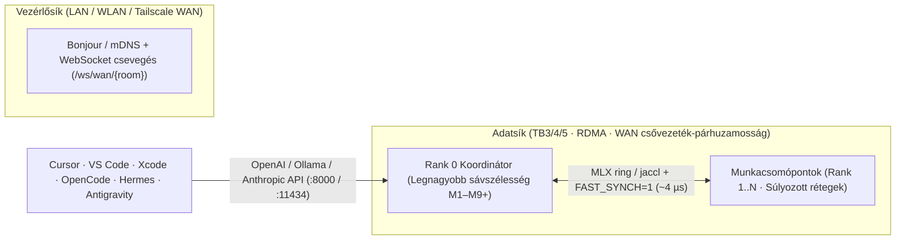

<div align="center">

# ☀️ SonnerStudio Cluster-Case-Companion (SS-CCC)

   **[English](README.md)** ·    **[Deutsch](README.de.md)** ·    **[Français](README.fr.md)** ·    **[Español](README.es.md)**<br/>
  **[Português](README.pt.md)** ·  **[Русский](README.ru.md)** ·  **[日本語](README.ja.md)** ·  **[中文](README.zh.md)**<br/>
  **[Nederlands](README.nl.md)** ·   **[Afrikaans](README.af.md)** ·  **[Polski](README.pl.md)** ·  **[Čeština](README.cs.md)**<br/>
 **[Slovenčina](README.sk.md)** ·  **[Magyar](README.hu.md)** ·  **[한국어](README.ko.md)** ·  **[हिन्दी](README.hi.md)** ·    **[தமிழ்](README.ta.md)**
<br/><a href="https://hits.sh/github.com/SonnerStudio/SonnerStudio-Cluster-Case-Companion/"></a>

*Natív macOS Apple Silicon klaszterkezelő és elosztott MLX-következtető stúdió*

<table>
  <tr>
    <td align="center">
      <br/>
      <sub><b>Klasztermód (52 GB egyesített tár · 2 csomópont)</b></sub>
    </td>
    <td align="center">
      <br/>
      <sub><b>Önálló mód (16 GB helyi · 1 csomópont)</b></sub>
    </td>
  </tr>
</table>

</div>

---

## 🧭 Áttekintés

A **SonnerStudio Cluster-Case-Companion (SS-CCC)** egyesíti bármely **Apple Silicon Mac (M1–M9+)** memóriáját és számítási erejét — egyetlen Mac minitől vagy MacBook Prón át a helyi **Thunderbolt 3/4/5 és RDMA** rendszereken keresztül a **globális internetes WAN klaszterekig (2–256+ Mac)** — natív **MLX**, **oMLX**, **Ollama** és **llama.cpp** támogatással.

<div align="center">
  
</div>

---

## 🌐 Globális internetklaszter, élő csevegés és tudományos Roofline

<table>
  <tr>
    <td align="center" width="50%">
      <br/>
      <sub><b>Globális internetklaszter és résztvevői csevegés</b><br/>Tailscale · WireGuard · libp2p QUIC · DERP · <code>/status</code> · <code>/layers</code> · <code>/ping</code></sub>
    </td>
    <td align="center" width="50%">
      <br/>
      <sub><b>Tudományos Roofline és energiaelemzés</b><br/>Log-Log Roofline · GPipe Bubble · <code>J/token</code> · <code>p50/p95/p99</code> · CSV/JSON/BibTeX</sub>
    </td>
  </tr>
</table>

---

## 🏗️ Hibrid architektúra (Vezérlősík, Thunderbolt és WAN)



---

## 🌐 Internetklaszter WAN-sávszélesség és átviteli figyelő


Az **Internetklaszter és csevegés** modulban az SS-CCC folyamatosan méri a valós WAN-kapcsolat teljesítményét (`netstat`, `ping`, `networkQuality`) — követi a **le-/feltöltési Mbps**-t, a **WAN RTT késleltetést (ms)**, a **jittert**, a **csomagvesztést** és a **token-szinkronizációs hatékonyságot**.

---

## ✨ Fő képességek

- **Univerzális Apple Silicon klaszterezés (M1–M9+):** Kapcsoljon össze bármilyen **Mac mini, MacBook Air/Pro, iMac, Mac Studio vagy Mac Pro** gépet **M1-től M6-ig** és a jövőbeli **M7–M12+** generációkig. A leggyorsabb memóriasávszélességű gép automatikusan **Rank 0 (Koordinátor)** lesz biztonságos `iogpu.wired_limit_mb` macOS-védelemmel.
- **Teljes rendszer- és szenzortelemetria:** Kiolvassa a `sysctl`, `sw_vers`, `system_profiler`, `ibv_devices`, `ipconfig`, `ioreg` és `ProcessInfo.thermalState` adatokat — egymás mellett mutatja a **CPU P/E magokat, GPU magokat, Neural Engine-t (16/32 ANE mag), NVMe SSD-t, hőmérsékletet és teljesítményfelvételt**.
- **Minden Thunderbolt-osztály (TB3 / TB4 / TB5) és RDMA:** Dinamikusan egyezteti a linksebességeket (`TB3/USB4: 26–32 Gbps`, `TB4: 30–37 Gbps`, `TB5: 65–80 Gbps`, `TB5 RDMA: 75–110 Gbps`) az `MLX_METAL_FAST_SYNCH=1` segítségével (45× gyorsabb GPU/CPU szinkron).
- **Élő Modellműhely és futtatókörnyezet-ellenőrzés:** Valódi telepített/futó modelleket keres (**oMLX**, **Ollama**, **llama.cpp**, helyi `.gguf` fájlok és `~/.cache/huggingface/hub`), memória-súlyozott rétegfelosztással és KV-cache kvantálással (`FP16 / 8-bit / 4-bit`).
- **6× egykattintásos ügynök- és IDE-integráció:** Azonnali konfigurációexport az **OpenCode**, **Hermes Agent**, **Google Antigravity**, **Cursor**, **Visual Studio Code** és **Apple Xcode** számára.
- **Globális internetes WAN klaszter és résztvevői csevegés (`/ws/wan/{room_id}`):** Kapcsoljon össze Maceket világszerte titkosított alagutakon (Tailscale / WireGuard, libp2p / DERP P2P vagy kézi végpont).
- **6 lapos tudományos labor és előzményrögzítés:** Váltson **Helyi (TB/RDMA)**, **Internet WAN** és **Egymás melletti összevetés** között 6 lapon: **Roofline**, **WAN topológia és skálázás**, **Memória és KV**, **Energia, CO₂ és költség**, **Kísérletek és export** (`CI₉₅`, `CV%`, `CSV / JSON / LaTeX / BibTeX`) és **Előzményrögzítés**.
- **GitHub-vezérelt programfrissítések és automatikus CI verziókezelés:** Indításkor és 30 percenként (`⌘U`) ellenőrzi a `version.json`, GitHub Releases és `commits/main` SHA értékeket 1-kattintásos újraépítéssel.
- **SonnerStudio Yellow (`#FFD400`), 17 nyelvű kézikönyv, Shorttips és menüsor-szolgáltatómód (`⌘⇧M`):** Teljes felület **17 nyelven** (`EN..TA`), kontextusfüggő **Shorttips** buborékok, **12 fejezetes interaktív kézikönyv**, **25/25 teszt** és **lekicsinyítés a felső menüsorba** háttérszolgáltatásként az IDE-k és ügynökök számára.

### 🖥️ Programmodulok áttekintése (mind a 11 oldalsáv-fül)


| Oldalsáv-fül | Rendeltetés |
| :--- | :--- |
| **1. Klaszter-áttekintés** | Élő memóriakészlet-sáv, aktív M1–M12+ topológia, TB/RDMA sebességek és **4-állapotú készenléti kártya** |
| **2. Eszközök és összevetés** | M1–M12+ Macek hozzáadása/eltávolítása, élő CPU/GPU/ANE/SSD/hő/teljesítmény elemzés |
| **3. Modellműhely** | Élő modellkeresés (oMLX / Ollama / llama.cpp / GGUF), futtatókörnyezet-teszt, arányos rétegek, ANE-Split és 3-szintű KV-cache |
| **4. Hálózat és RDMA** | Váltás Auto-Hibrid / Csak TB / LAN / RDMA között, `FAST_SYNCH=1`, Ring vs. JACCL Full-Mesh TP és TB3/4/5 |
| **5. Internetklaszter és csevegés** | Helyi TB/RDMA Macek összekapcsolása WAN társakkal (QUIC/Iroh 0-RTT, Tailscale), **WAN-sávszélesség** és Audio-Party |
| **6. Többmodelles mód (MMM)** | Több modell összehangolása **Helyi**, **Internet-WAN** vagy **Hibrid** módban **párhuzamos multi-IDE kiszolgálással** (`:8000/v1`) |
| **7. Ügynökök és IDE-k** | 1-kattintásos beállítás és másolható fájlok (**MCP Registry JSON** és **A2A Agent Card**) 6 IDE-hez és ügynökhöz |
| **8. Tudomány és Roofline** | 6 lapos kutatólabor valódi SSE/ICMP RTT-vel, közvetlen MMM-kiértékeléssel, Roofline-nal, `N=1..128`, `J/tok` / `CO₂` és előzményekkel |
| **9. API és konzol** | OpenAI (`/v1/chat/completions`, `/v1/responses` + MCP) és Ollama (`/api/tags`) végpontok tesztelése, **A2A Agent Card** |
| **10. Telepítés és előkészítés** | Helyi TB/LAN és WAN Macek automatikus felderítése, SSH/`wired_limit` beállítása és **üzemkészség ellenőrzése** |
| **11. Súgó és kézikönyv** | Kereshető **12 fejezetes, 17 nyelvű kézikönyv** (`⌘?`) interaktív ábrákkal és fénykiemelésekkel |

---

## 🛠️ Fordítás forráskódból (fontos az első indítás előtt)

> [!NOTE]
> Ez a tároló az SS-CCC **Swift forráskódját** tartalmazza (előre fordított `.app` binárist nem szállít). Indítás előtt fordítsa le helyben az Apple Silicon Macjén.

### Előfeltételek
- Bármely Apple Silicon Mac (**M1–M6+**) **macOS 14.0 vagy újabb** rendszerrel
- **Xcode Command Line Tools** (`swiftc` és macOS SDK):
  ```bash
  xcode-select --install
  ```

### Lépésről lépésre: a tárolótól a működő alkalmazásig
```bash
# 1. Tároló klónozása
git clone https://github.com/SonnerStudio/SonnerStudio-Cluster-Case-Companion.git
cd SonnerStudio-Cluster-Case-Companion

# 2. Futtatási jog adása a szkriptnek (egyszer)
chmod +x scripts/run_ssccc.sh

# 3. Swift források lefordítása a /tmp/SSCCCApp alá és indítás
./scripts/run_ssccc.sh
```
*(Opcionálisan Swift Package Managerrel is fordítható: `cd app && swift build -c release`.)*

---

## 🚀 Gyorsindítás

```bash
# 1. A natív SwiftUI Studio alkalmazás indítása
"./scripts/run_ssccc.sh"

# 2. (Opcionális) A Python/FastAPI átjáró indítása
cd core && uv sync --extra dev
PYTHONPATH=".." uv run uvicorn core.api.gateway:app --host 0.0.0.0 --port 8000

# 3. Thunderbolt pont-pont IP-címek beállítása
./scripts/setup_tb_network.sh studio   # 10.99.1.1
./scripts/setup_tb_network.sh mini     # 10.99.1.2
```

---

## 📖 Üzemeltetési útmutató: helyi és hibrid klaszter, modellbetöltés és méretezés

### 1. A helyi klaszter beállítása (Thunderbolt 3/4/5 és LAN)
1. **Fizikai összeköttetés:** Kösse össze a Maceket **Thunderbolt 3/4/5 kábelekkel** és/vagy **10GbE Ethernettel**.
2. **IP-címek kiosztása:** Futtassa a `./scripts/setup_tb_network.sh studio` (`10.99.1.1`) parancsot a fő gépen és a `mini` opciót a többin.
3. **Opcionális RDMA (macOS 26.2+ TB5-ön):** Kapcsolja be az Apple RDMA-t (`rdma_ctl enable`), így a `JACCL` **`~3 µs`** késleltetést ér el `~300 µs` helyett.
4. **Automatikus rangsorolás:** Vegye fel a gépeket az **Eszközök és összevetés** lapon. A `MemoryWeightedPlanner` automatikusan kijelöli a **Rank 0 (Koordinátor)** gépet.

### 2. Hibrid klaszterhálózat beállítása (Helyi + Internet WAN egyszerre)
1. **Helyi gyors mag (1. szint):** Tartsa aktívan a helyi TB/LAN gyűrűt a késleltetésre érzékeny rétegekhez.
2. **WAN koordinátori szoba (2. szint):** Az **Internetklaszter és csevegés** lapon indítson WAN-szobát (`/ws/wan/{room_id}`, port `8000`).
3. **Távoli munkások csatlakozása:** A világ bármely pontjáról csatlakozhatnak a **Szobakód + token** segítségével.
4. **Kétszintű hibrid irányítás:** A gyakori rétegek a helyi gyűrűn maradnak, a többlet pedig mikrokötegeléssel (`M ≥ 4`) megy a WAN-ra.

### 3. Ki tölti be a modellt, hány modell fér el és a kérések útja
- **Ki mit tölt be?**
  - **Koordinátor (Rank 0):** Futattja az API-átjárót (`:8000`), tokenizál, és **mindig tárolja az Embeddings és LM-Head rétegeket** plusz a saját részét.
  - **Munkacsomópontok (Rank 1..N):** Minden munkás **kizárólag a saját `[start_layer .. end_layer)` rétegszeletét** olvassa be — nulla pazarolt RAM.
- **Hány modell tartható egyszerre memóriában?**
  - **Elosztott klasztermód (`mlx.distributed` / `JACCL`):** **1 nagy felosztott modell** az egyesített memóriakészletben.
  - **Többmodelles kiszolgálás (`oMLX` / `Ollama` / MMM):** Amíg `Σ (Súlyok_i + KV_i) ≤ Használható_VRAM_GB`, addig **több modell párhuzamosan** futhat.
- **Végponttól végpontig terjedő végrehajtás:**
  1. **Felderítés és linkválasztás:** Felismeri a RAM-ot és interfészeket (`TB5 RDMA > TB > 10GbE > WLAN > WAN`).
  2. **Felosztási terv:** A `MemoryWeightedPlanner` kiírja a `hostfile.json`-t az `iogpu.wired_limit_mb` betartásával.
  3. **API-belépés:** Az ügynökök/IDE-k a `http://127.0.0.1:8000/v1/chat/completions` címre küldik a kéréseket.
  4. **Prefill fázis (`TTFT`):** A Rank 0 beágyazza a promptot és továbbítja az aktivációkat a csővezetéken.
  5. **Decode fázis (`TPOT` és `tok/s`):** Token-generálás `--kv-bits 4` és `MLX_METAL_FAST_SYNCH=1` mellett.
  6. **SSE stream és telemetria:** A Rank 0 streameli a tokeneket és naplózza a `tok/s`, `TTFT`, `TPOT`, `J/tok` értékeket.

### 4. Elméleti méretezés és teljesítményadatok

> **Analitikus becslési szabályok:**
> - **Memóriaigény:** `VRAM_GB ≈ Params_B × (Bits / 8) × 1.15 + KV_Cache_GB`
> - **Elméleti dekódolási határ:** `tok/s ≈ (Effective_Bandwidth_GB/s / Active_Weights_GB) × (1 − Comm_Overhead)`

| Felhasználási eset | Topológia és használható memória | Modell és kvantálás | Elméleti `TTFT` (2k) | Elméleti dekódolás (`tok/s`) | Energia és szűk keresztmetszet |
| :--- | :--- | :--- | :--- | :--- | :--- |
| **1. Önálló munkaállomás** | 1× Mac mini M4 (16 GB, `12 GB`, `120 GB/s`) | `Qwen2.5-14B` (`4-bit`, ~8,8 GB) | `~1,8 – 2,6 s` | **`11 – 14 tok/s`** (`~75 ms/tok`) | `~1,7 J/tok` · Memóriasávszélesség |
| **2. Egyetlen Pro Studio** | 1× Mac Studio M4 Max (64 GB, `58 GB`, `546 GB/s`) | `Llama-3.3-70B` (`4-bit`, ~40 GB) | `~1,1 – 1,7 s` | **`12 – 14 tok/s`** (`~74 ms/tok`) | `~3,8 J/tok` · Memóriasávszélesség |
| **3. Helyi 2 csomópontos TB5 gyűrű** | 2× M4 Max 64 GB (`116 GB`, `~1092 GB/s`, `~3 µs`) | `Qwen2.5-Coder-72B` (`8-bit`, ~78 GB) | `~1,4 – 2,0 s` | **`12 – 14 tok/s`** (`~76 ms/tok`) | `~7,5 J/tok` · Elhanyagolható RDMA |
| **4. Kutatólabor 4× Ultra gyűrű** | 4× M3 Ultra 256 GB (`992 GB`, `~3,27 TB/s`, TB5 RDMA) | `DeepSeek-V3 671B MoE` (`4-bit`, ~385 GB) | `~2,2 – 3,5 s` | **`38 – 55 tok/s`** (`~20 ms/tok`) | `~5,2 J/tok` · Aktív MoE szakértők |
| **5. Hibrid Irodai LAN + Otthoni WAN** | 2× TB4 + 2× WAN (`192 GB`, `35 ms` RTT) | `Llama-3.1-405B` (`3/4-bit`, ~170 GB) | `~6 – 11 s` | **`2,2 – 4,5 tok/s`** (`~280 ms/tok`) | `~28 J/tok` · WAN RTT (`M=8`) |
| **6. Globális közösségi WAN raj** | 16+ Mac világszerte (`1,5+ TB`, `60–120 ms` RTT) | `671B–1T+` Frontier (`4/8-bit`) | `~12 – 25 s` | **`1,2 – 3,0 tok/s`** (`~500 ms/tok`) | WAN késleltetés (kötegelés segít) |

---

## 📚 Kiválasztott dokumentáció (a program súgójába építve)

### 1. Univerzális Apple Silicon M-sorozatú klaszterezés (M1–M12+)
Az SS-CCC **minden Apple Silicon M-chipes Macet** támogat (**M1–M6** és nyitott **M7–M12+**) a **Mac mini, MacBook Air/Pro, iMac, Mac Studio és Mac Pro** családból.

| Mac / Chipcsalád | Memóriasávszélesség | Thunderbolt és RDMA | Ajánlott macOS tartalék |
| :--- | :--- | :--- | :--- |
| **M1 / M2** (Base) | 68 – 100 GB/s | TB 3 / USB4 (26–32 Gbps) | **4 GB** (≤ 24 GB RAM) |
| **M3 / M4** (Base) | 100 – 120 GB/s | TB 4 (30–37 Gbps) | **4 GB** (≤ 24 GB RAM) |
| **M5 / M6** (Base, M6 2nm) | **153 – 170 GB/s** (`M6`: 153 GB/s @ 16 GB, 170 GB/s @ 24–32 GB) | TB 4 / TB 5 (`80/120 Gbps`) | **4 GB** (≤ 32 GB RAM) |
| **M1–M3 Pro** | 150 – 200 GB/s | TB 4 (30–37 Gbps) | **4 – 6 GB** |
| **M4 / M5 Pro** | 273 – 307+ GB/s | TB 5 (`80/120 Gbps` boost) | **4 – 6 GB** |
| **M1–M3 Max** | 400 GB/s | TB 4 (30–37 Gbps) | **6 GB** (32–64 GB RAM) |
| **M4 Max** | **410 – 546 GB/s** (LPDDR5X-8533) | TB 5 + RDMA (`~3 µs`) | **6 GB** (32–128 GB RAM) |
| **M5 Max** | **460 – 614 GB/s** (32/40-magos GPU) | TB 5 + RDMA (`~3 µs` JACCL) | **6 GB** (36–128 GB RAM) |
| **M1–M2 Ultra / M3 Ultra** | **800 – 819 GB/s** (UltraFusion) | TB 4 / TB 5 RDMA (JACCL) | **8 GB** (≥ 96 GB RAM) |
| **M5 Ultra** | **1,2 TB/s** (~1 228 GB/s, akár 512 GB RAM, 80-magos GPU) | TB 5 RDMA (`JACCL`) | **8 GB** (96–512 GB RAM) |

> [!NOTE]
> **M6 elérhetőség:** Az Apple 2026 szept./okt. hónapban adta ki az alap 2nm-es **M6** chipet; az **M6 Pro, Max és Ultra** 2026 novemberében még nem jelent meg. Az SS-CCC automatikusan felismeri a jövőbeli M6–M12+ modelleket is.

### 2. Thunderbolt 5 RDMA (`JACCL`) és memóriabiztonság


- **macOS RDMA Thunderbolt 5 felett:** Az `rdma_ctl enable` és `JACCL` segítségével a késleltetés `~300 µs`-ról **`~3 µs`**-ra csökken **`3,5–3,8 GB/s`** átvitellel.
- **Soha ne osszon ki 100% RAM-ot:** Az SS-CCC betartatja az `iogpu.wired_limit_mb` védelmi tartalékot.
- **Arányos rétegfelosztás:** Minden Mac a használható memóriája arányában kap rétegeket.
- **KV-cache és gyors Metal szinkron:** A `--kv-bits 4` és `MLX_METAL_FAST_SYNCH=1` **45×** gyorsítja a szinkront.

---

## 🔄 GitHub-vezérelt frissítések és automatikus CI verziókezelés


Az SS-CCC beépített **GitHub-alapú frissítési csatornát** tartalmaz, hogy minden telepítés naprakész maradjon:

1. **Többforrású GitHub verzió-feloldás:**
   - `raw.githubusercontent.com/.../main/version.json` (élő kiadási jegyzék)
   - `api.github.com/repos/.../releases/latest` (hivatalos GitHub kiadások)
   - `api.github.com/repos/.../commits/main` (legfrissebb `main` rövid SHA)
2. **Alkalmazáson belüli frissítés (`UpdatePromptSheet`) és 1-kattintásos újraépítés:**
   - Újabb verzió vagy SHA észlelésekor felvillan a **Frissítés gomb** (`⌘U`).
   - **Forrástelepítések:** Lefuttatja a `git pull` + fordítás folyamatot és egykattintásos újraindítást kínál.
   - **Csomagolt `.app`:** Megnyitja a letöltést Safariban.
3. **Automatizált CI verzióléptetés (`.github/workflows/auto-version-control.yml`):**
   - Minden `main` push lefuttatja a `scripts/bump_version.py`-t, a 25 tesztet és frissíti a `vX.Y.Z` címkéket.

---

## 🧠 Többmodelles mód (MMM) — Egységes hangszerelés és több-IDE használat


A **Többmodelles mód (MMM)** több AI-modellt hangol össze egyszerre **Helyi**, **Internet-WAN** vagy **Hibrid** klaszterben.

### 4 Hangszerelési stratégia
1. **Párhuzamos többmodelles készlet:** Több specializált modell párhuzamos memóriában tartása.
2. **Mixture-of-Agents (MoA):** Ugyanazt a promptot specialistáknak küldi, majd `Aggregator` összegzi.
3. **Spekulatív dekódolás (Draft + Target):** Gyors `Draft` + nagy `Target` párosítás ($1,6\times$–$2,3\times$ gyorsítás).
4. **Szekvenciális modell-csővezeték:** Szakaszok láncolása (*Tervező → Kódoló → Ellenőr*).

### ⚙️ 1-kattintásos Auto-beállítás és utólagos élő szerkesztő


Minden slot bármikor testreszabható:
- **Auto-Setup profilok:** **Coding & IDE Swarm**, **Consensus & Audit**, **Turbo (Draft + Target)** és **Szakasz-csővezeték**.
- **Utólagos testreszabás:** Sorrend, másolás, ki/be kapcsolás, URL-szerkesztés (`:8000/v1`, `:11434/v1`).
- **VRAM-Fit optimalizáló és mentés:** 1 kattintással illeszt és JSON-be ment.

### Közös több-IDE és ügynök-hozzáférés (`:8000/v1`)
Több IDE (**Cursor**, **VS Code**, **Xcode**, **OpenCode**, **Hermes Agent**, **Antigravity**) használhatja egyszerre a klasztert a `:8000/v1` porton.

### Gyakorlati MMM felhasználási esetek
- **Több IDE egyszerre:** Cursor, OpenCode és Hermes újratöltés nélkül párhuzamosan.
- **Spekulatív turbó:** 16 GB Mac mini mint Draft, Mac Studio mint 70B+ Target.
- **MoA kódellenőrzés:** Kódoló, matematikai és aggregáló modell együtt.
- **Hibrid specializáció:** Gyors kiegészítés TB-n, nehéz 405B feladatok WAN-on.
- **Automatizált CI csővezetékek:** *Tervezés → Kódolás → Biztonsági audit*.
- **Tudományos mérések:** Minden MMM futás táplálja a `Tudomány és Roofline` panelt.

---

## 🎙️ Klaszter Audio-Party és élő WAN együttműködés


- **Konzol stílusú hangkoordináció:** Natív `AVAudioEngine` (`16 kHz PCM16`) a `/ws/wan-audio` végponton.
- **Taktikai vezérlés:** **Push-to-Talk** / **Nyitott mikrofon**, némítás, jelszintmérők és szerepek.
- **Valós idejű szobaszinkron (`/ws/wan/{room_id}`):** Szinkronizálja az `SSCCC-WAN-…` meghívókat és a csevegést.

---

## 🏆 Globális + helyi hibrid szuperklaszter rekordkísérlet


**Fel tudja venni a versenyt az Apple Silicon Macek decentralizált szövetsége egy adatközponti szuperszámítógéppel?**  
Egyetemeket, kutatólaborokat és fejlesztői közösségeket hívunk hivatalos **SS-CCC Hibrid Rekordkísérletre**.

### 🔬 Tudományos háttér és matematikai skálázási modell

1. **Kétszintű hierarchikus topológia (0. szintű TB szigetek + 1. szintű WAN gerincháló):**
   - A lapos WAN klasztereknél minden rétegátmenet interneten megy ($H_{\text{WAN}} = N - 1$).
   - A **Hibrid híddal** az egymást követő rétegek helyi TB-n maradnak (`~0,07 ms`), és csak szigetváltáskor használnak WAN-t.
2. **WAN RTT csillapítás kritikus mikrokötegeléssel ($B^*$) és tömörítéssel:**
   - A csővezeték hatékonyságát a GPipe buboréktörvény adja meg:
     $$\Phi_{\text{bubble}} = \frac{N - 1}{M + N - 1}, \qquad B^* = \left\lceil \frac{T_{\text{RTT,WAN}} + T_{\text{tx}}}{T_{\text{comp}}(B=1)} \right\rceil$$
   - Az $M \to B^*$ elrejti a kontinentális késleltetést, míg az **FP8 / INT4 / Top-K** (*Petals / SWARM*) $1\%$ alatt tartja a többletforgalmat.
3. **Szabványosított, reprodukálható rekordprotokoll ($T = 0,0$):**
   1. **Alakítson 0. szintű szigeteket:** Kösse össze a helyi Maceket Thunderbolton (`MLX_METAL_FAST_SYNCH=1`).
   2. **Híd és koordináció:** Ossza meg az `SSCCC-WAN-…` kódot az Audio-Partyban.
   3. **Futtasson kísérleteket:** Válasszon `N = 20` mérést (`temperature = 0.0`, `TTFT ≤ 2500 ms`, `TPOT ≤ 100 ms/tok`).
   4. **Archiválja az igazolást:** Exportálja a **JSON Manifest**, **CSV napló** és **LaTeX táblázat** fájlokat.


### 🥇 Hivatalos rekordkategóriák
- **Legnagyobb egyesített memóriatár:** Legmagasabb használható VRAM (`GB` / `TB`).
- **Legtöbb egyszerre összekapcsolt Mac ($N$):** Legnagyobb aktív háló (`32–256+`).
- **Legnagyobb interkontinentális Goodput:** Legmagasabb `tokens/s` SLO-n belül $\ge 2$ kontinensen.
- **Legjobb energiahatékonyság:** Legalacsonyabb `J/token` és `EDP` `70B+` modellnél.

---

## 🎯 Felhasználási területek és célközönség


| Felhasználói csoport | Gyakorlati használat az SS-CCC-vel |
| :--- | :--- |
| **AI-rendszerkutatók** | Roofline korlátok, *Petals/SWARM*, *DiLoCo* vizsgálata és `CI₉₅` + `LaTeX`/`BibTeX` export. |
| **Egyetemek és oktatólaborok** | Hallgatói MacBookok és labor Mac minik összefogása közös 70B–405B+ klaszterről. |
| **Szoftverstúdiók és ügynökcsapatok** | Privát kódoló modellek felhőköltség nélkül az OpenCode, Hermes, Antigravity, Cursor, VS Code és Xcode alá. |
| **Adatvédelem-központú jog és orvoslás** | Érzékeny adatok 100%-ban helyben vagy titkosított WireGuard/Tailscale alagútban. |
| **Globális open-source hackathonok** | Határokon átívelő szuperklaszterek percek alatt hangos egyeztetéssel. |
| **Green-AI és fenntarthatósági audit** | `J/token`, `EDP` és `gCO₂eq/1M token` mérése adatközpontokkal szemben. |

---

## 📁 Tároló szerkezete

```text
├── app/Sources/
│   ├── SSCCCApp.swift              # Főablak, MenuBarExtra háttérszolgáltatás és frissítési panel
│   ├── Models/
│   │   ├── ClusterModels.swift     # M1–M12+ következtetés, WAN/Tudomány/Előzmény és kiadási modellek
│   │   └── Localization.swift      # Teljes 17 nyelvű UI- és súgószótár (EN..TA)
│   ├── ViewModels/
│   │   └── ClusterViewModel.swift  # Hardverfelderítés, modellkeresés, WAN/Audio-Party és GitHub frissítő
│   └── Views/                      # 12 moduláris SwiftUI nézet + Theme.swift (11 fül, vészcsíkok és Shorttips)
├── core/                           # Python FastAPI átjáró, WebSocket WAN/Audio relék és MLX felosztás
├── scripts/
│   ├── run_ssccc.sh                # Lefordítja és elindítja a macOS alkalmazást
│   ├── bump_version.py             # Szinkronizálja a version.json-t és a ClusterModels.swift-et a Gittel
│   ├── setup_tb_network.sh         # Beállítja a 10.99.1.x Thunderbolt hidat
│   └── setup_wired_limit.sh        # Alkalmazza a biztonságos iogpu.wired_limit_mb korlátokat
├── tests/                          # 25 részből álló globális ellenőrző tesztcsomag (Swift + Python)
├── .github/workflows/              # Automatizált CI verziókövetés és címkézés
└── version.json                    # GitHubon tárolt frissítésvezérlő jegyzék
```

---

## 🚀 2026 SOTA architektúra-frissítés (11. fázis)

- **TB5 RDMA Tensor Parallelism és QUIC / Iroh WAN:** Váltás **Pipeline Ring** / **JACCL Full-Mesh TP** között és **QUIC / Iroh P2P (0-RTT)**.
- **ANE-Split és 3-szintű KV-cache / CacheGen:** Prefill átadása az Apple Neural Engine-nek (`EDP ×1,42`, `-31,5%` teljesítmény) `3,6×` tömörítéssel.
- **Új generációs MMM:** **EAGLE-3**, **Tree-MoA Early-Exit** és adaptív **Ares** útválasztó.
- **Modern ügynökszabványok:** **OpenAI `/v1/responses`**, **MCP Registry JSON** és **A2A Agent Cards**.
- **Hő- és szén-dioxid-tudatos ütemezés:** Automatikusan tehermentesíti a melegedő csomópontokat.

### 🛠️ 12. fázis: Automatikus klaszterbeállítás, készenléti ellenőrzés és Shorttips


- **11. oldalsáv-kategória (`Telepítés és előkészítés`):** Automatikusan megtalálja a helyi és WAN gépeket és beállítja az SSH-t.
- **4-állapotú készenléti ciklus:** **Kész**, **Nincs kész**, **Részben beállítva** vagy **Nincs beállítva** mind a 17 nyelven.
- **Alkalmazásszintű Shorttips:** Rövid magyarázatok `.help` buborékkal és **Solaris Shorttip Bannerrel**.
- **Interaktív súgó és élő adatok:** Mind a 12 fejezet ábrákkal nyílik meg és 100% valódi adatot használ szimuláción kívül.

### 🛰️ Lekicsinyítés a felső menüsorba (Háttérszolgáltatás ügynököknek és IDE-knek, ⌘⇧M)

- **Zökkenőmentes áthelyezés a felső macOS menüsorba:** Kattintson az ablak sárga kis méret gombjára, nyomja meg a **`⌘⇧M`**-et vagy válassza a fejléc **A menüsorba** gombját — a főablak elrejtőzik, az SS-CCC pedig halkan fut tovább az **Ollama** mellett (`.accessory` mód).
- **Beszédes élő mutatók a menüsorban:** Az ikon és a felugró panel azonnal mutatja a **Készenléti állapotot**, a **Teljes és használható RAM-ot (GB)**, az **Aktív csomópontokat**, a **Betöltött modellt és rétegeket**, a **Futtatókörnyezetet** és az **MMM slotokat**.
- **1-kattintásos végpontok és IDE lista:** Másolja a **`http://127.0.0.1:8000/v1`** (OpenAI/MMM) vagy **`http://127.0.0.1:11434`** (Ollama) címet közvetlenül a menüsorból a Cursor, OpenCode, Hermes, Antigravity, VS Code és Xcode részére.
- **Azonnali visszaállítás:** A teljes stúdióablak bármikor visszahívható a menüsorból (`⌘⇧M`), vagy ki-/bekapcsolható az automatikus lekicsinyítés.

---

## 🚧 Fejlesztési állapot és közreműködés

> [!IMPORTANT]
> **Az SS-CCC v1.6+ teljes mértékben futtatható és `25/25` automatizált teszttel ellenőrzött.**
> **Már megvalósítva:** Angol alapértelmezett indítás **teljes 17 nyelvű lokalizációval (`EN..TA`)**, **CPU, GPU és Neural Engine (ANE) magok kiolvasása**, **menüsor-háttérszolgáltató mód (`⌘⇧M`)**, **látogatószámláló mind a 17 README-ben**, nyitott M1–M12+ felismerés, 6 lapos kutatólabor, Audio-Party és GitHub-frissítő.

Szívesen látjuk fejlesztők, kutatók és Apple Silicon-rajongók **hozzájárulásait az SS-CCC-hez**:
- **Tesztelje saját hardverén:** Ossza meg M1–M12+ sebesség- és RDMA/JACCL tapasztalatait.
- **Csatlakozzon a rekordkísérlethez:** Kapcsoljon össze helyi TB-szigeteket WAN csomópontokkal.
- **Küldjön Pull Requesteket:** SwiftUI, MLX, szkriptek vagy fordítások fejlesztése mindig szívesen fogadott!

---

## 📄 Licenc

Közzétéve a [MIT-licenc](LICENSE.md) alatt.
