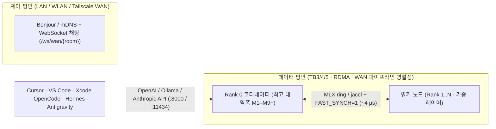
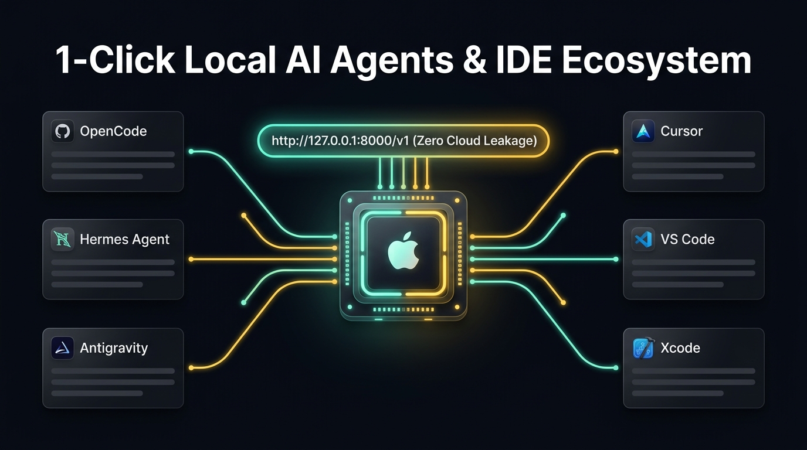
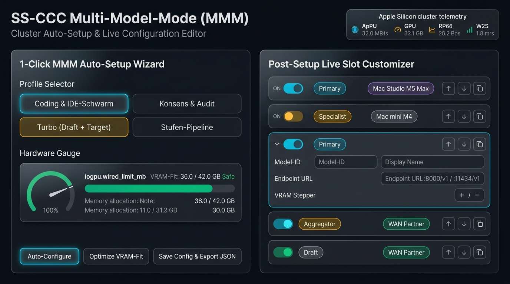

<div align="center">

# ☀️ SonnerStudio Cluster-Case-Companion (SS-CCC)

   **[English](README.md)** ·    **[Deutsch](README.de.md)** ·    **[Français](README.fr.md)** ·    **[Español](README.es.md)**<br/>
  **[Português](README.pt.md)** ·  **[Русский](README.ru.md)** ·  **[日本語](README.ja.md)** ·  **[中文](README.zh.md)**<br/>
  **[Nederlands](README.nl.md)** ·   **[Afrikaans](README.af.md)** ·  **[Polski](README.pl.md)** ·  **[Čeština](README.cs.md)**<br/>
 **[Slovenčina](README.sk.md)** ·  **[Magyar](README.hu.md)** ·  **[한국어](README.ko.md)** ·  **[हिन्दी](README.hi.md)** ·    **[தமிழ்](README.ta.md)**
<br/><a href="https://hits.sh/github.com/SonnerStudio/SonnerStudio-Cluster-Case-Companion/"></a>

*네이티브 macOS Apple Silicon 클러스터 관리자 및 분산 MLX 추론 스튜디오*

<table>
  <tr>
    <td align="center">
      <br/>
      <sub><b>클러스터 모드 (52 GB 통합 메모리 풀 · 2개 노드)</b></sub>
    </td>
    <td align="center">
      <br/>
      <sub><b>단독 모드 (16 GB 로컬 · 1개 노드)</b></sub>
    </td>
  </tr>
</table>

</div>

---

## 🧭 개요

**SonnerStudio Cluster-Case-Companion (SS-CCC)**은 단일 Mac mini나 MacBook Pro부터 다중 **Thunderbolt 3/4/5 및 RDMA** 데스크 클러스터, **글로벌 인터넷 WAN 클러스터(2–256+대 Mac)**에 이르기까지 모든 **Apple Silicon Mac(M1–M9+)**의 메모리와 연산력을 통합하며 **MLX**, **oMLX**, **Ollama**, **llama.cpp**를 기본 지원합니다.

<div align="center">
  
</div>

---

## 🌐 글로벌 인터넷 클러스터, 실시간 채팅 및 과학 Roofline 분석

<table>
  <tr>
    <td align="center" width="50%">
      <br/>
      <sub><b>글로벌 인터넷 클러스터 및 참가자 채팅</b><br/>Tailscale · WireGuard · libp2p QUIC · DERP · <code>/status</code> · <code>/layers</code> · <code>/ping</code></sub>
    </td>
    <td align="center" width="50%">
      <br/>
      <sub><b>과학적 Roofline 및 에너지 분석</b><br/>Log-Log Roofline · GPipe Bubble · <code>J/token</code> · <code>p50/p95/p99</code> · CSV/JSON/BibTeX</sub>
    </td>
  </tr>
</table>

---

## 🏗️ 하이브리드 아키텍처 (제어 평면, Thunderbolt 및 WAN)



---

## 🌐 인터넷 클러스터 WAN 대역폭 및 처리량 모니터


**인터넷 클러스터 및 채팅**에서 SS-CCC는 실제 WAN 회선 성능(`netstat`, `ping`, `networkQuality`)을 지속적으로 측정하여 **다운링크 / 업링크 Mbps**, **WAN RTT 지연 시간(ms)**, **지터**, **패킷 손실** 및 **토큰 동기화 효율**을 파트너 노드의 분산 `tok/s`와 즉시 연결합니다.

---

## ✨ 핵심 기능

- **범용 Apple Silicon 클러스터링 (M1–M9+):** **M1–M6** 및 향후 **M7–M12+** 세대의 모든 **Mac mini, MacBook Air/Pro, iMac, Mac Studio, Mac Pro**를 연결합니다. 메모리 대역폭이 가장 높은 노드가 자동으로 **Rank 0 (코디네이터)**가 되며 안전한 `iogpu.wired_limit_mb` macOS 예약 메모리를 유지합니다.
- **전체 시스템 및 센서 텔레메트리:** `sysctl`, `sw_vers`, `system_profiler`, `ibv_devices`, `ipconfig`, `ioreg`, `ProcessInfo.thermalState`를 읽어 **CPU P/E 코어, GPU 코어, Neural Engine(16/32 ANE 코어), NVMe SSD 용량, 발열 상태 및 소비 전력**을 나란히 표시합니다.
- **모든 Thunderbolt 등급 (TB3 / TB4 / TB5) 및 RDMA:** M1–M9+ 간 링크 속도(`TB3/USB4: 26–32 Gbps`, `TB4: 30–37 Gbps`, `TB5: 65–80 Gbps`, `TB5 RDMA: 75–110 Gbps`)를 동적으로 협상하며 `MLX_METAL_FAST_SYNCH=1`로 GPU/CPU 동기화를 45배 가속합니다.
- **라이브 모델 스튜디오 및 런타임 준비 점검:** **oMLX**, **Ollama**, **llama.cpp**, 로컬 `.gguf` 파일 및 `~/.cache/huggingface/hub`에서 실제 설치·실행 중인 모델을 탐색하고 가중치 기반 레이어 분할과 KV 캐시 양자화(`FP16 / 8-bit / 4-bit`)를 제공합니다.
- **6종 에이전트 및 IDE 원클릭 연동:** **OpenCode**, **Hermes Agent**, **Google Antigravity**, **Cursor**, **Visual Studio Code**, **Apple Xcode**용 설정을 즉시 내보냅니다.
- **글로벌 WAN 클러스터 및 참가자 채팅 (`/ws/wan/{room_id}`):** 암호화된 터널(Tailscale / WireGuard, libp2p / DERP P2P 또는 수동 엔드포인트)을 통해 전 세계 Apple Silicon Mac을 연결하고 실시간 채팅으로 협업합니다.
- **6탭 과학 연구실 및 히스토리 기록:** **로컬(TB/RDMA)**, **인터넷 WAN**, **직접 비교** 모드를 전환하며 **Roofline 및 병목**, **WAN 토폴로지 및 확장성**, **메모리 및 KV**, **에너지·CO₂·비용**, **실험·통계·내보내기**(`CI₉₅`, `CV%`, `CSV / JSON / LaTeX / BibTeX`), **히스토리 기록**을 수행합니다.
- **GitHub 제어 프로그램 업데이트 및 자동 CI 버전 관리:** 시작 시 및 30분마다(`⌘U`) `version.json`, GitHub Releases, `commits/main` SHA를 자동 확인해 1클릭 `git pull` + 빌드 + 재시작을 제공합니다.
- **SonnerStudio Yellow (`#FFD400`) UI, 17개 언어 매뉴얼, Shorttips 및 메뉴 막대 백그라운드 모드 (`⌘⇧M`):** **17개 언어**(`EN..TA`) 완전 번역, **앱 전체 마우스 Shorttips**, **12장 대화형 도움말**, **25/25 자동 테스트** 및 **상단 메뉴 막대 최소화** 기능을 제공합니다.

### 🖥️ 프로그램 모듈 한눈에 보기 (11개 사이드바 탭 전체)



| 사이드바 탭 | 주요 기능 |
| :--- | :--- |
| **1. 클러스터 개요** | 실시간 메모리 풀 막대, 활성 M1–M12+ 토폴로지, TB/RDMA 대역폭 및 **4단계 준비 상태 카드** |
| **2. 기기 및 비교** | M1–M12+ Mac 추가/제거, 실시간 CPU/GPU/ANE/SSD/온도/전력 조회 및 막대 비교 |
| **3. 모델 스튜디오** | oMLX / Ollama / llama.cpp / GGUF 실시간 탐색, 런타임 점검, 비례 레이어 분할, ANE-Split 및 3계층 KV 캐시 |
| **4. 네트워크 및 RDMA** | Auto-Hybrid / TB 전용 / LAN / RDMA 전환, `FAST_SYNCH=1`, Pipeline Ring vs JACCL Full-Mesh TP 및 TB3/4/5 등급 |
| **5. 인터넷 클러스터 및 채팅** | 로컬 TB/RDMA와 WAN 피어 연결(QUIC/Iroh 0-RTT, Tailscale), **WAN 대역폭 모니터** 및 Audio-Party |
| **6. 멀티 모델 모드 (MMM)** | **로컬**, **인터넷 WAN**, **하이브리드**에서 다중 모델 결합 및 **다중 IDE 동시 사용**(`:8000/v1`) |
| **7. 에이전트 및 IDE** | 6종 IDE 및 에이전트용 원클릭 설정 및 복사 가능한 파일(**MCP Registry JSON**, **A2A Agent Card** 포함) |
| **8. 과학 분석 및 Roofline** | 실제 SSE/ICMP RTT 기반 6탭 연구실, 직접 MMM 평가, Log-Log Roofline, `N=1..128`, `J/tok` / `CO₂` 및 히스토리 |
| **9. API 및 콘솔** | OpenAI(`/v1/chat/completions`, `/v1/responses` + MCP), Ollama(`/api/tags`) 및 **A2A Agent Card** 테스트 |
| **10. 설정 및 프로비저닝** | 로컬 TB/LAN 및 WAN Mac 자동 탐색, SSH 신뢰·`wired_limit` 배포 및 **운영 준비 상태 검증** |
| **11. 도움말 및 설명서** | 검색 가능한 **12장 17개 언어 대화형 매뉴얼** (`⌘?`) (상세 도해 및 발광 강조 포함) |

---

## 🛠️ 소스에서 빌드하기 (첫 실행 전 필수)

> [!NOTE]
> 이 저장소에는 SS-CCC의 **Swift 소스 코드**가 포함되어 있으며 사전 컴파일된 `.app` 바이너리는 제공되지 않습니다. Apple Silicon Mac에서 먼저 로컬로 컴파일하세요.

### 사전 요구 사항
- **macOS 14.0 이상**이 설치된 모든 Apple Silicon Mac (**M1–M6+**)
- **Xcode Command Line Tools** (`swiftc` 및 macOS SDK 포함):
  ```bash
  xcode-select --install
  ```

### 단계별 안내: 저장소에서 실행 가능한 앱까지
```bash
# 1. 저장소 복제
git clone https://github.com/SonnerStudio/SonnerStudio-Cluster-Case-Companion.git
cd SonnerStudio-Cluster-Case-Companion

# 2. 빌드 및 실행 스크립트에 실행 권한 부여 (최초 1회)
chmod +x scripts/run_ssccc.sh

# 3. 모든 Swift 소스를 /tmp/SSCCCApp으로 컴파일하고 앱 실행
./scripts/run_ssccc.sh
```
*(선택 사항: Swift Package Manager로 `cd app && swift build -c release` 명령으로도 빌드할 수 있습니다.)*

---

## 🚀 빠른 시작

```bash
# 1. 네이티브 SwiftUI Studio 앱 실행
"./scripts/run_ssccc.sh"

# 2. (선택) Python/FastAPI 게이트웨이 실행
cd core && uv sync --extra dev
PYTHONPATH=".." uv run uvicorn core.api.gateway:app --host 0.0.0.0 --port 8000

# 3. Thunderbolt P2P IP 주소 구성
./scripts/setup_tb_network.sh studio   # 10.99.1.1
./scripts/setup_tb_network.sh mini     # 10.99.1.2
```

---

## 📖 운영 가이드: 로컬 및 하이브리드 클러스터 구성, 모델 로드 및 이론 산정

### 1. 로컬 클러스터 설정 (Thunderbolt 3/4/5 및 LAN)
1. **물리적 연결:** **Thunderbolt 3/4/5 케이블**(P2P, 데이지 체인 또는 링) 및/또는 **10GbE 이더넷**으로 Mac을 직접 연결합니다.
2. **P2P IP 할당:** 기본 Mac에서 `./scripts/setup_tb_network.sh studio`(`10.99.1.1`), 워커 Mac에서 `mini`(`10.99.1.2`)를 실행합니다.
3. **선택적 RDMA (TB5의 macOS 26.2+):** `rdma_ctl enable`로 초저지연 RDMA를 활성화하면 `JACCL`이 TCP/IP(`~300 µs`) 대신 **`~3 µs`** 지연을 달성합니다.
4. **자동 순위 지정:** **기기 및 비교**에 Mac을 추가하면 `MemoryWeightedPlanner`가 메모리 대역폭이 가장 높은 Mac을 자동으로 **Rank 0 (코디네이터)**로 지정합니다.

### 2. 하이브리드 클러스터 네트워크 설정 (로컬 + 인터넷 WAN 동시 사용)
1. **로컬 고속 코어 (티어 1):** 지연에 민감한 레이어를 위해 로컬 TB/LAN 링을 활성 상태로 유지합니다.
2. **WAN 코디네이터 룸 (티어 2):** **인터넷 클러스터 및 채팅**에서 WAN 룸(`/ws/wan/{room_id}`, 포트 `8000`)을 시작합니다.
3. **원격 워커 참여:** 전 세계 Mac이 **룸 코드 + 참여 토큰**으로 합류합니다.
4. **2계층 하이브리드 라우팅:** 빈번한 레이어는 로컬 TB/LAN 링에 유지하고 나머지 파이프라인 단계를 마이크로 배칭(`M ≥ 4`)과 함께 WAN으로 분산합니다.

### 3. 모델 로드 담당, 동시 로드 가능 수 및 요청 흐름
- **누가 무엇을 로드하나요?**
  - **코디네이터 (Rank 0):** API 게이트웨이(`:8000`), 토크나이징을 호스팅하며 **항상 Embeddings와 LM-Head** 및 비례 레이어를 보유합니다.
  - **워커 (Rank 1..N):** 각 워커는 로컬 캐시에서 **할당된 레이어 구간 `[start_layer .. end_layer)`만** 로드하여 RAM 낭비가 없습니다.
- **동시에 몇 개의 모델을 로드할 수 있나요?**
  - **분산 클러스터 모드 (`mlx.distributed` / `JACCL`):** 결합된 메모리 풀 전체에 **대형 분할 모델 1개**를 실행합니다.
  - **멀티 모델 서빙 (`oMLX` / `Ollama` / MMM):** `Σ (Weights_i + KV_i) ≤ Total_Usable_VRAM_GB` 범위 내에서 **여러 모델을 동시에 상주**시킬 수 있습니다.
- **종단 간 실행 흐름:**
  1. **탐색 및 링크 선택:** RAM, 대역폭, 인터페이스(`TB5 RDMA > TB Bridge > 10GbE > WLAN > WAN`)를 감지합니다.
  2. **샤딩 계획:** `MemoryWeightedPlanner`가 `iogpu.wired_limit_mb` 한도 내에서 `hostfile.json`을 생성합니다.
  3. **API 수신:** 에이전트/IDE가 `http://127.0.0.1:8000/v1/chat/completions`로 요청을 보냅니다.
  4. **Prefill 단계 (`TTFT`):** Rank 0가 프롬프트를 임베딩하고 파이프라인으로 활성화를 전달합니다.
  5. **Decode 단계 (`TPOT` 및 `tok/s`):** `--kv-bits 4`와 `MLX_METAL_FAST_SYNCH=1`로 토큰을 생성합니다.
  6. **SSE 스트리밍 및 텔레메트리:** Rank 0가 토큰을 전송하고 `tok/s`, `TTFT`, `TPOT`, `J/tok`를 기록합니다.

### 4. 활용 시나리오별 이론적 산정 및 성능 데이터

> **해석적 추정 규칙:**
> - **메모리 사용량:** `VRAM_GB ≈ Params_B × (Bits / 8) × 1.15 + KV_Cache_GB`
> - **이론적 디코드 상한:** `tok/s ≈ (Effective_Bandwidth_GB/s / Active_Weights_GB) × (1 − Comm_Overhead)`

| 활용 시나리오 | 토폴로지 및 가용 풀 | 대표 모델 및 양자화 | 이론 `TTFT` (2k 프롬프트) | 이론 디코드 (`tok/s` / `TPOT`) | 에너지 및 주요 병목 |
| :--- | :--- | :--- | :--- | :--- | :--- |
| **1. 단독 워크스테이션 (Edge Dev)** | 1× Mac mini M4 (16 GB, `12 GB` 가용, `120 GB/s`) | `Qwen2.5-14B` (`4-bit`, ~8.8 GB) | `~1.8 – 2.6 s` | **`11 – 14 tok/s`** (`~75 ms/tok`) | `~1.7 J/tok` · 메모리 대역폭 한계 |
| **2. 단일 Pro Studio (고속 코딩)** | 1× Mac Studio M4 Max (64 GB, `58 GB`, `546 GB/s`) | `Llama-3.3-70B` (`4-bit`, ~40 GB) | `~1.1 – 1.7 s` | **`12 – 14 tok/s`** (`~74 ms/tok`) | `~3.8 J/tok` · 메모리 대역폭 한계 |
| **3. 로컬 2노드 TB5 RDMA 링** | 2× M4 Max 64 GB (`116 GB`, `~1,092 GB/s`, `~3 µs`) | `Qwen2.5-Coder-72B` (`8-bit`, ~78 GB) | `~1.4 – 2.0 s` | **`12 – 14 tok/s`** (`~76 ms/tok`) | `~7.5 J/tok` · 미미한 RDMA 동기화 |
| **4. 연구실 4노드 Ultra 링** | 4× M3 Ultra 256 GB (`992 GB`, `~3.27 TB/s`, TB5 RDMA) | `DeepSeek-V3 671B MoE` (`4-bit`, ~385 GB) | `~2.2 – 3.5 s` | **`38 – 55 tok/s`** (`~20 ms/tok`) | `~5.2 J/tok` · MoE 활성 전문가 대역폭 |
| **5. 하이브리드 사무실 LAN + 홈 WAN** | 2× 로컬 TB4 + 2× WAN (`192 GB`, `35 ms` RTT) | `Llama-3.1-405B` (`3/4-bit`, ~170 GB) | `~6 – 11 s` | **`2.2 – 4.5 tok/s`** (`~280 ms/tok`) | `~28 J/tok` · WAN RTT (`M=8` 완화) |
| **6. 글로벌 커뮤니티 WAN 스웜** | 전 세계 16+대 Mac (`1.5+ TB`, `60–120 ms` RTT) | `671B–1T+` Frontier (`4/8-bit`) | `~12 – 25 s` | **`1.2 – 3.0 tok/s`** (`~500 ms/tok`) | WAN 지연 시간 (배칭 확장) |

---

## 📚 주요 문서 (앱 내 도움말 센터 탑재)

### 1. 범용 Apple Silicon M 시리즈 클러스터링 (M1–M12+)
SS-CCC는 **Mac mini, MacBook Air/Pro, iMac, Mac Studio, Mac Pro** 전 모델에서 **M1–M6** 및 향후 **M7–M12+** 칩을 모두 지원합니다.

| Mac / 칩 제품군 | 메모리 대역폭 | Thunderbolt 및 RDMA | 권장 macOS 예약 메모리 |
| :--- | :--- | :--- | :--- |
| **M1 / M2** (Base) | 68 – 100 GB/s | TB 3 / USB4 (26–32 Gbps) | **4 GB** (≤ 24 GB RAM) |
| **M3 / M4** (Base) | 100 – 120 GB/s | TB 4 (30–37 Gbps) | **4 GB** (≤ 24 GB RAM) |
| **M5 / M6** (Base, M6 2nm) | **153 – 170 GB/s** (`M6`: 153 GB/s @ 16 GB, 170 GB/s @ 24–32 GB) | TB 4 / TB 5 (`80/120 Gbps`) | **4 GB** (≤ 32 GB RAM) |
| **M1–M3 Pro** | 150 – 200 GB/s | TB 4 (30–37 Gbps) | **4 – 6 GB** |
| **M4 / M5 Pro** | 273 – 307+ GB/s | TB 5 (`80/120 Gbps` boost) | **4 – 6 GB** |
| **M1–M3 Max** | 400 GB/s | TB 4 (30–37 Gbps) | **6 GB** (32–64 GB RAM) |
| **M4 Max** | **410 – 546 GB/s** (LPDDR5X-8533) | TB 5 + RDMA (`~3 µs`) | **6 GB** (32–128 GB RAM) |
| **M5 Max** | **460 – 614 GB/s** (32/40코어 GPU) | TB 5 + RDMA (`~3 µs` JACCL) | **6 GB** (36–128 GB RAM) |
| **M1–M2 Ultra / M3 Ultra** | **800 – 819 GB/s** (UltraFusion) | TB 4 / TB 5 RDMA (JACCL) | **8 GB** (≥ 96 GB RAM) |
| **M5 Ultra** | **1.2 TB/s** (~1,228 GB/s, 최대 512 GB RAM, 80코어 GPU) | TB 5 RDMA (`JACCL`) | **8 GB** (96–512 GB RAM) |

> [!NOTE]
> **M6 출시 참고:** Apple은 2026년 9~10월에 2nm 기본 **M6** 칩을 출시했으며 **M6 Pro/Max/Ultra**는 2026년 11월 기준 아직 출시 전입니다. SS-CCC는 향후 모든 M6–M12+ 모델을 자동 인식합니다.

### 2. Thunderbolt 5 RDMA (`JACCL`) 및 메모리 안전


- **Thunderbolt 5 기반 macOS RDMA:** `rdma_ctl enable`과 `JACCL`을 사용하면 지연 시간이 `~300 µs`에서 **`~3 µs`**로 줄며 **`3.5–3.8 GB/s`** 텐서 처리량을 제공합니다.
- **RAM 100% 할당 금지:** SS-CCC는 macOS 안정성을 위해 `iogpu.wired_limit_mb` 예약을 강제합니다.
- **비례 레이어 분할:** 각 Mac은 가용 메모리에 비례해 레이어를 담당합니다.
- **KV 캐시 및 고속 Metal 동기화:** `--kv-bits 4`와 `MLX_METAL_FAST_SYNCH=1`로 동기화 오버헤드를 **45배** 줄입니다.

---

## 🔄 GitHub 제어 프로그램 업데이트 및 자동 CI 버전 관리


SS-CCC에는 **GitHub 기반 통합 업데이트 파이프라인**이 내장되어 있습니다:

1. **다중 소스 GitHub 버전 확인:**
   - `raw.githubusercontent.com/.../main/version.json` (라이브 릴리스 매니페스트)
   - `api.github.com/repos/.../releases/latest` (공식 GitHub Releases)
   - `api.github.com/repos/.../commits/main` (최신 `main` 단축 SHA)
2. **앱 내 업데이트 창 (`UpdatePromptSheet`) 및 원클릭 재빌드:**
   - 상위 버전이나 새 커밋이 감지되면 상단 **업데이트 배지**(`⌘U`)가 켜집니다.
   - **소스 설치:** 앱 내에서 직접 `git pull` + 빌드를 수행하고 **지금 앱 재시작** 버튼을 제공합니다.
   - **패키지 `.app`:** Safari에서 릴리스 다운로드를 엽니다.
3. **자동화된 CI 버전 범프 (`.github/workflows/auto-version-control.yml`):**
   - `main` 푸시마다 `scripts/bump_version.py`와 25개 전체 테스트를 실행하고 `vX.Y.Z` 태그를 갱신합니다.

---

## 🧠 멀티 모델 모드 (MMM) — 크로스 클러스터 오케스트레이션 및 다중 IDE 공유


**멀티 모델 모드 (MMM)**는 **로컬**, **인터넷 WAN**, **하이브리드** 클러스터에서 여러 AI 모델을 동시에 조율합니다.

### 4가지 오케스트레이션 전략
1. **병렬 멀티 모델 풀:** 여러 전문 모델을 별도 VRAM 예산에 상시 유지합니다.
2. **Mixture-of-Agents (MoA):** 동일 프롬프트를 여러 전문가에게 병렬 전송한 뒤 `Aggregator`로 종합합니다.
3. **추측 디코딩 (Draft + Target):** 빠른 `Draft`와 대형 `Target`을 조합해 $1.6\times$–$2.3\times$ 가속합니다.
4. **순차 모델 파이프라인:** *계획가 → 코더 → 검토자* 단계로 모델을 연결합니다.

### ⚙️ 1클릭 자동 설정 및 사후 실시간 슬롯 편집기



슬롯은 언제든 자유롭게 조정할 수 있습니다:
- **1클릭 자동 설정 프로필:** **Coding & IDE Swarm**, **Consensus & Audit**, **Turbo (Draft + Target)**, **Stage Pipeline** 중 선택.
- **설정 후 전체 편집:** 순서 변경, 복제, 활성화 토글, URL(`:8000/v1`, `:11434/v1`) 편집.
- **VRAM 최적화 및 저장:** 1클릭 정리 및 JSON 내보내기.

### 다중 IDE 및 에이전트 동시 활용 (`:8000/v1`)
**Cursor**, **VS Code**, **Xcode**, **OpenCode**, **Hermes Agent**, **Antigravity**가 `:8000/v1` 게이트웨이를 동시에 사용할 수 있습니다.

### 실제 MMM 활용 사례
- **다중 IDE 동시 개발:** 모델 재로딩 지연 없이 Cursor, OpenCode, Hermes 동시 실행.
- **추측 디코딩 터보:** 16 GB Mac mini를 Draft로, Mac Studio를 70B+ Target으로 활용.
- **MoA 코드 리뷰:** 코딩·수학·종합 모델 결합.
- **하이브리드 특화 배치:** 빠른 자동완성은 로컬 TB, 405B 추론은 WAN 할당.
- **자동화 CI 파이프라인:** *설계 → 구현 → 보안 감사*.
- **과학적 앙상블 벤치마크:** 매 MMM 실행 결과를 `과학 분석 및 Roofline`으로 전송.

---

## 🎙️ 클러스터 Audio-Party 및 실시간 WAN 협업


- **콘솔 스타일 음성 협업:** 네이티브 `AVAudioEngine` (`16 kHz PCM16`)을 사용해 `/ws/wan-audio`로 저지연 음성 통신을 제공합니다.
- **전술 제어:** **Push-to-Talk** / **상시 마이크**, 음소거, 음성 레벨 미터, 노드 역할 배지 표시.
- **실시간 룸 동기화 (`/ws/wan/{room_id}`):** `SSCCC-WAN-…` 초대와 하이브리드 결합 이벤트를 동기화합니다.

---

## 🏆 글로벌 + 로컬 하이브리드 슈퍼클러스터 기록 도전


**탈중앙화된 Apple Silicon Mac 연합이 데이터센터 슈퍼컴퓨터에 필적할 수 있을까요?**  
전 세계 대학, 연구실 및 개발자 커뮤니티를 공식 **SS-CCC 하이브리드 슈퍼클러스터 기록 도전**에 초대합니다.

### 🔬 과학적 근거 및 수학적 확장 모델

1. **2계층 계층형 토폴로지 (Tier-0 TB/RDMA 섬 + Tier-1 WAN 백본):**
   - 단순 평면 WAN 클러스터는 모든 레이어 경계마다 인터넷을 통과해야 해 속도가 급락합니다($H_{\text{WAN}} = N - 1$).
   - **하이브리드 브리지**는 인접 레이어를 로컬 TB(`~0.07 ms`)에 두고 섬 간 이동만 WAN으로 제한합니다.
2. **임계 마이크로 배칭($B^*$) 및 활성화 압축을 통한 WAN RTT 상쇄:**
   - 파이프라인 효율은 GPipe 버블 법칙을 따릅니다:
     $$\Phi_{\text{bubble}} = \frac{N - 1}{M + N - 1}, \qquad B^* = \left\lceil \frac{T_{\text{RTT,WAN}} + T_{\text{tx}}}{T_{\text{comp}}(B=1)} \right\rceil$$
   - 마이크로 배치 $M \to B^*$ 증가로 대륙 간 RTT를 숨기고 **FP8 / INT4 / Top-K** 압축(*Petals / SWARM*)으로 오버헤드를 $1\%$ 이하로 유지합니다.
3. **표준 재현 가능 기록 프로토콜 ($T = 0.0$):**
   1. **Tier-0 섬 구성:** 로컬 Mac을 Thunderbolt로 연결합니다 (`MLX_METAL_FAST_SYNCH=1`).
   2. **브리지 및 조율:** `SSCCC-WAN-…` 코드를 공유하고 Audio-Party에서 레이어 분할을 맞춥니다.
   3. **실험 실행:** `N = 20`회 시험(`temperature = 0.0`, `TTFT ≤ 2500 ms`, `TPOT ≤ 100 ms/tok`)을 수행합니다.
   4. **검증 아카이브:** **JSON 매니페스트**, **CSV 로그**, **LaTeX 표**(`CI₉₅`, `CV%`, `J/token`, `EDP`, `gCO₂eq`)를 내보냅니다.


### 🥇 공식 기록 부문
- **최대 통합 메모리 풀:** 로컬 + WAN 합산 최고 가용 VRAM (`GB` / `TB`).
- **최다 동시 연결 Mac ($N$):** `N = 20` 검증을 통과한 최대 활성 메시(`32–256+`).
- **최고 대륙 간 하이브리드 Goodput:** $\ge 2$개 대륙에서 SLO를 충족한 최대 `tokens/s`.
- **최고 클러스터 에너지 효율:** `70B+` 모델에서 최저 `J/token` 및 `EDP`.

---

## 🎯 활용 분야 및 대상 사용자


| 사용자 그룹 | SS-CCC 활용 사례 |
| :--- | :--- |
| **AI 시스템 및 ML 연구자** | Roofline 한계, *Petals/SWARM* 압축, *DiLoCo* 분석 및 `CI₉₅` + `LaTeX`/`BibTeX` 즉시 내보내기. |
| **대학 및 교육 연구실** | 학생 MacBook과 연구실 Mac mini를 모아 70B–405B+ 공동 학습 클러스터 구축. |
| **소프트웨어 스튜디오 및 에이전트 팀** | OpenCode, Hermes, Antigravity, Cursor, VS Code, Xcode용 로컬 프라이빗 코딩 모델 무료 운용. |
| **보안 중시 법률·의료·기업** | 민감 데이터를 사내 또는 암호화된 WireGuard/Tailscale 터널 내부에만 완전히 유지. |
| **글로벌 오픈소스 해커톤** | 몇 분 만에 음성 협업이 가능한 국제 슈퍼클러스터 구축 및 기록 도전. |
| **그린 AI 및 지속 가능성 감사** | `J/token`, `EDP`, 지역별 `gCO₂eq/1M tokens`를 데이터센터 GPU와 비교. |

---

## 📁 저장소 구조

```text
├── app/Sources/
│   ├── SSCCCApp.swift              # 메인 창, MenuBarExtra 백그라운드 서비스, 업데이트 배지 및 시트
│   ├── Models/
│   │   ├── ClusterModels.swift     # M1–M12+ 칩 추론, WAN/과학/히스토리 및 릴리스 모델
│   │   └── Localization.swift      # 완전한 17개 언어 UI 및 도움말 사전 (EN..TA)
│   ├── ViewModels/
│   │   └── ClusterViewModel.swift  # 하드웨어 프로브, 모델 탐색, WAN/Audio-Party 및 GitHub 업데이터
│   └── Views/                      # 12개 모듈형 SwiftUI 뷰 + Theme.swift (11개 탭, 산업용 경고 줄무늬 및 Shorttips)
├── core/                           # Python FastAPI 게이트웨이, WebSocket WAN/Audio 릴레이 및 MLX 샤딩
├── scripts/
│   ├── run_ssccc.sh                # macOS 앱 컴파일 및 실행
│   ├── bump_version.py             # version.json 및 ClusterModels.swift를 Git과 동기화
│   ├── setup_tb_network.sh         # 10.99.1.x Thunderbolt 브리지 구성
│   └── setup_wired_limit.sh        # 안전한 iogpu.wired_limit_mb 제한 적용
├── tests/                          # 25개 전역 검증 테스트 스위트 (Swift + Python)
├── .github/workflows/              # 자동화된 CI 버전 제어 및 태깅
└── version.json                    # GitHub 호스팅 업데이트 제어 매니페스트
```

---

## 🚀 2026 SOTA 아키텍처 업그레이드 (Phase 11)

- **TB5 RDMA 텐서 병렬성 및 QUIC / Iroh WAN:** **Pipeline Ring** / **JACCL Full-Mesh TP** 전환 및 **QUIC / Iroh P2P (0-RTT)** 지원.
- **ANE-Split 및 3계층 KV 캐시 / CacheGen:** Prefill을 Neural Engine으로 오프로드 (`EDP ×1.42`, 전력 `-31.5%`) 및 `3.6×` 압축.
- **차세대 MMM:** **EAGLE-3**, **Tree-MoA Early-Exit** 및 적응형 라우터 **Ares**.
- **최신 에이전트 표준:** **OpenAI `/v1/responses`**, **MCP Server Registry JSON**, **A2A Agent Card**.
- **발열 및 탄소 인식 스케줄링:** 과열 노드를 자동으로 우회해 에너지 효율 극대화.

### 🛠️ Phase 12: 자동 클러스터 설정, 준비 상태 점검 및 전역 Shorttips


- **11번째 사이드바 항목 (`설정 및 프로비저닝`):** 로컬 및 WAN Mac을 자동 탐색하고 SSH 신뢰와 메모리 한도를 배포합니다.
- **4단계 준비 상태:** **준비 완료**, **준비 안 됨**, **부분 구성됨**, **구성되지 않음**을 17개 언어로 보고합니다.
- **앱 전체 호버 Shorttips:** macOS `.help`와 플로팅 **Solaris Shorttip 배너** 표시.
- **대화형 도움말 및 실시간 데이터:** 12장 모두 도해와 함께 열리며 시뮬레이션 OFF 시 실제 하드웨어 데이터만 사용합니다.

### 🛰️ 상단 메뉴 막대 최소화 (에이전트 및 IDE용 백그라운드 서비스 모드, ⌘⇧M)

- **상단 macOS 메뉴 막대로 매끄럽게 이동:** 창의 노란색 최소화 버튼을 누르거나 **`⌘⇧M`**, 또는 헤더의 **메뉴 막대로** 버튼을 클릭하면 창이 사라지고 SS-CCC가 **Ollama** 옆 메뉴 막대에서 조용히 백그라운드 서비스(`.accessory` 모드)로 실행됩니다.
- **풍부한 메뉴 막대 실시간 표시기:** 아이콘과 팝오버에서 **준비 상태**, **통합/가용 RAM(GB)**, **활성 노드 수**, **로드된 모델 및 레이어**, **런타임**, **활성 MMM 슬롯**을 즉시 확인할 수 있습니다.
- **1클릭 엔드포인트 복사 및 연결된 IDE 목록:** **`http://127.0.0.1:8000/v1`** (OpenAI/MMM) 또는 **`http://127.0.0.1:11434`** (Ollama) 주소를 팝오버에서 원클릭으로 복사해 Cursor, OpenCode, Hermes, Antigravity, VS Code, Xcode에 바로 공급합니다.
- **즉시 창 복원 및 자동 최소화:** 메뉴 막대(`⌘⇧M`)나 Dock에서 언제든 스튜디오 창을 다시 열 수 있으며 자동 최소화 옵션을 켜고 끌 수 있습니다.

---

## 🚧 개발 현황 및 기여 안내

> [!IMPORTANT]
> **SS-CCC v1.6+는 즉시 실행 가능하며 `25/25` 자동화 테스트를 모두 통과했습니다.**
> **구현 및 검증 완료:** 영어 기본 시작 및 **17개 언어 완전 현지화 (`EN..TA`)**, **CPU·GPU·Neural Engine (ANE) 코어 수 표시**, **메뉴 막대 백그라운드 서비스 모드 (`⌘⇧M`)**, **17개 모든 README의 방문자 카운터**, M1–M12+ 하드웨어 탐지, 6탭 과학 연구실, Audio-Party 및 GitHub 자동 업데이터.

개발자, 연구자 및 Apple Silicon 애호가 여러분의 **기여를 환영합니다**:
- **직접 테스트하기:** M1–M12+ Mac에서 SS-CCC를 실행하고 처리량과 RDMA/JACCL 결과를 공유해 주세요.
- **하이브리드 기록 도전에 참여하기:** 로컬 TB 클러스터와 WAN 피어를 결합해 JSON/CSV/LaTeX 리포트를 게시하세요.
- **Pull Request 보내기:** SwiftUI, MLX 샤딩, 스크립트 또는 번역 개선을 언제나 환영합니다!

---

## 📄 라이선스

[MIT 라이선스](LICENSE.md)에 따라 배포됩니다.
