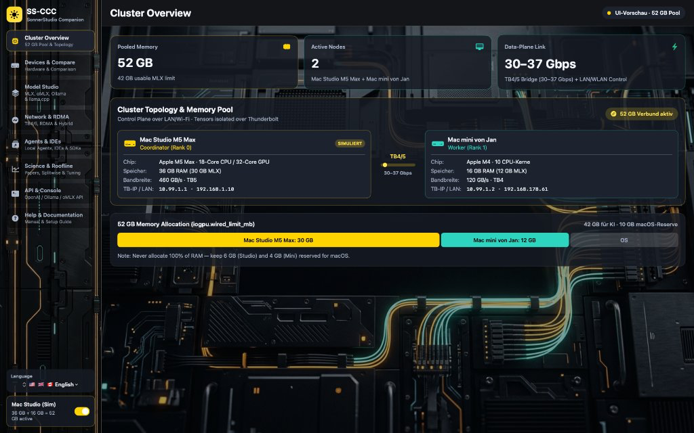
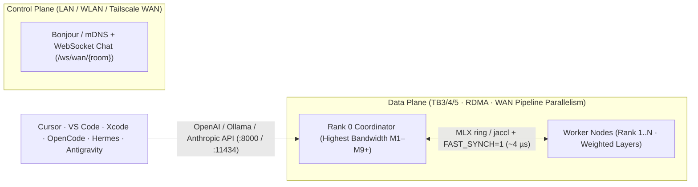

<div align="center">

# ☀️ SonnerStudio Cluster-Case-Companion (SS-CCC)

**🇺🇸 🇬🇧 🇨🇦 [English](README.md)** · **🇩🇪 🇦🇹 🇨🇭 [Deutsch](README.de.md)** · **🇫🇷 🇧🇪 🇨🇭 [Français](README.fr.md)** · **🇪🇸 🇲🇽 🇦🇷 [Español](README.es.md)** · **🇵🇹 🇧🇷 [Português](README.pt.md)**

*Native macOS Apple Silicon cluster manager & distributed MLX inference studio*

<table>
  <tr>
    <td align="center">
      <br/>
      <sub><b>Cluster Mode (52 GB Unified Pool · 2 Nodes)</b></sub>
    </td>
    <td align="center">
      <br/>
      <sub><b>Standalone Mode (16 GB Local · 1 Node)</b></sub>
    </td>
  </tr>
</table>

</div>

---

## 🧭 Overview

**SonnerStudio Cluster-Case-Companion (SS-CCC)** unifies the memory and compute of any **Apple Silicon Macs (M1–M9+)** — from a single Mac mini or MacBook Pro to multi-Mac **Thunderbolt 3/4/5 & RDMA** desks or **global Internet WAN clusters (2–256+ Macs)** — with native **MLX**, **oMLX**, **Ollama**, and **llama.cpp** integration.

<div align="center">
  
</div>

---

## 🌐 Global Internet Cluster, Live Chat & Scientific Roofline

<table>
  <tr>
    <td align="center" width="50%">
      <br/>
      <sub><b>Global Internet Cluster & Participant Chat</b><br/>Tailscale · WireGuard · libp2p QUIC · DERP · <code>/status</code> · <code>/layers</code> · <code>/ping</code></sub>
    </td>
    <td align="center" width="50%">
      <br/>
      <sub><b>Scientific Roofline & Energy Analytics</b><br/>Log-Log Roofline · GPipe Bubble · <code>J/token</code> · <code>p50/p95/p99</code> · CSV/JSON/BibTeX</sub>
    </td>
  </tr>
</table>

---

## 🏗️ Hybrid Architecture (Control Plane, Thunderbolt & WAN)



---

## ✨ Key Capabilities

- **Universal Apple Silicon Clustering (M1–M9+):** Combine any **Mac mini, MacBook Air/Pro, iMac, Mac Studio, or Mac Pro** across **M1 through M6** and future **M7, M8, M9+** generations (Base, Pro, Max, Ultra). The fastest node by memory bandwidth automatically assumes **Rank 0 (Coordinator)**, with safe `iogpu.wired_limit_mb` macOS memory guards.
- **Full System & Sensor Telemetry:** Reads `sysctl`, `sw_vers`, `system_profiler`, `ibv_devices`, `ipconfig`, `ioreg`, and `ProcessInfo.thermalState` — displaying **CPU P/E cores, GPU cores, Neural Engine (16/32 ANE cores), NVMe SSD capacity & free space, thermal state / temperature, and power draw** side by side.
- **All Thunderbolt Classes (TB3 / TB4 / TB5) & RDMA:** Dynamically negotiates pairwise link speeds across M1–M9+ (`TB3/USB4: 26–32 Gbps`, `TB4: 30–37 Gbps`, `TB5: 65–80 Gbps`, `TB5 RDMA: 75–110 Gbps`) with `MLX_METAL_FAST_SYNCH=1` (45× faster GPU/CPU sync).
- **Live Model Studio & Runtime Readiness:** Discovers real installed/running models from **oMLX**, **Ollama**, **llama.cpp**, local `.gguf` files, and `~/.cache/huggingface/hub` (no mock profiles when empty; displays a live runtime readiness check & setup commands instead), with memory-weighted layer sharding and KV-cache quantization (`FP16 / 8-bit / 4-bit`).
- **6× 1-Click Agent & IDE Integrations:** Instant configuration export for **OpenCode**, **Hermes Agent**, **Google Antigravity**, **Cursor**, **Visual Studio Code**, and **Apple Xcode**.
- **Global Internet WAN Cluster & Participant Chat (`/ws/wan/{room_id}`):** Connect any Apple Silicon Macs worldwide into large distributed clusters over encrypted tunnels (Tailscale / WireGuard, libp2p / DERP P2P relay, or manual endpoint) with built-in real-time participant chat.
- **5-Tab Science & Internet-WAN Research Lab:** Switch seamlessly between **Local (TB/RDMA)**, **Internet WAN**, and **Side-by-Side Comparison** across 5 dedicated tabs: **Roofline & Bottleneck** (effective WAN ceiling, $B^*$ critical batch), **WAN Topology & Scaling** ($N=1\dots128$ scaling curves, *Petals/SWARM* activation compression, straggler simulation, *DiLoCo* vs. DDP), **Memory & KV Analysis**, **Energy, CO₂ & Cost** (`J/token`, `EDP`, regional `gCO₂eq/kWh`), and **Trials, Stats & Export** (`CI₉₅`, `CV%`, `Goodput%`, `CSV / JSON / LaTeX / 8-paper BibTeX`).
- **SonnerStudio Yellow (`#FFD400`) UI, 5-Language Manual & Global Test Suite (`tests/`):** Full interface and searchable Help Center (`⌘?`) in **English, German, French, Spanish, and Portuguese**, verified by `tests/test_global_suite.py` (`python3 -m unittest discover -s tests -v`).

### 🖥️ Program Modules at a Glance

| Sidebar Tab | Purpose |
| :--- | :--- |
| **1. Cluster Overview** | Live memory pool bar, active M1–M9+ topology, and pairwise Thunderbolt/RDMA link throughput |
| **2. Devices & Compare** | Add/remove any M1–M9+ Mac, inspect CPU/GPU/ANE/SSD/thermal/power telemetry, and compare bars |
| **3. Model Studio** | Live model discovery (oMLX / Ollama / llama.cpp / GGUF), runtime readiness check, proportional layer splits, and KV-cache tuning |
| **4. Network & RDMA** | Switch Auto-Hybrid / TB-Only / LAN / RDMA, toggle `FAST_SYNCH=1`, and inspect TB3/TB4/TB5 classes |
| **5. Internet Cluster & Chat** | Join or host global WAN Mac clusters via Tailscale / WireGuard / libp2p / DERP and coordinate in live participant chat (`/ws/wan/{room_id}`) |
| **6. Agents & IDEs** | 1-click setup & copyable configs for OpenCode, Hermes Agent, Antigravity, Cursor, VS Code, and Xcode |
| **7. Science & Roofline** | 5-tab Local & Internet-WAN research lab: Log-Log Roofline (`P = min(β·I, π_eff)`), `N=1..128` scaling, *Petals/SWARM* & *DiLoCo*, KV memory equation, `J/tok` / `EDP` / `CO₂`, `CI₉₅` & `Goodput%` trials, and `CSV / JSON / LaTeX / BibTeX` export |
| **8. API & Console** | Test OpenAI (`/v1`) & Ollama (`/api/tags`) endpoints or run local cluster preview prompts |
| **9. Help & Documentation** | Searchable 5-language user manual (`⌘?`) covering clustering, safety limits, networking, and agents |

---

## 🛠️ Building from Source (Important Before First Launch)

> [!NOTE]
> This repository contains the **Swift source code** of SS-CCC (no pre-compiled `.app` binary is shipped here). To obtain a runnable version of the application, the code must be **compiled locally on your Apple Silicon Mac** first.

### Prerequisites
- Any Apple Silicon Mac (**M1–M6**) running **macOS 14.0 or newer**
- **Xcode Command Line Tools** (contains `swiftc` and the macOS SDK):
  ```bash
  xcode-select --install
  ```

### Step-by-Step: From Repository to Runnable App
```bash
# 1. Clone the repository
git clone https://github.com/SonnerStudio/SonnerStudio-Cluster-Case-Companion.git
cd SonnerStudio-Cluster-Case-Companion

# 2. Make the build & launch script executable (once)
chmod +x scripts/run_ssccc.sh

# 3. Compile all Swift sources into /tmp/SSCCCApp and launch the app
./scripts/run_ssccc.sh
```
*(Optional: You can also build directly via Swift Package Manager with `cd app && swift build -c release`.)*

---

## 🚀 Quick Start

```bash
# 1. Launch the native SwiftUI Studio App
"./scripts/run_ssccc.sh"

# 2. (Optional) Start the Python/FastAPI Gateway
cd core && uv sync --extra dev
PYTHONPATH=".." uv run uvicorn core.api.gateway:app --host 0.0.0.0 --port 8000

# 3. Configure Thunderbolt Point-to-Point IPs
./scripts/setup_tb_network.sh studio   # 10.99.1.1
./scripts/setup_tb_network.sh mini     # 10.99.1.2
```

---

## 📚 Selected Documentation (Built Into the App's Help Center)

### 1. Universal Apple Silicon M-Series Clustering (M1–M6)
SS-CCC supports **every Mac with an Apple Silicon M-series processor** (**M1, M2, M3, M4, M5, M6** — Base, Pro, Max, Ultra) across **Mac mini, MacBook Air, MacBook Pro, iMac, Mac Studio, and Mac Pro**. Under **Devices & Compare**, you can add any number of Macs to the cluster; the node with the highest memory bandwidth automatically takes **Rank 0 (Coordinator)**.

| Mac / Chip Family | Memory Bandwidth | Thunderbolt | Recommended macOS Reserve |
| :--- | :--- | :--- | :--- |
| **M1 / M2** (Base) | 68 – 100 GB/s | TB 3 / USB4 (26–32 Gbps) | **4 GB** (≤ 24 GB RAM) |
| **M3 / M4** (Base) | 100 – 120 GB/s | TB 4 (30–37 Gbps) | **4 GB** (≤ 24 GB RAM) |
| **M5 / M6** (Base) | 153 – 180 GB/s | TB 5 (65–80 Gbps) | **4 GB** (≤ 24 GB RAM) |
| **M1–M3 Pro** | 150 – 200 GB/s | TB 4 (30–37 Gbps) | **4 – 6 GB** |
| **M4–M6 Pro** | 273 – 310 GB/s | TB 5 (65–80 Gbps) | **4 – 6 GB** |
| **M1–M3 Max** | 400 GB/s | TB 4 (30–37 Gbps) | **6 GB** (32–64 GB RAM) |
| **M4–M6 Max** | 460 – 580 GB/s | TB 5 (65–80 Gbps) | **6 GB** (32–64 GB RAM) |
| **M1–M2 Ultra** / **M3 Ultra** | 800 GB/s | TB 4 / TB 5 | **8 GB** (≥ 96 GB RAM) |

### 2. Memory Safety & Weighted Layer Sharding
- **Never allocate 100% of RAM:** SS-CCC enforces `iogpu.wired_limit_mb` reserves so macOS and WindowServer stay responsive.
- **Proportional Layer Split:** Each Mac receives layers proportional to its usable memory (`Layers_i = TotalLayers × Usable_i / TotalUsable`).
- **KV-Cache & Fast Metal Sync:** Use `--kv-bits 4` + `--prefill-step-size 512` for 64k+ context windows, and `MLX_METAL_FAST_SYNCH=1` to cut Metal sync overhead by **45×** (~180 µs → ~4 µs).

---

## 🚧 Development Status & Contributing

> [!IMPORTANT]
> **SS-CCC is runnable today, but remains under active development and testing.**
> Core UI, hardware probing, weighted layer planning, and agent/runtime integrations work, while multi-node real-world benchmarks (across M1–M6 combinations, Thunderbolt 4/5 bridges, and RDMA/JACCL) are continuously being tested and refined.

We warmly invite developers, researchers, and Apple Silicon enthusiasts to **contribute and help shape SS-CCC**:
- **Test on your hardware:** Try SS-CCC with your M1–M6 Macs and share throughput, memory, and stability findings.
- **Report issues & ideas:** Open an issue on GitHub for bugs, hardware edge cases, or new feature proposals.
- **Submit Pull Requests:** Improvements to SwiftUI views, Python/MLX sharding, Thunderbolt/RDMA scripts, or translations are always welcome!

---

## 📄 License

Published under the [MIT License](LICENSE.md).
