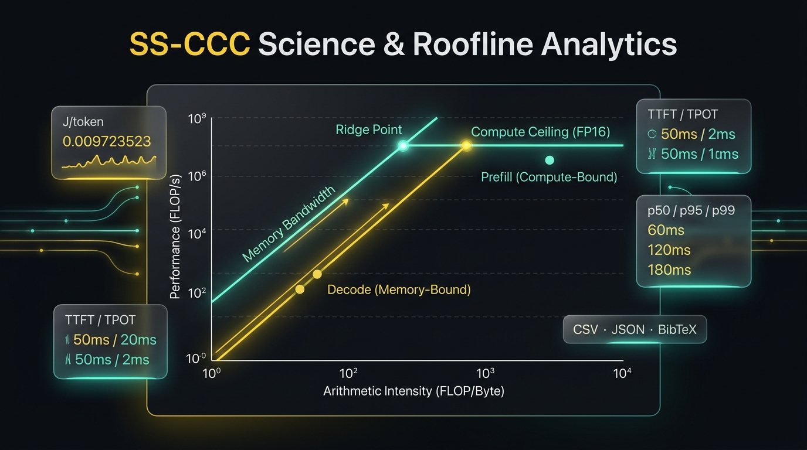
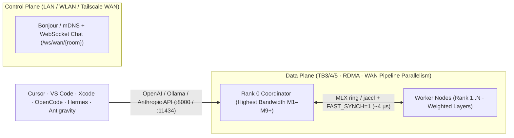

<div align="center">

# ☀️ SonnerStudio Cluster-Case-Companion (SS-CCC)

**🇺🇸 🇬🇧 🇨🇦 [English](README.md)** · **🇩🇪 🇦🇹 🇨🇭 [Deutsch](README.de.md)** · **🇫🇷 🇧🇪 🇨🇭 [Français](README.fr.md)** · **🇪🇸 🇲🇽 🇦🇷 [Español](README.es.md)** · **🇵🇹 🇧🇷 [Português](README.pt.md)**

*Native macOS Apple Silicon cluster manager & distributed MLX inference studio*

<table>
  <tr>
    <td align="center">
      <br/>
      <sub><b>Cluster Mode (52 GB Unified Pool · 2 Nodes)</b></sub>
    </td>
    <td align="center">
      <br/>
      <sub><b>Standalone Mode (16 GB Local · 1 Node)</b></sub>
    </td>
  </tr>
</table>

</div>

---

## 🧭 Overview

**SonnerStudio Cluster-Case-Companion (SS-CCC)** unifies the memory and compute of any **Apple Silicon Macs (M1–M9+)** — from a single Mac mini or MacBook Pro to multi-Mac **Thunderbolt 3/4/5 & RDMA** desks or **global Internet WAN clusters (2–256+ Macs)** — with native **MLX**, **oMLX**, **Ollama**, and **llama.cpp** integration.

<div align="center">
  
</div>

---

## 🌐 Global Internet Cluster, Live Chat & Scientific Roofline

<table>
  <tr>
    <td align="center" width="50%">
      <br/>
      <sub><b>Global Internet Cluster & Participant Chat</b><br/>Tailscale · WireGuard · libp2p QUIC · DERP · <code>/status</code> · <code>/layers</code> · <code>/ping</code></sub>
    </td>
    <td align="center" width="50%">
      <br/>
      <sub><b>Scientific Roofline & Energy Analytics</b><br/>Log-Log Roofline · GPipe Bubble · <code>J/token</code> · <code>p50/p95/p99</code> · CSV/JSON/BibTeX</sub>
    </td>
  </tr>
</table>

---

## 🏗️ Hybrid Architecture (Control Plane, Thunderbolt & WAN)



---

## ✨ Key Capabilities

- **Universal Apple Silicon Clustering (M1–M9+):** Combine any **Mac mini, MacBook Air/Pro, iMac, Mac Studio, or Mac Pro** across **M1 through M6** and future **M7, M8, M9+** generations (Base, Pro, Max, Ultra). The fastest node by memory bandwidth automatically assumes **Rank 0 (Coordinator)**, with safe `iogpu.wired_limit_mb` macOS memory guards.
- **Full System & Sensor Telemetry:** Reads `sysctl`, `sw_vers`, `system_profiler`, `ibv_devices`, `ipconfig`, `ioreg`, and `ProcessInfo.thermalState` — displaying **CPU P/E cores, GPU cores, Neural Engine (16/32 ANE cores), NVMe SSD capacity & free space, thermal state / temperature, and power draw** side by side.
- **All Thunderbolt Classes (TB3 / TB4 / TB5) & RDMA:** Dynamically negotiates pairwise link speeds across M1–M9+ (`TB3/USB4: 26–32 Gbps`, `TB4: 30–37 Gbps`, `TB5: 65–80 Gbps`, `TB5 RDMA: 75–110 Gbps`) with `MLX_METAL_FAST_SYNCH=1` (45× faster GPU/CPU sync).
- **Live Model Studio & Runtime Readiness:** Discovers real installed/running models from **oMLX**, **Ollama**, **llama.cpp**, local `.gguf` files, and `~/.cache/huggingface/hub` (no mock profiles when empty; displays a live runtime readiness check & setup commands instead), with memory-weighted layer sharding and KV-cache quantization (`FP16 / 8-bit / 4-bit`).
- **6× 1-Click Agent & IDE Integrations:** Instant configuration export for **OpenCode**, **Hermes Agent**, **Google Antigravity**, **Cursor**, **Visual Studio Code**, and **Apple Xcode**.
- **Global Internet WAN Cluster & Participant Chat (`/ws/wan/{room_id}`):** Connect any Apple Silicon Macs worldwide into large distributed clusters over encrypted tunnels (Tailscale / WireGuard, libp2p / DERP P2P relay, or manual endpoint) with built-in real-time participant chat.
- **6-Tab Science & Internet-WAN Research Lab + History Recording:** Switch seamlessly between **Local (TB/RDMA)**, **Internet WAN**, and **Side-by-Side Comparison** across 6 dedicated tabs: **Roofline & Bottleneck** (effective WAN ceiling, $B^*$ critical batch), **WAN Topology & Scaling** ($N=1\dots128$ scaling curves, *Petals/SWARM* activation compression, straggler simulation, *DiLoCo* vs. DDP), **Memory & KV Analysis**, **Energy, CO₂ & Cost** (`J/token`, `EDP`, regional `gCO₂eq/kWh`), **Trials, Stats & Export** (`CI₉₅`, `CV%`, `Goodput%`, `CSV / JSON / LaTeX / 8-paper BibTeX`), and **History Recording** (per-position or global snapshots, auto-recording, dual-line trend chart, and CSV export).
- **GitHub-Controlled Program Updates & Automatic Version Control:** Checks `version.json`, GitHub Releases, and `commits/main` SHA automatically on launch and every 30 minutes (`⌘U` or header pill). Displays an in-app update prompt with changelog, 1-click `git pull` + `swift build` + relaunch for source installs, and browser download for packaged releases — backed by `scripts/bump_version.py` and `.github/workflows/auto-version-control.yml`.
- **SonnerStudio Yellow (`#FFD400`) UI, 5-Language Manual & Global Test Suite (`tests/`):** Full interface and searchable 9-chapter Help Center (`⌘?`) in **English, German, French, Spanish, and Portuguese**, verified by `tests/test_global_suite.py` (`python3 -m unittest discover -s tests -v`).

### 🖥️ Program Modules at a Glance

| Sidebar Tab | Purpose |
| :--- | :--- |
| **1. Cluster Overview** | Live memory pool bar, active M1–M9+ topology, and pairwise Thunderbolt/RDMA link throughput |
| **2. Devices & Compare** | Add/remove any M1–M9+ Mac, inspect CPU/GPU/ANE/SSD/thermal/power telemetry, and compare bars |
| **3. Model Studio** | Live model discovery (oMLX / Ollama / llama.cpp / GGUF), runtime readiness check, proportional layer splits, and KV-cache tuning |
| **4. Network & RDMA** | Switch Auto-Hybrid / TB-Only / LAN / RDMA, toggle `FAST_SYNCH=1`, and inspect TB3/TB4/TB5 classes |
| **5. Internet Cluster, Audio-Party & Chat** | Couple local TB/RDMA Macs with global WAN peers (Tailscale/WireGuard/libp2p/DERP), coordinate via Xbox/PS-style Audio-Party & Chat (`/ws/wan-audio`, `/ws/wan`) |
| **6. Agents & IDEs** | 1-click setup & copyable configs for OpenCode, Hermes Agent, Antigravity, Cursor, VS Code, and Xcode |
| **7. Science & Roofline** | 6-tab Local & Internet-WAN research lab: Log-Log Roofline (`P = min(β·I, π_eff)`), `N=1..128` scaling, *Petals/SWARM* & *DiLoCo*, KV memory equation, `J/tok` / `EDP` / `CO₂`, `CI₉₅` & `Goodput%` trials, `CSV / JSON / LaTeX / BibTeX` export, and per-position/global **History Recording** |
| **8. API & Console** | Test OpenAI (`/v1`) & Ollama (`/api/tags`) endpoints or run local cluster preview prompts |
| **9. Help & Documentation** | Searchable 9-chapter, 5-language user manual (`⌘?`) covering M1–M12+ clustering, safety limits, WAN coupling, Audio-Party, Science Lab, and agents |

---

## 🛠️ Building from Source (Important Before First Launch)

> [!NOTE]
> This repository contains the **Swift source code** of SS-CCC (no pre-compiled `.app` binary is shipped here). To obtain a runnable version of the application, the code must be **compiled locally on your Apple Silicon Mac** first.

### Prerequisites
- Any Apple Silicon Mac (**M1–M6**) running **macOS 14.0 or newer**
- **Xcode Command Line Tools** (contains `swiftc` and the macOS SDK):
  ```bash
  xcode-select --install
  ```

### Step-by-Step: From Repository to Runnable App
```bash
# 1. Clone the repository
git clone https://github.com/SonnerStudio/SonnerStudio-Cluster-Case-Companion.git
cd SonnerStudio-Cluster-Case-Companion

# 2. Make the build & launch script executable (once)
chmod +x scripts/run_ssccc.sh

# 3. Compile all Swift sources into /tmp/SSCCCApp and launch the app
./scripts/run_ssccc.sh
```
*(Optional: You can also build directly via Swift Package Manager with `cd app && swift build -c release`.)*

---

## 🚀 Quick Start

```bash
# 1. Launch the native SwiftUI Studio App
"./scripts/run_ssccc.sh"

# 2. (Optional) Start the Python/FastAPI Gateway
cd core && uv sync --extra dev
PYTHONPATH=".." uv run uvicorn core.api.gateway:app --host 0.0.0.0 --port 8000

# 3. Configure Thunderbolt Point-to-Point IPs
./scripts/setup_tb_network.sh studio   # 10.99.1.1
./scripts/setup_tb_network.sh mini     # 10.99.1.2
```

---

## 📚 Selected Documentation (Built Into the App's Help Center)

### 1. Universal Apple Silicon M-Series Clustering (M1–M12+)
SS-CCC supports **every Mac with an Apple Silicon M-series processor** (**M1–M6** and open-ended **M7–M12+** — Base, Pro, Max, Ultra) across **Mac mini, MacBook Air, MacBook Pro, iMac, Mac Studio, and Mac Pro**. Under **Devices & Compare**, you can add any number of Macs to the cluster; the node with the highest memory bandwidth automatically takes **Rank 0 (Coordinator)**.

| Mac / Chip Family | Memory Bandwidth | Thunderbolt & RDMA | Recommended macOS Reserve |
| :--- | :--- | :--- | :--- |
| **M1 / M2** (Base) | 68 – 100 GB/s | TB 3 / USB4 (26–32 Gbps) | **4 GB** (≤ 24 GB RAM) |
| **M3 / M4** (Base) | 100 – 120 GB/s | TB 4 (30–37 Gbps) | **4 GB** (≤ 24 GB RAM) |
| **M5 / M6+** (Base) | 153 – 180+ GB/s | TB 5 (80 Gbps/dir, 160 Gbps bidir) | **4 GB** (≤ 24 GB RAM) |
| **M1–M3 Pro** | 150 – 200 GB/s | TB 4 (30–37 Gbps) | **4 – 6 GB** |
| **M4–M6+ Pro** | 273 – 310+ GB/s | TB 5 (80–120 Gbps boost) | **4 – 6 GB** |
| **M1–M3 Max** | 400 GB/s | TB 4 (30–37 Gbps) | **6 GB** (32–64 GB RAM) |
| **M4 Max** | **410 – 546 GB/s** (LPDDR5X-8533) | TB 5 + RDMA (`~3 µs` latency) | **6 GB** (32–64 GB RAM) |
| **M1–M2 Ultra / M3 Ultra** | **800 – 819 GB/s** (UltraFusion) | TB 4 / TB 5 RDMA (JACCL) | **8 GB** (≥ 96 GB RAM) |

### 2. Thunderbolt 5 RDMA (`JACCL`) & Memory Safety
- **macOS RDMA over Thunderbolt 5:** With `rdma_ctl enable` (macOS 26.2+) and Apple's `JACCL` (`mlx.distributed`) backend, node-to-node latency drops from `~300 µs` (TCP/IP) to **`~3 µs`**, delivering **`3.5–3.8 GB/s`** sustained MLX tensor throughput over direct point-to-point links.
- **Never allocate 100% of RAM:** SS-CCC enforces `iogpu.wired_limit_mb` reserves so macOS and WindowServer stay responsive.
- **Proportional Layer Split:** Each Mac receives layers proportional to its usable memory (`Layers_i = TotalLayers × Usable_i / TotalUsable`).
- **KV-Cache & Fast Metal Sync:** Use `--kv-bits 4` + `--prefill-step-size 512` for 64k+ context windows, and `MLX_METAL_FAST_SYNCH=1` to cut Metal sync overhead by **45×** (`~180 µs → ~4 µs`).

---

## 🔄 GitHub-Controlled Program Updates & Automatic Version Control

SS-CCC includes an integrated, **GitHub-driven update and version-control pipeline** so every local installation stays synchronized with upstream improvements without manual polling:

1. **Multi-Source GitHub Version Resolution:**
   - On launch (after `1.2 s`) and automatically every **30 minutes** via `startAutomaticUpdateMonitor()`, `ClusterViewModel` queries three GitHub endpoints concurrently:
     - `raw.githubusercontent.com/.../main/version.json` (live release manifest with `version`, `build`, `commit_sha`, `mandatory`, and `notes`)
     - `api.github.com/repos/.../releases/latest` (official GitHub Releases & `.dmg`/`.zip` assets)
     - `api.github.com/repos/.../commits/main` (latest `HEAD` short SHA)
2. **In-App Update Prompt (`UpdatePromptSheet`) & 1-Click Rebuild:**
   - Whenever a higher semantic version (`compareVersions`), higher build number, or newer `main` commit SHA is detected, an **Update Pill** lights up in the top header and opens the **Update Prompt** (`⌘U`).
   - **Source Installations:** Runs `git pull --ff-only origin main` + `swift build` directly inside the app and offers a 1-click **Relaunch App Now** button (`scripts/run_ssccc.sh`).
   - **Packaged `.app` Bundles:** Opens the GitHub Release asset download in Safari.
3. **Automated CI Version Bumping (`.github/workflows/auto-version-control.yml`):**
   - Every push to `main` triggers GitHub Actions to run `scripts/bump_version.py --part patch --sync-git`, synchronize `version.json` with `AppReleaseMetadata` in `ClusterModels.swift`, execute the full 12-test suite, commit `[skip ci] chore(release): auto-bump ...`, and update the Git tag `vX.Y.Z`.

---

## 🎙️ Cluster Audio-Party & Live WAN Collaboration

- **Console-Style Voice Coordination:** Built directly alongside the text chat in **Internet Cluster**, **Cluster Audio-Party** uses Apple's native `AVAudioEngine` (`16 kHz PCM16`) over `/ws/wan-audio` for low-latency team voice communication.
- **Tactical Controls:** Switch between **Push-to-Talk** and **Open-Mic** with configurable noise gate, instant **Mute / Deafen**, active speaker level meters, and live participant roles (`Rank 0 Gateway`, `WAN Worker`).
- **Real-Time Room Sync (`/ws/wan/{room_id}`):** Synchronizes `SSCCC-WAN-…` room invites, hybrid local-to-WAN coupling events, and telemetry chat messages across all connected peers.

---

## 🏆 Global + Local Hybrid Supercluster Record Attempt (Scientific Challenge)


**Can a decentralized, cross-continental coalition of Apple Silicon Macs rival a datacenter supercomputer?**  
We invite universities, AI research labs, developer communities, and Apple Silicon enthusiasts worldwide to organize an official **SS-CCC Hybrid Supercluster Record Attempt** — uniting as many **local Thunderbolt 3/4/5/RDMA clusters** and **Internet-connected WAN Macs** simultaneously as possible using SS-CCC's **Hybrid Bridge (`Couple Local + Internet`)**, **Cluster Audio-Party**, and **5-Tab Research Lab**.

### 🔬 Scientific Rationale & Mathematical Scaling Model

1. **Two-Tier Hierarchical Topology (Tier-0 TB/RDMA Islands + Tier-1 WAN Backbone):**
   - Naive flat WAN clustering suffers when every single Transformer layer boundary crosses a high-latency Internet link ($H_{\text{WAN}} = N - 1$).
   - By coupling local Thunderbolt/RDMA islands via **SS-CCC's Hybrid Bridge**, consecutive layers remain on intra-island Thunderbolt (`~0.07 ms` latency, `30–110 Gbps`), restricting WAN hops strictly to **inter-island gateway transitions** ($H_{\text{WAN}} \ll N_{\text{total}}$) via each island's **Rank 0 Gateway**.
2. **Amortizing WAN RTT via Critical Micro-Batching ($B^*$) & Activation Compression:**
   - Under Pipeline Parallelism, pipeline efficiency follows the GPipe bubble law:
     $$\Phi_{\text{bubble}} = \frac{N - 1}{M + N - 1}, \qquad B^* = \left\lceil \frac{T_{\text{RTT,WAN}} + T_{\text{tx}}}{T_{\text{comp}}(B=1)} \right\rceil$$
   - Increasing micro-batch depth $M$ toward $B^*$ hides cross-continent RTT behind concurrent pipeline execution, while **FP8 / INT4 / Top-K activation compression** (*Petals / SWARM*) shrinks per-hop hidden-state payloads ($B \cdot d_{\text{model}}$) below $1\%$ of typical WAN uplinks.
3. **Standardized Reproducible Record Protocol ($T = 0.0$):**
   1. **Form Tier-0 Islands:** Connect local M1–M9+ Macs via Thunderbolt 3/4/5 (`MLX_METAL_FAST_SYNCH=1`).
   2. **Bridge & Coordinate:** Enable **Hybrid Bridge (`Couple Local + Internet`)**, share your `SSCCC-WAN-…` room code, and join the **Cluster Audio-Party** (`Opus 16 kbps`, $<0.02\%$ WAN overhead) to synchronize layer splits.
   3. **Execute Trials:** Switch **Science & Roofline** to **Internet-WAN**, select `N = 20` trials (`1` warmup discarded, `temperature = 0.0`), and define your target SLO (`TTFT ≤ 2500 ms`, `TPOT ≤ 100 ms/tok`).
   4. **Archive Verification:** Export and publish the **JSON Reproducibility Manifest**, **CSV trial log**, and **LaTeX (`booktabs`) table** containing `hardware_fingerprint`, `TTFT/TPOT (p50/p95/p99 ± CI₉₅)`, `CV%`, `Goodput%`, `J/token`, `EDP`, and `gCO₂eq/1M tokens`.

### 🥇 Official Record Categories
- **Largest Unified Memory Pool:** Highest combined usable VRAM (`GB` / `TB`) across coupled local + WAN Macs.
- **Most Simultaneous Coupled Macs ($N$):** Largest active mesh (`32–256+` nodes) sustaining a valid `N = 20` trial run.
- **Highest Cross-Continent Hybrid Goodput:** Maximum `tokens/s` meeting interactive SLOs across $\ge 2$ continents.
- **Best Cluster Energy Efficiency:** Lowest `Joules/token` and `EDP (J·s)` for a `70B+` parameter model.

---

## 🎯 Use Cases & Who SS-CCC Is Built For

| User Group | Real-World Use Case with SS-CCC |
| :--- | :--- |
| **AI Systems & ML Researchers** | Analyze local vs. WAN Roofline limits ($P = \min(\beta \cdot I, \pi_{\text{eff}})$), *Petals/SWARM* activation compression, *DiLoCo* vs. DDP WAN communication, and export `CI₉₅` + `LaTeX`/`BibTeX` directly into papers. |
| **Universities & Teaching Labs** | Pool student MacBooks and lab Mac minis across campus LAN and home WANs into a shared 70B–405B+ teaching cluster, coordinated live via **Cluster Audio-Party**. |
| **Software Studios & Agentic Teams** | Run private, zero-cloud-cost coding models locally for **OpenCode**, **Hermes Agent**, **Antigravity**, **Cursor**, **VS Code**, and **Xcode** across existing office Macs. |
| **Privacy-First Legal, Medical & Enterprise** | Keep sensitive documents strictly on-premise or inside encrypted **WireGuard / Tailscale** tunnels with zero third-party API telemetry or data leakage. |
| **Global Open-Source Swarms & Hackathons** | Spin up ad-hoc cross-border superclusters in minutes, coordinate layer splits with Xbox/PlayStation-style voice callouts, and attempt community scale records. |
| **Green-AI & Sustainability Audits** | Benchmark `J/token`, Energy-Delay Product (`EDP`), and regional `gCO₂eq/1M tokens` (Norway hydro vs. EU/US grids) against datacenter GPU APIs. |

---

## 📁 Repository Structure

```text
├── app/Sources/
│   ├── SSCCCApp.swift              # Main window, header update pill & UpdatePromptSheet
│   ├── Models/
│   │   ├── ClusterModels.swift     # M1–M12+ chip inference, WAN/Science/History & Release models
│   │   └── Localization.swift      # Complete 5-language UI & Help dictionary (EN/DE/FR/ES/PT)
│   ├── ViewModels/
│   │   └── ClusterViewModel.swift  # Hardware probes, model discovery, WAN/Audio-Party & GitHub updater
│   └── Views/                      # 9 modular SwiftUI views (incl. 6-tab ScienceBenchmarksView & HelpDocsView)
├── core/                           # Python FastAPI gateway, WebSocket WAN/Audio relays & MLX sharding
├── scripts/
│   ├── run_ssccc.sh                # Compiles & launches the macOS app
│   ├── bump_version.py             # Synchronizes version.json & ClusterModels.swift with Git
│   ├── setup_tb_network.sh         # Configures 10.99.1.x Thunderbolt bridge
│   └── setup_wired_limit.sh        # Applies safe iogpu.wired_limit_mb limits
├── tests/                          # 12-test global verification suite (Swift + Python)
├── .github/workflows/              # Automated CI version control & tagging
└── version.json                    # GitHub-hosted update control manifest
```

---

## 🚧 Development Status & Contributing

> [!IMPORTANT]
> **SS-CCC v1.6+ is actively runnable and tested (`12/12` automated checks passing), while real-world multi-node endurance benchmarks continue.**
> **Currently implemented & verified:** English default startup with 5-language UI, open-ended M1–M12+ hardware probing, live model discovery (oMLX / Ollama / llama.cpp / GGUF), 6-tab Science Lab with per-position & global History Recording, Hybrid Local ↔ Internet-WAN coupling, `AVAudioEngine` Cluster Audio-Party, 9-chapter Help Center, and GitHub-controlled auto-updating with CI version control. Multi-node endurance runs across heterogeneous TB4/TB5/RDMA (`JACCL`) topologies are continuously being benchmarked and refined.

We warmly invite developers, researchers, and Apple Silicon enthusiasts to **contribute and help shape SS-CCC**:
- **Test on your hardware:** Try SS-CCC with your M1–M12+ Macs and share throughput, memory, and RDMA/JACCL stability findings.
- **Join the Hybrid Record Attempt:** Organize local TB islands + WAN peers and publish your exported JSON/CSV/LaTeX manifests.
- **Submit Pull Requests:** Improvements to SwiftUI views, Python/MLX sharding, Thunderbolt/RDMA scripts, or translations are always welcome!

---

## 📄 License

Published under the [MIT License](LICENSE.md).
