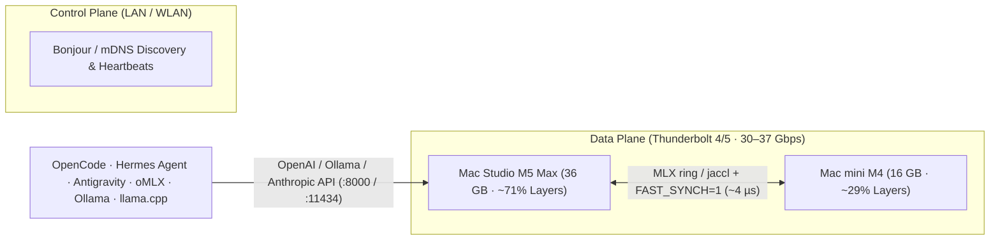

<div align="center">

# ☀️ SonnerStudio Cluster-Case-Companion (SS-CCC)

**🇺🇸 🇬🇧 🇨🇦 [English](README.md)** · **🇩🇪 🇦🇹 🇨🇭 [Deutsch](README.de.md)** · **🇫🇷 🇧🇪 🇨🇭 [Français](README.fr.md)** · **🇪🇸 🇲🇽 🇦🇷 [Español](README.es.md)** · **🇵🇹 🇧🇷 [Português](README.pt.md)**

*Native macOS Apple Silicon cluster manager & distributed MLX inference studio*


</div>

---

## 🧭 Overview

**SonnerStudio Cluster-Case-Companion (SS-CCC)** combines the unified memory of multiple Apple Silicon Macs — such as a **Mac Studio M5 Max (36 GB, Thunderbolt 5)** and a **Mac mini M4 (16 GB, Thunderbolt 4)** — into a **52 GB physical (~42 GB usable) AI cluster** over **Thunderbolt (Bridge or RDMA)**, **LAN/WLAN**, or **Hybrid** networking.

<div align="center">
  
</div>

---

## 🏗️ Hybrid Architecture (Control Plane & Data Plane)



---

## ✨ Key Capabilities

- **52 GB Heterogeneous Memory Coupling:** Memory-weighted pipeline parallelism (`~71%` layers + embeddings/LM-head on M5 Max `460 GB/s`, `~29%` layers on M4 `120 GB/s`) with safe `iogpu.wired_limit_mb` guards.
- **Native SwiftUI Studio (*Solaris Telemetry Lab*):**
  - **Cluster Overview & Device Comparison:** Live `sysctl` / `sw_vers` / `ibv_devices` / `ipconfig` telemetry with side-by-side comparison.
  - **Model Studio:** Proportional layer sharding, KV-cache quantization (`FP16 / 8-bit / 4-bit`), and direct integration for **oMLX**, **Ollama**, and **llama.cpp**.
  - **Agents & IDEs (1-Click Setup):** Instant configuration export for **OpenCode**, **Hermes Agent**, and **Google Antigravity**.
  - **Multilingual UI:** Built-in language switcher in the left sidebar (DE, EN, FR, ES, PT).

---

## 🛠️ Building from Source (Important Before First Launch)

> [!NOTE]
> This repository contains the **Swift source code** of SS-CCC (no pre-compiled `.app` binary is shipped here). To obtain a runnable version of the application, the code must be **compiled locally on your Apple Silicon Mac** first.

### Prerequisites
- Any Apple Silicon Mac (**M1–M6**) running **macOS 14.0 or newer**
- **Xcode Command Line Tools** (contains `swiftc` and the macOS SDK):
  ```bash
  xcode-select --install
  ```

### Step-by-Step: From Repository to Runnable App
```bash
# 1. Clone the repository
git clone https://github.com/SonnerStudio/SonnerStudio-Cluster-Case-Companion.git
cd SonnerStudio-Cluster-Case-Companion

# 2. Make the build & launch script executable (once)
chmod +x scripts/run_ssccc.sh

# 3. Compile all Swift sources into /tmp/SSCCCApp and launch the app
./scripts/run_ssccc.sh
```
*(Optional: You can also build directly via Swift Package Manager with `cd app && swift build -c release`.)*

---

## 🚀 Quick Start

```bash
# 1. Launch the native SwiftUI Studio App
"./scripts/run_ssccc.sh"

# 2. (Optional) Start the Python/FastAPI Gateway
cd core && uv sync --extra dev
PYTHONPATH=".." uv run uvicorn core.api.gateway:app --host 0.0.0.0 --port 8000

# 3. Configure Thunderbolt Point-to-Point IPs
./scripts/setup_tb_network.sh studio   # 10.99.1.1
./scripts/setup_tb_network.sh mini     # 10.99.1.2
```

---

## 📚 Selected Documentation (Built Into the App's Help Center)

### 1. Universal Apple Silicon M-Series Clustering (M1–M6)
SS-CCC supports **every Mac with an Apple Silicon M-series processor** (**M1, M2, M3, M4, M5, M6** — Base, Pro, Max, Ultra) across **Mac mini, MacBook Air, MacBook Pro, iMac, Mac Studio, and Mac Pro**. Under **Devices & Compare**, you can add any number of Macs to the cluster; the node with the highest memory bandwidth automatically takes **Rank 0 (Coordinator)**.

| Mac / Chip Family | Memory Bandwidth | Thunderbolt | Recommended macOS Reserve |
| :--- | :--- | :--- | :--- |
| **M1 / M2 / M3** (Base) | 68 – 100 GB/s | TB 4 | **4 GB** (≤ 24 GB RAM) |
| **M4 / M5 / M6** (Base) | 120 – 180 GB/s | TB 4 / TB 5 | **4 GB** (≤ 24 GB RAM) |
| **M1–M6 Pro** | 150 – 273 GB/s | TB 4 / TB 5 | **4 – 6 GB** |
| **M1–M6 Max** | 400 – 546 GB/s | TB 4 / TB 5 | **6 GB** (32–64 GB RAM) |
| **M1–M3 Ultra** | 800 GB/s | TB 4 | **8 GB** (≥ 96 GB RAM) |

### 2. Memory Safety & Weighted Layer Sharding
- **Never allocate 100% of RAM:** SS-CCC enforces `iogpu.wired_limit_mb` reserves so macOS and WindowServer stay responsive.
- **Proportional Layer Split:** Each Mac receives layers proportional to its usable memory (`Layers_i = TotalLayers × Usable_i / TotalUsable`).
- **KV-Cache & Fast Metal Sync:** Use `--kv-bits 4` + `--prefill-step-size 512` for 64k+ context windows, and `MLX_METAL_FAST_SYNCH=1` to cut Metal sync overhead by **45×** (~180 µs → ~4 µs).

---

## 📄 License

Published under the [MIT License](LICENSE.md).
