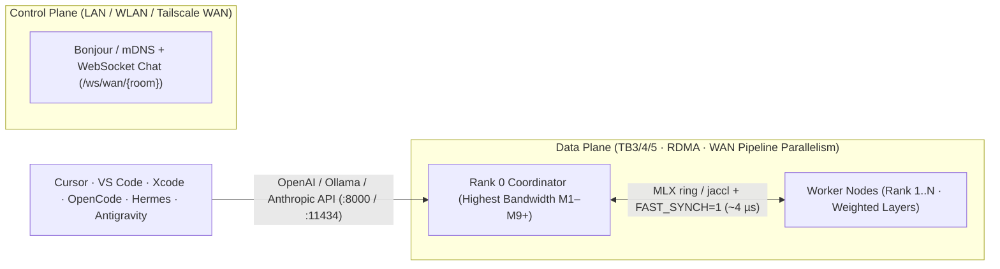

<div align="center">

# ☀️ SonnerStudio Cluster-Case-Companion (SS-CCC)

   **[English](README.md)** ·    **[Deutsch](README.de.md)** ·    **[Français](README.fr.md)** ·    **[Español](README.es.md)** ·   **[Português](README.pt.md)** ·  **[Русский](README.ru.md)** ·  **[日本語](README.ja.md)** ·  **[中文](README.zh.md)**

*Native macOS Apple Silicon cluster manager & distributed MLX inference studio*

<table>
  <tr>
    <td align="center">
      <br/>
      <sub><b>Cluster Mode (52 GB Unified Pool · 2 Nodes)</b></sub>
    </td>
    <td align="center">
      <br/>
      <sub><b>Standalone Mode (16 GB Local · 1 Node)</b></sub>
    </td>
  </tr>
</table>

</div>

---

## 🧭 Overview

**SonnerStudio Cluster-Case-Companion (SS-CCC)** unifies the memory and compute of any **Apple Silicon Macs (M1–M9+)** — from a single Mac mini or MacBook Pro to multi-Mac **Thunderbolt 3/4/5 & RDMA** desks or **global Internet WAN clusters (2–256+ Macs)** — with native **MLX**, **oMLX**, **Ollama**, and **llama.cpp** integration.

<div align="center">
  
</div>

---

## 🌐 Global Internet Cluster, Live Chat & Scientific Roofline

<table>
  <tr>
    <td align="center" width="50%">
      <br/>
      <sub><b>Global Internet Cluster & Participant Chat</b><br/>Tailscale · WireGuard · libp2p QUIC · DERP · <code>/status</code> · <code>/layers</code> · <code>/ping</code></sub>
    </td>
    <td align="center" width="50%">
      <br/>
      <sub><b>Scientific Roofline & Energy Analytics</b><br/>Log-Log Roofline · GPipe Bubble · <code>J/token</code> · <code>p50/p95/p99</code> · CSV/JSON/BibTeX</sub>
    </td>
  </tr>
</table>

---

## 🏗️ Hybrid Architecture (Control Plane, Thunderbolt & WAN)



---

## 🌐 Internet-Cluster WAN Bandwidth & Throughput Monitor


Inside **Internet-Cluster & Chat**, SS-CCC continuously monitors real WAN link performance (`netstat`, `ping`, `networkQuality`) — tracking **Downlink / Uplink Mbps**, **WAN RTT Latency (ms)**, **Jitter**, **Packet Loss**, and **Token Sync Efficiency** — and correlates internet throughput directly with distributed `tok/s` across partner nodes.

---

## ✨ Key Capabilities

- **Universal Apple Silicon Clustering (M1–M9+):** Combine any **Mac mini, MacBook Air/Pro, iMac, Mac Studio, or Mac Pro** across **M1 through M6** and future **M7, M8, M9+** generations (Base, Pro, Max, Ultra). The fastest node by memory bandwidth automatically assumes **Rank 0 (Coordinator)**, with safe `iogpu.wired_limit_mb` macOS memory guards.
- **Full System & Sensor Telemetry:** Reads `sysctl`, `sw_vers`, `system_profiler`, `ibv_devices`, `ipconfig`, `ioreg`, and `ProcessInfo.thermalState` — displaying **CPU P/E cores, GPU cores, Neural Engine (16/32 ANE cores), NVMe SSD capacity & free space, thermal state / temperature, and power draw** side by side.
- **All Thunderbolt Classes (TB3 / TB4 / TB5) & RDMA:** Dynamically negotiates pairwise link speeds across M1–M9+ (`TB3/USB4: 26–32 Gbps`, `TB4: 30–37 Gbps`, `TB5: 65–80 Gbps`, `TB5 RDMA: 75–110 Gbps`) with `MLX_METAL_FAST_SYNCH=1` (45× faster GPU/CPU sync).
- **Live Model Studio & Runtime Readiness:** Discovers real installed/running models from **oMLX**, **Ollama**, **llama.cpp**, local `.gguf` files, and `~/.cache/huggingface/hub` (no mock profiles when empty; displays a live runtime readiness check & setup commands instead), with memory-weighted layer sharding and KV-cache quantization (`FP16 / 8-bit / 4-bit`).
- **6× 1-Click Agent & IDE Integrations:** Instant configuration export for **OpenCode**, **Hermes Agent**, **Google Antigravity**, **Cursor**, **Visual Studio Code**, and **Apple Xcode**.
- **Global Internet WAN Cluster & Participant Chat (`/ws/wan/{room_id}`):** Connect any Apple Silicon Macs worldwide into large distributed clusters over encrypted tunnels (Tailscale / WireGuard, libp2p / DERP P2P relay, or manual endpoint) with built-in real-time participant chat.
- **6-Tab Science & Internet-WAN Research Lab + History Recording:** Switch seamlessly between **Local (TB/RDMA)**, **Internet WAN**, and **Side-by-Side Comparison** across 6 dedicated tabs: **Roofline & Bottleneck** (effective WAN ceiling, $B^*$ critical batch), **WAN Topology & Scaling** ($N=1\dots128$ scaling curves, *Petals/SWARM* activation compression, straggler simulation, *DiLoCo* vs. DDP), **Memory & KV Analysis**, **Energy, CO₂ & Cost** (`J/token`, `EDP`, regional `gCO₂eq/kWh`), **Trials, Stats & Export** (`CI₉₅`, `CV%`, `Goodput%`, `CSV / JSON / LaTeX / 8-paper BibTeX`), and **History Recording** (per-position or global snapshots, auto-recording, dual-line trend chart, and CSV export).
- **GitHub-Controlled Program Updates & Automatic Version Control:** Checks `version.json`, GitHub Releases, and `commits/main` SHA automatically on launch and every 30 minutes (`⌘U` or header pill). Displays an in-app update prompt with changelog, 1-click `git pull` + `swift build` + relaunch for source installs, and browser download for packaged releases — backed by `scripts/bump_version.py` and `.github/workflows/auto-version-control.yml`.
- **SonnerStudio Yellow (`#FFD400`) UI, 8-Language Manual, Hover Shorttips & Global Test Suite (`tests/`):** Full interface, **app-wide hover shorttips** (macOS tooltips + floating **Solaris Shorttip Banner**), **Click-to-Detail interactive Help Center** (12 chapters with deep-dive graphics & glow highlights, `⌘?`) in **English, German, French, Spanish, Portuguese, Russian, Japanese, and Chinese**, and live real-time telemetry (no mock data when Simulation Mode is off), verified by `tests/test_global_suite.py` (`python3 -m unittest discover -s tests -v`).

### 🖥️ Program Modules at a Glance (All 11 Sidebar Tabs)


| Sidebar Tab | Purpose |
| :--- | :--- |
| **1. Cluster Overview** | Live memory pool bar, active M1–M12+ topology, pairwise Thunderbolt/RDMA link throughput, and **4-state Setup & Readiness status card** |
| **2. Devices & Compare** | Add/remove any M1–M12+ Mac, inspect real-time CPU/GPU/ANE/SSD/thermal/power telemetry, and compare bars |
| **3. Model Studio** | Live model discovery (oMLX / Ollama / llama.cpp / GGUF), runtime readiness check, proportional layer splits, ANE-Split & 3-tier KV-cache/CacheGen tuning |
| **4. Network & RDMA** | Switch Auto-Hybrid / TB-Only / LAN / RDMA, toggle `FAST_SYNCH=1`, switch Pipeline Ring vs. JACCL Full-Mesh TP, and inspect TB3/TB4/TB5 classes |
| **5. Internet Cluster, Audio-Party & Chat** | Couple local TB/RDMA Macs with global WAN peers (QUIC/Iroh 0-RTT, Tailscale/WireGuard, libp2p/DERP), monitor live **Internet Bandwidth & WAN Throughput** (`netstat`, ICMP ping/jitter, `networkQuality -c`), and coordinate via Audio-Party & Chat (`/ws/wan-audio`, `/ws/wan`) |
| **6. Multi-Model-Mode (MMM)** | Combine multiple models across **Local**, **Internet-WAN**, or **Hybrid** clusters (*Parallel Pool*, *Mixture-of-Agents*, *EAGLE-3 / Speculative*, *Tree-MoA Early-Exit*, *Ares Adaptive Router*) with VRAM/thermal/carbon guards & simultaneous **Multi-IDE / Harness** consumption (`:8000/v1`) |
| **7. Agents & IDEs** | 1-click setup & copyable configs (incl. **MCP Registry JSON** & **A2A Agent Card**) for OpenCode, Hermes Agent, Antigravity, Cursor, VS Code, and Xcode |
| **8. Science & Roofline** | 6-tab Local & Internet-WAN research lab using **real SSE streaming & ICMP RTT** in live mode (labeled realistic simulation in sim mode), **direct Multi-Model-Mode (MMM) evaluation**, Log-Log Roofline, `N=1..128` scaling, *Petals/SWARM* & *DiLoCo*, KV memory, `J/tok` / `EDP` / `CO₂`, `CI₉₅` trials, `CSV / JSON / LaTeX / BibTeX`, and **History Recording** |
| **9. API & Console** | Test OpenAI (`/v1/chat/completions`, `/v1/responses` + MCP) & Ollama (`/api/tags`) endpoints, inspect **A2A Agent Cards** (`/.well-known/agent.json`), and run live local cluster prompts |
| **10. Setup & Provision** | Auto-discover local Thunderbolt/LAN Macs (Bonjour/mDNS), Internet WAN peers (`QUIC Iroh` / `Tailscale`), or Hybrid clusters; provision SSH trust, `iogpu.wired_limit_mb` & `mlx.distributed_config` across all nodes; verify **Operational Readiness** (**Ready / Not Ready / Partially Configured / Unconfigured**) |
| **11. Help & Documentation** | Searchable **12-chapter, 8-language Click-to-Detail manual** (`⌘?`) with interactive deep-dive diagrams, glow highlights, M1–M12+ clustering, safety limits, WAN coupling, Audio-Party, MMM, Science Lab, and agents |

---

## 🛠️ Building from Source (Important Before First Launch)

> [!NOTE]
> This repository contains the **Swift source code** of SS-CCC (no pre-compiled `.app` binary is shipped here). To obtain a runnable version of the application, the code must be **compiled locally on your Apple Silicon Mac** first.

### Prerequisites
- Any Apple Silicon Mac (**M1–M6**) running **macOS 14.0 or newer**
- **Xcode Command Line Tools** (contains `swiftc` and the macOS SDK):
  ```bash
  xcode-select --install
  ```

### Step-by-Step: From Repository to Runnable App
```bash
# 1. Clone the repository
git clone https://github.com/SonnerStudio/SonnerStudio-Cluster-Case-Companion.git
cd SonnerStudio-Cluster-Case-Companion

# 2. Make the build & launch script executable (once)
chmod +x scripts/run_ssccc.sh

# 3. Compile all Swift sources into /tmp/SSCCCApp and launch the app
./scripts/run_ssccc.sh
```
*(Optional: You can also build directly via Swift Package Manager with `cd app && swift build -c release`.)*

---

## 🚀 Quick Start

```bash
# 1. Launch the native SwiftUI Studio App
"./scripts/run_ssccc.sh"

# 2. (Optional) Start the Python/FastAPI Gateway
cd core && uv sync --extra dev
PYTHONPATH=".." uv run uvicorn core.api.gateway:app --host 0.0.0.0 --port 8000

# 3. Configure Thunderbolt Point-to-Point IPs
./scripts/setup_tb_network.sh studio   # 10.99.1.1
./scripts/setup_tb_network.sh mini     # 10.99.1.2
```

---

## 📖 Operational Guide: Local & Hybrid (Local + Internet) Cluster Setup, Model Loading & Theoretical Sizing

### 1. Setting Up the Local Cluster (Thunderbolt 3/4/5 & LAN)
1. **Physical Interconnect:** Connect your Macs directly via **Thunderbolt 3/4/5 cables** (point-to-point, daisy-chain, or ring) and/or **10GbE Ethernet**.
2. **Assign Point-to-Point IPs:** Run `./scripts/setup_tb_network.sh studio` (`10.99.1.1`) on your primary Mac and `./scripts/setup_tb_network.sh mini` (`10.99.1.2`, etc.) on worker Macs, or configure interfaces directly in **Network & Direct Memory**.
3. **Optional RDMA (macOS 26.2+ on TB5):** Enable Apple's low-latency RDMA transport with `rdma_ctl enable` so `JACCL` (`mlx.distributed`) achieves **`~3 µs`** node-to-node latency instead of `~300 µs` over TCP/IP.
4. **Automatic Rank Assignment:** Add all participating Macs under **Devices & Compare**. SS-CCC's `MemoryWeightedPlanner` automatically assigns **Rank 0 (Coordinator)** to the Mac with the highest memory bandwidth (tie-breaker: highest usable unified memory), while all others become **Rank 1..N (Workers)**.

### 2. Setting Up a Hybrid Cluster Network (Local + Internet WAN Simultaneously)
1. **Local High-Speed Core (Tier 1):** Keep your local Thunderbolt/LAN ring active (`10.99.1.x` / `192.168.x.x`) for latency-sensitive tensor/pipeline steps.
2. **WAN Coordinator Room (Tier 2):** In **Internet Cluster & Chat**, start a WAN room (`/ws/wan/{room_id}` on port `8000`, exposed via Tailscale, WireGuard, Cloudflare Tunnel, or a reverse proxy).
3. **Join Remote Workers:** Remote Macs anywhere on the Internet join using the **Room Code + Join Token**.
4. **Two-Tier Hybrid Routing:** SS-CCC keeps high-frequency layers on the local TB/LAN ring (`3–180 µs`) and routes overflow pipeline stages to WAN workers (`15–120 ms` RTT) using micro-batching (`M ≥ 4`) to hide WAN round-trip latency.

### 3. Who Loads the Model, How Many Models Fit, and End-to-End Request Flow
- **Who Loads What?**
  - **Coordinator (Rank 0):** Hosts the OpenAI/Anthropic/Ollama API gateway (`:8000`), runs tokenization, **always holds the Embeddings and LM-Head (`has_embeddings=True`, `has_lm_head=True`)**, plus its proportional share of transformer layers (`Layers_i = TotalLayers × Usable_i / TotalUsable`).
  - **Workers (Rank 1..N):** Each worker downloads/reads **only its assigned Safetensors/layer slice `[start_layer .. end_layer)`** from its local HuggingFace/oMLX/Ollama cache (`~/.cache/huggingface`, `~/.ollama/models`, `~/Models`)—no worker wastes RAM loading layers assigned to other nodes.
- **How Many Models Can Be Loaded Simultaneously?**
  - **Distributed Cluster Mode (`mlx.distributed` / `JACCL`):** **1 large sharded model at a time** across the combined cluster memory pool (switching models performs a fast hot-swap).
  - **Multi-Model Serving (`oMLX` / `Ollama` / Heterogeneous Nodes):** As long as `Σ (ModelWeights_i + KV_Cache_i) ≤ Total_Usable_VRAM_GB` (after reserving 4–8 GB per Mac via `iogpu.wired_limit_mb`), multiple models can stay resident simultaneously—e.g., a **32B coder model + 8B fast router + 1.5B embedding model** via `oMLX` paged KV-cache or `OLLAMA_MAX_LOADED_MODELS`.
- **End-to-End Execution Flow & Structure:**
  1. **Probe & Link Selection:** Detects Apple Silicon RAM, bandwidth, and interfaces (`TB5 RDMA > TB Bridge > 10GbE > WLAN > WAN`).
  2. **Sharding Plan:** `MemoryWeightedPlanner` writes `hostfile.json` and layer ranges while enforcing `iogpu.wired_limit_mb`.
  3. **API Ingress:** Agents/IDEs send requests to `http://127.0.0.1:8000/v1/chat/completions` (or `/v1/messages`, `/api/chat`).
  4. **Prefill Phase (Compute-Bound → `TTFT`):** Rank 0 embeds the prompt (`S_prompt`), computes its layers, and passes activations down the pipeline (`Rank 0 → 1 → ... → N → Rank 0`).
  5. **Decode Phase (Bandwidth-Bound → `TPOT` & `tok/s`):** Tokens are generated auto-regressively using `--kv-bits 4` compressed KV-cache and `MLX_METAL_FAST_SYNCH=1`.
  6. **SSE Streaming & Telemetry:** Rank 0 streams tokens to the client and records `tok/s`, `TTFT`, `TPOT`, `J/tok`, and `p50/p95/p99` in **Science & Benchmarks**.

### 4. Theoretical Sizing & Performance Data Across Use Cases

> **Analytical Estimation Rules:**
> - **Memory Footprint:** `VRAM_GB ≈ Params_B × (Bits / 8) × 1.15 + KV_Cache_GB`
> - **Theoretical Decode Ceiling:** `tok/s ≈ (Effective_Bandwidth_GB/s / Active_Weights_GB) × (1 − Comm_Overhead)`

| Use Case Scenario | Topology & Usable Pool | Typical Model & Quant | Theoretical `TTFT` (2k Prompt) | Theoretical Decode (`tok/s` / `TPOT`) | Energy & Primary Bottleneck |
| :--- | :--- | :--- | :--- | :--- | :--- |
| **1. Solo Workstation (Edge Dev)** | 1× Mac mini M4 (16 GB, `12 GB` usable, `120 GB/s`) | `Qwen2.5-14B` (`4-bit`, ~8.8 GB) | `~1.8 – 2.6 s` | **`11 – 14 tok/s`** (`~75 ms/tok`) | `~1.7 J/tok` · Memory-bandwidth bound |
| **2. Single Pro Studio (Fast Coding)** | 1× Mac Studio M4 Max (64 GB, `58 GB` usable, `546 GB/s`) | `Llama-3.3-70B` (`4-bit`, ~40 GB) | `~1.1 – 1.7 s` | **`12 – 14 tok/s`** (`~74 ms/tok`) | `~3.8 J/tok` · Memory-bandwidth bound |
| **3. Local 2-Node TB5 RDMA Ring** | 2× M4 Max 64 GB (`116 GB` usable, `~1,092 GB/s` agg., `~3 µs` JACCL) | `Qwen2.5-Coder-72B` (`8-bit`, ~78 GB) | `~1.4 – 2.0 s` | **`12 – 14 tok/s`** (`~76 ms/tok`) | `~7.5 J/tok` · Negligible RDMA sync |
| **4. Research Lab 4-Node Ultra Ring** | 4× M3 Ultra 256 GB (`992 GB` usable, `~3.27 TB/s` agg., TB5 RDMA) | `DeepSeek-V3 671B MoE` (`4-bit`, ~385 GB, ~37B active) | `~2.2 – 3.5 s` | **`38 – 55 tok/s`** (`~20 ms/tok`) | `~5.2 J/tok` · MoE active-expert BW |
| **5. Hybrid Office LAN + Home WAN** | 2× Local TB4/10GbE + 2× WAN (`192 GB` usable, `35 ms` WAN RTT) | `Llama-3.1-405B` (`3/4-bit`, ~170 GB) | `~6 – 11 s` | **`2.2 – 4.5 tok/s`** (`~280 ms/tok`) | `~28 J/tok` · WAN RTT (`M=8` helps) |
| **6. Global Community WAN Swarm** | 16+ Macs worldwide (`1.5+ TB` usable, `60–120 ms` WAN RTT) | `671B–1T+` Frontier (`4/8-bit`) | `~12 – 25 s` | **`1.2 – 3.0 tok/s`** (`~500 ms/tok`) | WAN latency bound (batching scales) |

---

## 📚 Selected Documentation (Built Into the App's Help Center)

### 1. Universal Apple Silicon M-Series Clustering (M1–M12+)
SS-CCC supports **every Mac with an Apple Silicon M-series processor** (**M1–M6** and open-ended **M7–M12+** — Base, Pro, Max, Ultra) across **Mac mini, MacBook Air, MacBook Pro, iMac, Mac Studio, and Mac Pro**. Under **Devices & Compare**, you can add any number of Macs to the cluster; the node with the highest memory bandwidth automatically takes **Rank 0 (Coordinator)**.

| Mac / Chip Family | Memory Bandwidth | Thunderbolt & RDMA | Recommended macOS Reserve |
| :--- | :--- | :--- | :--- |
| **M1 / M2** (Base) | 68 – 100 GB/s | TB 3 / USB4 (26–32 Gbps) | **4 GB** (≤ 24 GB RAM) |
| **M3 / M4** (Base) | 100 – 120 GB/s | TB 4 (30–37 Gbps) | **4 GB** (≤ 24 GB RAM) |
| **M5 / M6** (Base, M6 2nm) | **153 – 170 GB/s** (`M6`: 153 GB/s @ 16 GB, 170 GB/s @ 24–32 GB) | TB 4 / TB 5 (`80/120 Gbps`) | **4 GB** (≤ 32 GB RAM) |
| **M1–M3 Pro** | 150 – 200 GB/s | TB 4 (30–37 Gbps) | **4 – 6 GB** |
| **M4 / M5 Pro** | 273 – 307+ GB/s | TB 5 (`80/120 Gbps` boost) | **4 – 6 GB** |
| **M1–M3 Max** | 400 GB/s | TB 4 (30–37 Gbps) | **6 GB** (32–64 GB RAM) |
| **M4 Max** | **410 – 546 GB/s** (LPDDR5X-8533) | TB 5 + RDMA (`~3 µs` latency) | **6 GB** (32–128 GB RAM) |
| **M5 Max** | **460 – 614 GB/s** (32-core / 40-core GPU) | TB 5 + RDMA (`~3 µs` JACCL) | **6 GB** (36–128 GB RAM) |
| **M1–M2 Ultra / M3 Ultra** | **800 – 819 GB/s** (UltraFusion) | TB 4 / TB 5 RDMA (JACCL) | **8 GB** (≥ 96 GB RAM) |
| **M5 Ultra** | **1.2 TB/s** (~1,228 GB/s, up to 512 GB RAM, 80-core GPU) | TB 5 RDMA (`JACCL`) | **8 GB** (96–512 GB RAM) |

> [!NOTE]
> **M6 Availability Note:** Apple launched the 2nm **M6** base chip (`153–170 GB/s` unified memory bandwidth) in Sep/Oct 2026; **M6 Pro, M6 Max, and M6 Ultra** have **not been released yet** as of November 2026 (high-end MacBook Pro and Mac Studio tiers continue on M5 Pro, M5 Max, and M5 Ultra). SS-CCC's open-ended `M1–M12+` probing automatically recognizes future M6 Pro/Max/Ultra and M7–M12+ models as soon as they ship.

### 2. Thunderbolt 5 RDMA (`JACCL`) & Memory Safety


- **macOS RDMA over Thunderbolt 5:** With `rdma_ctl enable` (macOS 26.2+) and Apple's `JACCL` (`mlx.distributed`) backend, node-to-node latency drops from `~300 µs` (TCP/IP) to **`~3 µs`**, delivering **`3.5–3.8 GB/s`** sustained MLX tensor throughput over direct point-to-point links.
- **Never allocate 100% of RAM:** SS-CCC enforces `iogpu.wired_limit_mb` reserves so macOS and WindowServer stay responsive.
- **Proportional Layer Split:** Each Mac receives layers proportional to its usable memory (`Layers_i = TotalLayers × Usable_i / TotalUsable`).
- **KV-Cache & Fast Metal Sync:** Use `--kv-bits 4` + `--prefill-step-size 512` for 64k+ context windows, and `MLX_METAL_FAST_SYNCH=1` to cut Metal sync overhead by **45×** (`~180 µs → ~4 µs`).

---

## 🔄 GitHub-Controlled Program Updates & Automatic Version Control


SS-CCC includes an integrated, **GitHub-driven update and version-control pipeline** so every local installation stays synchronized with upstream improvements without manual polling:

1. **Multi-Source GitHub Version Resolution:**
   - On launch (after `1.2 s`) and automatically every **30 minutes** via `startAutomaticUpdateMonitor()`, `ClusterViewModel` queries three GitHub endpoints concurrently:
     - `raw.githubusercontent.com/.../main/version.json` (live release manifest with `version`, `build`, `commit_sha`, `mandatory`, and `notes`)
     - `api.github.com/repos/.../releases/latest` (official GitHub Releases & `.dmg`/`.zip` assets)
     - `api.github.com/repos/.../commits/main` (latest `HEAD` short SHA)
2. **In-App Update Prompt (`UpdatePromptSheet`) & 1-Click Rebuild:**
   - Whenever a higher semantic version (`compareVersions`), higher build number, or newer `main` commit SHA is detected, an **Update Pill** lights up in the top header and opens the **Update Prompt** (`⌘U`).
   - **Source Installations:** Runs `git pull --ff-only origin main` + `swift build` directly inside the app and offers a 1-click **Relaunch App Now** button (`scripts/run_ssccc.sh`).
   - **Packaged `.app` Bundles:** Opens the GitHub Release asset download in Safari.
3. **Automated CI Version Bumping (`.github/workflows/auto-version-control.yml`):**
   - Every push to `main` triggers GitHub Actions to run `scripts/bump_version.py --part patch --sync-git`, synchronize `version.json` with `AppReleaseMetadata` in `ClusterModels.swift`, execute the full 14-test suite, commit `[skip ci] chore(release): auto-bump ...`, and update the Git tag `vX.Y.Z`.

---

---

## 🧠 Multi-Model-Mode (MMM) — Unified Cross-Cluster Model Orchestration & Multi-IDE Consumption


The **Multi-Model-Mode (MMM)** (10th sidebar tab) unifies the compute and memory of **multiple AI models simultaneously** across the **Local Cluster** (Thunderbolt / RDMA), the **Internet Cluster** (Tailscale / WireGuard / libp2p QUIC), or a **Hybrid Cluster (Local + Internet)** — complete with `iogpu.wired_limit_mb` VRAM pool protection, live SSE execution, and direct export into **Science & Roofline**.

### 4 Orchestration Strategies
1. **Parallel Multi-Model Pool:** Keeps multiple specialized models resident across separate VRAM budgets (local + WAN) for simultaneous zero-reload inference.
2. **Mixture-of-Agents (MoA):** Dispatches the same prompt to multiple specialist slots in parallel and synthesizes a superior final answer via an `Aggregator` model.
3. **Speculative Decoding (Draft + Target):** Pairs a fast local `Draft` model (e.g., on Mac mini M4) with a large `Target` model on the TB5 or Hybrid cluster for $1.6\times$–$2.3\times$ decode speedups.
4. **Sequential Model Pipeline:** Chains models as specialized stages (*Planner → Coder → Reviewer*) across local low-latency nodes and high-VRAM WAN peers.

### ⚙️ 1-Click Auto-Setup & Post-Configuration Live Editor


Setting up multiple models across local and WAN nodes is effortless and fully customizable at any time:
- **1-Click Auto-Setup Profiles**: Choose between **Coding & IDE Swarm**, **Consensus & Audit**, **Turbo (Draft + Target)**, and **Stage Pipeline**. MMM automatically scans active target nodes, usable VRAM (`iogpu.wired_limit_mb`), and live-discovered models to pack and place optimal slots.
- **Full Post-Setup Customization**: Every slot can be modified **afterwards** at any time — reorder pipeline stages (`Up`/`Down`), duplicate replicas onto other nodes, toggle slots on/off, or open the inline **Slot Inspector** to edit Display Name, Model ID, Endpoint URL (`:8000/v1`, `:11434/v1`), and VRAM limits.
- **VRAM-Fit Optimizer & Persistence**: 1 click trims excess slots if your topology changes, and configurations are saved persistently (`UserDefaults`) or exported as JSON.

### Shared Multi-IDE & Agent-Harness Consumption (`:8000/v1`)
Multiple IDEs and coding harnesses (**Cursor**, **VS Code**, **Xcode**, **OpenCode**, **Hermes Agent**, **Google Antigravity**) can draw compute from the unified cluster **at the same time** via the OpenAI-compatible gateway (`exportMultiIdeMmmGatewayConfig()`), with live per-client throughput estimation (`tok/s` per concurrent client).

### Real-World MMM Use Cases
- **Multi-IDE & Multi-Agent Development:** Run Cursor, OpenCode, and Hermes Agent concurrently against one shared local/hybrid cluster without model-reloading stalls.
- **Speculative Decoding Turbo on Heterogeneous Macs:** Use a 16 GB Mac mini as a high-speed Draft generator while a Mac Studio or WAN cluster verifies tokens on a 70B+ Target model.
- **Mixture-of-Agents (MoA) Research & Code Review:** Combine a coding model, a math/reasoning model, and an aggregator model to eliminate single-model blind spots.
- **Hybrid Local + WAN Specialization:** Keep latency-critical autocomplete/draft models on your local Thunderbolt desk while offloading heavy reasoning or 405B stages to remote WAN peers.
- **Automated Multi-Stage CI / Refactoring Pipelines:** Route *Architecture Planning → Implementation → Security Audit* sequentially through dedicated model slots.
- **Scientific Ensemble Benchmarking:** Every MMM run automatically feeds combined `tok/s`, speedup factor, VRAM efficiency, and multi-IDE load into **Science & Roofline** (`recordScienceHistoryFromMMM`).

---

## 🎙️ Cluster Audio-Party & Live WAN Collaboration


- **Console-Style Voice Coordination:** Built directly alongside the text chat in **Internet Cluster**, **Cluster Audio-Party** uses Apple's native `AVAudioEngine` (`16 kHz PCM16`) over `/ws/wan-audio` for low-latency team voice communication.
- **Tactical Controls:** Switch between **Push-to-Talk** and **Open-Mic** with configurable noise gate, instant **Mute / Deafen**, active speaker level meters, and live participant roles (`Rank 0 Gateway`, `WAN Worker`).
- **Real-Time Room Sync (`/ws/wan/{room_id}`):** Synchronizes `SSCCC-WAN-…` room invites, hybrid local-to-WAN coupling events, and telemetry chat messages across all connected peers.

---

## 🏆 Global + Local Hybrid Supercluster Record Attempt (Scientific Challenge)


**Can a decentralized, cross-continental coalition of Apple Silicon Macs rival a datacenter supercomputer?**  
We invite universities, AI research labs, developer communities, and Apple Silicon enthusiasts worldwide to organize an official **SS-CCC Hybrid Supercluster Record Attempt** — uniting as many **local Thunderbolt 3/4/5/RDMA clusters** and **Internet-connected WAN Macs** simultaneously as possible using SS-CCC's **Hybrid Bridge (`Couple Local + Internet`)**, **Cluster Audio-Party**, and **5-Tab Research Lab**.

### 🔬 Scientific Rationale & Mathematical Scaling Model

1. **Two-Tier Hierarchical Topology (Tier-0 TB/RDMA Islands + Tier-1 WAN Backbone):**
   - Naive flat WAN clustering suffers when every single Transformer layer boundary crosses a high-latency Internet link ($H_{\text{WAN}} = N - 1$).
   - By coupling local Thunderbolt/RDMA islands via **SS-CCC's Hybrid Bridge**, consecutive layers remain on intra-island Thunderbolt (`~0.07 ms` latency, `30–110 Gbps`), restricting WAN hops strictly to **inter-island gateway transitions** ($H_{\text{WAN}} \ll N_{\text{total}}$) via each island's **Rank 0 Gateway**.
2. **Amortizing WAN RTT via Critical Micro-Batching ($B^*$) & Activation Compression:**
   - Under Pipeline Parallelism, pipeline efficiency follows the GPipe bubble law:
     $$\Phi_{\text{bubble}} = \frac{N - 1}{M + N - 1}, \qquad B^* = \left\lceil \frac{T_{\text{RTT,WAN}} + T_{\text{tx}}}{T_{\text{comp}}(B=1)} \right\rceil$$
   - Increasing micro-batch depth $M$ toward $B^*$ hides cross-continent RTT behind concurrent pipeline execution, while **FP8 / INT4 / Top-K activation compression** (*Petals / SWARM*) shrinks per-hop hidden-state payloads ($B \cdot d_{\text{model}}$) below $1\%$ of typical WAN uplinks.
3. **Standardized Reproducible Record Protocol ($T = 0.0$):**
   1. **Form Tier-0 Islands:** Connect local M1–M9+ Macs via Thunderbolt 3/4/5 (`MLX_METAL_FAST_SYNCH=1`).
   2. **Bridge & Coordinate:** Enable **Hybrid Bridge (`Couple Local + Internet`)**, share your `SSCCC-WAN-…` room code, and join the **Cluster Audio-Party** (`Opus 16 kbps`, $<0.02\%$ WAN overhead) to synchronize layer splits.
   3. **Execute Trials:** Switch **Science & Roofline** to **Internet-WAN**, select `N = 20` trials (`1` warmup discarded, `temperature = 0.0`), and define your target SLO (`TTFT ≤ 2500 ms`, `TPOT ≤ 100 ms/tok`).
   4. **Archive Verification:** Export and publish the **JSON Reproducibility Manifest**, **CSV trial log**, and **LaTeX (`booktabs`) table** containing `hardware_fingerprint`, `TTFT/TPOT (p50/p95/p99 ± CI₉₅)`, `CV%`, `Goodput%`, `J/token`, `EDP`, and `gCO₂eq/1M tokens`.


### 🥇 Official Record Categories
- **Largest Unified Memory Pool:** Highest combined usable VRAM (`GB` / `TB`) across coupled local + WAN Macs.
- **Most Simultaneous Coupled Macs ($N$):** Largest active mesh (`32–256+` nodes) sustaining a valid `N = 20` trial run.
- **Highest Cross-Continent Hybrid Goodput:** Maximum `tokens/s` meeting interactive SLOs across $\ge 2$ continents.
- **Best Cluster Energy Efficiency:** Lowest `Joules/token` and `EDP (J·s)` for a `70B+` parameter model.

---

## 🎯 Use Cases & Who SS-CCC Is Built For


| User Group | Real-World Use Case with SS-CCC |
| :--- | :--- |
| **AI Systems & ML Researchers** | Analyze local vs. WAN Roofline limits ($P = \min(\beta \cdot I, \pi_{\text{eff}})$), *Petals/SWARM* activation compression, *DiLoCo* vs. DDP WAN communication, and export `CI₉₅` + `LaTeX`/`BibTeX` directly into papers. |
| **Universities & Teaching Labs** | Pool student MacBooks and lab Mac minis across campus LAN and home WANs into a shared 70B–405B+ teaching cluster, coordinated live via **Cluster Audio-Party**. |
| **Software Studios & Agentic Teams** | Run private, zero-cloud-cost coding models locally for **OpenCode**, **Hermes Agent**, **Antigravity**, **Cursor**, **VS Code**, and **Xcode** across existing office Macs. |
| **Privacy-First Legal, Medical & Enterprise** | Keep sensitive documents strictly on-premise or inside encrypted **WireGuard / Tailscale** tunnels with zero third-party API telemetry or data leakage. |
| **Global Open-Source Swarms & Hackathons** | Spin up ad-hoc cross-border superclusters in minutes, coordinate layer splits with Xbox/PlayStation-style voice callouts, and attempt community scale records. |
| **Green-AI & Sustainability Audits** | Benchmark `J/token`, Energy-Delay Product (`EDP`), and regional `gCO₂eq/1M tokens` (Norway hydro vs. EU/US grids) against datacenter GPU APIs. |

---

## 📁 Repository Structure

```text
├── app/Sources/
│   ├── SSCCCApp.swift              # Main window, header update pill & UpdatePromptSheet
│   ├── Models/
│   │   ├── ClusterModels.swift     # M1–M12+ chip inference, WAN/Science/History & Release models
│   │   └── Localization.swift      # Complete 8-language UI & Help dictionary (EN/DE/FR/ES/PT/RU/JA/ZH)
│   ├── ViewModels/
│   │   └── ClusterViewModel.swift  # Hardware probes, model discovery, WAN/Audio-Party & GitHub updater
│   └── Views/                      # 12 modular SwiftUI views + Theme.swift (11 sidebar tabs, Setup & Provision, interactive Help deep-dives, hazard stripes & glow highlights)
├── core/                           # Python FastAPI gateway, WebSocket WAN/Audio relays & MLX sharding
├── scripts/
│   ├── run_ssccc.sh                # Compiles & launches the macOS app
│   ├── bump_version.py             # Synchronizes version.json & ClusterModels.swift with Git
│   ├── setup_tb_network.sh         # Configures 10.99.1.x Thunderbolt bridge
│   └── setup_wired_limit.sh        # Applies safe iogpu.wired_limit_mb limits
├── tests/                          # 24-test global verification suite (Swift + Python)
├── .github/workflows/              # Automated CI version control & tagging
└── version.json                    # GitHub-hosted update control manifest
```

---

## 🚀 2026 SOTA Architecture Upgrade (Phase 11)

- **TB5 RDMA Tensor Parallelism & QUIC / Iroh WAN:** Switch between **Pipeline Ring** and **JACCL Full-Mesh TP** (`ClusterMeshTopology`), run `rdma_ctl enable` + `bridge0` safety preflight checks, copy `mlx.distributed_config` JSON hostfiles, and select **QUIC / Iroh P2P (0-RTT Multiplex)** in Internet Cluster to eliminate TCP Head-of-Line blocking.
- **Disaggregated Prefill/Decode (ANE-Split) & 3-Tier KV-Cache / CacheGen:** Split prompt prefill onto the Apple Neural Engine (ANE) while keeping decode on MLX GPU (`EDP ×1.42`, `-31.5%` power), and configure **Tier 1–3 KV-Cache** (`RAM → NVMe SSD → Peer CacheGen`) with `3.6×` tensor compression and interactive prefix-hit TTFT telemetry.
- **Next-Gen MMM (EAGLE-3, Tree-MoA Early-Exit & Adaptive Confidence Router):** Activate **EAGLE-3** multi-layer feature fusion, **Tree-MoA Early-Exit** confidence thresholds (`50–95%`), and **Adaptive Confidence Escalation (Ares)** directly in Multi-Model-Mode.
- **Modern Agent & Gateway Standards:** Preview and export **OpenAI `/v1/responses`** payloads with native MCP tool declarations, **MCP Server Registry JSON**, and **A2A Agent Cards** (`/.well-known/agent.json`) in **Agents & IDEs** and **API Console**.
- **Thermal- & Carbon-Aware Workload Placement:** Automatically deprioritize `.serious`/`.critical` thermal nodes and weight energy efficiency (`Eco Carbon-Aware` / `Thermal-Balanced`) during MMM scheduling.

### 🛠️ Phase 12: Cluster Auto-Setup (`Setup & Provision`), Readiness Check & App-Wide Shorttips


- **11th Sidebar Category (`ClusterSetupView`):** Auto-discovers local Thunderbolt/LAN Macs (Bonjour/mDNS), Internet peers (`QUIC Iroh` / `Tailscale`), or Hybrid clusters, provisions SSH trust, `iogpu.wired_limit_mb` & `mlx.distributed_config`, and runs multi-step verification.
- **4-State Readiness Lifecycle (also visible in Cluster Overview):** Reports **Ready (Operational)**, **Not Ready**, **Partially Configured**, or **Unconfigured** across all 8 languages with remediation hints.
- **App-Wide Hover Shorttips:** Moving the mouse cursor over any sidebar item, card, or view displays localized shorttips via macOS `.help(...)` and the floating **Solaris Shorttip Banner**.
- **Interactive Click-to-Detail Help & Live Data:** All 12 Help chapters open interactive deep-dive cards with diagrams and glow highlights; turning off Simulation Mode immediately switches all metrics and readiness checks to live real-time hardware probes (zero mock data).

---

## 🚧 Development Status & Contributing

> [!IMPORTANT]
> **SS-CCC v1.6+ is actively runnable and tested (`24/24` automated checks passing), while real-world multi-node endurance benchmarks continue.**
> **Currently implemented & verified:** English default startup with 8-language UI (`EN/DE/FR/ES/PT/RU/JA/ZH`), **11-tab sidebar** incl. **Setup & Provision** (auto-discovery + 4-state Readiness Check), **3-tab Cluster Overview** (**Local Cluster**, **Internet Cluster** with regional & local subclusters, and **Local + Internet** hybrid view), **yellow-black industrial hazard-stripe banners (`HazardStripesBar` / `IndustrialHazardBanner`)** & **Solaris glow highlights**, open-ended M1–M12+ hardware probing (incl. M5 Max/Ultra & M6), live real-time telemetry (no mock data when Simulation Mode is off), live model discovery (oMLX / Ollama / llama.cpp / GGUF), 6-tab Science Lab with per-position & global History Recording, Hybrid Local ↔ Internet-WAN coupling, `AVAudioEngine` Cluster Audio-Party, **12-chapter interactive Click-to-Detail Help Center**, **app-wide 8-language Hover Shorttips**, and GitHub-controlled auto-updating with CI version control. Multi-node endurance runs across heterogeneous TB4/TB5/RDMA (`JACCL`) topologies are continuously being benchmarked and refined.

We warmly invite developers, researchers, and Apple Silicon enthusiasts to **contribute and help shape SS-CCC**:
- **Test on your hardware:** Try SS-CCC with your M1–M12+ Macs and share throughput, memory, and RDMA/JACCL stability findings.
- **Join the Hybrid Record Attempt:** Organize local TB islands + WAN peers and publish your exported JSON/CSV/LaTeX manifests.
- **Submit Pull Requests:** Improvements to SwiftUI views, Python/MLX sharding, Thunderbolt/RDMA scripts, or translations are always welcome!

---

## 📄 License

Published under the [MIT License](LICENSE.md).
