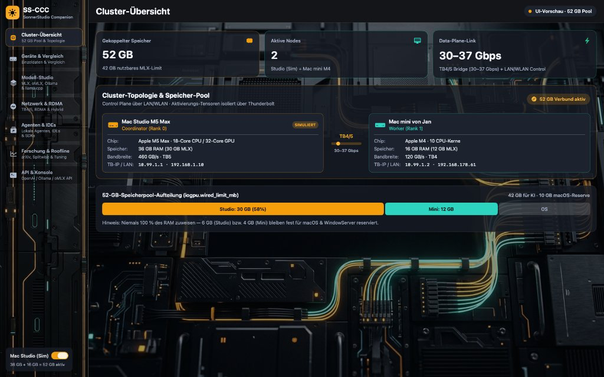
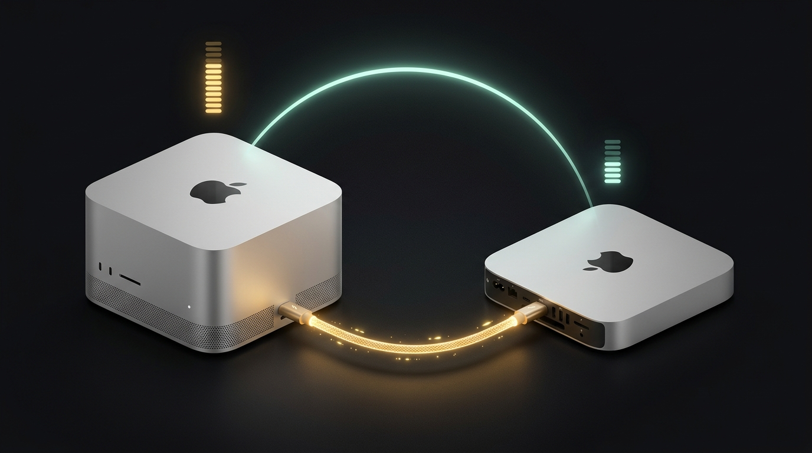
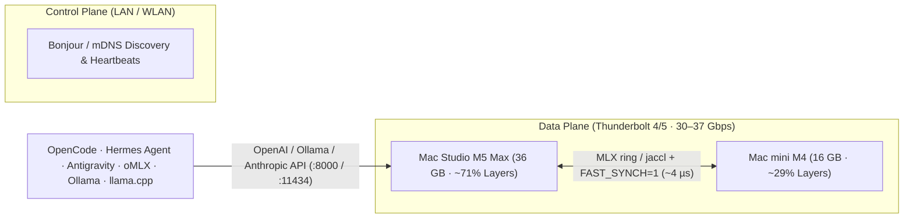

<div align="center">

# ☀️ SonnerStudio Cluster-Case-Companion (SS-CCC)

**🇺🇸 🇬🇧 🇨🇦 [English](README.md)** · **🇩🇪 🇦🇹 🇨🇭 [Deutsch](README.de.md)** · **🇫🇷 🇧🇪 🇨🇭 [Français](README.fr.md)** · **🇪🇸 🇲🇽 🇦🇷 [Español](README.es.md)** · **🇵🇹 🇧🇷 [Português](README.pt.md)**

*Native macOS Apple Silicon cluster manager & distributed MLX inference studio*



</div>

---

## 🧭 Overview

**SonnerStudio Cluster-Case-Companion (SS-CCC)** combines the unified memory of multiple Apple Silicon Macs — such as a **Mac Studio M5 Max (36 GB, Thunderbolt 5)** and a **Mac mini M4 (16 GB, Thunderbolt 4)** — into a **52 GB physical (~42 GB usable) AI cluster** over **Thunderbolt (Bridge or RDMA)**, **LAN/WLAN**, or **Hybrid** networking.

<div align="center">
  
</div>

---

## 🏗️ Hybrid Architecture (Control Plane & Data Plane)



---

## ✨ Key Capabilities

- **52 GB Heterogeneous Memory Coupling:** Memory-weighted pipeline parallelism (`~71%` layers + embeddings/LM-head on M5 Max `460 GB/s`, `~29%` layers on M4 `120 GB/s`) with safe `iogpu.wired_limit_mb` guards.
- **Native SwiftUI Studio (*Solaris Telemetry Lab*):**
  - **Cluster Overview & Device Comparison:** Live `sysctl` / `sw_vers` / `ibv_devices` / `ipconfig` telemetry with side-by-side comparison.
  - **Model Studio:** Proportional layer sharding, KV-cache quantization (`FP16 / 8-bit / 4-bit`), and direct integration for **oMLX**, **Ollama**, and **llama.cpp**.
  - **Agents & IDEs (1-Click Setup):** Instant configuration export for **OpenCode**, **Hermes Agent**, and **Google Antigravity**.
  - **Multilingual UI:** Built-in language switcher in the left sidebar (DE, EN, FR, ES, PT).

---

## 🚀 Quick Start

```bash
# 1. Launch the native SwiftUI Studio App
"./scripts/run_ssccc.sh"

# 2. (Optional) Start the Python/FastAPI Gateway
cd core && uv sync --extra dev
PYTHONPATH=".." uv run uvicorn core.api.gateway:app --host 0.0.0.0 --port 8000

# 3. Configure Thunderbolt Point-to-Point IPs
./scripts/setup_tb_network.sh studio   # 10.99.1.1
./scripts/setup_tb_network.sh mini     # 10.99.1.2
```

---

## 📄 License

Published under the [MIT License](LICENSE.md).
