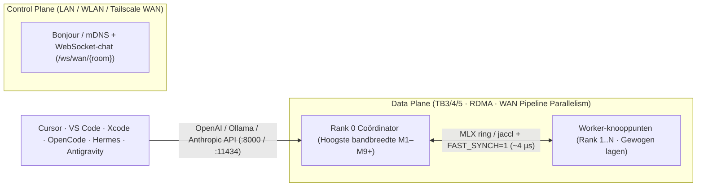
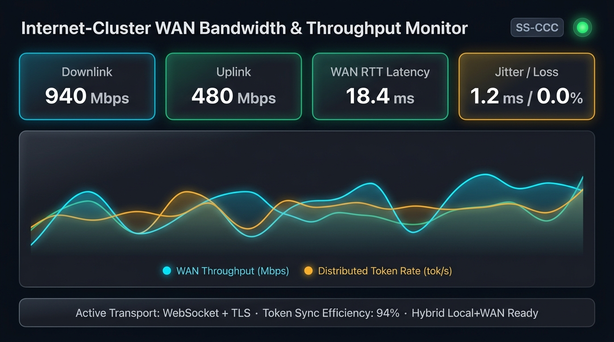

<div align="center">

# ☀️ SonnerStudio Cluster-Case-Companion (SS-CCC)

   **[English](README.md)** ·    **[Deutsch](README.de.md)** ·    **[Français](README.fr.md)** ·    **[Español](README.es.md)**<br/>
  **[Português](README.pt.md)** ·  **[Русский](README.ru.md)** ·  **[日本語](README.ja.md)** ·  **[中文](README.zh.md)**<br/>
  **[Nederlands](README.nl.md)** ·   **[Afrikaans](README.af.md)** ·  **[Polski](README.pl.md)** ·  **[Čeština](README.cs.md)**<br/>
 **[Slovenčina](README.sk.md)** ·  **[Magyar](README.hu.md)** ·  **[한국어](README.ko.md)** ·  **[हिन्दी](README.hi.md)** ·    **[தமிழ்](README.ta.md)**
<br/><a href="https://hits.sh/github.com/SonnerStudio/SonnerStudio-Cluster-Case-Companion/"></a>

*Eigenstandige macOS-clusterbeheerder voor Apple Silicon & gedistribueerde MLX-inferentiestudio*

<table>
  <tr>
    <td align="center">
      <br/>
      <sub><b>Clustermodus (52 GB gedeeld geheugen · 2 knooppunten)</b></sub>
    </td>
    <td align="center">
      <br/>
      <sub><b>Zelfstandige modus (16 GB lokaal · 1 knooppunt)</b></sub>
    </td>
  </tr>
</table>

</div>

---

## 🧭 Overzicht

**SonnerStudio Cluster-Case-Companion (SS-CCC)** bundelt het geheugen en de rekenkracht van willekeurige **Apple Silicon-Macs (M1–M9+)** — van een enkele Mac mini of MacBook Pro tot lokale **Thunderbolt 3/4/5 & RDMA**-clusters en **wereldwijde internet-WAN-clusters (2–256+ Macs)** — met rechtstreekse ondersteuning voor **MLX**, **oMLX**, **Ollama** en **llama.cpp**.

<div align="center">
  
</div>

---

## 🌐 Wereldwijd internetcluster, livechat & wetenschappelijke Roofline

<table>
  <tr>
    <td align="center" width="50%">
      <br/>
      <sub><b>Wereldwijd internetcluster & deelnemerschat</b><br/>Tailscale · WireGuard · libp2p QUIC · DERP · <code>/status</code> · <code>/layers</code> · <code>/ping</code></sub>
    </td>
    <td align="center" width="50%">
      <br/>
      <sub><b>Wetenschappelijke Roofline & energieanalyse</b><br/>Log-Log Roofline · GPipe Bubble · <code>J/token</code> · <code>p50/p95/p99</code> · CSV/JSON/BibTeX</sub>
    </td>
  </tr>
</table>

---

## 🏗️ Hybride architectuur (Control Plane, Thunderbolt & WAN)



---

## 🌐 Internetcluster WAN-bandbreedte & doorvoermonitor



Binnen **Internetcluster & Chat** meet SS-CCC continu de werkelijke WAN-verbindingsprestaties (`netstat`, `ping`, `networkQuality`) — inclusief **Downlink / Uplink Mbps**, **WAN-RTT-latentie (ms)**, **jitter**, **pakketverlies** en **tokensynchronisatie-efficiëntie** — en koppelt de internetdoorvoer direct aan gedistribueerde `tok/s` over partnerknooppunten.

---

## ✨ Belangrijkste mogelijkheden

- **Universele Apple Silicon-clustering (M1–M9+):** Combineer elke **Mac mini, MacBook Air/Pro, iMac, Mac Studio of Mac Pro** van **M1 tot M6** en toekomstige generaties **M7, M8, M9+** (Base, Pro, Max, Ultra). Het snelste knooppunt qua geheugenbandbreedte wordt automatisch **Rank 0 (Coördinator)** met veilige `iogpu.wired_limit_mb`-reserveringen voor macOS.
- **Volledige systeem- & sensortelemetrie:** Leest `sysctl`, `sw_vers`, `system_profiler`, `ibv_devices`, `ipconfig`, `ioreg` en `ProcessInfo.thermalState` uit — en toont **CPU P/E-kernen, GPU-kernen, Neural Engine (16/32 ANE-kernen), NVMe SSD-capaciteit & vrije ruimte, thermische status en vermogensopname** direct naast elkaar.
- **Alle Thunderbolt-klassen (TB3 / TB4 / TB5) & RDMA:** Onderhandelt dynamisch paarsgewijze snelheden over M1–M9+ (`TB3/USB4: 26–32 Gbps`, `TB4: 30–37 Gbps`, `TB5: 65–80 Gbps`, `TB5 RDMA: 75–110 Gbps`) met `MLX_METAL_FAST_SYNCH=1` (45× snellere GPU/CPU-synchronisatie).
- **Live Modelwerkplaats & runtimegereedheid:** Ontdekt daadwerkelijk geïnstalleerde/actieve modellen van **oMLX**, **Ollama**, **llama.cpp**, lokale `.gguf`-bestanden en `~/.cache/huggingface/hub` (geen schijnprofielen wanneer leeg; toont een live runtimecheck en installatiecommando's), met geheugengewogen laagverdeling en KV-cachekwantisatie (`FP16 / 8-bit / 4-bit`).
- **6× 1-klik agent- & IDE-integraties:** Directe configuratie-export voor **OpenCode**, **Hermes Agent**, **Google Antigravity**, **Cursor**, **Visual Studio Code** en **Apple Xcode**.
- **Wereldwijd internet-WAN-cluster & deelnemerschat (`/ws/wan/{room_id}`):** Verbind willekeurige Apple Silicon-Macs wereldwijd tot één gedistribueerd cluster via versleutelde tunnels (Tailscale / WireGuard, libp2p / DERP P2P-relais of handmatig eindpunt) met ingebouwde realtime chat.
- **6-tabblad onderzoeks- & WAN-lab + verloopopname:** Schakel naadloos tussen **Lokaal (TB/RDMA)**, **Internet WAN** en **Directe vergelijking** op 6 tabbladen: **Roofline & knelpunt**, **WAN-topologie & schaling**, **Geheugen & KV-analyse**, **Energie, CO₂ & kosten**, **Metingen, statistiek & export** (`CI₉₅`, `CV%`, `Goodput%`, `CSV / JSON / LaTeX / BibTeX`) en **Verloopopname**.
- **GitHub-gestuurde programma-updates & automatische versiebeheer-CI:** Controleert `version.json`, GitHub Releases en `commits/main`-SHA bij opstarten en elke 30 minuten (`⌘U`), met een in-app updatevenster, 1-klik `git pull` + `swift build` + herstart en automatische CI-tagcontrole.
- **SonnerStudio Geel (`#FFD400`), 17-talig handboek, hover-Shorttips & menubalk-achtergrondmodus (`⌘⇧M`):** Volledige interface, **app-brede hover-Shorttips**, **interactief 12-hoofdstukkenhandboek** in **17 talen** (`EN/DE/FR/ES/PT/RU/JA/ZH/NL/AF/PL/CS/SK/HU/KO/HI/TA`), **25/25 geautomatiseerde tests** en **minimaliseren naar de bovenste menubalk** als stille dienst voor agenten & IDE's.

### 🖥️ Overzicht van de 11 programmamodules


| Zijbalktabblad | Doel |
| :--- | :--- |
| **1. Cluster-overzicht** | Live geheugenpoolbalk, actieve M1–M12+-topologie, paarsgewijze TB/RDMA-snelheden & **4-staps Setup- en gereedheidsstatuskaart** |
| **2. Apparaten & Vergelijking** | M1–M12+-Macs toevoegen/verwijderen, realtime CPU/GPU/ANE/SSD/thermie/vermogen inspecteren en vergelijken |
| **3. Modelwerkplaats** | Live modeldetectie (oMLX / Ollama / llama.cpp / GGUF), runtimegereedheid, proportionele laagverdeling, ANE-Split & 3-traps KV-cache |
| **4. Netwerk & Direct Geheugen** | Wisselen tussen Auto-Hybrid / TB-Only / LAN / RDMA, `FAST_SYNCH=1`, Pipeline Ring vs. JACCL Full-Mesh TP & TB3/TB4/TB5-klassen |
| **5. Internetcluster & Chat** | Koppel lokale TB/RDMA-Macs met wereldwijde WAN-peers (QUIC/Iroh 0-RTT, Tailscale/WireGuard), monitor **WAN-bandbreedte** & Audio-Party (`/ws/wan-audio`, `/ws/wan`) |
| **6. Multi-Model-Modus (MMM)** | Combineer meerdere modellen over **Lokaal**, **Internet-WAN** of **Hybride** (*Parallel Pool*, *MoA*, *EAGLE-3 / Speculative*, *Tree-MoA Early-Exit*, *Ares*) voor **gelijktijdig multi-IDE-gebruik** (`:8000/v1`) |
| **7. Agenten & IDE's** | 1-klik configuratie & kopieerbare bestanden (incl. **MCP Registry JSON** & **A2A Agent Card**) voor OpenCode, Hermes, Antigravity, Cursor, VS Code en Xcode |
| **8. Onderzoek & Prestaties** | 6-tabblad lokaal & WAN-onderzoekslab met echte SSE-streaming & ICMP RTT, directe MMM-evaluatie, Log-Log Roofline, `N=1..128`, `J/tok` / `EDP` / `CO₂` en verloopopname |
| **9. API & Console** | Test OpenAI- (`/v1/chat/completions`, `/v1/responses` + MCP) & Ollama-eindpunten (`/api/tags`), inspecteer **A2A Agent Cards** en draai live prompts |
| **10. Configuratie & Inrichten** | Automatische ontdekking van lokale TB/LAN-Macs (Bonjour), WAN-peers (`QUIC Iroh` / `Tailscale`) of hybride clusters; SSH-trust & `iogpu.wired_limit_mb` uitrollen en **gereedheid verifiëren** |
| **11. Hulp & Handleiding** | Doorzoekbaar **12-hoofdstukkenhandboek in 17 talen** (`⌘?`) met interactieve detaildiagrammen, gloei-accenten en stap-voor-stap-gids |

---

## 🛠️ Bouwen vanaf broncode (belangrijk vóór de eerste start)

> [!NOTE]
> Deze repository bevat de **Swift-broncode** van SS-CCC (hier wordt geen voorgecompileerde `.app`-binary meegeleverd). Compileer de code eerst lokaal op je Apple Silicon-Mac om het programma te starten.

### Vereisten
- Elke Apple Silicon-Mac (**M1–M6+**) met **macOS 14.0 of nieuwer**
- **Xcode Command Line Tools** (bevat `swiftc` en de macOS-SDK):
  ```bash
  xcode-select --install
  ```

### Stap voor stap: van repository naar uitvoerbare app
```bash
# 1. Repository klonen
git clone https://github.com/SonnerStudio/SonnerStudio-Cluster-Case-Companion.git
cd SonnerStudio-Cluster-Case-Companion

# 2. Bouw- en startscript uitvoerbaar maken (eenmalig)
chmod +x scripts/run_ssccc.sh

# 3. Alle Swift-bronnen compileren naar /tmp/SSCCCApp en de app starten
./scripts/run_ssccc.sh
```
*(Optioneel: je kunt ook direct bouwen via Swift Package Manager met `cd app && swift build -c release`.)*

---

## 🚀 Snelstart

```bash
# 1. Start de eigenlijke SwiftUI Studio-app
"./scripts/run_ssccc.sh"

# 2. (Optioneel) Start de Python/FastAPI-gateway
cd core && uv sync --extra dev
PYTHONPATH=".." uv run uvicorn core.api.gateway:app --host 0.0.0.0 --port 8000

# 3. Configureer Thunderbolt point-to-point IP-adressen
./scripts/setup_tb_network.sh studio   # 10.99.1.1
./scripts/setup_tb_network.sh mini     # 10.99.1.2
```

---

## 📖 Praktijkhandleiding: lokaal & hybride clusteropzet, modellen laden & berekening

### 1. Lokaal cluster instellen (Thunderbolt 3/4/5 & LAN)
1. **Fysieke verbinding:** Verbind je Macs rechtstreeks met **Thunderbolt 3/4/5-kabels** (point-to-point, daisy-chain of ring) en/of **10GbE Ethernet**.
2. **Point-to-point IP's toewijzen:** Voer `./scripts/setup_tb_network.sh studio` (`10.99.1.1`) uit op de hoofd-Mac en `./scripts/setup_tb_network.sh mini` (`10.99.1.2`, enz.) op werkers.
3. **Optionele RDMA (macOS 26.2+ op TB5):** Schakel Apple's lage-latentie-RDMA in met `rdma_ctl enable`, zodat `JACCL` (`mlx.distributed`) **`~3 µs`** knooppuntlatentie bereikt in plaats van `~300 µs` via TCP/IP.
4. **Automatische rangtoewijzing:** Voeg alle Macs toe onder **Apparaten & Vergelijking**. SS-CCC's `MemoryWeightedPlanner` maakt automatisch de Mac met de hoogste geheugenbandbreedte **Rank 0 (Coördinator)** en alle andere **Rank 1..N (Workers)**.

### 2. Hybride clusternetwerk opzetten (Lokaal + Internet WAN tegelijk)
1. **Lokale snelle kern (Tier 1):** Houd je lokale Thunderbolt/LAN-ring actief (`10.99.1.x` / `192.168.x.x`) voor latentiegevoelige lagen.
2. **WAN-coördinatorkamer (Tier 2):** Start in **Internetcluster & Chat** een WAN-kamer (`/ws/wan/{room_id}` op poort `8000` via Tailscale, WireGuard of Cloudflare Tunnel).
3. **Externe werkers koppelen:** Macs wereldwijd voegen zich toe via de **Kamercode + deelnametoken**.
4. **Tweetraps hybride routering:** SS-CCC houdt hoogfrequente lagen op de lokale TB/LAN-ring (`3–180 µs`) en routeert overige pijplijnfasen naar WAN-werkers met micro-batching (`M ≥ 4`).

### 3. Wie laadt het model, hoeveel modellen passen erin & verzoekstroom
- **Wie laadt wat?**
  - **Coördinator (Rank 0):** Host de OpenAI/Anthropic/Ollama-API-gateway (`:8000`), tokeniseert en beheert **altijd Embeddings en LM-Head** plus zijn evenredige deel transformerlagen (`Layers_i = TotalLayers × Usable_i / TotalUsable`).
  - **Werkers (Rank 1..N):** Elke werker leest **uitsluitend zijn eigen toegewezen laagschijf `[start_layer .. end_layer)`** uit de lokale cache—geen enkel knooppunt verspilt RAM aan lagen van anderen.
- **Hoeveel modellen kunnen tegelijkertijd geladen zijn?**
  - **Gedistribueerde clustermodus (`mlx.distributed` / `JACCL`):** **1 groot opgesplitst model** verdeeld over het gecombineerde clustergeheugen (modellen wisselen doet een snelle hot-swap).
  - **Multi-model-server (`oMLX` / `Ollama` / MMM):** Zolang `Σ (ModelWeights_i + KV_Cache_i) ≤ Totaal_Bruikbaar_VRAM_GB` (na 4–8 GB macOS-reserve), draaien **meerdere modellen gelijktijdig** (bijv. **32B coder + 8B router + 1.5B embeddings**).
- **End-to-end uitvoeringsstroom:**
  1. **Detectie & linkkeuze:** Leest RAM, bandbreedte en interfaces (`TB5 RDMA > TB Bridge > 10GbE > WLAN > WAN`).
  2. **Shardingsplan:** `MemoryWeightedPlanner` schrijft `hostfile.json` en bewaakt `iogpu.wired_limit_mb`.
  3. **API-ingang:** Agenten/IDE's sturen verzoeken naar `http://127.0.0.1:8000/v1/chat/completions`.
  4. **Prefill-fase (`TTFT`):** Rank 0 embedt de prompt en stuurt activaties door de pijplijn (`Rank 0 → 1 → ... → N → Rank 0`).
  5. **Decodeerfase (`TPOT` & `tok/s`):** Tokens worden autoregressief gegenereerd met `--kv-bits 4` en `MLX_METAL_FAST_SYNCH=1`.
  6. **SSE-streaming & telemetrie:** Rank 0 streamt tokens en logt `tok/s`, `TTFT`, `TPOT`, `J/tok` en `p50/p95/p99`.

### 4. Theoretische dimensionering & prestatiegegevens over praktijkscenario's

> **Analytische schattingsregels:**
> - **Geheugenbeslag:** `VRAM_GB ≈ Params_B × (Bits / 8) × 1.15 + KV_Cache_GB`
> - **Theoretische decodeergrens:** `tok/s ≈ (Effective_Bandwidth_GB/s / Active_Weights_GB) × (1 − Comm_Overhead)`

| Gebruiksscenario | Topologie & bruikbaar geheugen | Model & kwantisatie | Theoretische `TTFT` (2k prompt) | Theoretische decode (`tok/s` / `TPOT`) | Energie & primaire bottleneck |
| :--- | :--- | :--- | :--- | :--- | :--- |
| **1. Solo werkstation (Edge Dev)** | 1× Mac mini M4 (16 GB, `12 GB` bruikbaar, `120 GB/s`) | `Qwen2.5-14B` (`4-bit`, ~8,8 GB) | `~1,8 – 2,6 s` | **`11 – 14 tok/s`** (`~75 ms/tok`) | `~1,7 J/tok` · Geheugenbandbreedte |
| **2. Enkele Pro Studio (Snel coderen)** | 1× Mac Studio M4 Max (64 GB, `58 GB` bruikbaar, `546 GB/s`) | `Llama-3.3-70B` (`4-bit`, ~40 GB) | `~1,1 – 1,7 s` | **`12 – 14 tok/s`** (`~74 ms/tok`) | `~3,8 J/tok` · Geheugenbandbreedte |
| **3. Lokale 2-knooppunts TB5 RDMA-ring** | 2× M4 Max 64 GB (`116 GB` bruikbaar, `~1.092 GB/s`, `~3 µs`) | `Qwen2.5-Coder-72B` (`8-bit`, ~78 GB) | `~1,4 – 2,0 s` | **`12 – 14 tok/s`** (`~76 ms/tok`) | `~7,5 J/tok` · Verwaarloosbare RDMA-sync |
| **4. Onderzoekslab 4-knooppunts Ultra-ring** | 4× M3 Ultra 256 GB (`992 GB`, `~3,27 TB/s`, TB5 RDMA) | `DeepSeek-V3 671B MoE` (`4-bit`, ~385 GB) | `~2,2 – 3,5 s` | **`38 – 55 tok/s`** (`~20 ms/tok`) | `~5,2 J/tok` · Actieve MoE-experts |
| **5. Hybride Kantoor-LAN + Thuis-WAN** | 2× Lokaal TB4 + 2× WAN (`192 GB`, `35 ms` RTT) | `Llama-3.1-405B` (`3/4-bit`, ~170 GB) | `~6 – 11 s` | **`2,2 – 4,5 tok/s`** (`~280 ms/tok`) | `~28 J/tok` · WAN RTT (`M=8` helpt) |
| **6. Wereldwijde community-WAN-zwerm** | 16+ Macs wereldwijd (`1,5+ TB`, `60–120 ms` RTT) | `671B–1T+` Frontier (`4/8-bit`) | `~12 – 25 s` | **`1,2 – 3,0 tok/s`** (`~500 ms/tok`) | WAN-latentie (batching schaalt) |

---

## 📚 Geselecteerde documentatie (ingebouwd in het handboek)

### 1. Universele Apple Silicon M-serie-clustering (M1–M12+)
SS-CCC ondersteunt **elke Mac met een Apple Silicon M-processor** (**M1–M6** en toekomstbestendig **M7–M12+** — Base, Pro, Max, Ultra) over **Mac mini, MacBook Air, MacBook Pro, iMac, Mac Studio en Mac Pro**. Voeg onder **Apparaten & Vergelijking** willekeurige Macs toe; de snelste wordt automatisch **Rank 0 (Coördinator)**.

| Mac / Chipfamilie | Geheugenbandbreedte | Thunderbolt & RDMA | Aanbevolen macOS-reserve |
| :--- | :--- | :--- | :--- |
| **M1 / M2** (Base) | 68 – 100 GB/s | TB 3 / USB4 (26–32 Gbps) | **4 GB** (≤ 24 GB RAM) |
| **M3 / M4** (Base) | 100 – 120 GB/s | TB 4 (30–37 Gbps) | **4 GB** (≤ 24 GB RAM) |
| **M5 / M6** (Base, M6 2nm) | **153 – 170 GB/s** (`M6`: 153 GB/s @ 16 GB, 170 GB/s @ 24–32 GB) | TB 4 / TB 5 (`80/120 Gbps`) | **4 GB** (≤ 32 GB RAM) |
| **M1–M3 Pro** | 150 – 200 GB/s | TB 4 (30–37 Gbps) | **4 – 6 GB** |
| **M4 / M5 Pro** | 273 – 307+ GB/s | TB 5 (`80/120 Gbps` boost) | **4 – 6 GB** |
| **M1–M3 Max** | 400 GB/s | TB 4 (30–37 Gbps) | **6 GB** (32–64 GB RAM) |
| **M4 Max** | **410 – 546 GB/s** (LPDDR5X-8533) | TB 5 + RDMA (`~3 µs`) | **6 GB** (32–128 GB RAM) |
| **M5 Max** | **460 – 614 GB/s** (32/40-core GPU) | TB 5 + RDMA (`~3 µs` JACCL) | **6 GB** (36–128 GB RAM) |
| **M1–M2 Ultra / M3 Ultra** | **800 – 819 GB/s** (UltraFusion) | TB 4 / TB 5 RDMA (JACCL) | **8 GB** (≥ 96 GB RAM) |
| **M5 Ultra** | **1,2 TB/s** (~1.228 GB/s, tot 512 GB RAM, 80-core GPU) | TB 5 RDMA (`JACCL`) | **8 GB** (96–512 GB RAM) |

> [!NOTE]
> **M6-beschikbaarheid:** Apple bracht de 2nm-**M6** basischip (`153–170 GB/s`) uit in sep/okt 2026; **M6 Pro, M6 Max en M6 Ultra** zijn in november 2026 nog niet verschenen. SS-CCC herkent toekomstige M6 Pro/Max/Ultra en M7–M12+ automatisch zodra ze verschijnen.

### 2. Thunderbolt 5 RDMA (`JACCL`) & geheugenveiligheid


- **macOS RDMA via Thunderbolt 5:** Met `rdma_ctl enable` (macOS 26.2+) en Apple's `JACCL`-backend zakt knooppuntlatentie van `~300 µs` (TCP/IP) naar **`~3 µs`** met **`3,5–3,8 GB/s`** tensor-doorvoer.
- **Wijs nooit 100% RAM toe:** SS-CCC handhaaft `iogpu.wired_limit_mb`-reserves zodat macOS en WindowServer vloeiend blijven.
- **Proportionele laagverdeling:** Elke Mac ontvangt lagen naar rato van bruikbaar geheugen (`Layers_i = TotalLayers × Usable_i / TotalUsable`).
- **KV-cache & snelle Metal-sync:** Gebruik `--kv-bits 4` + `--prefill-step-size 512` voor 64k+ context en `MLX_METAL_FAST_SYNCH=1` voor **45×** snellere Metal-synchronisatie.

---

## 🔄 GitHub-gestuurde programma-updates & automatische versiebeheer-CI


SS-CCC bevat een geïntegreerde **GitHub-gestuurde update- en versiecontrolepijplijn** zodat elke lokale installatie automatisch actueel blijft:

1. **Uitgebreide GitHub-versiecontrole:**
   - `raw.githubusercontent.com/.../main/version.json` (live releasemanifest met `version`, `build`, `commit_sha`, `mandatory` en `notes`)
   - `api.github.com/repos/.../releases/latest` (officiële GitHub Releases & `.dmg`/`.zip`-pakketten)
   - `api.github.com/repos/.../commits/main` (nieuwste `HEAD` short-SHA)
2. **In-app updatevenster (`UpdatePromptSheet`) & 1-klik heropbouw:**
   - Zodra een hogere semantische versie, hoger buildnummer of nieuwere `main`-SHA wordt ontdekt, licht de **Update-pil** bovenin op (`⌘U`).
   - **Broncode-installaties:** Voert direct `git pull --ff-only origin main` + hercompileer-stap uit en biedt een 1-klik knop **App nu herstarten**.
   - **Pakketten (`.app`):** Opent de GitHub Release-download in Safari.
3. **Geautomatiseerde CI-versieverhoging (`.github/workflows/auto-version-control.yml`):**
   - Elke push naar `main` draait `scripts/bump_version.py`, synchroniseert `version.json` en `ClusterModels.swift`, voert alle 25 tests uit en werkt Git-tags `vX.Y.Z` bij.

---

## 🧠 Multi-Model-Modus (MMM) — Gedeelde modelorkestratie & multi-IDE-gebruik


De **Multi-Model-Modus (MMM)** koppelt meerdere AI-modellen gelijktijdig over **Lokaal Cluster**, **Internetcluster** of **Hybride Cluster**, inclusief `iogpu.wired_limit_mb`-beveiliging en directe export naar **Onderzoek & Prestaties**.

### 4 Orkestratiestrategieën
1. **Parallelle multi-model-pool:** Houdt meerdere gespecialiseerde modellen gelijktijdig actief in aparte VRAM-budgetten.
2. **Mixture-of-Agents (MoA):** Stuurt dezelfde prompt parallel naar specialisten en combineert de uitkomsten via een `Aggregator`.
3. **Speculatief decoderen (Draft + Target):** Koppelt een snel `Draft`-model (bijv. Mac mini M4) aan een groot `Target`-model voor $1,6\times$–$2,3\times$ versnelling.
4. **Sequentiële modelpijplijn:** Keten modellen als fasen (*Planner → Coder → Reviewer*) over lokale en WAN-knooppunten.

### ⚙️ 1-klik Auto-Setup & live slot-editor achteraf


Het configureren en aanpassen van slots is altijd mogelijk:
- **1-klik Auto-Setup-profielen:** Kies uit **Coding & IDE Swarm**, **Consensus & Audit**, **Turbo (Draft + Target)** en **Fase-pijplijn**.
- **Volledige bewerking achteraf:** Sorteer fasen (`Omhoog`/`Omlaag`), dupliceer replica's, schakel slots aan/uit of bewerk model-ID en URL (`:8000/v1`, `:11434/v1`).
- **VRAM-Fit-optimizer & opslag:** Trim overtollige slots met 1 klik en bewaar profielen permanent (`UserDefaults`) of als JSON.

### Gedeeld multi-IDE- & agentgebruik (`:8000/v1`)
Meerdere IDE's (**Cursor**, **VS Code**, **Xcode**, **OpenCode**, **Hermes Agent**, **Google Antigravity**) gebruiken het cluster gelijktijdig via `:8000/v1` met live `tok/s`-doorvoerschatting per client.

### Praktische MMM-toepassingen
- **Multi-IDE & multi-agent-ontwikkeling:** Draai Cursor, OpenCode en Hermes Agent tegelijk zonder herlaadpauzes.
- **Speculatieve turbo op gemengde Macs:** Laat een 16 GB Mac mini vooruit voorspellen terwijl een Mac Studio verifieert.
- **MoA-code-audit:** Combineer een codeer-, wiskunde- en aggregatormodel.
- **Hybride Lokaal + WAN-specialisatie:** Snelle autocomplete lokaal via TB, zware 405B-taken via WAN.
- **Geautomatiseerde CI/refactoring-pijplijnen:** *Architectuur → Implementatie → Security-audit*.
- **Wetenschappelijke ensemblebenchmarks:** Elke MMM-run voedt automatisch `Onderzoek & Prestaties`.

---

## 🎙️ Cluster Audio-Party & live WAN-samenwerking


- **Spraakcoördinatie in console-stijl:** Gebouwd naast de tekstchat in **Internetcluster** met native `AVAudioEngine` (`16 kHz PCM16`) over `/ws/wan-audio`.
- **Tactische bediening:** Schakel tussen **Push-to-Talk** en **Open microfoon** met ruisdrempel, direct dempen, niveaumeters en roltags (`Rank 0 Gateway`, `WAN Worker`).
- **Realtime kamersync (`/ws/wan/{room_id}`):** Synchroniseert `SSCCC-WAN-…`-uitnodigingen, hybride koppelingen en chattelemetrie.

---

## 🏆 Wereldwijd + lokaal hybride supercluster-recordpoging


**Kan een gedecentraliseerde coalitie van Apple Silicon-Macs wedijveren met een datacenter-supercomputer?**  
We nodigen universiteiten, AI-labs, ontwikkelaars en Mac-liefhebbers uit voor een officiële **SS-CCC Hybride Supercluster-recordpoging** via **Hybride Koppeling**, **Audio-Party** en het **6-tabblad Onderzoekslab**.

### 🔬 Wetenschappelijke basis & wiskundig schaalmodel

1. **Tweetraps hiërarchische topologie (Tier-0 TB/RDMA-eilanden + Tier-1 WAN-ruggengraat):**
   - Platte WAN-clusters verliezen snelheid als elke laagovergang via internet loopt ($H_{\text{WAN}} = N - 1$).
   - Door lokale TB/RDMA-eilanden te koppelen blijven opeenvolgende lagen lokaal (`~0,07 ms`, `30–110 Gbps`), waardoor WAN-sprongen beperkt blijven tot eilandovergangen.
2. **WAN-RTT opvangen via kritieke micro-batching ($B^*$) & activatiecompressie:**
   - Bij pijplijnparallellisme volgt efficiëntie de GPipe-bubbelwet:
     $$\Phi_{\text{bubble}} = \frac{N - 1}{M + N - 1}, \qquad B^* = \left\lceil \frac{T_{\text{RTT,WAN}} + T_{\text{tx}}}{T_{\text{comp}}(B=1)} \right\rceil$$
   - Grotere micro-batches $M \to B^*$ verbergen trans-continentale RTT terwijl **FP8 / INT4 / Top-K** (*Petals / SWARM*) WAN-belasting onder $1\%$ houdt.
3. **Gestandaardiseerd reproduceerbaar recordprotocol ($T = 0,0$):**
   1. **Vorm Tier-0-eilanden:** Verbind lokale Macs via Thunderbolt 3/4/5 (`MLX_METAL_FAST_SYNCH=1`).
   2. **Koppel & coördineer:** Deel `SSCCC-WAN-…` en gebruik Audio-Party om laagsplits af te stemmen.
   3. **Voer metingen uit:** Kies `N = 20` metingen (`temperature = 0.0`, `TTFT ≤ 2500 ms`, `TPOT ≤ 100 ms/tok`).
   4. **Exporteer verificatie:** Deel het **JSON Reproducibility Manifest**, **CSV-logboek** en de **LaTeX-tabel** (`CI₉₅`, `CV%`, `J/token`, `EDP`, `gCO₂eq`).


### 🥇 Officiële recordcategorieën
- **Grootste gedeelde geheugenpool:** Hoogste bruikbare VRAM (`GB` / `TB`) over lokaal + WAN.
- **Meeste gekoppelde Macs tegelijk ($N$):** Grootste actieve mesh (`32–256+` knooppunten) met geldige `N = 20`-reeks.
- **Hoogste intercontinentale hybride Goodput:** Maximale `tokens/s` binnen SLO over $\ge 2$ continenten.
- **Beste cluster-energie-efficiëntie:** Laagste `J/token` en `EDP` bij een `70B+`-model.

---

## 🎯 Toepassingen & doelgroepen


| Doelgroep | Praktisch gebruik met SS-CCC |
| :--- | :--- |
| **AI-systeemonderzoekers** | Analyseer lokale vs. WAN Roofline-limieten, *Petals/SWARM*-compressie, *DiLoCo* vs. DDP en exporteer direct `CI₉₅` + `LaTeX`/`BibTeX`. |
| **Universiteiten & onderwijslabs** | Bundel MacBooks en Mac mini's over campus-LAN en thuis-WAN tot een 70B–405B+-onderwijscluster. |
| **Softwarestudio's & agentteams** | Draai lokale codeermodellen zonder cloudkosten voor OpenCode, Hermes, Antigravity, Cursor, VS Code en Xcode. |
| **Privacygerichte advocatuur & zorg** | Houd gevoelige data 100% intern of binnen versleutelde WireGuard/Tailscale-tunnels zonder API-datalek. |
| **Wereldwijde open-source-hackathons** | Bouw in minuten een grensoverschrijdend supercluster met spraakcoördinatie en recordmetingen. |
| **Green-AI & duurzaamheidsaudits** | Vergelijk `J/token`, `EDP` en `gCO₂eq/1M tokens` (Noorwegen hydro vs. EU/US) met datacenter-GPU's. |

---

## 📁 Structuur van de repository

```text
├── app/Sources/
│   ├── SSCCCApp.swift              # Hoofdvenster, MenuBarExtra-achtergrondservice, update-pil & heropstart
│   ├── Models/
│   │   ├── ClusterModels.swift     # M1–M12+-chipinferentie, WAN-/Onderzoek-/Verloop- & Releasemodellen
│   │   └── Localization.swift      # Volledig 17-talig UI- & helpwoordenboek (EN..TA)
│   ├── ViewModels/
│   │   └── ClusterViewModel.swift  # Hardware-scans, modeldetectie, WAN/Audio-Party & GitHub-updater
│   └── Views/                      # 12 modulaire SwiftUI-weergaven + Theme.swift (11 tabbladen, warnstrepen & Shorttips)
├── core/                           # Python FastAPI-gateway, WebSocket WAN/Audio-relais & MLX-sharding
├── scripts/
│   ├── run_ssccc.sh                # Compileert & start de macOS-applicatie
│   ├── bump_version.py             # Synchroniseert version.json & ClusterModels.swift met Git
│   ├── setup_tb_network.sh         # Configureert 10.99.1.x Thunderbolt-bridge
│   └── setup_wired_limit.sh        # Past veilige iogpu.wired_limit_mb-limieten toe
├── tests/                          # 25-delige globale testreeks (Swift + Python)
├── .github/workflows/              # Geautomatiseerd CI-versiebeheer & tagging
└── version.json                    # GitHub-gestuurd updatemanifest
```

---

## 🚀 2026 SOTA-architectuurupgrade (Fase 11)

- **TB5 RDMA Tensor Parallelism & QUIC / Iroh WAN:** Kies tussen **Pipeline Ring** en **JACCL Full-Mesh TP**, voer `rdma_ctl enable`-preflightchecks uit en selecteer **QUIC / Iroh P2P (0-RTT)**.
- **Gedisaggregeerde Prefill/Decode (ANE-Split) & 3-traps KV-cache / CacheGen:** Verplaats prompt-prefill naar de Apple Neural Engine (`EDP ×1,42`, `-31,5%` vermogen) en configureer **RAM → NVMe SSD → Peer CacheGen**.
- **Next-Gen MMM (EAGLE-3, Tree-MoA Early-Exit & Ares):** Activeer **EAGLE-3**-fusie, betrouwbaarheidsdrempels en adaptieve modelescalatie.
- **Moderne agent- & gatewaystandaarden:** Exporteer **OpenAI `/v1/responses`**, **MCP Server Registry JSON** en **A2A Agent Cards**.
- **Thermisch- & koolstofbewuste planning:** Verlaag automatisch prioriteit bij `.serious`/`.critical` hittestatus.

### 🛠️ Fase 12: Cluster Auto-Setup, gereedheidsdiagnose & app-brede Shorttips


- **11e zijbalkcategorie (`Configuratie & Inrichten`):** Ontdekt lokale TB/LAN-Macs en WAN-peers automatisch en rolt SSH + geheugenbeveiliging uit.
- **4-staps gereedheidslevenscyclus:** Rapporteert **Gereed**, **Niet gereed**, **Onvolledig geconfigureerd** of **Niet geconfigureerd** in alle 17 talen.
- **App-brede hover-Shorttips:** Korte uitleg in macOS `.help` en de zwevende **Solaris-Shorttip-balk**.
- **Interactieve help & echte livedata:** Alle 12 hoofdstukken tonen detaildiagrammen; buiten simulatie werken alleen echte hardwaremetingen.

### 🛰️ Minimaliseren naar de menubalk (achtergronddienst voor agenten & IDE's, ⌘⇧M)

- **Naadloze verplaatsing naar de bovenste macOS-menubalk:** Klik op het gele minimaliseerbolletje van het venster, druk op **`⌘⇧M`** of gebruik de knop **Naar menubalk** in de header — het hoofdvenster verdwijnt en SS-CCC draait stil verder tussen **Ollama** en systeemachtergrondprogramma's (`.accessory`-modus).
- **Informatieve live-indicatoren in de menubalk:** Het menubalkicoon + popover toont direct **Gereedheidsstatus**, **Totaal / bruikbaar poolgeheugen (GB)**, **Actieve knooppunten**, **Geladen model & lagen**, **Laufzeit** en **Actieve MMM-slots**.
- **1-klik eindpunten & gekoppelde IDE's/agenten:** Kopieer **`http://127.0.0.1:8000/v1`** (OpenAI/MMM) of **`http://127.0.0.1:11434`** (Ollama) rechtstreeks vanuit het popovermenu en controleer welke agenten (Cursor, OpenCode, Hermes, Antigravity, VS Code, Xcode) aangesloten zijn.
- **Venster direct terughalen & automatische modus:** Herstel het volledige Studio-venster op elk moment vanuit de menubalk (`⌘⇧M`) of schakel de automatische minimaliseeroptie direct in het popovermenu.

---

## 🚧 Ontwikkelingsstatus & bijdragen

> [!IMPORTANT]
> **SS-CCC v1.6+ is volledig uitvoerbaar en geverifieerd door `25/25` geautomatiseerde tests, terwijl duurtests op grote multi-node-clusters doorlopen.**
> **Reeds geïmplementeerd & geverifieerd:** Engelse standaardstart met **volledige 17-talige lokalisatie (`EN/DE/FR/ES/PT/RU/JA/ZH/NL/AF/PL/CS/SK/HU/KO/HI/TA`) over alle 11 weergaven, submenu's, tabellen en detailkaarten (`L10n.tr`)**, **lokale Mac CPU-, GPU- & Neural Engine (ANE)-uitlezing**, **menubalk-achtergrondservice (`⌘⇧M` & minimaliseeronderschepping)**, **bezoekerteller in alle 17 README-bestanden**, open-ended M1–M12+ hardware-detectie, live modelontdekking, 6-tabblad Science Lab, Hybride Lokaal ↔ WAN, `AVAudioEngine` Audio-Party, **12-hoofdstukken-helpcentrum** en **GitHub-autoupdater**.

We nodigen ontwikkelaars, onderzoekers en Apple Silicon-enthousiastelingen van harte uit om **bij te dragen aan SS-CCC**:
- **Test op je eigen hardware:** Probeer SS-CCC op jouw M1–M12+ Macs en deel doorvoer- en RDMA-ervaringen.
- **Doe mee aan de hybride recordpoging:** Koppel lokale TB-eilanden met WAN-peers en publiceer JSON/CSV/LaTeX-manifesten.
- **Dien pull requests in:** Verbeteringen aan SwiftUI, MLX-sharding, scripts of vertalingen zijn altijd welkom!

---

## 📄 Licentie

Uitgebracht onder de [MIT-licentie](LICENSE.md).
