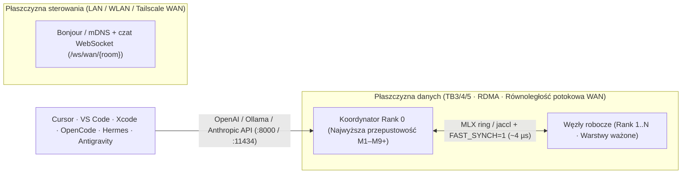
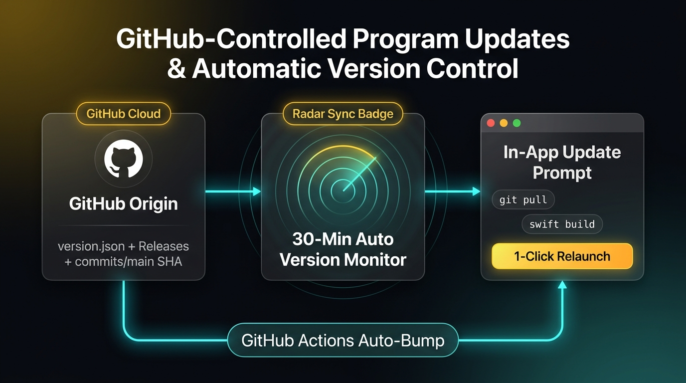
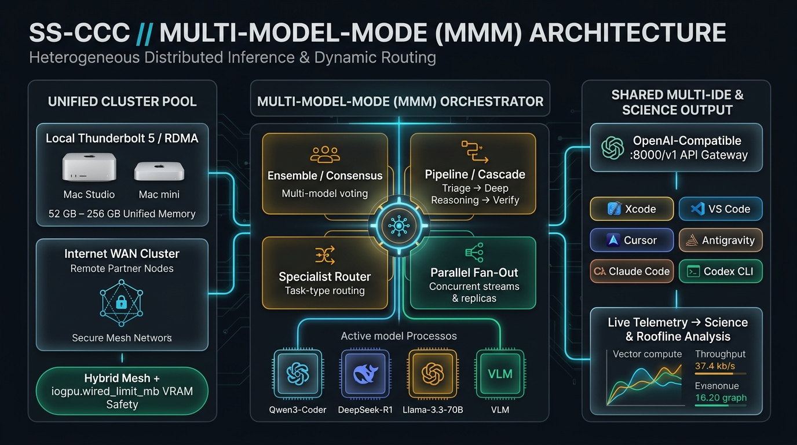

<div align="center">

# ☀️ SonnerStudio Cluster-Case-Companion (SS-CCC)

   **[English](README.md)** ·    **[Deutsch](README.de.md)** ·    **[Français](README.fr.md)** ·    **[Español](README.es.md)**<br/>
  **[Português](README.pt.md)** ·  **[Русский](README.ru.md)** ·  **[日本語](README.ja.md)** ·  **[中文](README.zh.md)**<br/>
  **[Nederlands](README.nl.md)** ·   **[Afrikaans](README.af.md)** ·  **[Polski](README.pl.md)** ·  **[Čeština](README.cs.md)**<br/>
 **[Slovenčina](README.sk.md)** ·  **[Magyar](README.hu.md)** ·  **[한국어](README.ko.md)** ·  **[हिन्दी](README.hi.md)** ·    **[தமிழ்](README.ta.md)**
<br/><a href="https://hits.sh/github.com/SonnerStudio/SonnerStudio-Cluster-Case-Companion/"></a>

*Natywny menedżer klastrów Apple Silicon dla macOS i studio rozproszonej inferencji MLX*

<table>
  <tr>
    <td align="center">
      <br/>
      <sub><b>Tryb klastra (52 GB zunifikowanej puli · 2 węzły)</b></sub>
    </td>
    <td align="center">
      <br/>
      <sub><b>Tryb samodzielny (16 GB lokalnie · 1 węzeł)</b></sub>
    </td>
  </tr>
</table>

</div>

---

## 🧭 Przegląd

**SonnerStudio Cluster-Case-Companion (SS-CCC)** łączy pamięć i moc obliczeniową dowolnych komputerów **Mac z układami Apple Silicon (M1–M9+)** — od pojedynczego Mac mini lub MacBook Pro po lokalne klastry **Thunderbolt 3/4/5 i RDMA** oraz **globalne klastry internetowe WAN (2–256+ Maców)** — z natywną obsługą **MLX**, **oMLX**, **Ollama** i **llama.cpp**.

<div align="center">
  
</div>

---

## 🌐 Globalny klaster internetowy, czat na żywo i naukowy Roofline

<table>
  <tr>
    <td align="center" width="50%">
      <br/>
      <sub><b>Globalny klaster internetowy i czat uczestników</b><br/>Tailscale · WireGuard · libp2p QUIC · DERP · <code>/status</code> · <code>/layers</code> · <code>/ping</code></sub>
    </td>
    <td align="center" width="50%">
      <br/>
      <sub><b>Naukowa analiza Roofline i energii</b><br/>Log-Log Roofline · GPipe Bubble · <code>J/token</code> · <code>p50/p95/p99</code> · CSV/JSON/BibTeX</sub>
    </td>
  </tr>
</table>

---

## 🏗️ Architektura hybrydowa (Płaszczyzna sterowania, Thunderbolt i WAN)



---

## 🌐 Monitor przepustowości i pasma WAN klastra internetowego


W module **Klaster internetowy i czat** aplikacja SS-CCC na bieżąco mierzy rzeczywistą wydajność łącza WAN (`netstat`, `ping`, `networkQuality`) — śledząc **pobieranie / wysyłanie Mbps**, **opóźnienie WAN RTT (ms)**, **jitter**, **utratę pakietów** oraz **efektywność synchronizacji tokenów**.

---

## ✨ Kluczowe możliwości

- **Uniwersalne klastrowanie Apple Silicon (M1–M9+):** Łącz dowolne **Mac mini, MacBook Air/Pro, iMac, Mac Studio i Mac Pro** od **M1 do M6** oraz przyszłych generacji **M7–M12+**. Najszybszy węzeł pod względem przepustowości pamięci automatycznie zostaje **Rank 0 (Koordynator)** z bezpiecznym limitem `iogpu.wired_limit_mb`.
- **Pełna telemetria systemu i czujników:** Odczytuje `sysctl`, `sw_vers`, `system_profiler`, `ibv_devices`, `ipconfig`, `ioreg` oraz `ProcessInfo.thermalState` — pokazując **rdzenie CPU P/E, GPU, Neural Engine (16/32 rdzenie ANE), dysk NVMe SSD, stan termiczny i pobór mocy** obok siebie.
- **Wszystkie klasy Thunderbolt (TB3 / TB4 / TB5) i RDMA:** Dynamicznie negocjuje prędkości połączeń (`TB3/USB4: 26–32 Gbps`, `TB4: 30–37 Gbps`, `TB5: 65–80 Gbps`, `TB5 RDMA: 75–110 Gbps`) z `MLX_METAL_FAST_SYNCH=1` (45× szybsza synchronizacja GPU/CPU).
- **Warsztat modeli na żywo i gotowość środowisk:** Wykrywa realnie zainstalowane/uruchomione modele z **oMLX**, **Ollama**, **llama.cpp**, lokalnych plików `.gguf` i `~/.cache/huggingface/hub` wraz z ważonym podziałem warstw i kwantyzacją pamięci podręcznej KV (`FP16 / 8-bit / 4-bit`).
- **6× integracje z agentami i IDE jednym kliknięciem:** Błyskawiczny eksport konfiguracji dla **OpenCode**, **Hermes Agent**, **Google Antigravity**, **Cursor**, **Visual Studio Code** i **Apple Xcode**.
- **Globalny klaster WAN i czat uczestników (`/ws/wan/{room_id}`):** Łącz komputery Mac z całego świata w jeden rozproszony klaster przez szyfrowane tunele (Tailscale / WireGuard, libp2p / DERP P2P lub ręczny punkt końcowy).
- **6-zakładkowe laboratorium badawcze i rejestr historii:** Przełączaj się między **Lokalnym (TB/RDMA)**, **Internetowym WAN** i **Porównaniem bezpośrednim** na 6 kartach: **Roofline i wąskie gardła**, **Topologia i skalowanie WAN**, **Pamięć i analiza KV**, **Energia, CO₂ i koszty**, **Próby, statystyki i eksport** (`CI₉₅`, `CV%`, `CSV / JSON / LaTeX / BibTeX`) oraz **Rejestracja historii**.
- **Aktualizacje sterowane przez GitHub i automatyczne CI wersji:** Automatycznie sprawdza `version.json`, GitHub Releases i SHA `commits/main` przy uruchomieniu i co 30 minut (`⌘U`), oferując aktualizację 1 kliknięciem i automatyczny restart.
- **Interfejs SonnerStudio Yellow (`#FFD400`), podręcznik w 17 językach, Shorttips i tryb paska menu (`⌘⇧M`):** Pełna lokalizacja w **17 językach** (`EN..TA`), kontekstowe podpowiedzi **Shorttips**, **12-rozdziałowy interaktywny podręcznik**, **25/25 testów globalnych** oraz **minimalizacja do górnego paska menu** jako usługa w tle dla agentów i IDE.

### 🖥️ Przegląd modułów programu (wszystkie 11 zakładek paska bocznego)


| Zakładka paska bocznego | Przeznaczenie |
| :--- | :--- |
| **1. Przegląd klastra** | Pasek puli pamięci na żywo, aktywna topologia M1–M12+, przepustowość TB/RDMA i **4-stanowa karta gotowości** |
| **2. Urządzenia i porównanie** | Dodawanie/usuwanie komputerów Mac M1–M12+, podgląd CPU/GPU/ANE/SSD/temperatury/mocy na żywo |
| **3. Warsztat modeli** | Wykrywanie modeli (oMLX / Ollama / llama.cpp / GGUF), gotowość runtime, podział warstw, ANE-Split i 3-poziomowy KV-cache |
| **4. Sieć i RDMA** | Tryby Auto-Hybrid / TB-Only / LAN / RDMA, `FAST_SYNCH=1`, Pipeline Ring vs. JACCL Full-Mesh TP i klasy TB3/TB4/TB5 |
| **5. Klaster internetowy i czat** | Łączenie lokalnych Maców TB/RDMA z węzłami WAN (QUIC/Iroh 0-RTT, Tailscale), monitoring **pasma WAN** i Audio-Party |
| **6. Tryb wielomodelowy (MMM)** | Orkiestracja wielu modeli lokalnie, przez WAN lub hybrydowo z **jednoczesnym dostępem dla wielu IDE** (`:8000/v1`) |
| **7. Agenci i środowiska IDE** | Konfiguracje 1 kliknięciem (w tym **MCP Registry JSON** i **A2A Agent Card**) dla 6 środowisk i agentów |
| **8. Nauka i Roofline** | 6-kartowe laboratorium naukowe z prawdziwym SSE i ICMP RTT, oceną MMM, Roofline, `N=1..128`, `J/tok` / `CO₂` i historią |
| **9. API i konsola** | Testowanie punktów końcowych OpenAI (`/v1/chat/completions`, `/v1/responses` + MCP), Ollama (`/api/tags`) i **A2A Agent Card** |
| **10. Konfiguracja i wdrożenie** | Automatyczne wykrywanie Maców TB/LAN i WAN, konfiguracja SSH / `wired_limit` i weryfikacja **Gotowości operacyjnej** |
| **11. Pomoc i podręcznik** | Przeszukiwalny **12-rozdziałowy podręcznik w 17 językach** (`⌘?`) z interaktywnymi diagramami |

---

## 🛠️ Budowanie ze źródeł (ważne przed pierwszym uruchomieniem)

> [!NOTE]
> To repozytorium zawiera **kod źródłowy Swift** aplikacji SS-CCC (nie zawiera gotowego pliku binarnego `.app`). Przed uruchomieniem skompiluj kod lokalnie na swoim Macu Apple Silicon.

### Wymagania wstępne
- Dowolny Mac z Apple Silicon (**M1–M6+**) i systemem **macOS 14.0 lub nowszym**
- **Narzędzia wiersza poleceń Xcode** (`swiftc` i macOS SDK):
  ```bash
  xcode-select --install
  ```

### Krok po kroku: od repozytorium do działającej aplikacji
```bash
# 1. Sklonuj repozytorium
git clone https://github.com/SonnerStudio/SonnerStudio-Cluster-Case-Companion.git
cd SonnerStudio-Cluster-Case-Companion

# 2. Nadaj uprawnienia wykonywania skryptowi budowania (raz)
chmod +x scripts/run_ssccc.sh

# 3. Skompiluj źródła Swift do /tmp/SSCCCApp i uruchom aplikację
./scripts/run_ssccc.sh
```
*(Opcjonalnie możesz też zbudować projekt przez Swift Package Manager poleceniem `cd app && swift build -c release`.)*

---

## 🚀 Szybki start

```bash
# 1. Uruchom natywną aplikację SwiftUI Studio
"./scripts/run_ssccc.sh"

# 2. (Opcjonalnie) Uruchom bramkę Python/FastAPI
cd core && uv sync --extra dev
PYTHONPATH=".." uv run uvicorn core.api.gateway:app --host 0.0.0.0 --port 8000

# 3. Skonfiguruj adresy IP punkt-punkt Thunderbolt
./scripts/setup_tb_network.sh studio   # 10.99.1.1
./scripts/setup_tb_network.sh mini     # 10.99.1.2
```

---

## 📖 Przewodnik operacyjny: konfiguracja klastra lokalnego i hybrydowego oraz ładowanie modeli

### 1. Konfiguracja klastra lokalnego (Thunderbolt 3/4/5 i LAN)
1. **Połączenie fizyczne:** Połącz komputery Mac kablami **Thunderbolt 3/4/5** (punkt-punkt, łańcuchowo lub w pierścieniu) i/lub **10GbE Ethernet**.
2. **Przypisz adresy IP:** Uruchom `./scripts/setup_tb_network.sh studio` (`10.99.1.1`) na głównym Macu oraz `./scripts/setup_tb_network.sh mini` (`10.99.1.2`) na węzłach roboczych.
3. **Opcjonalne RDMA (macOS 26.2+ na TB5):** Włącz niskoopóźnieniowe RDMA poleceniem `rdma_ctl enable`, aby `JACCL` osiągał **`~3 µs`** zamiast `~300 µs`.
4. **Automatyczne przypisanie rang:** Dodaj wszystkie Maki w **Urządzenia i porównanie**. Planer `MemoryWeightedPlanner` automatycznie wyznacza **Rank 0 (Koordynator)** dla najszybszej pamięci.

### 2. Konfiguracja sieci hybrydowej (Lokalnie + Internet WAN jednocześnie)
1. **Lokalny szybki rdzeń (Warstwa 1):** Utrzymuj aktywny pierścień Thunderbolt/LAN dla warstw wrażliwych na opóźnienia.
2. **Pokój koordynatora WAN (Warstwa 2):** W **Klaster internetowy i czat** uruchom pokój WAN (`/ws/wan/{room_id}` na porcie `8000`).
3. **Dołączanie zdalnych węzłów:** Komputery Mac z całego świata łączą się za pomocą **Kodu pokoju i tokenu**.
4. **Dwupoziomowy routing hybrydowy:** Często używane warstwy pozostają na lokalnym pierścieniu TB/LAN, a pozostałe etapy trafiają przez WAN z mikro-wsadowaniem (`M ≥ 4`).

### 3. Kto ładuje model, ile modeli się mieści i przepływ żądania
- **Kto co ładuje?**
  - **Koordynator (Rank 0):** Obsługuje bramkę API (`:8000`), tokenizację oraz **zawsze przechowuje Embeddings i LM-Head** wraz z przypisaną częścią warstw.
  - **Węzły robocze (Rank 1..N):** Każdy węzeł ładuje **tylko swój wycinek warstw `[start_layer .. end_layer)`** — zero marnowania pamięci RAM.
- **Ile modeli może być załadowanych jednocześnie?**
  - **Tryb rozproszonego klastra (`mlx.distributed` / `JACCL`):** **1 duży model podzielony** na wspólną pulę pamięci całego klastra.
  - **Obsługa wielu modeli (`oMLX` / `Ollama` / MMM):** Dopóki `Σ (Wagi_i + KV_i) ≤ Dostępny_VRAM_GB` (po odjęciu 4–8 GB rezerwy macOS), jednocześnie działa **wiele modeli**.
- **Przepływ wykonania end-to-end:**
  1. **Sondowanie i wybór łącza:** Wykrywa RAM, pasmo i interfejsy (`TB5 RDMA > TB > 10GbE > WLAN > WAN`).
  2. **Plan podziału:** `MemoryWeightedPlanner` tworzy `hostfile.json` z zachowaniem `iogpu.wired_limit_mb`.
  3. **Wejście API:** Agenci i IDE wysyłają żądania pod `http://127.0.0.1:8000/v1/chat/completions`.
  4. **Faza Prefill (`TTFT`):** Rank 0 tworzy embeddingi i przekazuje aktywacje potokiem.
  5. **Faza Decode (`TPOT` i `tok/s`):** Tokeny generowane są z `--kv-bits 4` oraz `MLX_METAL_FAST_SYNCH=1`.
  6. **Strumień SSE i telemetria:** Rank 0 wysyła tokeny i rejestruje `tok/s`, `TTFT`, `TPOT` oraz `J/tok`.

### 4. Teoretyczne wymiarowanie i dane wydajnościowe

> **Analityczne zasady szacowania:**
> - **Zapotrzebowanie pamięciowe:** `VRAM_GB ≈ Params_B × (Bits / 8) × 1.15 + KV_Cache_GB`
> - **Teoretyczny limit dekodowania:** `tok/s ≈ (Effective_Bandwidth_GB/s / Active_Weights_GB) × (1 − Comm_Overhead)`

| Scenariusz użycia | Topologia i dostępna pula | Model i kwantyzacja | Teoretyczne `TTFT` (2k) | Teoretyczne dekodowanie (`tok/s`) | Energia i wąskie gardło |
| :--- | :--- | :--- | :--- | :--- | :--- |
| **1. Stacja solo (Edge Dev)** | 1× Mac mini M4 (16 GB, `12 GB`, `120 GB/s`) | `Qwen2.5-14B` (`4-bit`, ~8,8 GB) | `~1,8 – 2,6 s` | **`11 – 14 tok/s`** (`~75 ms/tok`) | `~1,7 J/tok` · Pasmo pamięci |
| **2. Pojedynczy Pro Studio** | 1× Mac Studio M4 Max (64 GB, `58 GB`, `546 GB/s`) | `Llama-3.3-70B` (`4-bit`, ~40 GB) | `~1,1 – 1,7 s` | **`12 – 14 tok/s`** (`~74 ms/tok`) | `~3,8 J/tok` · Pasmo pamięci |
| **3. Lokalny pierścień 2× TB5 RDMA** | 2× M4 Max 64 GB (`116 GB`, `~1092 GB/s`, `~3 µs`) | `Qwen2.5-Coder-72B` (`8-bit`, ~78 GB) | `~1,4 – 2,0 s` | **`12 – 14 tok/s`** (`~76 ms/tok`) | `~7,5 J/tok` · Znikomy narzut RDMA |
| **4. Laboratorium 4× Ultra RDMA** | 4× M3 Ultra 256 GB (`992 GB`, `~3,27 TB/s`, TB5 RDMA) | `DeepSeek-V3 671B MoE` (`4-bit`, ~385 GB) | `~2,2 – 3,5 s` | **`38 – 55 tok/s`** (`~20 ms/tok`) | `~5,2 J/tok` · Aktywni eksperci MoE |
| **5. Hybryda Biuro LAN + Dom WAN** | 2× TB4 + 2× WAN (`192 GB`, `35 ms` RTT) | `Llama-3.1-405B` (`3/4-bit`, ~170 GB) | `~6 – 11 s` | **`2,2 – 4,5 tok/s`** (`~280 ms/tok`) | `~28 J/tok` · WAN RTT (`M=8`) |
| **6. Globalny rój społecznościowy WAN** | 16+ Maców na świecie (`1,5+ TB`, `60–120 ms` RTT) | `671B–1T+` Frontier (`4/8-bit`) | `~12 – 25 s` | **`1,2 – 3,0 tok/s`** (`~500 ms/tok`) | Opóźnienie WAN (wsadowanie skaluje) |

---

## 📚 Wybrana dokumentacja (wbudowana w centrum pomocy aplikacji)

### 1. Uniwersalne klastrowanie serii Apple Silicon M (M1–M12+)
SS-CCC obsługuje **każdego Maca z procesorem Apple Silicon M** (**M1–M6** oraz otwarte **M7–M12+**) w modelach **Mac mini, MacBook Air/Pro, iMac, Mac Studio i Mac Pro**.

| Rodzina Mac / układu | Przepustowość pamięci | Thunderbolt i RDMA | Zalecana rezerwa macOS |
| :--- | :--- | :--- | :--- |
| **M1 / M2** (Base) | 68 – 100 GB/s | TB 3 / USB4 (26–32 Gbps) | **4 GB** (≤ 24 GB RAM) |
| **M3 / M4** (Base) | 100 – 120 GB/s | TB 4 (30–37 Gbps) | **4 GB** (≤ 24 GB RAM) |
| **M5 / M6** (Base, M6 2nm) | **153 – 170 GB/s** (`M6`: 153 GB/s @ 16 GB, 170 GB/s @ 24–32 GB) | TB 4 / TB 5 (`80/120 Gbps`) | **4 GB** (≤ 32 GB RAM) |
| **M1–M3 Pro** | 150 – 200 GB/s | TB 4 (30–37 Gbps) | **4 – 6 GB** |
| **M4 / M5 Pro** | 273 – 307+ GB/s | TB 5 (`80/120 Gbps` boost) | **4 – 6 GB** |
| **M1–M3 Max** | 400 GB/s | TB 4 (30–37 Gbps) | **6 GB** (32–64 GB RAM) |
| **M4 Max** | **410 – 546 GB/s** (LPDDR5X-8533) | TB 5 + RDMA (`~3 µs`) | **6 GB** (32–128 GB RAM) |
| **M5 Max** | **460 – 614 GB/s** (GPU 32/40 rdzeni) | TB 5 + RDMA (`~3 µs` JACCL) | **6 GB** (36–128 GB RAM) |
| **M1–M2 Ultra / M3 Ultra** | **800 – 819 GB/s** (UltraFusion) | TB 4 / TB 5 RDMA (JACCL) | **8 GB** (≥ 96 GB RAM) |
| **M5 Ultra** | **1,2 TB/s** (~1 228 GB/s, do 512 GB RAM, 80-rdzeniowy GPU) | TB 5 RDMA (`JACCL`) | **8 GB** (96–512 GB RAM) |

> [!NOTE]
> **Dostępność M6:** Apple zaprezentował podstawowy układ 2nm **M6** we wrześniu/październiku 2026 r.; **M6 Pro, Max i Ultra** nie zostały jeszcze wydane w listopadzie 2026 r. SS-CCC automatycznie rozpozna kolejne układy M6–M12+.

### 2. Thunderbolt 5 RDMA (`JACCL`) i bezpieczeństwo pamięci


- **macOS RDMA po Thunderbolt 5:** Polecenie `rdma_ctl enable` i backend `JACCL` obniżają opóźnienie z `~300 µs` do **`~3 µs`** przy przepustowości **`3,5–3,8 GB/s`**.
- **Nigdy nie przydzielaj 100% RAM:** SS-CCC pilnuje rezerw `iogpu.wired_limit_mb` dla stabilności macOS.
- **Proporcjonalny podział warstw:** Każdy Mac otrzymuje warstwy proporcjonalnie do użytecznej pamięci.
- **KV-cache i szybka synchronizacja Metal:** `--kv-bits 4` oraz `MLX_METAL_FAST_SYNCH=1` przyspieszają synchronizację **45×**.

---

## 🔄 Aktualizacje z GitHub i automatyczna kontrola wersji CI



SS-CCC posiada wbudowany **mechanizm aktualizacji i kontroli wersji z GitHub**:

1. **Wielozródłowe sprawdzanie wersji:**
   - `raw.githubusercontent.com/.../main/version.json` (bieżący manifest wydania)
   - `api.github.com/repos/.../releases/latest` (oficjalne wydania GitHub)
   - `api.github.com/repos/.../commits/main` (najnowsze krótkie SHA gałęzi `main`)
2. **Okno aktualizacji w aplikacji (`UpdatePromptSheet`) i przebudowa 1 kliknięciem:**
   - Gdy pojawi się nowsza wersja lub commit SHA, podświetla się **pastylka aktualizacji** (`⌘U`).
   - **Instalacje źródłowe:** Wykonuje `git pull` + kompilację i oferuje przycisk **Uruchom aplikację ponownie**.
   - **Paczki `.app`:** Otwiera pobieranie w Safari.
3. **Automatyczne podbijanie wersji CI (`.github/workflows/auto-version-control.yml`):**
   - Każdy push na `main` uruchamia `scripts/bump_version.py`, 25 testów oraz aktualizuje tagi `vX.Y.Z`.

---

## 🧠 Tryb wielomodelowy (MMM) — Jednolita orkiestracja i obsługa wielu IDE



**Tryb wielomodelowy (MMM)** łączy wiele modeli AI jednocześnie na klastrze **lokalnym**, **internetowym WAN** lub **hybrydowym** z ochroną pamięci `iogpu.wired_limit_mb`.

### 4 strategie orkiestracji
1. **Równoległa pula modeli:** Utrzymuje wiele wyspecjalizowanych modeli jednocześnie w pamięci VRAM.
2. **Mixture-of-Agents (MoA):** Wysyła ten sam prompt do specjalistów równolegle i łączy wyniki poprzez `Aggregator`.
3. **Dekodowanie spekulatywne (Draft + Target):** Łączy szybki model `Draft` z dużym `Target` dla przyspieszenia $1,6\times$–$2,3\times$.
4. **Sekwencyjny potok modeli:** Łączy modele w etapy (*Planista → Programista → Recenzent*).

### ⚙️ Auto-konfiguracja 1 kliknięciem i edytor slotów na żywo


Każdy slot można dowolnie dostosować nawet po uruchomieniu:
- **Profile Auto-Setup:** Wybierz **Coding & IDE Swarm**, **Consensus & Audit**, **Turbo (Draft + Target)** lub **Potok etapów**.
- **Pełna edycja po konfiguracji:** Zmieniaj kolejność, powielaj repliki, przełączaj sloty i edytuj adresy (`:8000/v1`, `:11434/v1`).
- **Optymalizator VRAM i zapis:** Jednym kliknięciem dopasuj sloty i eksportuj konfigurację JSON.

### Współdzielone użycie przez wiele IDE i agentów (`:8000/v1`)
Wiele środowisk (**Cursor**, **VS Code**, **Xcode**, **OpenCode**, **Hermes Agent**, **Antigravity**) może korzystać z klastra naraz przez `:8000/v1`.

### Praktyczne zastosowania MMM
- **Praca wielu IDE jednocześnie:** Cursor, OpenCode i Hermes działają wspólnie bez przeładowywania modeli.
- **Spekulatywne Turbo:** 16 GB Mac mini jako szybki Draft + Mac Studio jako Target 70B+.
- **Przegląd kodu MoA:** Połączenie modelu programistycznego, matematycznego i agregatora.
- **Specjalizacja hybrydowa:** Szybkie podpowiedzi lokalnie po TB, ciężkie modele 405B w chmurze WAN.
- **Potoki CI i refaktoryzacji:** *Architektura → Implementacja → Audyt bezpieczeństwa*.
- **Naukowe testy porównawcze:** Każdy przebieg MMM zasila statystyki `Nauka i Roofline`.

---

## 🎙️ Klaster Audio-Party i współpraca na żywo przez WAN


- **Koordynacja głosowa jak na konsoli:** Wbudowana obok czatu z natywnym `AVAudioEngine` (`16 kHz PCM16`) przez `/ws/wan-audio`.
- **Sterowanie taktyczne:** Tryb **Push-to-Talk** lub **Otwarty mikrofon**, wyciszenie, mierniki sygnału i role węzłów.
- **Synchronizacja pokoju (`/ws/wan/{room_id}`):** Synchronizuje zaproszenia `SSCCC-WAN-…` i telemetrię czatu.

---

## 🏆 Próba rekordu hybrydowego superklastra (Lokalnie + Globalny WAN)


**Czy zdecentralizowana koalicja komputerów Mac z Apple Silicon może dorównać superkomputerowi w centrum danych?**  
Zapraszamy uczelnie, laboratoria AI i społeczności programistów do podjęcia oficjalnej **próby rekordu SS-CCC** przy użyciu **Mostu hybrydowego**, **Audio-Party** i **6-kartowego laboratorium naukowego**.

### 🔬 Podstawy naukowe i matematyczny model skalowania

1. **Dwupoziomowa topologia hierarchiczna (Wyspy Tier-0 TB/RDMA + Szkielet Tier-1 WAN):**
   - Płaskie klastry WAN tracą wydajność przy każdym przeskoku warstwy przez internet ($H_{\text{WAN}} = N - 1$).
   - Dzięki **Mostowi hybrydowemu** sąsiednie warstwy pozostają na lokalnym TB (`~0,07 ms`), ograniczając ruch WAN do przejść między wyspami.
2. **Amortyzacja WAN RTT przez krytyczne mikro-wsadowanie ($B^*$) i kompresję aktywacji:**
   - Sprawność potoku określa prawo bąbelków GPipe:
     $$\Phi_{\text{bubble}} = \frac{N - 1}{M + N - 1}, \qquad B^* = \left\lceil \frac{T_{\text{RTT,WAN}} + T_{\text{tx}}}{T_{\text{comp}}(B=1)} \right\rceil$$
   - Zwiększanie $M \to B^*$ ukrywa opóźnienie międzykontynentalne, a kompresja **FP8 / INT4 / Top-K** (*Petals / SWARM*) utrzymuje narzut poniżej $1\%$.
3. **Standardowy protokół powtarzalnych pomiarów ($T = 0,0$):**
   1. **Utwórz wyspy Tier-0:** Połącz lokalne Maki przez Thunderbolt (`MLX_METAL_FAST_SYNCH=1`).
   2. **Mostkuj i koordynuj:** Udostępnij kod `SSCCC-WAN-…` i zsynchronizuj podział w Audio-Party.
   3. **Wykonaj próby:** Ustaw `N = 20` prób (`temperature = 0.0`, `TTFT ≤ 2500 ms`, `TPOT ≤ 100 ms/tok`).
   4. **Archiwizuj weryfikację:** Wyeksportuj **Manifest JSON**, **dziennik CSV** i **tabelę LaTeX** (`CI₉₅`, `CV%`, `J/token`, `EDP`, `gCO₂eq`).


### 🥇 Oficjalne kategorie rekordów
- **Największa zunifikowana pula pamięci:** Najwyższy użyteczny VRAM (`GB` / `TB`).
- **Najwięcej połączonych Maców naraz ($N$):** Największa aktywna sieć (`32–256+`).
- **Najwyższy międzykontynentalny Goodput:** Maksymalne `tokens/s` w granicach SLO na $\ge 2$ kontynentach.
- **Najlepsza efektywność energetyczna klastra:** Najniższe `J/token` i `EDP` dla modeli `70B+`.

---

## 🎯 Zastosowania i odbiorcy SS-CCC


| Grupa użytkowników | Zastosowanie z SS-CCC |
| :--- | :--- |
| **Badacze systemów AI i ML** | Analiza limitów Roofline, kompresji *Petals/SWARM*, *DiLoCo* i bezpośredni eksport `CI₉₅` + `LaTeX`/`BibTeX`. |
| **Uczelnie i laboratoria** | Łączenie studenckich MacBooków i uczelnianych Mac mini w klastry dydaktyczne 70B–405B+. |
| **Zespoły programistyczne** | Prywatne modele kodujące dla OpenCode, Hermes, Antigravity, Cursor, VS Code i Xcode bez opłat chmurowych. |
| **Kancelarie i medycyna (Prywatność)** | Pełne przetwarzanie lokalne lub w szyfrowanych tunelach WireGuard/Tailscale bez wycieku danych. |
| **Globalne hackathony open-source** | Tworzenie międzynarodowych superklastrów z komunikacją głosową w kilka minut. |
| **Audyty Green-AI i zrównoważonego rozwoju** | Pomiary `J/token`, `EDP` i `gCO₂eq/1M tokenów` względem farm GPU. |

---

## 📁 Struktura repozytorium

```text
├── app/Sources/
│   ├── SSCCCApp.swift              # Główne okno, usługa MenuBarExtra w tle i arkusz aktualizacji
│   ├── Models/
│   │   ├── ClusterModels.swift     # Wnioskowanie M1–M12+, modele WAN/Nauka/Historia i wydania
│   │   └── Localization.swift      # Pełny słownik UI i pomocy w 17 językach (EN..TA)
│   ├── ViewModels/
│   │   └── ClusterViewModel.swift  # Sondowanie sprzętu, wykrywanie modeli, WAN/Audio-Party i updater GitHub
│   └── Views/                      # 12 modułowych widoków SwiftUI + Theme.swift (11 zakładek, pasy ostrzegawcze i Shorttips)
├── core/                           # Bramka Python FastAPI, przekaźniki WebSocket WAN/Audio i podział MLX
├── scripts/
│   ├── run_ssccc.sh                # Kompiluje i uruchamia aplikację macOS
│   ├── bump_version.py             # Synchronizuje version.json i ClusterModels.swift z Git
│   ├── setup_tb_network.sh         # Konfiguruje most Thunderbolt 10.99.1.x
│   └── setup_wired_limit.sh        # Ustawia bezpieczne limity iogpu.wired_limit_mb
├── tests/                          # Zestaw 25 globalnych testów weryfikacyjnych (Swift + Python)
├── .github/workflows/              # Automatyczna kontrola wersji CI i tagowanie
└── version.json                    # Manifest kontroli aktualizacji na GitHub
```

---

## 🚀 Modernizacja architektury SOTA 2026 (Faza 11)

- **TB5 RDMA Tensor Parallelism i QUIC / Iroh WAN:** Przełączanie **Pipeline Ring** / **JACCL Full-Mesh TP**, testy `rdma_ctl enable` i **QUIC / Iroh P2P (0-RTT)**.
- **ANE-Split i 3-poziomowy KV-Cache / CacheGen:** Przeniesienie Prefill na Neural Engine (`EDP ×1,42`, `-31,5%` mocy) z kompresją `3,6×`.
- **MMM nowej generacji:** **EAGLE-3**, **Tree-MoA Early-Exit** i adaptacyjny router **Ares**.
- **Współczesne standardy agentów:** **OpenAI `/v1/responses`**, **MCP Server Registry JSON** oraz **A2A Agent Cards**.
- **Harmonogramowanie świadome temperatury i śladu węglowego:** Automatyczne odciążanie nagrzanych węzłów.

### 🛠️ Faza 12: Auto-konfiguracja klastra, test gotowości i podpowiedzi Shorttips


- **11. kategoria paska bocznego (`Konfiguracja i wdrożenie`):** Automatyczne wykrywanie Maców lokalnych i WAN oraz konfiguracja SSH.
- **4-stanowy cykl gotowości:** Raportuje **Gotowy**, **Niegotowy**, **Częściowo skonfigurowany** lub **Nieskonfigurowany** we wszystkich 17 językach.
- **Shorttips w całej aplikacji:** Podpowiedzi po najechaniu myszą w `.help` i **Solaris Shorttip Banner**.
- **Interaktywna pomoc i dane na żywo:** Wszystkie 12 rozdziałów otwiera grafiki szczegółowe przy 100% prawdziwych odczytach bez symulacji.

### 🛰️ Minimalizacja do górnego paska menu (Usługa w tle dla agentów i IDE, ⌘⇧M)

- **Płynne przeniesienie na górny pasek menu macOS:** Kliknij żółty przycisk minimalizacji okna, użyj skrótu **`⌘⇧M`** lub przycisku **Do paska menu** w nagłówku — główne okno znika, a SS-CCC działa dyskretnie obok **Ollama** i innych procesów tła (tryb `.accessory`).
- **Czytelne wskaźniki na żywo w menu:** Ikona i okno wysuwane pokazują **Stan gotowości**, **Łączny i dostępny RAM (GB)**, **Aktywne węzły**, **Załadowany model i warstwy**, **Środowisko uruchomieniowe** i **Aktywne sloty MMM**.
- **Kopiowanie punktów końcowych 1 kliknięciem i lista IDE:** Skopiuj **`http://127.0.0.1:8000/v1`** (OpenAI/MMM) lub **`http://127.0.0.1:11434`** (Ollama) bezpośrednio dla Cursor, OpenCode, Hermes, Antigravity, VS Code i Xcode.
- **Natychmiastowe przywracanie okna:** W każdej chwili otwórz ponownie pełne okno Studio z poziomu paska menu (`⌘⇧M`) lub włącz/wyłącz automatyczną minimalizację.

---

## 🚧 Stan rozwoju i współtworzenie

> [!IMPORTANT]
> **SS-CCC v1.6+ jest w pełni uruchamialny i potwierdzony wynikiem `25/25` testów automatycznych.**
> **Już zaimplementowane:** Domyślny start po angielsku z **pełnym tłumaczeniem na 17 języków (`EN..TA`)**, **odczyt rdzeni CPU, GPU i Neural Engine (ANE)**, **tryb usługi na pasku menu (`⌘⇧M`)**, **licznik odwiedzin we wszystkich 17 plikach README**, otwarte wykrywanie sprzętu M1–M12+, 6-kartowe laboratorium naukowe, Audio-Party oraz aktualizator GitHub.

Zapraszamy programistów, naukowców i pasjonatów Apple Silicon do **współtworzenia SS-CCC**:
- **Przetestuj na własnym sprzęcie:** Sprawdź SS-CCC na swoich Macach M1–M12+ i podziel się wynikami RDMA/JACCL.
- **Weź udział w próbie rekordu:** Połącz lokalne wyspy TB z węzłami WAN i opublikuj raporty JSON/CSV/LaTeX.
- **Przesyłaj Pull Requesty:** Wszelkie ulepszenia SwiftUI, MLX, skryptów czy tłumaczeń są mile widziane!

---

## 📄 Licencja

Opublikowano na licencji [MIT](LICENSE.md).
