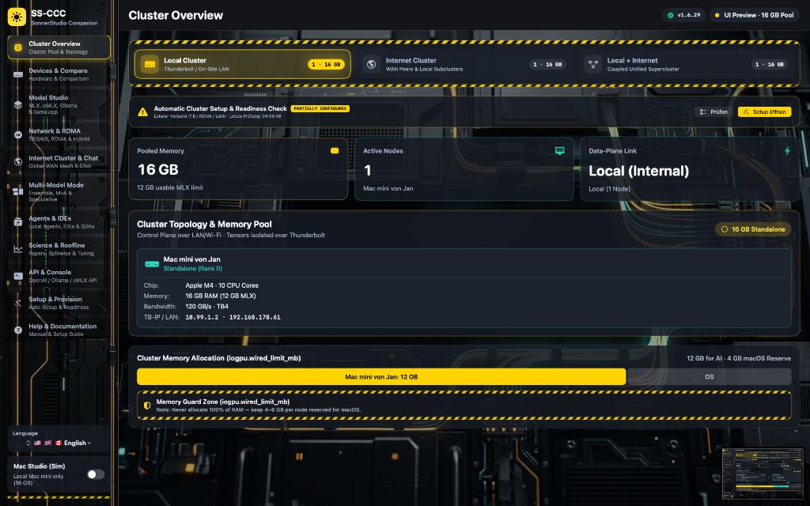
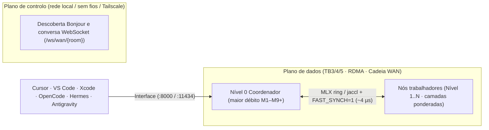

<div align="center">

# ☀️ Assistente de conjunto SonnerStudio (SS-CCC)

**🇺🇸 🇬🇧 🇨🇦 [English](README.md)** · **🇩🇪 🇦🇹 🇨🇭 [Deutsch](README.de.md)** · **🇫🇷 🇧🇪 🇨🇭 [Français](README.fr.md)** · **🇪🇸 🇲🇽 🇦🇷 [Español](README.es.md)** · **🇵🇹 🇧🇷 [Português](README.pt.md)**

*Gestor nativo macOS de conjuntos Apple Silicon e oficina de inferência distribuída MLX*

<table>
  <tr>
    <td align="center">
      <br/>
      <sub><b>Modo Conjunto (52 GB unificados · 2 equipamentos)</b></sub>
    </td>
    <td align="center">
      <br/>
      <sub><b>Modo Individual (16 GB local · 1 equipamento)</b></sub>
    </td>
  </tr>
</table>

</div>

---

## 🧭 Visão geral

O **Assistente de conjunto SonnerStudio (SS-CCC)** acopla a memória unificada de qualquer **Mac Apple Silicon (M1–M9+)** — desde um Mac mini ou MacBook Pro até agrupamentos locais **Thunderbolt 3/4/5 e RDMA** ou **redes mundiais pela Internet (2–256+ Macs)** — com ligação direta ao **MLX**, **oMLX**, **Ollama** e **llama.cpp**.

<div align="center">
  
</div>

---

## 🌐 Rede Internet mundial, conversa e análise científica

<table>
  <tr>
    <td align="center" width="50%">
      <br/>
      <sub><b>Rede Internet e conversa dos participantes</b><br/>Tailscale · WireGuard · libp2p QUIC · DERP · <code>/status</code> · <code>/layers</code> · <code>/ping</code></sub>
    </td>
    <td align="center" width="50%">
      <br/>
      <sub><b>Análise Roofline e balanço energético</b><br/>Curva log-log · Bolha GPipe · <code>J/token</code> · <code>p50/p95/p99</code> · CSV/JSON/BibTeX</sub>
    </td>
  </tr>
</table>

---

## 🏗️ Arquitetura híbrida (controlo, Thunderbolt e Internet)



---

## ✨ Funcionalidades principais

- **Acoplamento universal Apple Silicon (M1 – M9+):** Liga livremente vários Mac (Mac mini, MacBook Air/Pro, iMac, Mac Studio, Mac Pro) das gerações M1 a M6 e futuras **M7, M8, M9+** num agrupamento comum com cálculo automático da largura de banda de memória.
- **Telemetria completa de equipamento e sensores:** Leitura direta através de `sysctl`, `sw_vers`, `system_profiler`, `ioreg`, `pmset` e `ibv_devices`: núcleos CPU (P/E), núcleos GPU, núcleos do motor neuronal (16 / 32 núcleos ANE), espaço SSD total/livre, estado térmico, temperatura da bateria (`°C`) e consumo elétrico (`W`).
- **Classes Thunderbolt 3 / 4 / 5 e RDMA:** Deteção e classificação automáticas para processadores M1–M9+ (TB3 `40 Gbps`, TB4 `40 Gbps`, TB5 `80/120 Gbps`, bem como RDMA por Thunderbolt 5), com plano de controlo LAN/Wi-Fi separado e plano de dados Thunderbolt isolado.
- **Divisão ponderada de camadas e proteção `iogpu.wired_limit_mb`:** Distribuição proporcional consoante a largura de banda de memória de cada nó ativo, mantendo uma reserva segura do sistema para o macOS.
- **Deteção real de modelos (oMLX, Ollama e llama.cpp):** Leitura direta dos modelos disponíveis no **oMLX**, **Ollama**, **llama.cpp**, ficheiros `.gguf` locais e cache MLX (sem perfis fictícios quando vazio, com verificação de estado e comandos copiáveis).
- **Agrupamento global pela Internet (WAN) e conversação entre participantes (`/ws/wan/{room_id}`):** Ligue computadores Mac com Apple Silicon em todo o mundo por túnel cifrado (Tailscale/WireGuard, retransmissão P2P libp2p/DERP ou ponto manual) em grandes agrupamentos distribuídos com sala de conversa em tempo real.
- **Laboratório científico de 6 separadores (Local e WAN) e histórico:** Alterne entre **Local (TB/RDMA)**, **Internet WAN** e **Comparação direta** em seis áreas: **Limite e gargalo** (teto de rede efetivo, lote crítico $B^*$), **Topologia WAN e escala** ($N=1\dots128$, compressão *Petals/SWARM*, retardatários, *DiLoCo* vs. DDP), **Memória e cache KV**, **Energia, CO₂ e custo** (`J/token`, `EDP`, `gCO₂eq/kWh`), **Ensaios, estatística e exportação** (`IC₉₅`, `CV%`, `Goodput%`, `CSV / JSON / LaTeX / BibTeX`) e **Histórico** (gravação por posição individual ou global, gráfico de tendência e CSV).
- **Atualizações via GitHub e controlo automático de versões:** Verifica `version.json`, *GitHub Releases* e o SHA de `commits/main` no arranque e a cada 30 minutos (`⌘U`). Apresenta um aviso de atualização integrado com `git pull` + `swift build` + reinício num clique ou transferência via GitHub, suportado por `scripts/bump_version.py` e `.github/workflows/auto-version-control.yml`.
- **Agentes e ambientes num clique:** Configuração imediata para **OpenCode**, **Hermes Agent**, **Google Antigravity**, **Cursor**, **Visual Studio Code** e **Xcode**.
- **Modo de simulação comutável, tema amarelo SonnerStudio (`#FFD400`) e testes globais (`tests/`):** A simulação de demonstração mantém-se na barra lateral; todo o projeto é verificado por `tests/test_global_suite.py` (`python3 -m unittest discover -s tests -v`).
- **Interface multilingue e centro de ajuda integrado:** Alternância imediata entre inglês, alemão, francês, espanhol e português, bem como um centro de ajuda pesquisável diretamente na aplicação.

### 🖥️ As nove áreas do programa num relance

| Área | Conteúdo e função |
| :--- | :--- |
| **1. Visão do agrupamento** | Memória conjunta, nós ativos, velocidade da ligação de dados, topologia visual e barra de alocação `iogpu.wired_limit_mb`. |
| **2. Dispositivos e comparação** | Telemetria em tempo real de cada Mac (CPU, GPU, ANE, RAM, largura de banda, SSD, temperatura, potência) e adição de Mac M1–M9+. |
| **3. Oficina de modelos** | Leitura real de modelos (oMLX, Ollama, llama.cpp, GGUF), estado dos serviços, divisão de camadas e memória KV. |
| **4. Rede e RDMA** | Matriz de classes Thunderbolt 3/4/5 para M1–M9+, estado RDMA e encaminhamento da ponte LAN/Thunderbolt. |
| **5. Agrupamento Internet, Audio-Party e conversa** | Ligar Mac TB/RDMA locais a nós WAN globais, coordenar via Audio-Party (estilo consola) e conversa (`/ws/wan-audio`, `/ws/wan`). |
| **6. Agentes e ambientes** | Configuração num clique para **OpenCode**, **Hermes Agent**, **Antigravity**, **Cursor**, **Visual Studio Code** e **Xcode**. |
| **7. Ciência e Roofline** | Laboratório de 6 separadores (Local e WAN): curva `P = min(β·I, π_eff)`, escala `N=1..128`, *Petals/SWARM* e *DiLoCo*, equação KV, `J/token` / `EDP` / `CO₂`, `IC₉₅` e `Goodput%`, exportação `CSV / JSON / LaTeX / BibTeX` e **Histórico** por posição/global |
| **8. API e consola** | Pontos de extremidade compatíveis com OpenAI / Ollama / oMLX, registo de atividade e comandos de arranque prontos a copiar. |
| **9. Ajuda e documentação** | Manual integrado de 9 capítulos em 5 idiomas (`⌘?`) com pesquisa integral e guia passo a passo. |

---

## 🛠️ Compilar a partir do código-fonte (antes da primeira execução)

> [!NOTE]
> Este repositório contém apenas o **código-fonte em Swift** do SS-CCC (não inclui um executável pré-compilado). Para obter uma versão pronta a iniciar, o código tem de ser **compilado localmente no seu Mac Apple Silicon**.

### Pré-requisitos
- Um Mac com Apple Silicon (**M1–M6**) e **macOS 14.0 ou mais recente**
- **Ferramentas de linha de comandos do Xcode** (`swiftc` e o SDK do macOS):
  ```bash
  xcode-select --install
  ```

### Passo a passo até à aplicação executável
```bash
# 1. Clonar o repositório e entrar na pasta
git clone https://github.com/SonnerStudio/SonnerStudio-Cluster-Case-Companion.git
cd SonnerStudio-Cluster-Case-Companion

# 2. Tornar o guião de compilação e arranque executável
chmod +x scripts/run_ssccc.sh

# 3. Compilar o código Swift para /tmp/SSCCCApp e iniciar a aplicação
./scripts/run_ssccc.sh
```
*(Opcional: também é possível compilar com o Swift Package Manager usando `cd app && swift build -c release`.)*

---

## 🚀 Arranque rápido

```bash
"./scripts/run_ssccc.sh"
```

---

## 📚 Documentação selecionada (incluída na ajuda do programa)

### 1. Todos os Mac com processador M em conjunto (M1–M6)
O SS-CCC suporta **qualquer Mac com processador Apple Silicon** (**M1, M2, M3, M4, M5, M6** — Base, Pro, Max e Ultra): **Mac mini, MacBook Air, MacBook Pro, iMac, Mac Studio e Mac Pro**. Em **Dispositivos e Comparação**, adicione quantos Mac desejar; o equipamento com maior largura de banda assume automaticamente o **nível 0 (coordenador)**.

| Família de chip | Largura de banda | Thunderbolt | Reserva recomendada para macOS |
| :--- | :--- | :--- | :--- |
| **M1 / M2** (Base) | 68 – 100 GB/s | TB 3 / USB4 (26–32 Gbps) | **4 GB** (≤ 24 GB RAM) |
| **M3 / M4** (Base) | 100 – 120 GB/s | TB 4 (30–37 Gbps) | **4 GB** (≤ 24 GB RAM) |
| **M5 / M6** (Base) | 153 – 180 GB/s | TB 5 (65–80 Gbps) | **4 GB** (≤ 24 GB RAM) |
| **M1–M3 Pro** | 150 – 200 GB/s | TB 4 (30–37 Gbps) | **4 – 6 GB** |
| **M4–M6+ Pro** | 273 – 310+ GB/s | TB 5 (80–120 Gbps boost) | **4 – 6 GB** |
| **M1–M3 Max** | 400 GB/s | TB 4 (30–37 Gbps) | **6 GB** (32–64 GB RAM) |
| **M4 Max** | **410 – 546 GB/s** (LPDDR5X-8533) | TB 5 + RDMA (`~3 µs` latência) | **6 GB** (32–64 GB RAM) |
| **M1–M2 Ultra / M3 Ultra** | **800 – 819 GB/s** (UltraFusion) | TB 4 / TB 5 RDMA (JACCL) | **8 GB** (≥ 96 GB RAM) |

### 2. Thunderbolt 5 RDMA (`JACCL`), proteção de memória e repartição ponderada
- **RDMA no macOS sobre Thunderbolt 5:** Com `rdma_ctl enable` (macOS 26.2+) e o motor `JACCL` (`mlx.distributed`), a latência entre nós desce de `~300 µs` (TCP/IP) para **`~3 µs`** com **`3,5–3,8 GB/s`** de débito sustentado.
- **Nunca alocar 100 % da RAM:** `iogpu.wired_limit_mb` protege a fluidez do macOS e do WindowServer.
- **Repartição proporcional de camadas:** cada Mac recebe camadas consoante a sua memória utilizável (`Camadas_i = Total × Utilizável_i / TotalUtilizável`).
- **Cache KV de 4 bits e sincronização rápida:** `--kv-bits 4` e `MLX_METAL_FAST_SYNCH=1` (45× mais rápido, ~180 µs → ~4 µs).

---

## 🔄 Atualizações controladas pelo GitHub e controlo automático de versões

1. **Verificação multifonte no GitHub:** No arranque (após `1,2 s`) e a cada **30 minutos** (`startAutomaticUpdateMonitor()`), `ClusterViewModel` consulta `main/version.json`, `releases/latest` e `commits/main` (SHA curto).
2. **Aviso na aplicação (`UpdatePromptSheet`, `⌘U`):** Quando deteta uma versão, compilação ou SHA mais recente, disponibiliza para instalações a partir do código `git pull --ff-only origin main` + `swift build` + reinício num clique (`scripts/run_ssccc.sh`), ou transferência direta via GitHub Releases.
3. **Automatização CI (`.github/workflows/auto-version-control.yml`):** Cada *push* para `main` executa `scripts/bump_version.py --part patch --sync-git`, sincroniza `version.json` e `ClusterModels.swift`, corre os 12 testes e cria a tag `vX.Y.Z`.

---

## 🎙️ Audio-Party de agrupamento e colaboração WAN em direto

- **Voz em tempo real (`AVAudioEngine`, 16 kHz PCM16):** Ligada a `/ws/wan-audio` junto ao chat (`/ws/wan/{room_id}`), com modos **Premir para falar / Microfone aberto**, **Silenciar / Ensurdecer**, medidor de nível e papéis (`Porta de nível 0`, `Nó WAN`).

---

## 🏆 Desafio de recorde mundial: supercomputador híbrido local + Internet


**Conseguirá uma coligação distribuída de computadores Mac Apple Silicon rivalizar com um centro de dados?**  
Convidamos universidades, equipas de investigação e entusiastas de Apple Silicon a organizar uma **tentativa oficial de recorde com o SS-CCC**: reúnam em simultâneo o maior número possível de **agrupamentos locais Thunderbolt 3/4/5/RDMA** e **Mac ligados pela Internet** através da **ponte híbrida («Ligar local + Internet»)**, da **Audio-Party** e do **laboratório científico de 5 separadores**.

### 🔬 Protocolo científico e modelação

1. **Topologia hierárquica em dois níveis (ilhas locais TB/RDMA + rede WAN):**
   - A ponte híbrida mantém camadas consecutivas nas ilhas Thunderbolt locais (`~0,07 ms`, `30–110 Gbps`), restringindo os saltos WAN às transições entre portas de nível 0 ($H_{\text{WAN}} \ll N_{\text{total}}$).
2. **Ocultação da latência WAN ($B^*$) e compressão de ativações:**
   - Com $\Phi_{\text{bolha}} = \frac{N - 1}{M + N - 1}$ e o lote crítico $B^* = \lceil \frac{T_{\text{RTT,WAN}} + T_{\text{tx}}}{T_{\text{comp}}(B=1)} \rceil$, os micro-lotes $M \to B^*$ e a compressão **FP8 / INT4 / Top-K** (*Petals / SWARM*) mantêm a sobrecarga abaixo de $1\%$ da ligação de envio.
3. **Protocolo reprodutível ($T = 0,0$):** Ative a ponte híbrida, entre na **Audio-Party** (`Opus 16 kbps`, $<0,02\%$ da ligação), execute `N = 20` ensaios (`T = 0,0`) em modo **Internet-WAN** e exporte o **manifesto JSON**, **CSV** e a **tabela LaTeX (`booktabs`)** com `IC₉₅`, `Goodput%`, `J/token`, `EDP` e `gCO₂eq/1M tokens`.

### 🥇 Categorias de recorde e casos de utilização
- **Categorias:** maior memória unificada total (`TB`), maior número de Mac ligados em simultâneo ($N \ge 32\text{–}256+$), maior débito útil transcontinental e melhor eficiência energética (`J/token`).
- **Casos de utilização:** investigação em sistemas de IA (curvas Roofline, *DiLoCo* vs. DDP, artigos LaTeX/BibTeX), laboratórios universitários com portáteis e Mac mini, estúdios de software para **OpenCode / Cursor / Xcode** sem custos na nuvem, setores jurídicos e médicos sob túnel **WireGuard**, maratonas globais coordenadas via **Audio-Party** e auditorias **Green-AI**.

---

## 🚧 Estado de desenvolvimento e colaboração

> [!IMPORTANT]
> **O SS-CCC (v1.6+) é totalmente executável e validado por `12/12` testes automatizados; os ensaios de resistência multinó continuam.**
> **Já implementado e verificado:** idioma inicial em inglês (com 5 idiomas), deteção aberta M1–M12+, descoberta em tempo real de modelos (oMLX / Ollama / llama.cpp / GGUF), laboratório científico de 6 separadores com histórico por posição e global, ponte híbrida Local ↔ Internet-WAN, Audio-Party com `AVAudioEngine`, manual de 9 capítulos e atualização automática controlada via GitHub + CI.

Convidamos programadores, investigadores e entusiastas de Apple Silicon a **participar no desenvolvimento e a fazer evoluir o SS-CCC**:
- **Testar no seu equipamento:** Experimente o SS-CCC nos seus Mac M1–M12+ e partilhe medições de débito, memória e RDMA/JACCL.
- **Participar no desafio de recorde:** Ligue ilhas TB locais a nós WAN e publique os seus manifestos JSON/CSV/LaTeX.
- **Enviar melhorias:** Contributos para a interface SwiftUI, para a repartição MLX, para os guiões Thunderbolt ou para as traduções são sempre bem-vindos!

---

## 📄 Licença

Publicado sob a [Licença MIT](LICENSE.md).
