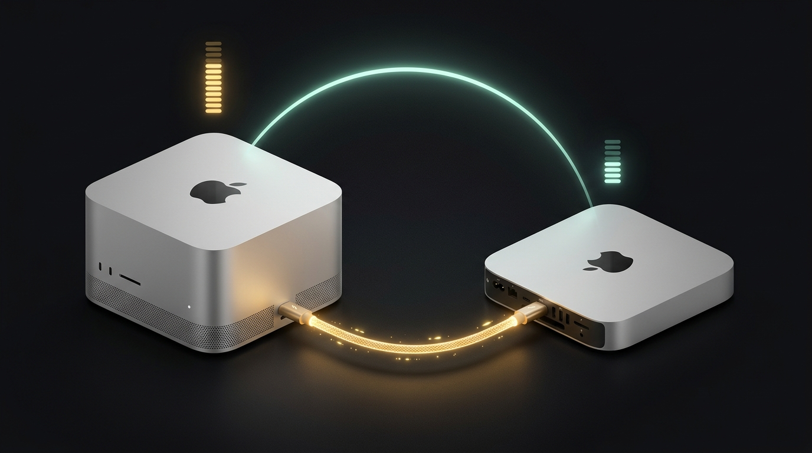
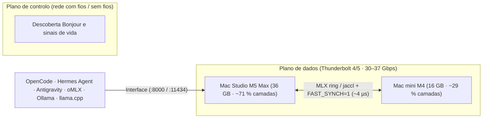

<div align="center">

# ☀️ Assistente de conjunto SonnerStudio (SS-CCC)

**🇺🇸 🇬🇧 🇨🇦 [English](README.md)** · **🇩🇪 🇦🇹 🇨🇭 [Deutsch](README.de.md)** · **🇫🇷 🇧🇪 🇨🇭 [Français](README.fr.md)** · **🇪🇸 🇲🇽 🇦🇷 [Español](README.es.md)** · **🇵🇹 🇧🇷 [Português](README.pt.md)**

*Gestor nativo macOS de conjuntos Apple Silicon e oficina de inferência distribuída MLX*

<table>
  <tr>
    <td align="center">
      <br/>
      <sub><b>Modo Conjunto (52 GB unificados · 2 equipamentos)</b></sub>
    </td>
    <td align="center">
      <br/>
      <sub><b>Modo Individual (16 GB local · 1 equipamento)</b></sub>
    </td>
  </tr>
</table>

</div>

---

## 🧭 Visão geral

O **Assistente de conjunto SonnerStudio (SS-CCC)** acopla a memória unificada de vários Macs Apple Silicon — por exemplo, um **Mac Studio M5 Max (36 GB, Thunderbolt 5)** e um **Mac mini M4 (16 GB, Thunderbolt 4)** — num **conjunto de 52 GB físicos (~42 GB úteis)** através de **Thunderbolt (ponte ou acesso direto à memória)**, **rede com fios/sem fios** ou modo **híbrido**.

<div align="center">
  
</div>

---

## 🏗️ Arquitetura híbrida (plano de controlo e plano de dados)



---

## ✨ Funcionalidades principais

- **Acoplamento universal Apple Silicon (M1 – M9+):** Liga livremente vários Mac (Mac mini, MacBook Air/Pro, iMac, Mac Studio, Mac Pro) das gerações M1 a M6 e futuras **M7, M8, M9+** num agrupamento comum com cálculo automático da largura de banda de memória.
- **Telemetria completa de equipamento e sensores:** Leitura direta através de `sysctl`, `sw_vers`, `system_profiler`, `ioreg`, `pmset` e `ibv_devices`: núcleos CPU (P/E), núcleos GPU, núcleos do motor neuronal (16 / 32 núcleos ANE), espaço SSD total/livre, estado térmico, temperatura da bateria (`°C`) e consumo elétrico (`W`).
- **Classes Thunderbolt 3 / 4 / 5 e RDMA:** Deteção e classificação automáticas para processadores M1–M9+ (TB3 `40 Gbps`, TB4 `40 Gbps`, TB5 `80/120 Gbps`, bem como RDMA por Thunderbolt 5), com plano de controlo LAN/Wi-Fi separado e plano de dados Thunderbolt isolado.
- **Divisão ponderada de camadas e proteção `iogpu.wired_limit_mb`:** Distribuição proporcional consoante a largura de banda de memória de cada nó ativo, mantendo uma reserva segura do sistema para o macOS.
- **Deteção real de modelos (oMLX, Ollama e llama.cpp):** Leitura direta dos modelos disponíveis no **oMLX**, **Ollama**, **llama.cpp**, ficheiros `.gguf` locais e cache MLX (sem perfis fictícios quando vazio, com verificação de estado e comandos copiáveis).
- **Agentes e ambientes num clique:** Configuração imediata para **OpenCode**, **Hermes Agent**, **Google Antigravity**, **Cursor**, **Visual Studio Code** e **Xcode**.
- **Modo de simulação comutável, tema amarelo SonnerStudio (`#FFD400`) e testes globais (`tests/`):** A simulação de demonstração mantém-se na barra lateral; todo o projeto é verificado por `tests/test_global_suite.py` (`python3 -m unittest discover -s tests -v`).
- **Interface multilingue e centro de ajuda integrado:** Alternância imediata entre inglês, alemão, francês, espanhol e português, bem como um centro de ajuda pesquisável diretamente na aplicação.

### 🖥️ As oito áreas do programa num relance

| Área | Conteúdo e função |
| :--- | :--- |
| **1. Visão do agrupamento** | Memória conjunta, nós ativos, velocidade da ligação de dados, topologia visual e barra de alocação `iogpu.wired_limit_mb`. |
| **2. Dispositivos e comparação** | Telemetria em tempo real de cada Mac (CPU, GPU, ANE, RAM, largura de banda, SSD, temperatura, potência) e adição de Mac M1–M9+. |
| **3. Oficina de modelos** | Leitura real de modelos (oMLX, Ollama, llama.cpp, GGUF), estado dos serviços, divisão de camadas e memória KV. |
| **4. Rede e RDMA** | Matriz de classes Thunderbolt 3/4/5 para M1–M9+, estado RDMA e encaminhamento da ponte LAN/Thunderbolt. |
| **5. Agentes e ambientes** | Configuração num clique para **OpenCode**, **Hermes Agent**, **Antigravity**, **Cursor**, **Visual Studio Code** e **Xcode**. |
| **6. Ciência e Roofline** | Gráfico logarítmico interativo (`P = min(β·I, π)`), pontos de inflexão, fórmula GPipe, TTFT/TPOT, energia `J/token`, ensaios reprodutíveis (`T=0,0`, `p50/p95/p99`) e exportação CSV/JSON/BibTeX |
| **7. API e consola** | Pontos de extremidade compatíveis com OpenAI / Ollama / oMLX, registo de atividade e comandos de arranque prontos a copiar. |
| **8. Ajuda e documentação** | Manual integrado com pesquisa de texto integral, visão geral da arquitetura e guia passo a passo. |

---

## 🛠️ Compilar a partir do código-fonte (antes da primeira execução)

> [!NOTE]
> Este repositório contém apenas o **código-fonte em Swift** do SS-CCC (não inclui um executável pré-compilado). Para obter uma versão pronta a iniciar, o código tem de ser **compilado localmente no seu Mac Apple Silicon**.

### Pré-requisitos
- Um Mac com Apple Silicon (**M1–M6**) e **macOS 14.0 ou mais recente**
- **Ferramentas de linha de comandos do Xcode** (`swiftc` e o SDK do macOS):
  ```bash
  xcode-select --install
  ```

### Passo a passo até à aplicação executável
```bash
# 1. Clonar o repositório e entrar na pasta
git clone https://github.com/SonnerStudio/SonnerStudio-Cluster-Case-Companion.git
cd SonnerStudio-Cluster-Case-Companion

# 2. Tornar o guião de compilação e arranque executável
chmod +x scripts/run_ssccc.sh

# 3. Compilar o código Swift para /tmp/SSCCCApp e iniciar a aplicação
./scripts/run_ssccc.sh
```
*(Opcional: também é possível compilar com o Swift Package Manager usando `cd app && swift build -c release`.)*

---

## 🚀 Arranque rápido

```bash
"./scripts/run_ssccc.sh"
```

---

## 📚 Documentação selecionada (incluída na ajuda do programa)

### 1. Todos os Mac com processador M em conjunto (M1–M6)
O SS-CCC suporta **qualquer Mac com processador Apple Silicon** (**M1, M2, M3, M4, M5, M6** — Base, Pro, Max e Ultra): **Mac mini, MacBook Air, MacBook Pro, iMac, Mac Studio e Mac Pro**. Em **Dispositivos e Comparação**, adicione quantos Mac desejar; o equipamento com maior largura de banda assume automaticamente o **nível 0 (coordenador)**.

| Família de chip | Largura de banda | Thunderbolt | Reserva recomendada para macOS |
| :--- | :--- | :--- | :--- |
| **M1 / M2** (Base) | 68 – 100 GB/s | TB 3 / USB4 (26–32 Gbps) | **4 GB** (≤ 24 GB RAM) |
| **M3 / M4** (Base) | 100 – 120 GB/s | TB 4 (30–37 Gbps) | **4 GB** (≤ 24 GB RAM) |
| **M5 / M6** (Base) | 153 – 180 GB/s | TB 5 (65–80 Gbps) | **4 GB** (≤ 24 GB RAM) |
| **M1–M3 Pro** | 150 – 200 GB/s | TB 4 (30–37 Gbps) | **4 – 6 GB** |
| **M4–M6 Pro** | 273 – 310 GB/s | TB 5 (65–80 Gbps) | **4 – 6 GB** |
| **M1–M3 Max** | 400 GB/s | TB 4 (30–37 Gbps) | **6 GB** (32–64 GB RAM) |
| **M4–M6 Max** | 460 – 580 GB/s | TB 5 (65–80 Gbps) | **6 GB** (32–64 GB RAM) |
| **M1–M2 Ultra** / **M3 Ultra** | 800 GB/s | TB 4 / TB 5 | **8 GB** (≥ 96 GB RAM) |

### 2. Proteção de memória e repartição ponderada
- **Nunca alocar 100 % da RAM:** `iogpu.wired_limit_mb` protege a fluidez do macOS e do WindowServer.
- **Repartição proporcional de camadas:** cada Mac recebe camadas consoante a sua memória utilizável (`Camadas_i = Total × Utilizável_i / TotalUtilizável`).
- **Cache KV de 4 bits e sincronização rápida:** `--kv-bits 4` e `MLX_METAL_FAST_SYNCH=1` (45× mais rápido, ~180 µs → ~4 µs).

---

## 🚧 Estado de desenvolvimento e colaboração

> [!IMPORTANT]
> **O SS-CCC já é executável, mas encontra-se ainda em desenvolvimento e validação contínua.**
> A interface, a leitura do equipamento, a repartição ponderada de camadas e a ligação a agentes já estão operacionais; os ensaios em combinações reais de Mac M1–M6, pontes Thunderbolt 4/5 e RDMA/JACCL continuam a ser aperfeiçoados.

Convidamos programadores, investigadores e entusiastas de Apple Silicon a **participar no desenvolvimento e a fazer evoluir o SS-CCC**:
- **Testar no seu equipamento:** Experimente o SS-CCC nos seus Mac M1–M6 e partilhe medições de débito, memória e estabilidade.
- **Partilhar sugestões e falhas:** Abra um registo no GitHub para erros, casos específicos ou novas funcionalidades.
- **Enviar melhorias:** Contributos para a interface SwiftUI, para a repartição MLX, para os guiões Thunderbolt ou para as traduções são sempre bem-vindos!

---

## 📄 Licença

Publicado sob a [Licença MIT](LICENSE.md).
