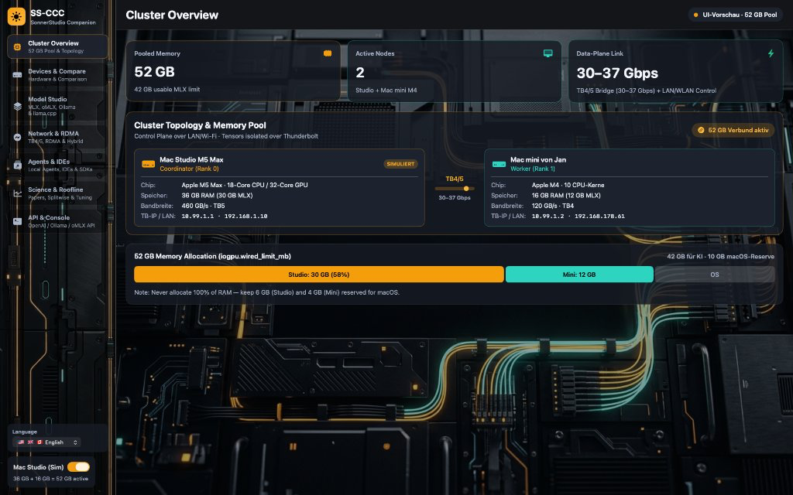
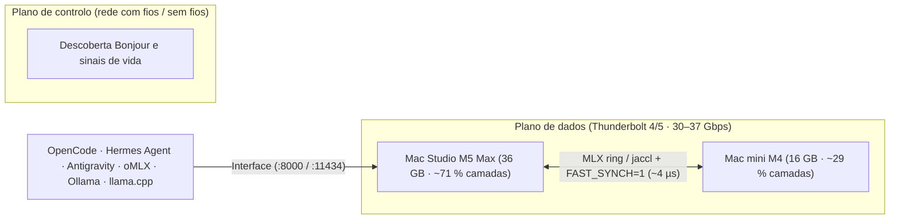

<div align="center">

# ☀️ Assistente de conjunto SonnerStudio (SS-CCC)

**🇺🇸 🇬🇧 🇨🇦 [English](README.md)** · **🇩🇪 🇦🇹 🇨🇭 [Deutsch](README.de.md)** · **🇫🇷 🇧🇪 🇨🇭 [Français](README.fr.md)** · **🇪🇸 🇲🇽 🇦🇷 [Español](README.es.md)** · **🇵🇹 🇧🇷 [Português](README.pt.md)**

*Gestor nativo macOS de conjuntos Apple Silicon e oficina de inferência distribuída MLX*



</div>

---

## 🧭 Visão geral

O **Assistente de conjunto SonnerStudio (SS-CCC)** acopla a memória unificada de vários Macs Apple Silicon — por exemplo, um **Mac Studio M5 Max (36 GB, Thunderbolt 5)** e um **Mac mini M4 (16 GB, Thunderbolt 4)** — num **conjunto de 52 GB físicos (~42 GB úteis)** através de **Thunderbolt (ponte ou acesso direto à memória)**, **rede com fios/sem fios** ou modo **híbrido**.

<div align="center">
  
</div>

---

## 🏗️ Arquitetura híbrida (plano de controlo e plano de dados)



---

## ✨ Funcionalidades principais

- **Acoplamento heterogéneo de 52 GB:** Divisão proporcional de camadas (`~71 %` no M5 Max a `460 GB/s`, `~29 %` no M4 a `120 GB/s`) com proteção `iogpu.wired_limit_mb`.
- **Interface nativa macOS:**
  - **Visão geral e comparação:** Leitura direta (`sysctl`, `sw_vers`, `ibv_devices`, `ipconfig`) com barras comparativas.
  - **Oficina de modelos:** Divisão de camadas, quantização da memória KV (`FP16 / 8-bit / 4-bit`) e ligação direta com **oMLX**, **Ollama** e **llama.cpp**.
  - **Agentes e ambientes (um clique):** Configuração imediata para **OpenCode**, **Hermes Agent** e **Google Antigravity**.
  - **Interface multilingue:** Seletor de idioma no menu lateral esquerdo.

---

## 🚀 Arranque rápido

```bash
"./scripts/run_ssccc.sh"
```

---

## 📚 Documentação selecionada (incluída na ajuda do programa)

### 1. Todos os Mac com processador M em conjunto (M1–M6)
O SS-CCC suporta **qualquer Mac com processador Apple Silicon** (**M1, M2, M3, M4, M5, M6** — Base, Pro, Max e Ultra): **Mac mini, MacBook Air, MacBook Pro, iMac, Mac Studio e Mac Pro**. Em **Dispositivos e Comparação**, adicione quantos Mac desejar; o equipamento com maior largura de banda assume automaticamente o **nível 0 (coordenador)**.

| Família de chip | Largura de banda | Thunderbolt | Reserva recomendada para macOS |
| :--- | :--- | :--- | :--- |
| **M1 / M2 / M3** (Base) | 68 – 100 GB/s | TB 4 | **4 GB** (≤ 24 GB RAM) |
| **M4 / M5 / M6** (Base) | 120 – 180 GB/s | TB 4 / TB 5 | **4 GB** (≤ 24 GB RAM) |
| **M1–M6 Pro** | 150 – 273 GB/s | TB 4 / TB 5 | **4 – 6 GB** |
| **M1–M6 Max** | 400 – 546 GB/s | TB 4 / TB 5 | **6 GB** (32–64 GB RAM) |
| **M1–M3 Ultra** | 800 GB/s | TB 4 | **8 GB** (≥ 96 GB RAM) |

### 2. Proteção de memória e repartição ponderada
- **Nunca alocar 100 % da RAM:** `iogpu.wired_limit_mb` protege a fluidez do macOS e do WindowServer.
- **Repartição proporcional de camadas:** cada Mac recebe camadas consoante a sua memória utilizável (`Camadas_i = Total × Utilizável_i / TotalUtilizável`).
- **Cache KV de 4 bits e sincronização rápida:** `--kv-bits 4` e `MLX_METAL_FAST_SYNCH=1` (45× mais rápido, ~180 µs → ~4 µs).

---

## 📄 Licença

Publicado sob a [Licença MIT](LICENSE.md).
