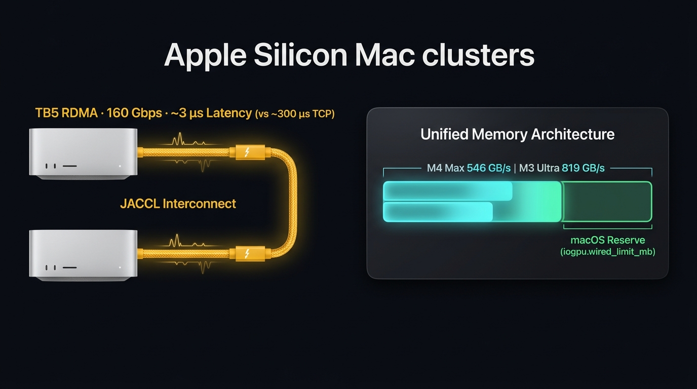

<div align="center">

# ☀️ SonnerStudio Cluster-Case-Companion (SS-CCC)

**🇺🇸 🇬🇧 🇨🇦 [English](README.md)** · **🇩🇪 🇦🇹 🇨🇭 [Deutsch](README.de.md)** · **🇫🇷 🇧🇪 🇨🇭 [Français](README.fr.md)** · **🇪🇸 🇲🇽 🇦🇷 [Español](README.es.md)** · **🇵🇹 🇧🇷 [Português](README.pt.md)** · **🇷🇺 [Русский](README.ru.md)** · **🇯🇵 [日本語](README.ja.md)** · **🇨🇳 [中文](README.zh.md)**

*Нативный менеджер кластеров Apple Silicon для macOS и студия распределённого MLX-инференса*

<table>
  <tr>
    <td align="center">
      <br/>
      <sub><b>Режим кластера (52 ГБ общий пул · 2 узла)</b></sub>
    </td>
    <td align="center">
      <br/>
      <sub><b>Автономный режим (16 ГБ локально · 1 узел)</b></sub>
    </td>
  </tr>
</table>

</div>

---

## 🧭 Обзор

**SonnerStudio Cluster-Case-Companion (SS-CCC)** — это нативное macOS-приложение (SwiftUI) и шлюз управления (Python/FastAPI) для объединения нескольких компьютеров **Apple Silicon Mac (M1–M12+)** через **Thunderbolt 3/4/5 (RDMA / JACCL)**, **10GbE LAN** и **глобальные Интернет-сети (WAN)** в единый высокопроизводительный пул объединённой памяти и распределённого MLX-инференса.

Вместо отправки исходного кода, конфиденциальных документов или промптов в сторонние облака локальные ИИ-агенты и IDE (**OpenCode**, **Hermes Agent**, **Google Antigravity**, **Cursor**, **Continue**, **Xcode**) подключаются к единому локальному API по адресу `http://127.0.0.1:8000/v1`.

---

## 🌐 Глобальный Интернет-кластер, живой чат и научный Roofline-анализ

<table>
  <tr>
    <td align="center" width="50%">
      <br/>
      <sub><b>Глобальный Интернет-кластер Mac (WAN), гибридная связка и чат участников</b></sub>
    </td>
    <td align="center" width="50%">
      <br/>
      <sub><b>Анализ Roofline (Williams), фазы Splitwise, энергия (Дж/ток) и p50/p95/p99</b></sub>
    </td>
  </tr>
</table>

SS-CCC связывает локальные кластеры Thunderbolt с распределёнными узлами через **Tailscale / WireGuard, ZeroTier, libp2p QUIC и DERP-ретрансляторы** (`/ws/wan/{room_id}`, `/ws/wan-chat`, `/ws/wan-audio`).

---

## 🏗️ Гибридная архитектура (Управление, Thunderbolt и WAN)

<div align="center">
  
</div>

- **Плоскость управления (LAN / Wi-Fi):** обнаружение узлов, OpenAI/Anthropic/Ollama-совместимые эндпоинты (`:8000`) и телеметрия.
- **Плоскость данных (Thunderbolt 3/4/5 + RDMA):** изолированная передача тензоров активаций по `10.99.1.x` (`30–37 Гбит/с` TB4, до `160 Гбит/с` двунаправленно / `~3 мкс` RDMA JACCL на TB5).
- **Уровень Интернет-WAN:** гибридное конвейерное расширение для моделей `405B–671B+` с микро-батчингом (`M ≥ 4`).

---

## ✨ Ключевые возможности


- **Универсальная поддержка Apple Silicon (M1–M12+):** все линейки Mac mini, MacBook Air/Pro, iMac, Mac Studio и Mac Pro.
- **Взвешенный планировщик слоёв (`MemoryWeightedPlanner`):** Ранг 0 (Координатор) получает максимальную ПСП и всегда хранит Embeddings + LM-Head; каждый узел загружает долю слоёв пропорционально доступной памяти.
- **Защита памяти (`iogpu.wired_limit_mb`):** резерв 4–8 ГБ для macOS и WindowServer предотвращает OOM-сбои.
- **Среды выполнения:** `MLX` (`mlx.distributed` / `JACCL`), `oMLX` (порт `8000` с SSD Paged KV-Cache), `Ollama` (`11434`), `llama.cpp` (`8080`).
- **Интеграция в 1 клик:** OpenCode, Hermes Agent, Google Antigravity, Cursor, VS Code, Xcode.
- **Мультиязычный интерфейс (8 языков):** English, Deutsch, Français, Español, Português, Русский, 日本語, 中文.

---

## 🛠️ Сборка из исходного кода (важно перед первым запуском)

> **Примечание:** В репозитории намеренно хранятся только исходный код, скрипты и документация — скомпилированных бинарников нет.

```bash
git clone https://github.com/SonnerStudio/SonnerStudio-Cluster-Case-Companion.git
cd SonnerStudio-Cluster-Case-Companion
chmod +x scripts/*.sh
"./scripts/run_ssccc.sh"
```

---

## 🚀 Быстрый старт

```bash
# 1. Запуск нативного приложения SwiftUI
"./scripts/run_ssccc.sh"

# 2. (Опционально) Запуск шлюза Python/FastAPI
cd core && uv sync --extra dev
PYTHONPATH=".." uv run uvicorn core.api.gateway:app --host 0.0.0.0 --port 8000

# 3. Настройка точка-точка IP для Thunderbolt
./scripts/setup_tb_network.sh studio   # 10.99.1.1
./scripts/setup_tb_network.sh mini     # 10.99.1.2
```

---

## 📖 Руководство по эксплуатации: локальный и гибридный кластер (Локально + Интернет), загрузка моделей и теоретические расчёты

### 1. Настройка локального кластера (Thunderbolt 3/4/5 и LAN)
1. **Физическое подключение:** соедините Mac напрямую кабелями **Thunderbolt 3/4/5** (точка-точка, кольцо или mesh) и/или через **10GbE Ethernet**.
2. **Точка-точка IP:** выполните `./scripts/setup_tb_network.sh studio` (`10.99.1.1`) на главном Mac и `./scripts/setup_tb_network.sh mini` (`10.99.1.2` и т. д.) на рабочих узлах.
3. **Опциональный RDMA (macOS 26.2+ на TB5):** активируйте `rdma_ctl enable`, чтобы `JACCL` (`mlx.distributed`) снизил задержку с `~300 мкс` (TCP/IP) до **`~3 мкс`**.
4. **Автоматическое назначение рангов:** добавьте все Mac во вкладке **Устройства и сравнение**. Узел с наибольшей ПСП автоматически становится **Рангом 0 (Координатором)**, остальные — **Рангами 1..N (Worker)**.

### 2. Настройка гибридного кластера (Локально + Интернет WAN одновременно)
1. **Локальное быстрое ядро (Уровень 1):** локальное кольцо Thunderbolt/LAN (`10.99.1.x` / `192.168.x.x`) остаётся активным для критичных к задержке слоёв.
2. **Комната WAN-координатора (Уровень 2):** во вкладке **Интернет-кластер и чат** откройте комнату (`/ws/wan/{room_id}` на порту `8000` через Tailscale, WireGuard, Cloudflare Tunnel или обратный прокси).
3. **Подключение удалённых узлов:** Mac из любой точки мира подключаются по **Коду комнаты + Токену доступа**.
4. **Двухуровневая гибридная маршрутизация:** горячие слои остаются в локальном кольце (`3–180 мкс`), а избыточные слои уходят на WAN-узлы (`15–120 мс` RTT) с микро-батчингом (`M ≥ 4`).

### 3. Кто загружает модель, сколько моделей помещается и как проходит запрос?
- **Кто что загружает?**
  - **Координатор (Ранг 0):** поднимает API-шлюз (`:8000`), выполняет токенизацию, **всегда хранит Embeddings и LM-Head (`has_embeddings=True`, `has_lm_head=True`)** и свою пропорциональную долю слоёв (`Layers_i = TotalLayers × Usable_i / TotalUsable`).
  - **Worker-узлы (Ранги 1..N):** каждый узел загружает **только свой срез Safetensors/слоёв `[start_layer .. end_layer)`** из локального кэша HuggingFace/oMLX/Ollama (`~/.cache/huggingface`, `~/.ollama/models`, `~/Models`).
- **Сколько моделей можно загрузить одновременно?**
  - **Распределённый режим (`mlx.distributed` / `JACCL`):** **1 большая шардированная модель за раз** на весь объединённый пул памяти (переключение через быстрый hot-swap).
  - **Мультимодельный режим (`oMLX` / `Ollama` / гетерогенные узлы):** пока `Σ (Веса_i + KV_Cache_i) ≤ Общий_Доступный_VRAM_ГБ` (после резерва 4–8 ГБ на узел через `iogpu.wired_limit_mb`), в памяти могут одновременно находиться **несколько моделей** (например, **32B-кодер + 8B-быстрый роутер + 1.5B-эмбеддинги**).
- **Структура и цикл обработки запроса:**
  1. **Зондирование и выбор канала** (`TB5 RDMA > TB Bridge > 10GbE > WLAN > WAN`).
  2. **План шардинга** (`hostfile.json` и лимит `iogpu.wired_limit_mb`).
  3. **Вход API** (`http://127.0.0.1:8000/v1/chat/completions`, `/v1/messages`, `/api/chat`).
  4. **Фаза Prefill (`TTFT`):** Ранг 0 кодирует промпт и передаёт активации по конвейеру (`Ранг 0 → 1 → ... → N → Ранг 0`).
  5. **Фаза Decode (`TPOT` и `tok/s`):** авторегрессивная генерация токенов с `--kv-bits 4` и `MLX_METAL_FAST_SYNCH=1`.
  6. **SSE-стриминг и телеметрия** во вкладке **Наука и Roofline** (`tok/s`, `Дж/ток`, `p50/p95/p99`).

### 4. Теоретические расчёты и ориентиры производительности по сценариям

> **Аналитические формулы оценки:**
> - **Потребление памяти:** `VRAM_ГБ ≈ Параметры_B × (Бит / 8) × 1,15 + KV_Cache_ГБ`
> - **Теоретический предел Decode:** `tok/s ≈ (Эффективная_ПСП_ГБ/с / Активные_Веса_ГБ) × (1 − Потери_Связи)`

| Сценарий использования | Топология и доступный пул | Модель и квантование | Теор. `TTFT` (2k промпт) | Теор. скорость (`tok/s` / `TPOT`) | Энергия и главное ограничение |
| :--- | :--- | :--- | :--- | :--- | :--- |
| **1. Одиночная станция (Edge Dev)** | 1× Mac mini M4 (16 ГБ, `12 ГБ` дост., `120 ГБ/с`) | `Qwen2.5-14B` (`4-bit`, ~8,8 ГБ) | `~1,8 – 2,6 с` | **`11 – 14 tok/s`** (`~75 мс/ток`) | `~1,7 Дж/ток` · ПСП памяти |
| **2. Одиночный Pro Studio** | 1× Mac Studio M4 Max (64 ГБ, `58 ГБ` дост., `546 ГБ/с`) | `Llama-3.3-70B` (`4-bit`, ~40 ГБ) | `~1,1 – 1,7 с` | **`12 – 14 tok/s`** (`~74 мс/ток`) | `~3,8 Дж/ток` · ПСП памяти |
| **3. Локальное кольцо 2× TB5 RDMA** | 2× M4 Max 64 ГБ (`116 ГБ` дост., `~1092 ГБ/с` сумм., `~3 мкс` JACCL) | `Qwen2.5-Coder-72B` (`8-bit`, ~78 ГБ) | `~1,4 – 2,0 с` | **`12 – 14 tok/s`** (`~76 мс/ток`) | `~7,5 Дж/ток` · Миним. накладные RDMA |
| **4. Лаборатория 4× Ultra TB5 RDMA** | 4× M3 Ultra 256 ГБ (`992 ГБ` дост., `~3,27 ТБ/с` сумм.) | `DeepSeek-V3 671B MoE` (`4-bit`, ~385 ГБ, ~37B активн.) | `~2,2 – 3,5 с` | **`38 – 55 tok/s`** (`~20 мс/ток`) | `~5,2 Дж/ток` · ПСП активных экспертов |
| **5. Гибрид Офис LAN + Дом WAN** | 2× TB4/10GbE + 2× WAN (`192 ГБ` дост., `35 мс` WAN RTT) | `Llama-3.1-405B` (`3/4-bit`, ~170 ГБ) | `~6 – 11 с` | **`2,2 – 4,5 tok/s`** (`~280 мс/ток`) | `~28 Дж/ток` · WAN RTT (`M=8` помогает) |
| **6. Глобальный рой WAN** | 16+ Mac по миру (`1,5+ ТБ` дост., `60–120 мс` WAN RTT) | `671B–1T+` Frontier (`4/8-bit`) | `~12 – 25 с` | **`1,2 – 3,0 tok/s`** (`~500 мс/ток`) | Задержка WAN (батчинг масштабирует) |

---

## 📚 Документация и Thunderbolt 5 RDMA (`JACCL`)



Полная 9-раздельная документация встроена прямо во вкладку **Справка и руководство** внутри приложения.

---

## 🔄 Обновления через GitHub и автоматический контроль версий


- **Монитор каждые 30 минут:** сверяет `version.json`, GitHub Releases и SHA коммитов `main`.
- **Обновление в 1 клик:** `git pull` + `swift build` + перезапуск приложения прямо из интерфейса.
- **CI Auto-Bump:** GitHub Actions автоматически обновляет сборку и `version.json` при пуше в `main`.

---

## 🎙️ Кластерная Audio-Party и совместная работа в WAN


Встроенный голосовой чат (`AVAudioEngine 16 кГц PCM16 · /ws/wan-audio`) с режимами Push-to-Talk и Open-Mic.

---

## 📊 Научная лаборатория (6 вкладок) и запись истории


Запись телеметрии по отдельным позициям или глобально с экспортом в `CSV`, `JSON`, `LaTeX` и `BibTeX`.

---

## 🏆 Вызов на мировой рекорд: локальный + глобальный гибридный суперкластер


Объедините локальные Mac по Thunderbolt и удалённые Mac через Интернет, чтобы совместно запустить модели `405B–671B+` с воспроизводимой научной телеметрией (`p50/p95/p99`, `Дж/ток`, `CO₂`).

---

## 🎯 Сценарии использования


1. **Исследования систем ИИ и Roofline-бенчмаркинг**
2. **Университеты и учебные лаборатории**
3. **Студии разработки и локальные ИИ-агенты**
4. **Приватная медицина, юриспруденция и R&D (100% оффлайн)**
5. **Глобальные хакатоны и распределённые рои**
6. **Аудит энергоэффективности и «зелёного» ИИ (`Дж/ток`)**

---

## 🚧 Статус разработки и участие

Проект активно развивается. Приветствуются PR, тесты на разных поколениях Apple Silicon (M1–M12+) и отчёты из научной лаборатории.

## 📄 Лицензия

[LICENSE.md](LICENSE.md)
