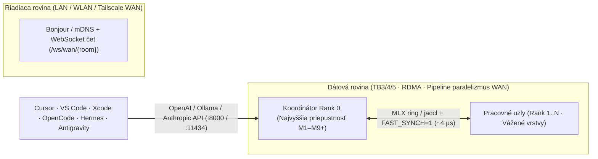

<div align="center">

# ☀️ SonnerStudio Cluster-Case-Companion (SS-CCC)

   **[English](README.md)** ·    **[Deutsch](README.de.md)** ·    **[Français](README.fr.md)** ·    **[Español](README.es.md)**<br/>
  **[Português](README.pt.md)** ·  **[Русский](README.ru.md)** ·  **[日本語](README.ja.md)** ·  **[中文](README.zh.md)**<br/>
  **[Nederlands](README.nl.md)** ·   **[Afrikaans](README.af.md)** ·  **[Polski](README.pl.md)** ·  **[Čeština](README.cs.md)**<br/>
 **[Slovenčina](README.sk.md)** ·  **[Magyar](README.hu.md)** ·  **[한국어](README.ko.md)** ·  **[हिन्दी](README.hi.md)** ·    **[தமிழ்](README.ta.md)**
<br/><a href="https://hits.sh/github.com/SonnerStudio/SonnerStudio-Cluster-Case-Companion/"></a>

*Natívny správca klastrov Apple Silicon pre macOS a štúdio distribuovanej inferencie MLX*

<table>
  <tr>
    <td align="center">
      <br/>
      <sub><b>Režim klastra (52 GB zdieľanej pamäte · 2 uzly)</b></sub>
    </td>
    <td align="center">
      <br/>
      <sub><b>Samostatný režim (16 GB lokálne · 1 uzol)</b></sub>
    </td>
  </tr>
</table>

</div>

---

## 🧭 Prehľad

**SonnerStudio Cluster-Case-Companion (SS-CCC)** zjednocuje pamäť a výpočtový výkon ľubovoľných **Macov s čipmi Apple Silicon (M1–M9+)** — od jedného Macu mini alebo MacBooku Pro cez lokálne zostavy **Thunderbolt 3/4/5 a RDMA** až po **globálne internetové WAN klastre (2–256+ Macov)** — s natívnou integráciou **MLX**, **oMLX**, **Ollama** a **llama.cpp**.

<div align="center">
  
</div>

---

## 🌐 Globálny internetový klaster, živý čet a vedecký Roofline

<table>
  <tr>
    <td align="center" width="50%">
      <br/>
      <sub><b>Globálny internetový klaster a čet účastníkov</b><br/>Tailscale · WireGuard · libp2p QUIC · DERP · <code>/status</code> · <code>/layers</code> · <code>/ping</code></sub>
    </td>
    <td align="center" width="50%">
      <br/>
      <sub><b>Vedecký Roofline a energetická analýza</b><br/>Log-Log Roofline · GPipe Bubble · <code>J/token</code> · <code>p50/p95/p99</code> · CSV/JSON/BibTeX</sub>
    </td>
  </tr>
</table>

---

## 🏗️ Hybridná architektúra (Riadiaca rovina, Thunderbolt a WAN)



---

## 🌐 Monitor šírky pásma a priepustnosti WAN internetového klastra


V module **Internetový klaster a čet** SS-CCC nepretržite meria skutočný výkon linky WAN (`netstat`, `ping`, `networkQuality`) — sleduje **sťahovanie / odosielanie Mbps**, **latenciu WAN RTT (ms)**, **jitter**, **stratu paketov** a **efektivitu synchronizácie tokenov**.

---

## ✨ Kľúčové schopnosti

- **Univerzálny clustering Apple Silicon (M1–M9+):** Spojte akýkoľvek **Mac mini, MacBook Air/Pro, iMac, Mac Studio alebo Mac Pro** naprieč generáciami **M1 až M6** aj budúcimi **M7, M8, M9+**. Uzol s najvyššou priepustnosťou pamäte sa automaticky stáva **Rank 0 (Koordinátor)** s ochranou `iogpu.wired_limit_mb`.
- **Kompletná telemetria systému a senzorov:** Číta `sysctl`, `sw_vers`, `system_profiler`, `ibv_devices`, `ipconfig`, `ioreg` a `ProcessInfo.thermalState` — zobrazuje **CPU P/E jadrá, GPU jadrá, Neural Engine (16/32 jadier ANE), kapacitu NVMe SSD, teplotný stav a príkon** vedľa seba.
- **Všetky triedy Thunderbolt (TB3 / TB4 / TB5) a RDMA:** Dynamicky vyjednáva párové rýchlosti (`TB3/USB4: 26–32 Gbps`, `TB4: 30–37 Gbps`, `TB5: 65–80 Gbps`, `TB5 RDMA: 75–110 Gbps`) s `MLX_METAL_FAST_SYNCH=1` (45× rýchlejšia synchronizácia GPU/CPU).
- **Živá Dielňa modelov a kontrola pripravenosti:** Objavuje reálne nainštalované/bežiace modely z **oMLX**, **Ollama**, **llama.cpp**, lokálnych súborov `.gguf` a `~/.cache/huggingface/hub` vrátane pamäťovo váženého delenia vrstiev a kvantizácie KV-cache (`FP16 / 8-bit / 4-bit`).
- **6× integrácia agentov a IDE jedným kliknutím:** Okamžitý export konfigurácií pre **OpenCode**, **Hermes Agent**, **Google Antigravity**, **Cursor**, **Visual Studio Code** a **Apple Xcode**.
- **Globálny WAN klaster a čet účastníkov (`/ws/wan/{room_id}`):** Spojte Macy po celom svete do distribuovaného klastra cez šifrované tunely (Tailscale / WireGuard, libp2p / DERP P2P alebo manuálny koncový bod).
- **6-kartové vedecké laboratórium a záznam histórie:** Prepínajte medzi **Lokálnym (TB/RDMA)**, **Internetovým WAN** a **Priamym porovnaním** na 6 kartách: **Roofline a úzke hrdlo**, **Topológia a škálovanie WAN**, **Pamäť a KV**, **Energia, CO₂ a náklady**, **Pokusy, štatistika a export** (`CI₉₅`, `CV%`, `CSV / JSON / LaTeX / BibTeX`) a **Záznam histórie**.
- **Aktualizácie riadené cez GitHub a automatické CI verzovanie:** Kontroluje `version.json`, GitHub Releases a SHA `commits/main` pri spustení aj každých 30 minút (`⌘U`), s aktualizáciou jedným kliknutím a reštartom.
- **Vzhľad SonnerStudio Yellow (`#FFD400`), príručka v 17 jazykoch, Shorttips a režim lišty ponúk (`⌘⇧M`):** Kompletné rozhranie v **17 jazykoch** (`EN..TA`), kontextové tipy **Shorttips**, **12-kapitolová interaktívna príručka**, **25/25 testov** a **minimalizácia do hornej lišty ponúk** ako služba na pozadí pre agentov a IDE.

### 🖥️ Prehľad modulov programu (všetkých 11 kariet bočného panela)


| Karta bočného panela | Účel |
| :--- | :--- |
| **1. Prehľad klastra** | Živý ukazovateľ pamäťového fondu, aktívna topológia M1–M12+, priepustnosť TB/RDMA a **4-stavová karta pripravenosti** |
| **2. Zariadenia a porovnanie** | Pridávanie/odoberanie Macov M1–M12+, živá telemetria CPU/GPU/ANE/SSD/teploty/príkonu a porovnanie |
| **3. Dielňa modelov** | Živé vyhľadávanie modelov (oMLX / Ollama / llama.cpp / GGUF), kontrola runtime, delenie vrstiev, ANE-Split a 3-vrstvová KV-cache |
| **4. Sieť a priama pamäť** | Prepínanie Auto-Hybrid / Iba TB / LAN / RDMA, `FAST_SYNCH=1`, Pipeline Ring vs. JACCL Full-Mesh TP a triedy TB3/4/5 |
| **5. Internetový klaster a čet** | Prepojenie lokálnych Macov TB/RDMA so vzdialenými WAN uzlami (QUIC/Iroh 0-RTT, Tailscale), monitoring **WAN pásma** a Audio-Party |
| **6. Viacmodelový režim (MMM)** | Kombinácia viacerých modelov lokálne, cez WAN alebo hybridne so **súčasným zdieľaním pre viacero IDE** (`:8000/v1`) |
| **7. Agenti a prostredia IDE** | Nastavenie 1 kliknutím a kopírovateľné súbory (vr. **MCP Registry JSON** a **A2A Agent Card**) pre 6 IDE a agentov |
| **8. Veda a Roofline** | 6-kartové výskumné laboratórium s reálnym SSE a ICMP RTT, vyhodnotením MMM, Roofline, `N=1..128`, `J/tok` / `CO₂` a históriou |
| **9. API a konzola** | Testovanie koncových bodov OpenAI (`/v1/chat/completions`, `/v1/responses` + MCP), Ollama (`/api/tags`) a **A2A Agent Cards** |
| **10. Nastavenie a nasadenie** | Automatické vyhľadanie TB/LAN Macov aj WAN uzlov, nastavenie SSH / `wired_limit` a overenie **Prevádzkovej pripravenosti** |
| **11. Pomocník a príručka** | Prehľadávateľná **12-kapitolová príručka v 17 jazykoch** (`⌘?`) s interaktívnymi schémami |

---

## 🛠️ Zostavenie zo zdrojového kódu (dôležité pred prvým spustením)

> [!NOTE]
> Tento repozitár obsahuje **zdrojový kód Swift** aplikácie SS-CCC (neobsahuje predkompilovaný binárny balík `.app`). Pred spustením kód skompilujte lokálne na svojom Macu Apple Silicon.

### Požiadavky
- Ľubovoľný Mac s Apple Silicon (**M1–M6+**) a systémom **macOS 14.0 alebo novším**
- **Xcode Command Line Tools** (`swiftc` a macOS SDK):
  ```bash
  xcode-select --install
  ```

### Krok za krokom: od repozitára k spustenej aplikácii
```bash
# 1. Naklonujte repozitár
git clone https://github.com/SonnerStudio/SonnerStudio-Cluster-Case-Companion.git
cd SonnerStudio-Cluster-Case-Companion

# 2. Nastavte spúšťacie oprávnenia skriptu (raz)
chmod +x scripts/run_ssccc.sh

# 3. Skompilujte zdroje Swift do /tmp/SSCCCApp a spustite aplikáciu
./scripts/run_ssccc.sh
```
*(Voliteľne možno zostaviť cez Swift Package Manager pomocou `cd app && swift build -c release`.)*

---

## 🚀 Rýchly štart

```bash
# 1. Spustite natívnu aplikáciu SwiftUI Studio
"./scripts/run_ssccc.sh"

# 2. (Voliteľne) Spustite bránu Python/FastAPI
cd core && uv sync --extra dev
PYTHONPATH=".." uv run uvicorn core.api.gateway:app --host 0.0.0.0 --port 8000

# 3. Nakonfigurujte IP adresy bod-bod cez Thunderbolt
./scripts/setup_tb_network.sh studio   # 10.99.1.1
./scripts/setup_tb_network.sh mini     # 10.99.1.2
```

---

## 📖 Prevádzková príručka: lokálny a hybridný klaster, načítavanie modelov a výpočty

### 1. Nastavenie lokálneho klastra (Thunderbolt 3/4/5 a LAN)
1. **Fyzické prepojenie:** Prepojte Macy káblami **Thunderbolt 3/4/5** (bod-bod, reťazovo alebo do kruhu) a/alebo **10GbE Ethernetom**.
2. **Priradenie IP adries:** Spustite `./scripts/setup_tb_network.sh studio` (`10.99.1.1`) na hlavnom Macu a `./scripts/setup_tb_network.sh mini` (`10.99.1.2`) na pracovných uzloch.
3. **Voliteľné RDMA (macOS 26.2+ na TB5):** Povoľte nízkolatenčné RDMA príkazom `rdma_ctl enable`, čím `JACCL` dosiahne **`~3 µs`** namiesto `~300 µs`.
4. **Automatické priradenie rolí:** Pridajte všetky Macy v **Zariadenia a porovnanie**. Plánovač `MemoryWeightedPlanner` automaticky určí **Rank 0 (Koordinátor)**.

### 2. Nastavenie hybridnej siete (Lokálne + Internet WAN súčasne)
1. **Lokálne rýchle jadro (Vrstva 1):** Ponechajte aktívny lokálny kruh Thunderbolt/LAN pre citlivé vrstvy.
2. **Miestnosť koordinátora WAN (Vrstva 2):** V module **Internetový klaster a čet** otvorte miestnosť WAN (`/ws/wan/{room_id}` na porte `8000`).
3. **Pripojenie vzdialených uzlov:** Macy odkiaľkoľvek na internete sa pripoja cez **Kód miestnosti a token**.
4. **Dvojvrstvové hybridné smerovanie:** Vysokofrekvenčné vrstvy zostávajú na TB/LAN, ďalšie stupne idú cez WAN s mikro-dávkovaním (`M ≥ 4`).

### 3. Kto načítava model, koľko modelov sa zmestí a tok požiadavky
- **Kto čo načítava?**
  - **Koordinátor (Rank 0):** Hostuje API bránu (`:8000`), tokenizuje a **vždy drží Embeddings a LM-Head** plus svoj podiel vrstiev.
  - **Pracovné uzly (Rank 1..N):** Každý uzol načíta **len svoj pridelený výsek vrstiev `[start_layer .. end_layer)`** — žiadne plytvanie pamäťou RAM.
- **Koľko modelov možno načítať súčasne?**
  - **Distribuovaný režim klastra (`mlx.distributed` / `JACCL`):** **1 veľký rozdelený model** naprieč celou zdieľanou pamäťou.
  - **Viacmodelový režim (`oMLX` / `Ollama` / MMM):** Kým platí `Σ (Váhy_i + KV_i) ≤ Použiteľný_VRAM_GB`, beží **viacero modelov súbežne**.
- **End-to-end tok spracovania:**
  1. **Prieskum a voľba linky:** Zistí RAM, šírku pásma a rozhrania (`TB5 RDMA > TB > 10GbE > WLAN > WAN`).
  2. **Plán delenia:** `MemoryWeightedPlanner` zapíše `hostfile.json` so zachovaním limitu `iogpu.wired_limit_mb`.
  3. **Vstup API:** Agenti a IDE odosielajú požiadavky na `http://127.0.0.1:8000/v1/chat/completions`.
  4. **Fáza Prefill (`TTFT`):** Rank 0 vytvorí embeddingy a odovzdá aktivácie potrubím.
  5. **Fáza Decode (`TPOT` a `tok/s`):** Tokeny sa generujú s `--kv-bits 4` a `MLX_METAL_FAST_SYNCH=1`.
  6. **Streamovanie SSE a telemetria:** Rank 0 odosiela tokeny a zaznamenáva `tok/s`, `TTFT`, `TPOT` a `J/tok`.

### 4. Teoretické dimenzovanie a výkonnostný prehľad

> **Analytické pravidlá odhadu:**
> - **Pamäťová stopa:** `VRAM_GB ≈ Params_B × (Bits / 8) × 1.15 + KV_Cache_GB`
> - **Teoretický limit dekódovania:** `tok/s ≈ (Effective_Bandwidth_GB/s / Active_Weights_GB) × (1 − Comm_Overhead)`

| Scenár použitia | Topológia a využiteľný fond | Model a kvantizácia | Teoretické `TTFT` (2k) | Teoretické dekódovanie (`tok/s`) | Energia a hlavný limit |
| :--- | :--- | :--- | :--- | :--- | :--- |
| **1. Samostatná stanica (Edge Dev)** | 1× Mac mini M4 (16 GB, `12 GB`, `120 GB/s`) | `Qwen2.5-14B` (`4-bit`, ~8,8 GB) | `~1,8 – 2,6 s` | **`11 – 14 tok/s`** (`~75 ms/tok`) | `~1,7 J/tok` · Priepustnosť pamäte |
| **2. Jeden Pro Studio (Rýchle kódovanie)** | 1× Mac Studio M4 Max (64 GB, `58 GB`, `546 GB/s`) | `Llama-3.3-70B` (`4-bit`, ~40 GB) | `~1,1 – 1,7 s` | **`12 – 14 tok/s`** (`~74 ms/tok`) | `~3,8 J/tok` · Priepustnosť pamäte |
| **3. Lokálny kruh 2× TB5 RDMA** | 2× M4 Max 64 GB (`116 GB`, `~1092 GB/s`, `~3 µs`) | `Qwen2.5-Coder-72B` (`8-bit`, ~78 GB) | `~1,4 – 2,0 s` | **`12 – 14 tok/s`** (`~76 ms/tok`) | `~7,5 J/tok` · Zanedbateľná réžia RDMA |
| **4. Laboratórium 4× Ultra TB5 RDMA** | 4× M3 Ultra 256 GB (`992 GB`, `~3,27 TB/s`, TB5 RDMA) | `DeepSeek-V3 671B MoE` (`4-bit`, ~385 GB) | `~2,2 – 3,5 s` | **`38 – 55 tok/s`** (`~20 ms/tok`) | `~5,2 J/tok` · Aktívni experti MoE |
| **5. Hybrid Kancelária LAN + Domov WAN** | 2× TB4 + 2× WAN (`192 GB`, `35 ms` RTT) | `Llama-3.1-405B` (`3/4-bit`, ~170 GB) | `~6 – 11 s` | **`2,2 – 4,5 tok/s`** (`~280 ms/tok`) | `~28 J/tok` · WAN RTT (`M=8`) |
| **6. Globálny komunitný roj WAN** | 16+ Macov po svete (`1,5+ TB`, `60–120 ms` RTT) | `671B–1T+` Frontier (`4/8-bit`) | `~12 – 25 s` | **`1,2 – 3,0 tok/s`** (`~500 ms/tok`) | Latencia WAN (dávkovanie škáluje) |

---

## 📚 Vybraná dokumentácia (vstavaná v centre pomocníka aplikácie)

### 1. Univerzálny clustering radu Apple Silicon M (M1–M12+)
SS-CCC podporuje **každý Mac s procesorom Apple Silicon M** (**M1–M6** aj budúce **M7–M12+**) naprieč modelmi **Mac mini, MacBook Air/Pro, iMac, Mac Studio a Mac Pro**.

| Rodina Mac / čipu | Priepustnosť pamäte | Thunderbolt a RDMA | Odporúčaná rezerva macOS |
| :--- | :--- | :--- | :--- |
| **M1 / M2** (Base) | 68 – 100 GB/s | TB 3 / USB4 (26–32 Gbps) | **4 GB** (≤ 24 GB RAM) |
| **M3 / M4** (Base) | 100 – 120 GB/s | TB 4 (30–37 Gbps) | **4 GB** (≤ 24 GB RAM) |
| **M5 / M6** (Base, M6 2nm) | **153 – 170 GB/s** (`M6`: 153 GB/s @ 16 GB, 170 GB/s @ 24–32 GB) | TB 4 / TB 5 (`80/120 Gbps`) | **4 GB** (≤ 32 GB RAM) |
| **M1–M3 Pro** | 150 – 200 GB/s | TB 4 (30–37 Gbps) | **4 – 6 GB** |
| **M4 / M5 Pro** | 273 – 307+ GB/s | TB 5 (`80/120 Gbps` boost) | **4 – 6 GB** |
| **M1–M3 Max** | 400 GB/s | TB 4 (30–37 Gbps) | **6 GB** (32–64 GB RAM) |
| **M4 Max** | **410 – 546 GB/s** (LPDDR5X-8533) | TB 5 + RDMA (`~3 µs`) | **6 GB** (32–128 GB RAM) |
| **M5 Max** | **460 – 614 GB/s** (32/40-jadrové GPU) | TB 5 + RDMA (`~3 µs` JACCL) | **6 GB** (36–128 GB RAM) |
| **M1–M2 Ultra / M3 Ultra** | **800 – 819 GB/s** (UltraFusion) | TB 4 / TB 5 RDMA (JACCL) | **8 GB** (≥ 96 GB RAM) |
| **M5 Ultra** | **1,2 TB/s** (~1 228 GB/s, až 512 GB RAM, 80-jadrové GPU) | TB 5 RDMA (`JACCL`) | **8 GB** (96–512 GB RAM) |

> [!NOTE]
> **Dostupnosť čipov M6:** Apple vydal základný 2nm čip **M6** v septembri/októbri 2026; **M6 Pro, Max a Ultra** zatiaľ v novembri 2026 neboli uvedené. SS-CCC automaticky rozpozná aj všetky budúce čipy M6–M12+.

### 2. Thunderbolt 5 RDMA (`JACCL`) a ochrana pamäte


- **macOS RDMA cez Thunderbolt 5:** S `rdma_ctl enable` a backendom `JACCL` klesne latencia z `~300 µs` na **`~3 µs`** pri priepustnosti **`3,5–3,8 GB/s`**.
- **Nikdy nepriraďujte 100 % RAM:** SS-CCC stráži rezervu `iogpu.wired_limit_mb` pre stabilitu macOS.
- **Proporcionálne delenie vrstiev:** Každý Mac dostane vrstvy úmerne použiteľnej pamäti.
- **KV-cache a rýchla synchronizácia Metal:** `--kv-bits 4` a `MLX_METAL_FAST_SYNCH=1` zrýchľujú synchronizáciu **45×**.

---

## 🔄 Aktualizácie z GitHubu a automatické CI verzovanie


SS-CCC obsahuje vstavaný **aktualizačný systém napojený na GitHub**, takže každá inštalácia zostáva aktuálna:

1. **Viaczdrojové overenie verzie na GitHubu:**
   - `raw.githubusercontent.com/.../main/version.json` (živý manifest vydania)
   - `api.github.com/repos/.../releases/latest` (oficiálne vydania GitHub)
   - `api.github.com/repos/.../commits/main` (najnovšie krátke SHA vetvy `main`)
2. **Okno aktualizácie v aplikácii (`UpdatePromptSheet`) a prestavba 1 kliknutím:**
   - Akonáhle sa nájde novšia verzia alebo SHA, rozsvieti sa **pilulka Aktualizácia** (`⌘U`).
   - **Zdrojové inštalácie:** Spustí `git pull` + kompiláciu a ponúkne tlačidlo **Reštartovať aplikáciu teraz**.
   - **Balíčky `.app`:** Otvorí stiahnutie v Safari.
3. **Automatické zvyšovanie verzie CI (`.github/workflows/auto-version-control.yml`):**
   - Každý push do `main` spustí `scripts/bump_version.py`, všetkých 25 testov a aktualizuje tag `vX.Y.Z`.

---

## 🧠 Viacmodelový režim (MMM) — Jednotná orchestrácia a zdieľanie pre viacero IDE


**Viacmodelový režim (MMM)** spája viacero AI modelov naraz v **Lokálnom**, **Internetovom WAN** alebo **Hybridnom** klastri s ochranou `iogpu.wired_limit_mb`.

### 4 Stratégie orchestrácie
1. **Paralelný fond modelov:** Udržiava viac špecializovaných modelov súčasne vo VRAM.
2. **Mixture-of-Agents (MoA):** Odosiela rovnaký prompt viacerým špecialistom a spája výsledok cez `Aggregator`.
3. **Špekulatívne dekódovanie (Draft + Target):** Páruje rýchly `Draft` model s veľkým `Target` modelom ($1,6\times$–$2,3\times$ zrýchlenie).
4. **Sekvenčné modelové potrubie:** Reťazí modely do fáz (*Plánovač → Programátor → Kontrolór*).

### ⚙️ Auto-nastavenie jedným kliknutím a živý editor slotov


Sloty možno kedykoľvek upravovať aj dodatočne:
- **Profily Auto-Setup:** Zvoľte **Coding & IDE Swarm**, **Consensus & Audit**, **Turbo (Draft + Target)** alebo **Fázové potrubie**.
- **Dodatočné úpravy:** Meňte poradie, duplikujte repliky, vypínajte sloty a upravujte URL (`:8000/v1`, `:11434/v1`).
- **VRAM-Fit optimalizátor a ukladanie:** Jedným kliknutím oreže nadbytočné sloty a exportuje JSON.

### Zdieľané využitie viacerých IDE a agentov (`:8000/v1`)
Viacero IDE (**Cursor**, **VS Code**, **Xcode**, **OpenCode**, **Hermes Agent**, **Antigravity**) môže klaster využívať súbežne cez `:8000/v1`.

### Praktické scenáre MMM
- **Viac IDE súčasne:** Cursor, OpenCode aj Hermes bežia naraz bez opätovného načítania.
- **Špekulatívne turbo:** 16 GB Mac mini ako Draft a Mac Studio ako Target 70B+.
- **MoA revízia kódu:** Spojenie programovacieho, matematického a agregačného modelu.
- **Hybridná špecializácia:** Rýchle našepkávanie lokálne po TB, náročné úlohy 405B cez WAN.
- **Automatizované CI linky:** *Architektúra → Implementácia → Bezpečnostný audit*.
- **Vedecké benchmarky:** Každý beh MMM automaticky zapisuje výsledky do `Veda a Roofline`.

---

## 🎙️ Klaster Audio-Party a živá spolupráca cez WAN


- **Hlasová koordinácia v štýle konzoly:** Vstavaná vedľa textového četu pomocou natívneho `AVAudioEngine` (`16 kHz PCM16`) cez `/ws/wan-audio`.
- **Taktické ovládanie:** Prepínač **Push-to-Talk** / **Otvorený mikrofón**, stlmenie, indikátory hlasitosti a roly uzlov.
- **Synchronizácia miestnosti (`/ws/wan/{room_id}`):** Synchronizuje pozvánky `SSCCC-WAN-…` a telemetriu četu.

---

## 🏆 Pokus o rekord hybridného superklastra (Lokálne + Globálny WAN)


**Dokáže decentralizovaná koalícia Macov Apple Silicon konkurovať superpočítaču v dátovom centre?**  
Pozývame univerzity, AI laboratóriá a vývojárov po celom svete k oficiálnemu **pokusu o rekord SS-CCC** pomocou **Hybridného mosta**, **Audio-Party** a **6-kartového vedeckého laboratória**.

### 🔬 Vedecké zdôvodnenie a matematický model škálovania

1. **Dvojvrstvová hierarchická topológia (Ostrovy Tier-0 TB/RDMA + Chrbtica Tier-1 WAN):**
   - Ploché WAN klastre trpia, ak každý prechod vrstvy ide cez internet ($H_{\text{WAN}} = N - 1$).
   - Vďaka **Hybridnému mostu** zostávajú susedné vrstvy na TB (`~0,07 ms`), takže cez WAN idú len prechody medzi ostrovmi.
2. **Amortizácia WAN RTT pomocou kritického mikro-dávkovania ($B^*$) a kompresie:**
   - Účinnosť potrubia sa riadi GPipe bublinovým zákonom:
     $$\Phi_{\text{bubble}} = \frac{N - 1}{M + N - 1}, \qquad B^* = \left\lceil \frac{T_{\text{RTT,WAN}} + T_{\text{tx}}}{T_{\text{comp}}(B=1)} \right\rceil$$
   - Zvýšenie $M \to B^*$ skryje medzikontinentálne RTT a kompresia **FP8 / INT4 / Top-K** (*Petals / SWARM*) drží réžiu pod $1\%$.
3. **Štandardizovaný reprodukovateľný protokol ($T = 0,0$):**
   1. **Vytvorte ostrovy Tier-0:** Prepojte lokálne Macy cez Thunderbolt (`MLX_METAL_FAST_SYNCH=1`).
   2. **Prepojte a koordinujte:** Zdieľajte kód `SSCCC-WAN-…` a zlaďte delenie v Audio-Party.
   3. **Vykonajte merania:** Zvoľte `N = 20` pokusov (`temperature = 0.0`, `TTFT ≤ 2500 ms`, `TPOT ≤ 100 ms/tok`).
   4. **Archivujte overenie:** Exportujte **JSON Manifest**, **CSV protokol** a **LaTeX tabuľku** (`CI₉₅`, `CV%`, `J/token`, `EDP`, `gCO₂eq`).


### 🥇 Oficiálne rekordné kategórie
- **Najväčší zdieľaný pamäťový fond:** Najvyšší použiteľný VRAM (`GB` / `TB`).
- **Najviac súčasne prepojených Macov ($N$):** Najväčšia aktívna sieť (`32–256+`).
- **Najvyšší medzikontinentálny Goodput:** Najviac `tokens/s` spĺňajúcich SLO naprieč $\ge 2$ kontinentmi.
- **Najlepšia energetická účinnosť klastra:** Najnižšie `J/token` a `EDP` pre model `70B+`.

---

## 🎯 Využitie a pre koho je SS-CCC navrhnutý


| Cieľová skupina | Praktické využitie s SS-CCC |
| :--- | :--- |
| **Výskumníci AI systémov a ML** | Analýza Roofline limitov, kompresie *Petals/SWARM*, *DiLoCo* a priamy export `CI₉₅` + `LaTeX`/`BibTeX`. |
| **Univerzity a výučbové laboratóriá** | Spojenie študentských MacBookov a školských Macov mini do zdieľaných klastrov 70B–405B+. |
| **Vývojárske štúdiá a agentné tímy** | Súkromné lokálne modely pre OpenCode, Hermes, Antigravity, Cursor, VS Code a Xcode bez cloudových poplatkov. |
| **Advokácia a zdravotníctvo (Súkromie)** | Spracovanie citlivých dát výhradne lokálne alebo v šifrovaných tuneloch WireGuard/Tailscale. |
| **Globálne open-source hackathony** | Rýchle zostavenie medzinárodných superklastrov s hlasovou koordináciou v priebehu minút. |
| **Audity Green-AI a udržateľnosti** | Meranie `J/token`, `EDP` a `gCO₂eq/1M tokenov` oproti dátovým centrám. |

---

## 📁 Štruktúra repozitára

```text
├── app/Sources/
│   ├── SSCCCApp.swift              # Hlavné okno, služba MenuBarExtra na pozadí a dialóg aktualizácií
│   ├── Models/
│   │   ├── ClusterModels.swift     # Odvodzovanie M1–M12+, modely WAN/Veda/História a vydania
│   │   └── Localization.swift      # Kompletný slovník UI a pomocníka v 17 jazykoch (EN..TA)
│   ├── ViewModels/
│   │   └── ClusterViewModel.swift  # Sondy hardvéru, zisťovanie modelov, WAN/Audio-Party a GitHub updater
│   └── Views/                      # 12 modulárnych pohľadov SwiftUI + Theme.swift (11 kariet, výstražné pruhy a Shorttips)
├── core/                           # Brána Python FastAPI, relé WebSocket WAN/Audio a delenie MLX
├── scripts/
│   ├── run_ssccc.sh                # Skompiluje a spustí aplikáciu pre macOS
│   ├── bump_version.py             # Synchronizuje version.json a ClusterModels.swift s Gitom
│   ├── setup_tb_network.sh         # Konfiguruje Thunderbolt most 10.99.1.x
│   └── setup_wired_limit.sh        # Nastavuje bezpečné limity iogpu.wired_limit_mb
├── tests/                          # Sada 25 globálnych overovacích testov (Swift + Python)
├── .github/workflows/              # Automatické CI riadenie verzií a značkovanie
└── version.json                    # Manifest kontroly aktualizácií hostovaný na GitHubu
```

---

## 🚀 Architektonický upgrade SOTA 2026 (Fáza 11)

- **TB5 RDMA Tensor Parallelism a QUIC / Iroh WAN:** Prepínanie **Pipeline Ring** / **JACCL Full-Mesh TP**, testy `rdma_ctl enable` a **QUIC / Iroh P2P (0-RTT)**.
- **ANE-Split a 3-vrstvová KV-cache / CacheGen:** Presun prefill fázy na Neural Engine (`EDP ×1,42`, `-31,5 %` výkonu) s `3,6×` kompresiou.
- **MMM novej generácie:** **EAGLE-3**, **Tree-MoA Early-Exit** a adaptívny smerovač **Ares**.
- **Moderné štandardy agentov:** **OpenAI `/v1/responses`**, **MCP Server Registry JSON** a **A2A Agent Cards**.
- **Teplotne a uhlíkovo vedomé plánovanie:** Automaticky odľahčuje prehriate uzly.

### 🛠️ Fáza 12: Automatické nastavenie klastra, kontrola pripravenosti a Shorttips


- **11. kategória bočného panela (`Nastavenie a nasadenie`):** Automaticky vyhľadá lokálne aj WAN Macy a nastaví SSH.
- **4-stavový životný cyklus pripravenosti:** Hlási **Pripravené**, **Nepripravené**, **Čiastočne nastavené** alebo **Nenastavené** vo všetkých 17 jazykoch.
- **Shorttips v celej aplikácii:** Stručné popisy pri prejdení myšou v `.help` aj **Solaris Shorttip Banner**.
- **Interaktívna nápoveda a živé dáta:** Všetkých 12 kapitol otvára schémy so 100% skutočnými dátami mimo simulácie.

### 🛰️ Minimalizácia do hornej lišty ponúk (Služba na pozadí pre agentov a IDE, ⌘⇧M)

- **Plynulý presun do hornej lišty ponúk macOS:** Kliknite na žlté tlačidlo minimalizácie, stlačte **`⌘⇧M`** alebo použite tlačidlo **Do lišty ponúk** v záhlaví — hlavné okno sa skryje a SS-CCC ticho beží vedľa **Ollamy** (režim `.accessory`).
- **Prehľadné živé indikátory v lište:** Ikona a okno ihneď ukazujú **Stav pripravenosti**, **Celkovú a využiteľnú RAM (GB)**, **Aktívne uzly**, **Načítaný model a vrstvy**, **Runtime** a **Aktívne MMM sloty**.
- **Kopírovanie endpointov 1 kliknutím a prehľad IDE:** Skopírujte **`http://127.0.0.1:8000/v1`** (OpenAI/MMM) alebo **`http://127.0.0.1:11434`** (Ollama) priamo z lišty pre Cursor, OpenCode, Hermes, Antigravity, VS Code a Xcode.
- **Okamžité obnovenie okna:** Plné okno Štúdia možno kedykoľvek vrátiť z lišty ponúk (`⌘⇧M`) alebo zapnúť automatickú minimalizáciu.

---

## 🚧 Stav vývoja a zapojenie

> [!IMPORTANT]
> **SS-CCC v1.6+ je plne spustiteľný a overený `25/25` automatizovanými testami.**
> **Už implementované:** Predvolený štart v angličtine s **kompletnou lokalizáciou do 17 jazykov (`EN..TA`)**, **čítanie jadier CPU, GPU a Neural Engine (ANE)**, **režim služby na pozadí v lište ponúk (`⌘⇧M`)**, **počítadlo návštevníkov vo všetkých 17 README**, otvorená detekcia M1–M12+, 6-kartové vedecké laboratórium, Audio-Party a GitHub updater.

Srdečne pozývame vývojárov, výskumníkov a nadšencov Apple Silicon k **spolupráci na SS-CCC**:
- **Otestujte na svojom hardvéri:** Zdieľajte nameraný výkon a stabilitu RDMA/JACCL na svojich Macoch M1–M12+.
- **Pridajte sa k rekordnému pokusu:** Prepojte lokálne TB ostrovy s WAN uzlami a zverejnite JSON/CSV/LaTeX manifesty.
- **Posielajte Pull Requesty:** Vylepšenia SwiftUI, MLX delenia, skriptov či prekladov sú vždy vítané!

---

## 📄 Licencia

Publikované pod [licenciou MIT](LICENSE.md).
