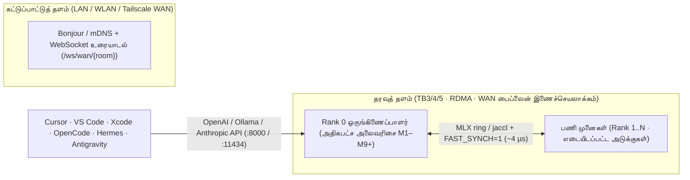

<div align="center">

# ☀️ SonnerStudio Cluster-Case-Companion (SS-CCC)

   **[English](README.md)** ·    **[Deutsch](README.de.md)** ·    **[Français](README.fr.md)** ·    **[Español](README.es.md)**<br/>
  **[Português](README.pt.md)** ·  **[Русский](README.ru.md)** ·  **[日本語](README.ja.md)** ·  **[中文](README.zh.md)**<br/>
  **[Nederlands](README.nl.md)** ·   **[Afrikaans](README.af.md)** ·  **[Polski](README.pl.md)** ·  **[Čeština](README.cs.md)**<br/>
 **[Slovenčina](README.sk.md)** ·  **[Magyar](README.hu.md)** ·  **[한국어](README.ko.md)** ·  **[हिन्दी](README.hi.md)** ·    **[தமிழ்](README.ta.md)**
<br/><a href="https://hits.sh/github.com/SonnerStudio/SonnerStudio-Cluster-Case-Companion/"></a><br/>
📖 **[திட்ட Wiki](wiki/Home.md)** · 🌐 **[GitHub Wiki](https://github.com/SonnerStudio/SonnerStudio-Cluster-Case-Companion/wiki)** · 🤝 **[பங்களிப்பு](CONTRIBUTING.md)** · 🛡️ **[பாதுகாப்பு](SECURITY.md)** · 📰 **[செய்திகள் & LinkedIn](docs/PRESS_RELEASE.en.md)**

*நேட்டிவ் macOS Apple Silicon கிளஸ்டர் மேலாளர் & பகிர்ந்தளிக்கப்பட்ட MLX அனுமான ஸ்டுடியோ*

<table>
  <tr>
    <td align="center">
      <br/>
      <sub><b>கிளஸ்டர் பயன்முறை (52 GB ஒருங்கிணைந்த தொகுப்பு · 2 முனைகள்)</b></sub>
    </td>
    <td align="center">
      <br/>
      <sub><b>தனித்த பயன்முறை (16 GB உள்ளூர் · 1 முனை)</b></sub>
    </td>
  </tr>
</table>

</div>

---

## 🧭 மேலோட்டம்

**SonnerStudio Cluster-Case-Companion (SS-CCC)** ஒரு ஒற்றை Mac mini அல்லது MacBook Pro முதல் **Thunderbolt 3/4/5 & RDMA** மேசை கிளஸ்டர்கள் மற்றும் **உலகளாவிய இணைய WAN கிளஸ்டர்கள் (2–256+ Macs)** வரை எந்தவொரு **Apple Silicon Mac-களின் (M1–M9+)** நினைவகம் மற்றும் கணினித் திறனையும் **MLX**, **oMLX**, **Ollama** மற்றும் **llama.cpp** உடன் நேரடியாக ஒருங்கிணைக்கிறது.

<div align="center">
  
</div>

---

## 🌐 உலகளாவிய இணைய கிளஸ்டர், நேரலை உரையாடல் & அறிவியல் Roofline

<table>
  <tr>
    <td align="center" width="50%">
      <br/>
      <sub><b>உலகளாவிய இணைய கிளஸ்டர் & பங்கேற்பாளர் உரையாடல்</b><br/>Tailscale · WireGuard · libp2p QUIC · DERP · <code>/status</code> · <code>/layers</code> · <code>/ping</code></sub>
    </td>
    <td align="center" width="50%">
      <br/>
      <sub><b>அறிவியல் Roofline & ஆற்றல் பகுப்பாய்வு</b><br/>Log-Log Roofline · GPipe Bubble · <code>J/token</code> · <code>p50/p95/p99</code> · CSV/JSON/BibTeX</sub>
    </td>
  </tr>
</table>

---

## 🏗️ கலப்பு கட்டமைப்பு (கட்டுப்பாட்டுத் தளம், Thunderbolt & WAN)



---

## 🌐 இணைய கிளஸ்டர் WAN அலைவரிசை & செயல்திறன் கண்காணிப்பாளர்


**இணைய கிளஸ்டர் & உரையாடல்** பிரிவில் SS-CCC உண்மையான WAN இணைப்புத் திறனை (`netstat`, `ping`, `networkQuality`) தொடர்ந்து அளவிடுகிறது — **பதிவிறக்க / பதிவேற்ற Mbps**, **WAN RTT தாமதம் (ms)**, **நடுக்கம்**, **பாக்கெட் இழப்பு** மற்றும் **டோக்கன் ஒத்திசைவு திறன்** ஆகியவற்றைக் கண்காணிக்கிறது.

---

## ✨ முக்கிய திறன்கள்

- **உலகளாவிய Apple Silicon கிளஸ்டரிங் (M1–M9+):** **M1 முதல் M6** மற்றும் எதிர்கால **M7–M12+** தலைமுறைகளின் எந்த **Mac mini, MacBook Air/Pro, iMac, Mac Studio அல்லது Mac Pro**-வையும் இணைக்கவும். அதிக நினைவக அலைவரிசை கொண்ட முனை தானாக **Rank 0 (ஒருங்கிணைப்பாளர்)** ஆகும் மற்றும் பாதுகாப்பான `iogpu.wired_limit_mb` macOS நினைவக ஒதுக்கீடு அமல்படுத்தப்படும்.
- **முழுமையான அமைப்பு & சென்சார் தொலைநிலை அளவீடு:** `sysctl`, `sw_vers`, `system_profiler`, `ibv_devices`, `ipconfig`, `ioreg` மற்றும் `ProcessInfo.thermalState` ஆகியவற்றைப் படித்து **CPU P/E கோர்கள், GPU கோர்கள், Neural Engine (16/32 ANE கோர்கள்), NVMe SSD கொள்ளளவு, வெப்ப நிலை & மின் நுகர்வு** ஆகியவற்றை அருகருகே காட்டுகிறது.
- **அனைத்து Thunderbolt வகுப்புகள் (TB3 / TB4 / TB5) & RDMA:** இணைப்பு வேகத்தை (`TB3/USB4: 26–32 Gbps`, `TB4: 30–37 Gbps`, `TB5: 65–80 Gbps`, `TB5 RDMA: 75–110 Gbps`) தானாக நிர்ணயித்து `MLX_METAL_FAST_SYNCH=1` மூலம் GPU/CPU ஒத்திசைவை 45× விரைவுபடுத்துகிறது.
- **நேரலை மாதிரி பணிமனை & இயக்கத் தயார்நிலை:** **oMLX**, **Ollama**, **llama.cpp**, உள்ளூர் `.gguf` கோப்புகள் மற்றும் `~/.cache/huggingface/hub` ஆகியவற்றிலிருந்து நிறுவப்பட்ட மாதிரிகளை நேரடியாகக் கண்டறிந்து அடுக்கு பிரிப்பு & KV-கேச் குவாண்டைசேஷனை (`FP16 / 8-bit / 4-bit`) வழங்குகிறது.
- **6× ஒரு-கிளிக் முகவர் & IDE ஒருங்கிணைப்புகள்:** **OpenCode**, **Hermes Agent**, **Google Antigravity**, **Cursor**, **Visual Studio Code** மற்றும் **Apple Xcode** ஆகியவற்றிற்கான அமைப்பை உடனடியாக ஏற்றுமதி செய்யலாம்.
- **உலகளாவிய இணைய WAN கிளஸ்டர் & உரையாடல் (`/ws/wan/{room_id}`):** மறைகுறியாக்கப்பட்ட சுரங்கப்பாதைகள் (Tailscale / WireGuard, libp2p / DERP P2P அல்லது நேரடி முகவரி) வழியாக உலகெங்கிலும் உள்ள Macs-களை இணைக்கவும்.
- **6-தாவல் அறிவியல் ஆய்வகம் & வரலாற்றுப் பதிவு:** **உள்ளூர் (TB/RDMA)**, **இணைய WAN** மற்றும் **நேரடி ஒப்பீடு** இடையே மாறி **Roofline**, **WAN இடவியல்**, **நினைவகம் & KV**, **ஆற்றல், CO₂ & செலவு**, **சோதனைகள் & ஏற்றுமதி** (`CI₉₅`, `CSV / JSON / LaTeX / BibTeX`) மற்றும் **வரலாற்றுப் பதிவு** செய்யுங்கள்.
- **GitHub கட்டுப்படுத்தப்பட்ட புதுப்பிப்புகள் & தானியங்கி CI பதிப்பு கட்டுப்பாடு:** தொடக்கத்திலும் ஒவ்வொரு 30 நிமிடங்களுக்கும் (`⌘U`) `version.json`, GitHub Releases & `commits/main` SHA-ஐச் சரிபார்த்து 1-கிளிக் `git pull` + மறுகட்டுமானம் வழங்குகிறது.
- **SonnerStudio Yellow (`#FFD400`), 17-மொழி கையேடு, Shorttips & மெனு பட்டை பின்னணி பயன்முறை (`⌘⇧M`):** **17 மொழிகளில்** (`EN..TA`) முழு மொழிபெயர்ப்பு, **Shorttips**, **12-அத்தியாய ஊடாடும் உதவி**, **25/25 தானியங்கி சோதனைகள்** மற்றும் முகவர்கள்/IDE-களுக்காக **மேல் மெனு பட்டையில் சுருக்கும் வசதி**.

### 🖥️ ஒரு பார்வையில் 11 நிரல் தொகுதிகள்


| பக்கவாட்டுத் தாவல் | நோக்கம் |
| :--- | :--- |
| **1. கிளஸ்டர் மேலோட்டம்** | நேரலை நினைவகத் தொகுப்பு பட்டை, செயலில் உள்ள M1–M12+ இடவியல், TB/RDMA வேகம் & **4-நிலை தயார்நிலை அட்டை** |
| **2. சாதனங்கள் & ஒப்பீடு** | M1–M12+ Mac-களைச் சேர்/நீக்கு, நேரலை CPU/GPU/ANE/SSD/வெப்பம்/மின்சாரம் ஆகியவற்றை ஒப்பிடு |
| **3. மாதிரி பணிமனை** | நேரலை மாதிரி கண்டறிதல் (oMLX / Ollama / llama.cpp / GGUF), இயக்கத் தயார்நிலை, அடுக்கு பிரிப்பு, ANE-Split & KV-கேச் |
| **4. பிணையம் & RDMA** | Auto-Hybrid / TB-Only / LAN / RDMA மாற்றம், `FAST_SYNCH=1`, Ring vs. JACCL Full-Mesh TP & TB3/4/5 வகுப்புகள் |
| **5. இணைய கிளஸ்டர் & உரையாடல்** | உள்ளூர் TB/RDMA-ஐ உலகளாவிய WAN இணைப்புகளுடன் (QUIC/Iroh 0-RTT, Tailscale) இணைத்து **WAN அலைவரிசை** & Audio-Party காண்க |
| **6. பல்மாதிரி பயன்முறை (MMM)** | **உள்ளூர்**, **WAN** அல்லது **கலப்பு** கிளஸ்டரில் பல மாதிரிகளை ஒன்றிணைத்து **பல IDE-களுக்கு** (`:8000/v1`) வழங்குகிறது |
| **7. முகவர்கள் & IDEகள்** | 6 IDEகள் & முகவர்களுக்கான 1-கிளிக் அமைப்பு (**MCP Registry JSON** & **A2A Agent Card** உட்பட) |
| **8. அறிவியல் & Roofline** | உண்மையான SSE & ICMP RTT உடன் 6-தாவல் ஆய்வகம், MMM மதிப்பீடு, Roofline, `N=1..128`, `J/tok` / `CO₂` & வரலாறு |
| **9. API & கன்சோல்** | OpenAI (`/v1/chat/completions`, `/v1/responses` + MCP), Ollama (`/api/tags`) & **A2A Agent Card** நேரலை சோதனை |
| **10. அமைப்பு & தயார்நிலை** | உள்ளூர் TB/LAN & WAN Macs-களைத் தானாகக் கண்டறிந்து SSH & `wired_limit` அமைத்து **இயக்கத் தயார்நிலையைச் சரிபார்க்கிறது** |
| **11. உதவி & கையேடு** | தேடக்கூடிய **12-அத்தியாய, 17-மொழி ஊடாடும் கையேடு** (`⌘?`) விரிவான வரைபடங்களுடன் |

---

## 🛠️ மூலக் குறியீட்டிலிருந்து உருவாக்குதல் (முதல் இயக்கத்திற்கு முன் முக்கியம்)

> [!NOTE]
> இந்தக் களஞ்சியத்தில் SS-CCC இன் **Swift மூலக் குறியீடு** உள்ளது (முன்கூட்டியே தொகுக்கப்பட்ட `.app` கோப்பு இல்லை). இயக்க உங்கள் Apple Silicon Mac-இல் முதலில் தொகுக்கவும்.

### முன்னிபந்தனைகள்
- **macOS 14.0 அல்லது அதற்குப் பிந்தைய** பதிப்பை இயக்கும் எந்தவொரு Apple Silicon Mac (**M1–M6+**)
- **Xcode Command Line Tools** (`swiftc` மற்றும் macOS SDK அடங்கியது):
  ```bash
  xcode-select --install
  ```

### படிப்படியாக: களஞ்சியத்திலிருந்து இயங்கும் செயலி வரை
```bash
# 1. களஞ்சியத்தை நகலெடுக்கவும்
git clone https://github.com/SonnerStudio/SonnerStudio-Cluster-Case-Companion.git
cd SonnerStudio-Cluster-Case-Companion

# 2. உருவாக்கும் ஸ்கிரிப்ட்டை இயக்கக் கூடியதாக மாற்றவும் (ஒருமுறை)
chmod +x scripts/run_ssccc.sh

# 3. அனைத்து Swift கோப்புகளையும் /tmp/SSCCCApp-இல் தொகுத்து செயலியை இயக்கவும்
./scripts/run_ssccc.sh
```
*(விருப்பப்பட்டால் Swift Package Manager வழியாக `cd app && swift build -c release` கொண்டும் உருவாக்கலாம்.)*

---

## 🚀 விரைவுத் தொடக்கம்

```bash
# 1. நேட்டிவ் SwiftUI Studio செயலியைத் தொடங்கவும்
"./scripts/run_ssccc.sh"

# 2. (விருப்பம்) Python/FastAPI நுழைவாயிலைத் தொடங்கவும்
cd core && uv sync --extra dev
PYTHONPATH=".." uv run uvicorn core.api.gateway:app --host 0.0.0.0 --port 8000

# 3. Thunderbolt பாயிண்ட்-டு-பாயிண்ட் IP-களை அமைக்கவும்
./scripts/setup_tb_network.sh studio   # 10.99.1.1
./scripts/setup_tb_network.sh mini     # 10.99.1.2
```

---

## 📖 செயல்பாட்டு வழிகாட்டி: உள்ளூர் & கலப்பு கிளஸ்டர் அமைப்பு, மாதிரி ஏற்றுதல்

### 1. உள்ளூர் கிளஸ்டர் அமைப்பு (Thunderbolt 3/4/5 & LAN)
1. **இணைப்பு:** **Thunderbolt 3/4/5 கேபிள்கள்** மற்றும்/அல்லது **10GbE ஈதர்நெட்** வழியாக Macs-களை இணைக்கவும்.
2. **IP ஒதுக்கீடு:** முதன்மை Mac-இல் `./scripts/setup_tb_network.sh studio` (`10.99.1.1`) மற்றும் பிறவற்றில் `mini` (`10.99.1.2`) இயக்கவும்.
3. **விருப்ப RDMA (TB5-இல் macOS 26.2+):** `rdma_ctl enable` மூலம் `JACCL` தாமதத்தை `~300 µs`-இலிருந்து **`~3 µs`** ஆகக் குறைக்கவும்.
4. **தானியங்கி தரவரிசை:** **சாதனங்கள் & ஒப்பீடு** பகுதியில் Macs-களைச் சேர்க்கவும்; `MemoryWeightedPlanner` வேகமான Mac-ஐ **Rank 0** ஆக்கும்.

### 2. கலப்பு கிளஸ்டர் பிணைய அமைப்பு (உள்ளூர் + இணைய WAN ஒரே நேரத்தில்)
1. **உள்ளூர் அதிவேக மையம் (அடுக்கு 1):** உள்ளூர் TB/LAN வளையத்தைச் செயலில் வைத்திருக்கவும்.
2. **WAN ஒருங்கிணைப்பாளர் அறை (அடுக்கு 2):** **இணைய கிளஸ்டர் & உரையாடல்** பகுதியில் WAN அறை (`/ws/wan/{room_id}`, போர்ட் `8000`) தொடங்கவும்.
3. **தொலைநிலை முனைகள்:** உலகெங்கிலும் உள்ள Macs **அறை குறியீடு + டோக்கன்** மூலம் இணையலாம்.
4. **இரு-அடுக்கு ரூட்டிங்:** முக்கிய அடுக்குகள் உள்ளூர் வளையத்திலும் கூடுதல் நிலைகள் `M ≥ 4` உடன் WAN வழியாகவும் இயங்கும்.

### 3. மாதிரியை யார் ஏற்றுவார்கள், எத்தனை மாதிரிகள் பொருந்தும் & கோரிக்கை ஓட்டம்
- **யார் எதை ஏற்றுவார்கள்?**
  - **ஒருங்கிணைப்பாளர் (Rank 0):** API நுழைவாயிலை (`:8000`) இயக்குகிறது மற்றும் **எப்போதும் Embeddings & LM-Head** மற்றும் தன் பங்கு அடுக்குகளை வைத்திருக்கும்.
  - **பணி முனைகள் (Rank 1..N):** ஒவ்வொரு முனையும் தன் `[start_layer .. end_layer)` அடுக்குகளை மட்டுமே உள்ளூர் தற்காலிக சேமிப்பிலிருந்து படிக்கும்.
- **ஒரே நேரத்தில் எத்தனை மாதிரிகள் ஏற்றலாம்?**
  - **பகிர்ந்தளிக்கப்பட்ட கிளஸ்டர் பயன்முறை (`mlx.distributed` / `JACCL`):** ஒருங்கிணைந்த நினைவகத்தில் **ஒரு பெரிய பிரிக்கப்பட்ட மாதிரி**.
  - **பல்மாதிரி சேவை (`oMLX` / `Ollama` / MMM):** `Σ (Weights_i + KV_i) ≤ Total_Usable_VRAM_GB` வரை **பல மாதிரிகள் ஒரே நேரத்தில்** இயங்கும்.
- **முழுமையான செயல்பாட்டு ஓட்டம்:**
  1. **சோதனை & இணைப்பு தேர்வு:** RAM, அலைவரிசை மற்றும் இணைப்புகளை (`TB5 RDMA > TB > 10GbE > WLAN > WAN`) கண்டறிகிறது.
  2. **பிரிப்புத் திட்டம்:** `MemoryWeightedPlanner` `iogpu.wired_limit_mb` பாதுகாப்புடன் `hostfile.json` எழுதுகிறது.
  3. **API நுழைவு:** முகவர்கள்/IDEகள் `http://127.0.0.1:8000/v1/chat/completions`-க்கு கோரிக்கை அனுப்புகின்றன.
  4. **Prefill நிலை (`TTFT`):** Rank 0 ப்ராம்ப்டை எம்பெட்டிங் செய்து பைப்லைன் வழியே அனுப்புகிறது.
  5. **Decode நிலை (`TPOT` & `tok/s`):** `--kv-bits 4` மற்றும் `MLX_METAL_FAST_SYNCH=1` உடன் டோக்கன்கள் உருவாகின்றன.
  6. **SSE ஸ்ட்ரீமிங் & அளவீடு:** Rank 0 டோக்கன்களை அனுப்பி `tok/s`, `TTFT`, `TPOT`, `J/tok` ஆகியவற்றைப் பதிவு செய்கிறது.

### 4. பயன்பாட்டு சூழல்களின் கோட்பாட்டு அளவீடு & செயல்திறன் தரவு

> **கணிப்பு விதிகள்:**
> - **நினைவக அளவு:** `VRAM_GB ≈ Params_B × (Bits / 8) × 1.15 + KV_Cache_GB`
> - **கோட்பாட்டு டீகோட் உச்சவரம்பு:** `tok/s ≈ (Effective_Bandwidth_GB/s / Active_Weights_GB) × (1 − Comm_Overhead)`

| பயன்பாட்டுச் சூழல் | இடவியல் & பயனுள்ள தொகுப்பு | மாதிரி & குவாண்டைசேஷன் | கோட்பாட்டு `TTFT` (2k) | கோட்பாட்டு டீகோட் (`tok/s`) | ஆற்றல் & முக்கிய தடை |
| :--- | :--- | :--- | :--- | :--- | :--- |
| **1. தனிப் பணிநிலையம் (Edge Dev)** | 1× Mac mini M4 (16 GB, `12 GB`, `120 GB/s`) | `Qwen2.5-14B` (`4-bit`, ~8.8 GB) | `~1.8 – 2.6 s` | **`11 – 14 tok/s`** (`~75 ms/tok`) | `~1.7 J/tok` · நினைவக அலைவரிசை |
| **2. ஒற்றை Pro Studio** | 1× Mac Studio M4 Max (64 GB, `58 GB`, `546 GB/s`) | `Llama-3.3-70B` (`4-bit`, ~40 GB) | `~1.1 – 1.7 s` | **`12 – 14 tok/s`** (`~74 ms/tok`) | `~3.8 J/tok` · நினைவக அலைவரிசை |
| **3. உள்ளூர் 2-முனை TB5 RDMA வளையம்** | 2× M4 Max 64 GB (`116 GB`, `~1,092 GB/s`, `~3 µs`) | `Qwen2.5-Coder-72B` (`8-bit`, ~78 GB) | `~1.4 – 2.0 s` | **`12 – 14 tok/s`** (`~76 ms/tok`) | `~7.5 J/tok` · மிகக் குறைந்த RDMA சுமை |
| **4. ஆய்வகம் 4-முனை Ultra வளையம்** | 4× M3 Ultra 256 GB (`992 GB`, `~3.27 TB/s`, TB5 RDMA) | `DeepSeek-V3 671B MoE` (`4-bit`, ~385 GB) | `~2.2 – 3.5 s` | **`38 – 55 tok/s`** (`~20 ms/tok`) | `~5.2 J/tok` · செயலில் உள்ள MoE |
| **5. கலப்பு அலுவலக LAN + வீட்டு WAN** | 2× TB4 + 2× WAN (`192 GB`, `35 ms` RTT) | `Llama-3.1-405B` (`3/4-bit`, ~170 GB) | `~6 – 11 s` | **`2.2 – 4.5 tok/s`** (`~280 ms/tok`) | `~28 J/tok` · WAN RTT (`M=8`) |
| **6. உலகளாவிய சமூக WAN கூட்டம்** | உலகெங்கும் 16+ Macs (`1.5+ TB`, `60–120 ms` RTT) | `671B–1T+` Frontier (`4/8-bit`) | `~12 – 25 s` | **`1.2 – 3.0 tok/s`** (`~500 ms/tok`) | WAN தாமதம் (பேட்சிங் உதவும்) |

---

## 📚 தேர்ந்தெடுக்கப்பட்ட ஆவணங்கள் (செயலியின் உதவி மையத்தில் உள்ளது)

### 1. உலகளாவிய Apple Silicon M-தொடர் கிளஸ்டரிங் (M1–M12+)
**Mac mini, MacBook Air/Pro, iMac, Mac Studio & Mac Pro** ஆகியவற்றில் **M1–M6** மற்றும் எதிர்கால **M7–M12+** சில்லுகள் அனைத்தையும் SS-CCC ஆதரிக்கிறது.

| Mac / சில்லு குடும்பம் | நினைவக அலைவரிசை | Thunderbolt & RDMA | பரிந்துரைக்கப்பட்ட macOS ஒதுக்கீடு |
| :--- | :--- | :--- | :--- |
| **M1 / M2** (Base) | 68 – 100 GB/s | TB 3 / USB4 (26–32 Gbps) | **4 GB** (≤ 24 GB RAM) |
| **M3 / M4** (Base) | 100 – 120 GB/s | TB 4 (30–37 Gbps) | **4 GB** (≤ 24 GB RAM) |
| **M5 / M6** (Base, M6 2nm) | **153 – 170 GB/s** (`M6`: 153 GB/s @ 16 GB, 170 GB/s @ 24–32 GB) | TB 4 / TB 5 (`80/120 Gbps`) | **4 GB** (≤ 32 GB RAM) |
| **M1–M3 Pro** | 150 – 200 GB/s | TB 4 (30–37 Gbps) | **4 – 6 GB** |
| **M4 / M5 Pro** | 273 – 307+ GB/s | TB 5 (`80/120 Gbps` boost) | **4 – 6 GB** |
| **M1–M3 Max** | 400 GB/s | TB 4 (30–37 Gbps) | **6 GB** (32–64 GB RAM) |
| **M4 Max** | **410 – 546 GB/s** (LPDDR5X-8533) | TB 5 + RDMA (`~3 µs`) | **6 GB** (32–128 GB RAM) |
| **M5 Max** | **460 – 614 GB/s** (32/40-கோர் GPU) | TB 5 + RDMA (`~3 µs` JACCL) | **6 GB** (36–128 GB RAM) |
| **M1–M2 Ultra / M3 Ultra** | **800 – 819 GB/s** (UltraFusion) | TB 4 / TB 5 RDMA (JACCL) | **8 GB** (≥ 96 GB RAM) |
| **M5 Ultra** | **1.2 TB/s** (~1,228 GB/s, 512 GB RAM வரை, 80-கோர் GPU) | TB 5 RDMA (`JACCL`) | **8 GB** (96–512 GB RAM) |

> [!NOTE]
> **M6 குறிப்பு:** Apple செப்/அக் 2026-இல் 2nm **M6** அடிப்படை சில்லை வெளியிட்டது; **M6 Pro, Max & Ultra** நவம்பர் 2026 நிலவரப்படி இன்னும் வெளிவரவில்லை. SS-CCC எதிர்கால M6–M12+ சில்லுகளைத் தானாகவே அடையாளம் காணும்.

### 2. Thunderbolt 5 RDMA (`JACCL`) & நினைவகப் பாதுகாப்பு


- **Thunderbolt 5 வழியாக macOS RDMA:** `rdma_ctl enable` மற்றும் `JACCL` தாமதத்தை `~300 µs`-இலிருந்து **`~3 µs`** ஆகக் குறைக்கிறது.
- **100% RAM ஒதுக்க வேண்டாம்:** macOS நிலைத்தன்மைக்கு SS-CCC `iogpu.wired_limit_mb`-ஐக் கட்டாயப்படுத்துகிறது.
- **விகிதாசார அடுக்கு பிரிப்பு:** ஒவ்வொரு Mac-க்கும் அதன் பயனுள்ள நினைவகத்திற்கு ஏற்ப அடுக்குகள் கிடைக்கும்.
- **KV-கேச் & விரைவு Metal ஒத்திசைவு:** `--kv-bits 4` மற்றும் `MLX_METAL_FAST_SYNCH=1` ஒத்திசைவை **45×** விரைவுபடுத்துகிறது.

---

## 🔄 GitHub கட்டுப்படுத்தப்பட்ட புதுப்பிப்புகள் & தானியங்கி CI பதிப்பு கட்டுப்பாடு


ஒவ்வொரு நிறுவலும் புதுப்பித்த நிலையில் இருக்க SS-CCC ஒருங்கிணைந்த **GitHub புதுப்பிப்பு பைப்லைனை** உள்ளடக்கியது:

1. **பல-மூல GitHub பதிப்பு சரிபார்ப்பு:**
   - `raw.githubusercontent.com/.../main/version.json` (நேரலை வெளியீட்டு விவரம்)
   - `api.github.com/repos/.../releases/latest` (அதிகாரப்பூர்வ GitHub வெளியீடுகள்)
   - `api.github.com/repos/.../commits/main` (புதிய `main` SHA)
2. **செயலிக்குள் புதுப்பிப்பு (`UpdatePromptSheet`) & 1-கிளிக் மறுகட்டுமானம்:**
   - புதிய பதிப்பு கண்டறியப்பட்டதும் மேல் பட்டையில் **புதுப்பிப்பு பொத்தான்** (`⌘U`) ஒளிரும்.
   - **மூல நிறுவல்கள்:** `git pull` + உருவாக்கி **இப்போது மறுதொடக்கம் செய்** பொத்தானை வழங்கும்.
   - **தொகுக்கப்பட்ட `.app`:** Safari-யில் பதிவிறக்கத்தைத் திறக்கும்.
3. **தானியங்கி CI பதிப்பு உயர்வு (`.github/workflows/auto-version-control.yml`):**
   - ஒவ்வொரு `main` push-இலும் `scripts/bump_version.py` மற்றும் 25 சோதனைகள் இயக்கப்பட்டு `vX.Y.Z` குறி புதுப்பிக்கப்படும்.

---

## 🧠 பல்மாதிரி பயன்முறை (MMM) — ஒருங்கிணைந்த ஒழுங்கமைப்பு & பல-IDE பகிர்வு


**பல்மாதிரி பயன்முறை (MMM)** **உள்ளூர்**, **இணைய WAN** அல்லது **கலப்பு** கிளஸ்டரில் பல AI மாதிரிகளை ஒரே நேரத்தில் ஒருங்கிணைக்கிறது.

### 4 ஒருங்கிணைப்பு உத்திகள்
1. **இணை பல்மாதிரி தொகுப்பு:** பல சிறப்பு மாதிரிகளைத் தனி VRAM ஒதுக்கீடுகளில் தயார் நிலையில் வைத்திருக்கிறது.
2. **Mixture-of-Agents (MoA):** ஒரே ப்ராம்ப்டை வல்லுநர்களுக்கு அனுப்பி `Aggregator` மூலம் தொகுக்கிறது.
3. **ஊக டீகோடிங் (Draft + Target):** வேகமான `Draft` மற்றும் பெரிய `Target` மூலம் $1.6\times$–$2.3\times$ வேகம்.
4. **வரிசை மாதிரி பைப்லைன்:** *திட்டமிடுபவர் → குறியீட்டாளர் → மதிப்பாய்வாளர்* நிலைகளாக இணைக்கிறது.

### ⚙️ 1-கிளிக் தானியங்கி அமைப்பு & நேரலை ஸ்லாட் திருத்தி


எப்போது வேண்டுமானாலும் ஸ்லாட்களைத் திருத்தலாம்:
- **1-கிளிக் சுயவிவரங்கள்:** **Coding & IDE Swarm**, **Consensus & Audit**, **Turbo**, **Stage Pipeline**.
- **முழு மாற்றம்:** வரிசை மாற்றுதல், நகலெடுத்தல், நிலைமாற்றுதல், URL (`:8000/v1`, `:11434/v1`) திருத்துதல்.
- **VRAM-Fit மேம்படுத்தி:** 1 கிளிக்கில் பொருத்தி JSON-இல் சேமிக்கவும்.

### பகிரப்பட்ட பல-IDE & முகவர் பயன்பாடு (`:8000/v1`)
**Cursor**, **VS Code**, **Xcode**, **OpenCode**, **Hermes Agent** மற்றும் **Antigravity** அனைத்தும் ஒரே நேரத்தில் `:8000/v1`-ஐப் பயன்படுத்தலாம்.

### நடைமுறை MMM பயன்பாடுகள்
- **பல IDE ஒரே நேரத்தில்:** Cursor, OpenCode, Hermes தாமதமின்றி இணையாக இயங்கும்.
- **ஊக டர்போ:** 16 GB Mac mini Draft ஆகவும் Mac Studio 70B+ Target ஆகவும்.
- **MoA குறியீடு ஆய்வு:** குறியீடு, கணிதம் மற்றும் தொகுப்பு மாதிரிகளின் இணைப்பு.
- **கலப்பு சிறப்பு:** உள்ளூர் TB-இல் விரைவு நிரப்புதல், WAN-இல் 405B பணி.
- **தானியங்கி CI பைப்லைன்கள்:** *வடிவமைப்பு → உருவாக்கம் → பாதுகாப்பு தணிக்கை*.
- **அறிவியல் மதிப்பீடு:** ஒவ்வொரு MMM ஓட்டமும் `அறிவியல் & Roofline`-இல் பதிவாகும்.

---

## 🎙️ கிளஸ்டர் Audio-Party & நேரலை WAN ஒத்துழைப்பு


- **கன்சோல் பாணி குரல் ஒருங்கிணைப்பு:** `/ws/wan-audio` வழியாக நேட்டிவ் `AVAudioEngine` (`16 kHz PCM16`).
- **கட்டுப்பாடுகள்:** **Push-to-Talk** / **திறந்த மைக்**, Mute, ஒலி அளவீடு & பங்கேற்பாளர் நிலை.
- **நேரலை அறை ஒத்திசைவு (`/ws/wan/{room_id}`):** `SSCCC-WAN-…` அழைப்புகள் & உரையாடலை ஒத்திசைக்கும்.

---

## 🏆 உலகளாவிய + உள்ளூர் கலப்பு சூப்பர் கிளஸ்டர் சாதனை முயற்சி


**Apple Silicon Macs-களின் பரவலாக்கப்பட்ட கூட்டணி ஒரு தரவு மைய சூப்பர் கணினிக்கு இணையாக இயங்குமா?**  
பல்கலைக்கழகங்கள், AI ஆய்வகங்கள் & டெவலப்பர்களை அதிகாரப்பூர்வ **SS-CCC கலப்பு சாதனை முயற்சியில்** இணைய அழைக்கிறோம்.

### 🔬 அறிவியல் அடிப்படை & கணித அளவிடுதல் மாதிரி

1. **இரு-அடுக்கு படிநிலை இடவியல் (Tier-0 TB/RDMA தீவுகள் + Tier-1 WAN முதுகெலும்பு):**
   - சாதாரண WAN கிளஸ்டர்கள் ஒவ்வொரு அடுக்கு மாற்றத்திலும் இணையத்தைக் கடப்பதால் வேகம் குறையும் ($H_{\text{WAN}} = N - 1$).
   - **கலப்பு பாலம்** அடுத்தடுத்த அடுக்குகளை உள்ளூர் TB-இல் (`~0.07 ms`) வைத்து தீவு இடைமாற்றங்களை மட்டுமே WAN-க்கு அனுப்பும்.
2. **முக்கிய மைக்ரோ-பேட்சிங் ($B^*$) & சுருக்கத்தால் WAN RTT குறைப்பு:**
   - பைப்லைன் செயல்திறன் GPipe குமிழ் விதியைப் பின்பற்றுகிறது:
     $$\Phi_{\text{bubble}} = \frac{N - 1}{M + N - 1}, \qquad B^* = \left\lceil \frac{T_{\text{RTT,WAN}} + T_{\text{tx}}}{T_{\text{comp}}(B=1)} \right\rceil$$
   - $M \to B^*$ தாமதத்தை மறைக்கிறது மற்றும் **FP8 / INT4 / Top-K** (*Petals / SWARM*) கூடுதல் சுமையை $1\%$-க்கு கீழ் வைத்திருக்கிறது.
3. **நிலையான மறுஉருவாக்க சாதனை நெறிமுறை ($T = 0.0$):**
   1. **Tier-0 தீவுகளை அமைக்கவும்:** உள்ளூர் Macs-களை Thunderbolt-ஆல் இணைக்கவும் (`MLX_METAL_FAST_SYNCH=1`).
   2. **பாலம் & ஒருங்கிணைப்பு:** `SSCCC-WAN-…` குறியீட்டைப் பகிர்ந்து Audio-Party-இல் ஒருங்கிணைக்கவும்.
   3. **சோதனைகளை இயக்கவும்:** `N = 20` சோதனைகள் (`temperature = 0.0`, `TTFT ≤ 2500 ms`, `TPOT ≤ 100 ms/tok`).
   4. **சரிபார்ப்பைச் சேமிக்கவும்:** **JSON Manifest**, **CSV பதிவு** & **LaTeX அட்டவணை** (`CI₉₅`, `CV%`, `J/token`, `EDP`, `gCO₂eq`) ஏற்றுமதி செய்யவும்.


### 🥇 அதிகாரப்பூர்வ சாதனைப் பிரிவுகள்
- **மிகப்பெரிய ஒருங்கிணைந்த நினைவகத் தொகுப்பு:** அதிகபட்ச பயனுள்ள VRAM (`GB` / `TB`).
- **அதிகபட்ச ஒரே நேர இணைந்த Macs ($N$):** `N = 20` தேர்ச்சி பெற்ற மிகப்பெரிய வலைப்பின்னல் (`32–256+`).
- **அதிகபட்ச கண்டம் கடந்த Goodput:** $\ge 2$ கண்டங்களில் SLO-க்குள் அதிகபட்ச `tokens/s`.
- **சிறந்த கிளஸ்டர் ஆற்றல் திறன்:** `70B+` மாதிரிக்குக் குறைந்த `J/token` & `EDP`.

---

## 🎯 பயன்பாடுகள் & இலக்குப் பயனர்கள்


| பயனர் குழு | SS-CCC உடன் நடைமுறை பயன்பாடு |
| :--- | :--- |
| **AI அமைப்புகள் & ML ஆய்வாளர்கள்** | Roofline வரம்புகள், *Petals/SWARM*, *DiLoCo* ஆய்வு & `CI₉₅` + `LaTeX`/`BibTeX` ஏற்றுமதி. |
| **பல்கலைக்கழகங்கள் & கற்பித்தல் ஆய்வகங்கள்** | மாணவர் MacBook-கள் மற்றும் Mac mini-களை 70B–405B+ கற்றல் கிளஸ்டராக இணைத்தல். |
| **மென்பொருள் குழுக்கள் & முகவர் அணிகள்** | OpenCode, Hermes, Antigravity, Cursor, VS Code, Xcode ஆகியவற்றிற்கு கிளவுட் செலவின்றி உள்ளூர் மாதிரிகள். |
| **தனியுரிமை-முதன்மை சட்டம் & மருத்துவம்** | முழுத் தரவையும் உள்ளூரிலேயே அல்லது மறைகுறியாக்கப்பட்ட WireGuard/Tailscale சுரங்கத்தில் வைத்தல். |
| **உலகளாவிய ஓப்பன்-சோர்ஸ் ஹேக்கத்தான்கள்** | குரல் ஒருங்கிணைப்புடன் சில நிமிடங்களில் எல்லை கடந்த சூப்பர் கிளஸ்டர்கள். |
| **பசுமை-AI & நிலைத்தன்மைத் தணிக்கை** | தரவு மைய GPU-களுடன் `J/token`, `EDP` & `gCO₂eq/1M tokens` ஒப்பீடு. |

---

## 📁 களஞ்சிய அமைப்பு

```text
├── app/Sources/
│   ├── SSCCCApp.swift              # முதன்மைச் சாளரம், MenuBarExtra பின்னணி சேவை, புதுப்பிப்பு & தாள்
│   ├── Models/
│   │   ├── ClusterModels.swift     # M1–M12+ கணிப்பு, WAN/அறிவியல்/வரலாறு & வெளியீட்டு மாதிரிகள்
│   │   └── Localization.swift      # முழுமையான 17-மொழி UI & உதவி அகராதி (EN..TA)
│   ├── ViewModels/
│   │   └── ClusterViewModel.swift  # வன்பொருள் ஆய்வு, மாதிரி கண்டறிதல், WAN/Audio-Party & GitHub புதுப்பிப்பி
│   └── Views/                      # 12 SwiftUI காட்சிகள் + Theme.swift (11 தாவல்கள், எச்சரிக்கைப் பட்டைகள் & Shorttips)
├── app/Resources/                # Solaris Dock Icon (ssccc_app_icon.png / AppIcon.icns) & Assets
├── core/                           # Python FastAPI நுழைவாயில், WebSocket WAN/Audio & MLX பிரிப்பு
├── scripts/
│   ├── run_ssccc.sh                # macOS செயலியைத் தொகுத்து இயக்குகிறது
│   ├── bump_version.py             # version.json & ClusterModels.swift-ஐ Git உடன் ஒத்திசைக்கிறது
│   ├── setup_tb_network.sh         # 10.99.1.x Thunderbolt பாலத்தை அமைக்கிறது
│   └── setup_wired_limit.sh        # பாதுகாப்பான iogpu.wired_limit_mb வரம்புகளைப் பயன்படுத்துகிறது
├── tests/                          # 25-சோதனை உலகளாவிய சரிபார்ப்புத் தொகுப்பு (Swift + Python)
├── wiki/                           # Wiki (Home.md, _Sidebar.md, Architecture, MMM, MenuBar, Science, 17 Languages)
├── CONTRIBUTING.md                 # GitHub right-sidebar guide
├── SECURITY.md                     # Security & memory guard policy
├── CODE_OF_CONDUCT.md              # Community standards
├── .github/workflows/              # தானியங்கி CI பதிப்பு கட்டுப்பாடு & குறித்தல்
└── version.json                    # GitHub-இல் உள்ள புதுப்பிப்பு கட்டுப்பாட்டுப் பட்டியல்
```

---

## 🚀 2026 SOTA கட்டமைப்பு மேம்பாடு (கட்டம் 11)

- **TB5 RDMA Tensor Parallelism & QUIC / Iroh WAN:** **Pipeline Ring** / **JACCL Full-Mesh TP** மற்றும் **QUIC / Iroh P2P (0-RTT)**.
- **ANE-Split & 3-அடுக்கு KV-கேச் / CacheGen:** Neural Engine-இல் prefill (`EDP ×1.42`, `-31.5%` மின்சாரம்) & `3.6×` சுருக்கம்.
- **அடுத்த தலைமுறை MMM:** **EAGLE-3**, **Tree-MoA Early-Exit** & **Ares** தகவமைப்பு திசைவி.
- **நவீன முகவர் தரநிலைகள்:** **OpenAI `/v1/responses`**, **MCP Server Registry JSON** & **A2A Agent Cards**.
- **வெப்ப & கார்பன் விழிப்புணர்வுத் திட்டமிடல்:** வெப்பமடையும் முனைகளின் சுமையைத் தானாகக் குறைக்கிறது.

### 🛠️ கட்டம் 12: தானியங்கி கிளஸ்டர் அமைப்பு, தயார்நிலை சரிபார்ப்பு & Shorttips


- **11வது பக்கவாட்டுப் பிரிவு (`அமைப்பு & தயார்நிலை`):** உள்ளூர் & WAN Macs-களைத் தானாகக் கண்டறிந்து SSH அமைக்கும்.
- **4-நிலை தயார்நிலை சுழற்சி:** **தயார்**, **தயாரில்லை**, **பகுதி அமைப்பு** அல்லது **அமைக்கப்படவில்லை** என 17 மொழிகளிலும் காட்டும்.
- **செயலி முழுதும் Shorttips:** `.help` மற்றும் மிதக்கும் **Solaris Shorttip பட்டை**.
- **ஊடாடும் உதவி & நேரலைத் தரவு:** 12 அத்தியாயங்களும் வரைபடங்களுடன் திறந்து உண்மையான வன்பொருள் தரவைப் பயன்படுத்தும்.

### 🛰️ மேல் மெனு பட்டையில் சுருக்குதல் (முகவர்கள் & IDE-களுக்கான பின்னணி சேவை பயன்முறை, ⌘⇧M)

- **macOS மேல் மெனு பட்டைக்கு எளிய மாற்றம்:** சாளரத்தின் மஞ்சள் சுருக்கு பொத்தானை அழுத்தவும், **`⌘⇧M`** பயன்படுத்தவும் அல்லது தலைப்பில் உள்ள **மெனு பட்டைக்கு** பொத்தானைச் சொடுக்கவும் — முதன்மைச் சாளரம் மறைந்து SS-CCC **Ollama** அருகே மேல் மெனு பட்டையில் அமைதியான பின்னணிச் சேவையாக (`.accessory` பயன்முறை) இயங்கும்.
- **தெளிவான நேரலை அளவுகோல்கள்:** மெனு பட்டை சின்னம் மற்றும் பாப்ஓவர் உடனடியாக **தயார்நிலை**, **தொகுப்பு / பயனுள்ள RAM (GB)**, **செயலில் உள்ள முனைகள்**, **ஏற்றப்பட்ட மாதிரி & அடுக்குகள்**, **இயக்க நேரம்** & **MMM ஸ்லாட்களைக்** காட்டும்.
- **1-கிளிக் முனை நகலெடுப்பு & இணைந்த IDEகள்:** Cursor, OpenCode, Hermes, Antigravity, VS Code & Xcode ஆகியவற்றிற்கு **`http://127.0.0.1:8000/v1`** (OpenAI/MMM) அல்லது **`http://127.0.0.1:11434`** (Ollama) முகவரிகளை நேரடியாக நகலெடுக்கவும்.
- **உடனடி சாளர மீட்பு:** மெனு பட்டை (`⌘⇧M`) அல்லது Dock வழியாக எப்போது வேண்டுமானாலும் முழு ஸ்டுடியோ சாளரத்தைத் திரும்பத் திறக்கலாம்.
- **நவீன Solaris Dock சின்னம்:** கீழ் macOS Dock பட்டிக்கான பிரத்யேக `1024×1024` செயலிச் சின்னம் (`ssccc_app_icon.png` & `AppIcon.icns`) தொடக்கத்திலும் மீட்டெடுப்பிலும் தானாகப் பொருத்தப்படுகிறது.

---

## 🚧 வளர்ச்சி நிலை & பங்களிப்பு

> [!IMPORTANT]
> **SS-CCC v1.6+ முழுமையாக இயக்கக்கூடியது மற்றும் `25/25` தானியங்கி சோதனைகளால் சரிபார்க்கப்பட்டது.**
> **ஏற்கனவே செயல்படுத்தப்பட்டவை:** ஆங்கிலத் தொடக்க மொழி மற்றும் **முழு 17-மொழி மொழிபெயர்ப்பு (`EN..TA`)**, **CPU, GPU & Neural Engine (ANE) கோர் அளவீடு**, **மெனு பட்டை பின்னணி சேவை பயன்முறை (`⌘⇧M`)**, **17 README-களிலும் பார்வையாளர் எண்ணிக்கை**, M1–M12+ கண்டறிதல், 6-தாவல் அறிவியல் ஆய்வகம், Audio-Party & GitHub தானியங்கி புதுப்பிப்பு.

டெவலப்பர்கள், ஆய்வாளர்கள் & Apple Silicon ஆர்வலர்களை **SS-CCC-க்குப் பங்களிக்க** அன்புடன் அழைக்கிறோம்:
- **உங்கள் வன்பொருளில் சோதிக்கவும்:** உங்கள் M1–M12+ Macs முடிவுகளையும் RDMA/JACCL அனுபவத்தையும் பகிரவும்.
- **கலப்பு சாதனை முயற்சியில் இணையுங்கள்:** உள்ளூர் TB & WAN முனைகளை இணைத்து JSON/CSV/LaTeX வெளியிடவும்.
- **Pull Requests அனுப்புங்கள்:** SwiftUI, MLX, ஸ்கிரிப்ட்கள் அல்லது மொழிபெயர்ப்பு மேம்பாடுகள் எப்போதும் வரவேற்கப்படுகின்றன!

---

## 📄 உரிமம்

[MIT உரிமத்தின்](LICENSE.md) கீழ் வெளியிடப்பட்டது.
