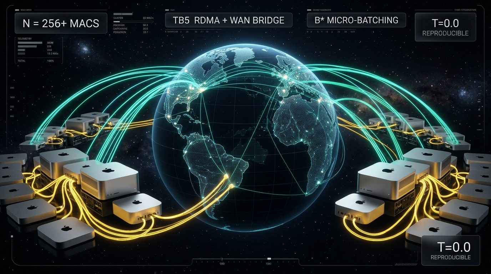
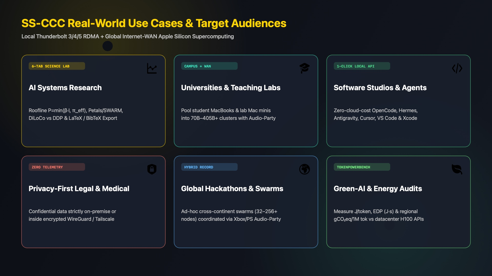

<div align="center">

# ☀️ SonnerStudio Cluster-Case-Companion (SS-CCC)

**🇺🇸 🇬🇧 🇨🇦 [English](README.md)** · **🇩🇪 🇦🇹 🇨🇭 [Deutsch](README.de.md)** · **🇫🇷 🇧🇪 🇨🇭 [Français](README.fr.md)** · **🇪🇸 🇲🇽 🇦🇷 [Español](README.es.md)** · **🇵🇹 🇧🇷 [Português](README.pt.md)** · **🇷🇺 [Русский](README.ru.md)** · **🇯🇵 [日本語](README.ja.md)** · **🇨🇳 [中文](README.zh.md)**

*原生 macOS Apple Silicon 集群管理器与分布式 MLX 推理工作室*

<table>
  <tr>
    <td align="center">
      <br/>
      <sub><b>集群模式 (52 GB 统一内存池 · 2 节点)</b></sub>
    </td>
    <td align="center">
      <br/>
      <sub><b>单机模式 (16 GB 本地 · 1 节点)</b></sub>
    </td>
  </tr>
</table>

</div>

---

## 🧭 概览

**SonnerStudio Cluster-Case-Companion (SS-CCC)** 是一款原生 macOS (SwiftUI) 桌面应用与 Python/FastAPI 控制网关，可通过 **Thunderbolt 3/4/5 (RDMA / JACCL)**、**10GbE 局域网** 与 **全球互联网 (WAN)** 将多台 **Apple Silicon Mac (M1–M12+)** 聚合为统一的显存池与分布式 MLX 推理集群。

无需将源码或敏感文档上传至云端，本地 AI 智能体与 IDE（**OpenCode**、**Hermes Agent**、**Google Antigravity**、**Cursor**、**Continue**、**Xcode**）均可直接连接 `http://127.0.0.1:8000/v1`。

---

## 🌐 全球互联网集群、实时聊天与科学 Roofline 分析

<table>
  <tr>
    <td align="center" width="50%">
      <br/>
      <sub><b>全球互联网 Mac 集群 (WAN)、混合耦合与参与者聊天</b></sub>
    </td>
    <td align="center" width="50%">
      <br/>
      <sub><b>Roofline 分析 (Williams)、Splitwise 阶段解耦、能耗 (J/tok) 与 p50/p95/p99</b></sub>
    </td>
  </tr>
</table>

SS-CCC 通过 **Tailscale / WireGuard、ZeroTier、libp2p QUIC 与 DERP 中继**（`/ws/wan/{room_id}`、`/ws/wan-chat`、`/ws/wan-audio`）将本地 Thunderbolt 集群与远程节点无缝连接。

---

## 🏗️ 混合架构（控制平面、Thunderbolt 与 WAN）

<div align="center">
  
</div>

- **控制平面 (LAN / Wi-Fi):** 节点发现、OpenAI/Anthropic/Ollama 兼容接口 (`:8000`) 与健康监测。
- **数据平面 (Thunderbolt 3/4/5 + RDMA):** 基于 `10.99.1.x` 的隔离张量传输（TB4 为 `30–37 Gbps`，TB5 RDMA JACCL 双向最高 `160 Gbps` / `~3 µs` 延迟）。
- **互联网 WAN 层:** 通过微批次 (`M ≥ 4`) 隐藏跨网延迟，支持 `405B–671B+` 超大模型。

---

## ✨ 核心功能


- **全系列 Apple Silicon 支持 (M1–M12+):** 涵盖 Mac mini、MacBook Air/Pro、iMac、Mac Studio 与 Mac Pro。
- **加权流水线分片 (`MemoryWeightedPlanner`):** 内存带宽最高的 Mac 自动担任 **Rank 0（协调器）** 并持有 Embeddings + LM-Head；各工作节点按可用内存比例分担层数。
- **内存安全保护 (`iogpu.wired_limit_mb`):** 每台 Mac 自动预留 4–8 GB 给 macOS 与 WindowServer，防止 OOM 崩溃。
- **运行时支持:** `MLX` (`mlx.distributed` / `JACCL`)、`oMLX`（端口 `8000`，SSD 分页 KV 缓存）、`Ollama` (`11434`)、`llama.cpp` (`8080`)。
- **一键集成:** OpenCode、Hermes Agent、Google Antigravity、Cursor、VS Code、Xcode。
- **8 种语言界面:** English、Deutsch、Français、Español、Português、Русский、日本語、中文。

---

## 🛠️ 从源码编译（首次运行前必读）

> **说明：** 本仓库仅包含源代码、脚本与文档，不包含预编译二进制文件。

```bash
git clone https://github.com/SonnerStudio/SonnerStudio-Cluster-Case-Companion.git
cd SonnerStudio-Cluster-Case-Companion
chmod +x scripts/*.sh
"./scripts/run_ssccc.sh"
```

---

## 🚀 快速开始

```bash
# 1. 启动原生 SwiftUI 应用
"./scripts/run_ssccc.sh"

# 2. (可选) 启动 Python/FastAPI 网关
cd core && uv sync --extra dev
PYTHONPATH=".." uv run uvicorn core.api.gateway:app --host 0.0.0.0 --port 8000

# 3. 配置 Thunderbolt 点对点 IP
./scripts/setup_tb_network.sh studio   # 10.99.1.1
./scripts/setup_tb_network.sh mini     # 10.99.1.2
```

---

## 📖 使用指南：本地与混合（本地 + 互联网）集群配置、模型加载机制与理论性能数据

### 1. 本地集群搭建 (Thunderbolt 3/4/5 与 LAN)
1. **物理连接：** 使用 **Thunderbolt 3/4/5 线缆**（点对点、环形或网状）和/或 **10GbE 以太网** 直连多台 Mac。
2. **分配点对点 IP：** 在主节点运行 `./scripts/setup_tb_network.sh studio` (`10.99.1.1`)，在工作节点运行 `./scripts/setup_tb_network.sh mini` (`10.99.1.2` 等)。
3. **可选 RDMA（macOS 26.2+ TB5）：** 启用 `rdma_ctl enable`，让 `JACCL` (`mlx.distributed`) 节点间延迟从 `~300 µs` (TCP/IP) 降至 **`~3 µs`**。
4. **自动分配 Rank：** 在 **设备与对比** 中添加所有 Mac。内存带宽最高的 Mac 自动成为 **Rank 0（协调器）**，其余成为 **Rank 1..N（工作节点）**。

### 2. 混合集群网络搭建（本地 + 互联网 WAN 同时在线）
1. **本地高速核心 (Tier 1)：** 保持本地 Thunderbolt/LAN 环网 (`10.99.1.x` / `192.168.x.x`) 运行，承载高敏感度层。
2. **WAN 协调器房间 (Tier 2)：** 在 **互联网集群与聊天** 创建 WAN 房间（`/ws/wan/{room_id}`，端口 `8000`，可通过 Tailscale、WireGuard、Cloudflare Tunnel 或反向代理暴露）。
3. **远程节点加入：** 全球任意 Mac 凭 **房间号 + 加入令牌** 作为 WAN 工作节点接入。
4. **两级混合路由：** 高频层留在本地环网 (`3–180 µs`)，溢出层通过微批次 (`M ≥ 4`) 调度至 WAN 节点 (`15–120 ms` RTT)。

### 3. 由谁加载模型？能同时加载多少个模型？请求如何流转？
- **由谁加载什么？**
  - **协调器 (Rank 0)：** 提供 API 网关 (`:8000`) 与分词，**始终持有 Embeddings 与 LM-Head (`has_embeddings=True`, `has_lm_head=True`)** 及按比例分配的 Transformer 层 (`Layers_i = TotalLayers × Usable_i / TotalUsable`)。
  - **工作节点 (Rank 1..N)：** 每个节点仅从本地 HuggingFace/oMLX/Ollama 缓存（`~/.cache/huggingface`, `~/.ollama/models`, `~/Models`）加载 **分配给自己的 Safetensors/层切片 `[start_layer .. end_layer)`**，绝不浪费内存。
- **最多可同时加载多少个模型？**
  - **分布式集群模式 (`mlx.distributed` / `JACCL`)：** 整个聚合内存池每次运行 **1 个大型分片模型**（支持快速热切换）。
  - **多模型并行模式 (`oMLX` / `Ollama` / 异构节点)：** 只要满足 `Σ (模型权重_i + KV_Cache_i) ≤ 总可用_VRAM_GB`（扣除 `iogpu.wired_limit_mb` 预留的 4–8 GB），即可 **同时常驻多个模型**（例如：**32B 编程模型 + 8B 快速路由 + 1.5B 向量模型**）。
- **端到端请求流程：**
  1. **硬件探测与链路选择** (`TB5 RDMA > TB Bridge > 10GbE > WLAN > WAN`)
  2. **分片规划** (`hostfile.json` 与 `iogpu.wired_limit_mb` 保护)
  3. **API 接入** (`http://127.0.0.1:8000/v1/chat/completions`, `/v1/messages`, `/api/chat`)
  4. **Prefill 阶段 (`TTFT`)：** Rank 0 编码提示词并沿流水线传递激活值 (`Rank 0 → 1 → ... → N → Rank 0`)
  5. **Decode 阶段 (`TPOT` 与 `tok/s`)：** 配合 `--kv-bits 4` 与 `MLX_METAL_FAST_SYNCH=1` 逐 token 生成
  6. **SSE 流式输出与遥测记录**

### 4. 不同应用场景的理论容量与性能参考

> **解析估算公式：**
> - **显存需求：** `VRAM_GB ≈ 参数量_B × (Bits / 8) × 1.15 + KV_Cache_GB`
> - **Decode 理论上限：** `tok/s ≈ (有效带宽_GB/s / 活跃权重_GB) × (1 − 通信开销)`

| 应用场景 | 拓扑与可用内存池 | 典型模型与量化 | 理论 `TTFT` (2k prompt) | 理论 Decode (`tok/s` / `TPOT`) | 能耗与主要瓶颈 |
| :--- | :--- | :--- | :--- | :--- | :--- |
| **1. 单机工作站 (Edge Dev)** | 1× Mac mini M4 (16 GB, `12 GB` 可用, `120 GB/s`) | `Qwen2.5-14B` (`4-bit`, ~8.8 GB) | `~1.8 – 2.6 s` | **`11 – 14 tok/s`** (`~75 ms/tok`) | `~1.7 J/tok` · 内存带宽 |
| **2. 单台 Pro Studio (高速编程)** | 1× Mac Studio M4 Max (64 GB, `58 GB` 可用, `546 GB/s`) | `Llama-3.3-70B` (`4-bit`, ~40 GB) | `~1.1 – 1.7 s` | **`12 – 14 tok/s`** (`~74 ms/tok`) | `~3.8 J/tok` · 内存带宽 |
| **3. 本地双节点 TB5 RDMA 环** | 2× M4 Max 64 GB (`116 GB` 可用, `~1,092 GB/s` 聚合, `~3 µs` JACCL) | `Qwen2.5-Coder-72B` (`8-bit`, ~78 GB) | `~1.4 – 2.0 s` | **`12 – 14 tok/s`** (`~76 ms/tok`) | `~7.5 J/tok` · RDMA 同步开销极低 |
| **4. 实验室 4 节点 Ultra TB5 RDMA** | 4× M3 Ultra 256 GB (`992 GB` 可用, `~3.27 TB/s` 聚合) | `DeepSeek-V3 671B MoE` (`4-bit`, ~385 GB, ~37B 活跃) | `~2.2 – 3.5 s` | **`38 – 55 tok/s`** (`~20 ms/tok`) | `~5.2 J/tok` · MoE 活跃专家带宽 |
| **5. 混合 办公室 LAN + 家庭 WAN** | 2× TB4/10GbE + 2× WAN (`192 GB` 可用, `35 ms` WAN RTT) | `Llama-3.1-405B` (`3/4-bit`, ~170 GB) | `~6 – 11 s` | **`2.2 – 4.5 tok/s`** (`~280 ms/tok`) | `~28 J/tok` · WAN 延迟 (`M=8` 缓解) |
| **6. 全球社区 WAN 集群** | 16+ Mac 全球互联 (`1.5+ TB` 可用, `60–120 ms` WAN RTT) | `671B–1T+` Frontier (`4/8-bit`) | `~12 – 25 s` | **`1.2 – 3.0 tok/s`** (`~500 ms/tok`) | WAN 延迟（批处理可扩展吞吐） |

---

## 📚 文档中心与 Thunderbolt 5 RDMA (`JACCL`)


完整 9 章用户手册已内置于应用的 **帮助与手册** 标签页中。

---

## 🔄 GitHub 托管更新与自动版本控制


- **每 30 分钟自动检测：** 比对 `version.json`、GitHub Releases 与 `main` 分支提交 SHA。
- **一键更新：** 应用内直接执行 `git pull` + `swift build` + 一键重启。
- **CI Auto-Bump：** 推送至 `main` 时由 GitHub Actions 自动递增构建号。

---

## 🎙️ 集群 Audio-Party 语音派对与实时 WAN 协作


内置基于 `AVAudioEngine 16 kHz PCM16 · /ws/wan-audio` 的主机风格语音派对。

---

## 📊 科学实验室 (6 个标签页) 与历史记录


支持按单指标或全局自动/手动录制，并导出 `CSV / JSON / LaTeX / BibTeX`。

---

## 🏆 世界纪录挑战：本地 + 全球混合超级集群



将本地 Thunderbolt 集群与全球互联网 Mac 联合，共同运行 `405B–671B+` 模型并记录可复现科学遥测数据（`p50/p95/p99`, `J/tok`, `CO₂`）。

---

## 🎯 应用场景



1. **AI 系统研究与 Roofline 基准测试**
2. **高校与教学科研实验室**
3. **软件工作室与本地 AI 智能体**
4. **隐私优先的医疗、法律与研发（100% 离线）**
5. **全球黑客松与分布式计算群**
6. **绿色 AI 与能效审计 (`J/tok`)**

---

## 🚧 开发状态与贡献

欢迎提交 PR、各代 Apple Silicon (M1–M12+) 测试数据与科学实验室报告。

## 📄 许可证

[LICENSE.md](LICENSE.md)
