<div align="center">

# ☀️ SonnerStudio Cluster-Case-Companion (SS-CCC)

   **[English](README.md)** ·    **[Deutsch](README.de.md)** ·    **[Français](README.fr.md)** ·    **[Español](README.es.md)**<br/>
  **[Português](README.pt.md)** ·  **[Русский](README.ru.md)** ·  **[日本語](README.ja.md)** ·  **[中文](README.zh.md)**<br/>
  **[Nederlands](README.nl.md)** ·   **[Afrikaans](README.af.md)** ·  **[Polski](README.pl.md)** ·  **[Čeština](README.cs.md)**<br/>
 **[Slovenčina](README.sk.md)** ·  **[Magyar](README.hu.md)** ·  **[한국어](README.ko.md)** ·  **[हिन्दी](README.hi.md)** ·    **[தமிழ்](README.ta.md)**
<br/><a href="https://hits.sh/github.com/SonnerStudio/SonnerStudio-Cluster-Case-Companion/"></a>

*原生 macOS Apple Silicon 集群管理器与分布式 MLX 推理工作室*

<table>
  <tr>
    <td align="center">
      <br/>
      <sub><b>集群模式 (52 GB 统一内存池 · 2 节点)</b></sub>
    </td>
    <td align="center">
      <br/>
      <sub><b>单机模式 (16 GB 本地 · 1 节点)</b></sub>
    </td>
  </tr>
</table>

</div>

---

## 🧭 概览

**SonnerStudio Cluster-Case-Companion (SS-CCC)** 是一款原生 macOS (SwiftUI) 桌面应用与 Python/FastAPI 控制网关，可通过 **Thunderbolt 3/4/5 (RDMA / JACCL)**、**10GbE 局域网** 与 **全球互联网 (WAN)** 将多台 **Apple Silicon Mac (M1–M12+)** 聚合为统一的显存池与分布式 MLX 推理集群。

无需将源码或敏感文档上传至云端，本地 AI 智能体与 IDE（**OpenCode**、**Hermes Agent**、**Google Antigravity**、**Cursor**、**Continue**、**Xcode**）均可直接连接 `http://127.0.0.1:8000/v1`。

---

## 🌐 全球互联网集群、实时聊天与科学 Roofline 分析

<table>
  <tr>
    <td align="center" width="50%">
      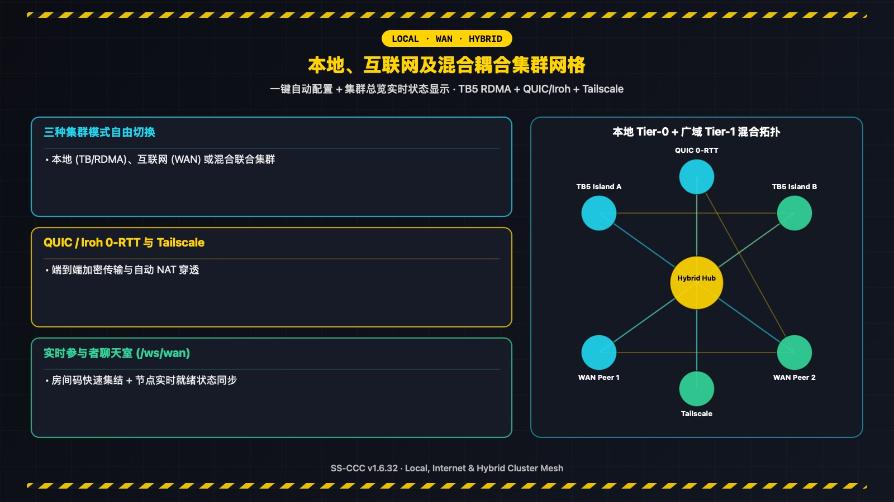<br/>
      <sub><b>全球互联网 Mac 集群 (WAN)、混合耦合与参与者聊天</b></sub>
    </td>
    <td align="center" width="50%">
      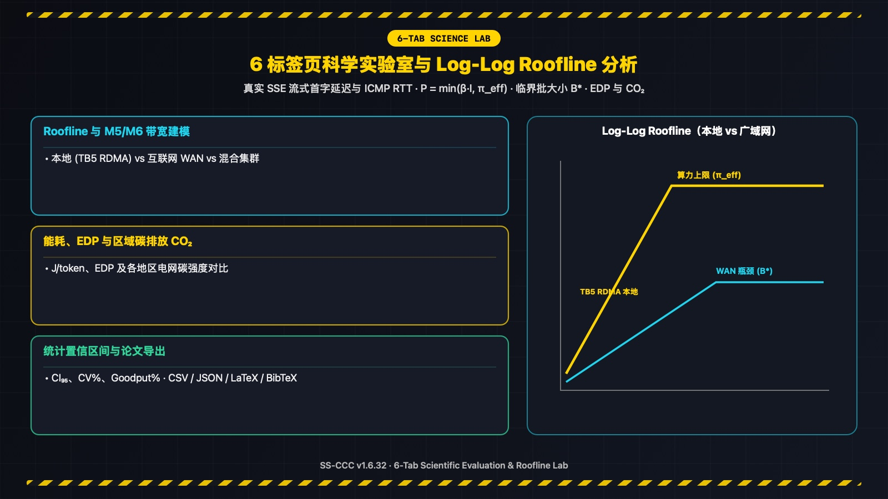<br/>
      <sub><b>Roofline 分析 (Williams)、Splitwise 阶段解耦、能耗 (J/tok) 与 p50/p95/p99</b></sub>
    </td>
  </tr>
</table>

SS-CCC 通过 **Tailscale / WireGuard、ZeroTier、libp2p QUIC 与 DERP 中继**（`/ws/wan/{room_id}`、`/ws/wan-chat`、`/ws/wan-audio`）将本地 Thunderbolt 集群与远程节点无缝连接。

---

## 🏗️ 混合架构（控制平面、Thunderbolt 与 WAN）

<div align="center">
  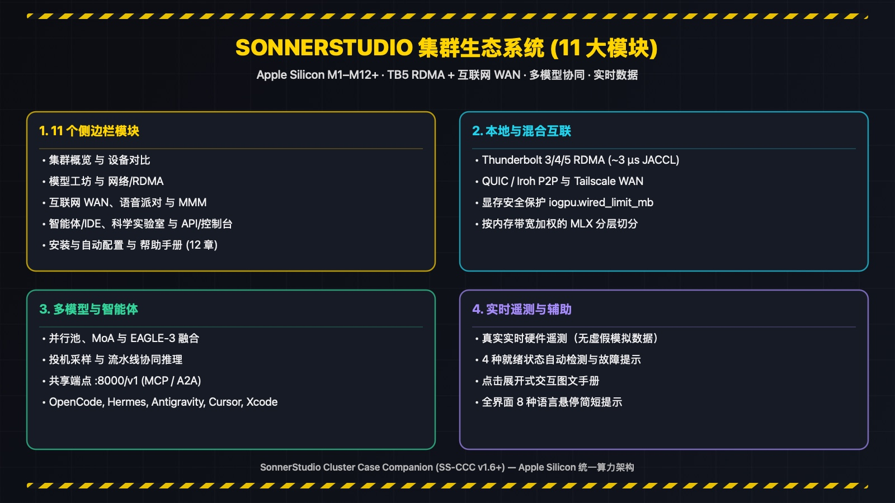
</div>

- **控制平面 (LAN / Wi-Fi):** 节点发现、OpenAI/Anthropic/Ollama 兼容接口 (`:8000`) 与健康监测。
- **数据平面 (Thunderbolt 3/4/5 + RDMA):** 基于 `10.99.1.x` 的隔离张量传输（TB4 为 `30–37 Gbps`，TB5 RDMA JACCL 双向最高 `160 Gbps` / `~3 µs` 延迟）。
- **互联网 WAN 层:** 通过微批次 (`M ≥ 4`) 隐藏跨网延迟，支持 `405B–671B+` 超大模型。

---

## 🌐 互联网集群 WAN 带宽与数据吞吐量监控

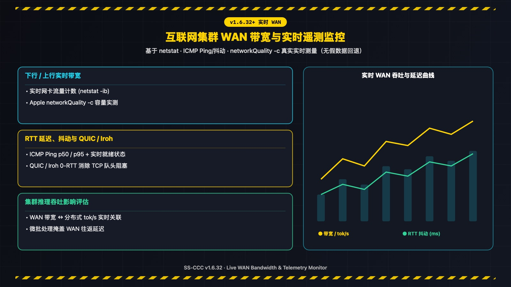

在**互联网集群与实时聊天**面板中，SS-CCC 通过 `netstat`、`ping` 与 `networkQuality` 实时监控真实 WAN 链路性能（**下行/上行 Mbps**、**WAN RTT 延迟 ms**、**抖动**、**丢包率**与**Token 同步效率**），并将其直接关联到跨节点分布式推理速度（`tok/s`）。

---

## ✨ 核心功能

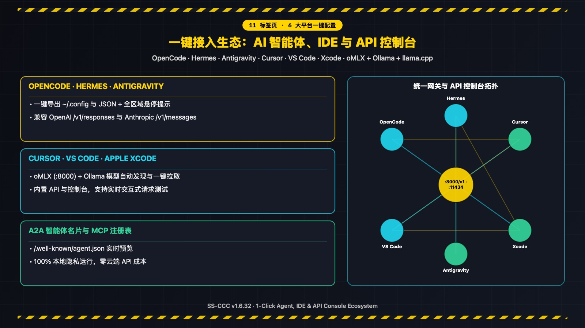

- **全系列 Apple Silicon 支持 (M1–M12+):** 涵盖 Mac mini、MacBook Air/Pro、iMac、Mac Studio 与 Mac Pro。
- **加权流水线分片 (`MemoryWeightedPlanner`):** 内存带宽最高的 Mac 自动担任 **Rank 0（协调器）** 并持有 Embeddings + LM-Head；各工作节点按可用内存比例分担层数。
- **内存安全保护 (`iogpu.wired_limit_mb`):** 每台 Mac 自动预留 4–8 GB 给 macOS 与 WindowServer，防止 OOM 崩溃。
- **运行时支持:** `MLX` (`mlx.distributed` / `JACCL`)、`oMLX`（端口 `8000`，SSD 分页 KV 缓存）、`Ollama` (`11434`)、`llama.cpp` (`8080`)。
- **一键集成:** OpenCode、Hermes Agent、Google Antigravity、Cursor、VS Code、Xcode。
- **17 种语言界面:** English、Deutsch、Français、Español、Português、Русский、日本語、中文、Nederlands、Afrikaans、Polski、Čeština、Slovenčina、Magyar、한국어、हिन्दी、தமிழ்、Nederlands、Afrikaans、Polski、Čeština、Slovenčina、Magyar、한국어、हिन्दी、தமிழ்。

---

## 🧩 11 大侧边栏模块与核心新特性

- **多模型协同模式 (Multi-Model-Mode / MMM，第 6 项菜单)：** 在**本地集群**、**互联网 WAN 集群**或**混合集群（本地 + 互联网）**中聚合多个模型的算力（支持 *Parallel Pool*、*Mixture-of-Agents*、*EAGLE-3 / Speculative*、*Tree-MoA Early-Exit* 与 *Ares*），内置 `iogpu.wired_limit_mb` 显存与热/碳感知保护，并支持 **多个 IDE 与智能体框架通过 `:8000/v1` 同时调用**。
- **安装与自动配置 (`Setup & Provision`，第 10 项菜单)：** 自动发现本地 Thunderbolt/LAN Mac（Bonjour/mDNS）、互联网对等节点（`QUIC Iroh` / `Tailscale`）或混合集群，自动完成 SSH 互信、`iogpu.wired_limit_mb` 与 `mlx.distributed_config` 配置，并执行 **4 种就绪状态检查**（**已就绪 / 未就绪 / 配置不完整 / 未配置**）。
- **实时遥测、悬停提示 Shorttips 与交互式图文手册：** 支持全界面 17 语言悬停 **Shorttips**、可点击展开图解与高亮发光的 **12 章交互式帮助中心**，以及关闭模拟模式后的 100% 真实实时硬件数据。

| 侧边栏菜单 | 核心功能与职责 |
| :--- | :--- |
| **1. 集群概览** | 统一显存分配条、活跃 M1–M12+ 拓扑、TB/RDMA 速率与 **4 状态就绪卡片** |
| **2. 设备对比** | 添加/移除任意 M1–M12+ Mac，实时对比 CPU/GPU/ANE/SSD/温度/功耗 |
| **3. 模型工坊** | 实时探测 oMLX / Ollama / llama.cpp / GGUF 模型、按内存加权分层、ANE-Split 与三层 KV/CacheGen |
| **4. 网络与 RDMA** | 切换 Auto-Hybrid / TB / LAN / RDMA、`FAST_SYNCH=1`、Pipeline Ring 与 JACCL Full-Mesh TP |
| **5. 互联网集群与聊天** | 将本地 TB/RDMA 节点与全球 WAN 节点耦合（QUIC/Iroh 0-RTT, Tailscale），**实时 WAN 带宽监控**与 Audio-Party |
| **6. 多模型协同模式 (MMM)** | *Parallel Pool*、*MoA*、*EAGLE-3*、*Tree-MoA* 与 *Ares* 协同，VRAM/热管理与多 IDE 并发共享 |
| **7. 智能体与 IDE** | 为 OpenCode、Hermes、Antigravity、Cursor、VS Code、Xcode 提供一键配置（含 **MCP / A2A**） |
| **8. 科学与 Roofline** | 6 标签页科学实验室（真实 SSE/ICMP、MMM 直接评估、Roofline、`N=1..128`、`J/tok`/`CO₂`、历史记录） |
| **9. API 与控制台** | 测试 OpenAI (`/v1/chat/completions`, `/v1/responses` + MCP)、Ollama (`/api/tags`) 与 **A2A Agent Card** |
| **10. 安装与自动配置** | 自动发现 Mac、跨节点配置（SSH / `wired_limit` / `mlx.distributed`）与 **4 状态就绪校验** |
| **11. 帮助与手册** | 可全文搜索的 **12 章 17 语言交互式图文手册** (`⌘?`)（含点击展开图解与发光高亮） |

---

## 🛠️ 从源码编译（首次运行前必读）

> **说明：** 本仓库仅包含源代码、脚本与文档，不包含预编译二进制文件。

```bash
git clone https://github.com/SonnerStudio/SonnerStudio-Cluster-Case-Companion.git
cd SonnerStudio-Cluster-Case-Companion
chmod +x scripts/*.sh
"./scripts/run_ssccc.sh"
```

---

## 🚀 快速开始

```bash
# 1. 启动原生 SwiftUI 应用
"./scripts/run_ssccc.sh"

# 2. (可选) 启动 Python/FastAPI 网关
cd core && uv sync --extra dev
PYTHONPATH=".." uv run uvicorn core.api.gateway:app --host 0.0.0.0 --port 8000

# 3. 配置 Thunderbolt 点对点 IP
./scripts/setup_tb_network.sh studio   # 10.99.1.1
./scripts/setup_tb_network.sh mini     # 10.99.1.2
```

---

## 📖 使用指南：本地与混合（本地 + 互联网）集群配置、模型加载机制与理论性能数据

### 1. 本地集群搭建 (Thunderbolt 3/4/5 与 LAN)
1. **物理连接：** 使用 **Thunderbolt 3/4/5 线缆**（点对点、环形或网状）和/或 **10GbE 以太网** 直连多台 Mac。
2. **分配点对点 IP：** 在主节点运行 `./scripts/setup_tb_network.sh studio` (`10.99.1.1`)，在工作节点运行 `./scripts/setup_tb_network.sh mini` (`10.99.1.2` 等)。
3. **可选 RDMA（macOS 26.2+ TB5）：** 启用 `rdma_ctl enable`，让 `JACCL` (`mlx.distributed`) 节点间延迟从 `~300 µs` (TCP/IP) 降至 **`~3 µs`**。
4. **自动分配 Rank：** 在 **设备与对比** 中添加所有 Mac。内存带宽最高的 Mac 自动成为 **Rank 0（协调器）**，其余成为 **Rank 1..N（工作节点）**。

### 2. 混合集群网络搭建（本地 + 互联网 WAN 同时在线）
1. **本地高速核心 (Tier 1)：** 保持本地 Thunderbolt/LAN 环网 (`10.99.1.x` / `192.168.x.x`) 运行，承载高敏感度层。
2. **WAN 协调器房间 (Tier 2)：** 在 **互联网集群与聊天** 创建 WAN 房间（`/ws/wan/{room_id}`，端口 `8000`，可通过 Tailscale、WireGuard、Cloudflare Tunnel 或反向代理暴露）。
3. **远程节点加入：** 全球任意 Mac 凭 **房间号 + 加入令牌** 作为 WAN 工作节点接入。
4. **两级混合路由：** 高频层留在本地环网 (`3–180 µs`)，溢出层通过微批次 (`M ≥ 4`) 调度至 WAN 节点 (`15–120 ms` RTT)。

### 3. 由谁加载模型？能同时加载多少个模型？请求如何流转？
- **由谁加载什么？**
  - **协调器 (Rank 0)：** 提供 API 网关 (`:8000`) 与分词，**始终持有 Embeddings 与 LM-Head (`has_embeddings=True`, `has_lm_head=True`)** 及按比例分配的 Transformer 层 (`Layers_i = TotalLayers × Usable_i / TotalUsable`)。
  - **工作节点 (Rank 1..N)：** 每个节点仅从本地 HuggingFace/oMLX/Ollama 缓存（`~/.cache/huggingface`, `~/.ollama/models`, `~/Models`）加载 **分配给自己的 Safetensors/层切片 `[start_layer .. end_layer)`**，绝不浪费内存。
- **最多可同时加载多少个模型？**
  - **分布式集群模式 (`mlx.distributed` / `JACCL`)：** 整个聚合内存池每次运行 **1 个大型分片模型**（支持快速热切换）。
  - **多模型并行模式 (`oMLX` / `Ollama` / 异构节点)：** 只要满足 `Σ (模型权重_i + KV_Cache_i) ≤ 总可用_VRAM_GB`（扣除 `iogpu.wired_limit_mb` 预留的 4–8 GB），即可 **同时常驻多个模型**（例如：**32B 编程模型 + 8B 快速路由 + 1.5B 向量模型**）。
- **端到端请求流程：**
  1. **硬件探测与链路选择** (`TB5 RDMA > TB Bridge > 10GbE > WLAN > WAN`)
  2. **分片规划** (`hostfile.json` 与 `iogpu.wired_limit_mb` 保护)
  3. **API 接入** (`http://127.0.0.1:8000/v1/chat/completions`, `/v1/messages`, `/api/chat`)
  4. **Prefill 阶段 (`TTFT`)：** Rank 0 编码提示词并沿流水线传递激活值 (`Rank 0 → 1 → ... → N → Rank 0`)
  5. **Decode 阶段 (`TPOT` 与 `tok/s`)：** 配合 `--kv-bits 4` 与 `MLX_METAL_FAST_SYNCH=1` 逐 token 生成
  6. **SSE 流式输出与遥测记录**

### 4. 不同应用场景的理论容量与性能参考

> **解析估算公式：**
> - **显存需求：** `VRAM_GB ≈ 参数量_B × (Bits / 8) × 1.15 + KV_Cache_GB`
> - **Decode 理论上限：** `tok/s ≈ (有效带宽_GB/s / 活跃权重_GB) × (1 − 通信开销)`

| 应用场景 | 拓扑与可用内存池 | 典型模型与量化 | 理论 `TTFT` (2k prompt) | 理论 Decode (`tok/s` / `TPOT`) | 能耗与主要瓶颈 |
| :--- | :--- | :--- | :--- | :--- | :--- |
| **1. 单机工作站 (Edge Dev)** | 1× Mac mini M4 (16 GB, `12 GB` 可用, `120 GB/s`) | `Qwen2.5-14B` (`4-bit`, ~8.8 GB) | `~1.8 – 2.6 s` | **`11 – 14 tok/s`** (`~75 ms/tok`) | `~1.7 J/tok` · 内存带宽 |
| **2. 单台 Pro Studio (高速编程)** | 1× Mac Studio M4 Max (64 GB, `58 GB` 可用, `546 GB/s`) | `Llama-3.3-70B` (`4-bit`, ~40 GB) | `~1.1 – 1.7 s` | **`12 – 14 tok/s`** (`~74 ms/tok`) | `~3.8 J/tok` · 内存带宽 |
| **3. 本地双节点 TB5 RDMA 环** | 2× M4 Max 64 GB (`116 GB` 可用, `~1,092 GB/s` 聚合, `~3 µs` JACCL) | `Qwen2.5-Coder-72B` (`8-bit`, ~78 GB) | `~1.4 – 2.0 s` | **`12 – 14 tok/s`** (`~76 ms/tok`) | `~7.5 J/tok` · RDMA 同步开销极低 |
| **4. 实验室 4 节点 Ultra TB5 RDMA** | 4× M3 Ultra 256 GB (`992 GB` 可用, `~3.27 TB/s` 聚合) | `DeepSeek-V3 671B MoE` (`4-bit`, ~385 GB, ~37B 活跃) | `~2.2 – 3.5 s` | **`38 – 55 tok/s`** (`~20 ms/tok`) | `~5.2 J/tok` · MoE 活跃专家带宽 |
| **5. 混合 办公室 LAN + 家庭 WAN** | 2× TB4/10GbE + 2× WAN (`192 GB` 可用, `35 ms` WAN RTT) | `Llama-3.1-405B` (`3/4-bit`, ~170 GB) | `~6 – 11 s` | **`2.2 – 4.5 tok/s`** (`~280 ms/tok`) | `~28 J/tok` · WAN 延迟 (`M=8` 缓解) |
| **6. 全球社区 WAN 集群** | 16+ Mac 全球互联 (`1.5+ TB` 可用, `60–120 ms` WAN RTT) | `671B–1T+` Frontier (`4/8-bit`) | `~12 – 25 s` | **`1.2 – 3.0 tok/s`** (`~500 ms/tok`) | WAN 延迟（批处理可扩展吞吐） |

### 5. Apple Silicon 芯片家族参数（M1–M12+，含 M5 Max/Ultra 与 M6）

| 芯片家族 | 统一内存带宽 | Thunderbolt 与 RDMA | 推荐 macOS 预留内存 |
| :--- | :--- | :--- | :--- |
| **M1 / M2** (基础版) | 68 – 100 GB/s | TB 3 / USB4 (26–32 Gbps) | **4 GB** (≤ 24 GB RAM) |
| **M3 / M4** (基础版) | 100 – 120 GB/s | TB 4 (30–37 Gbps) | **4 GB** (≤ 24 GB RAM) |
| **M5 / M6** (基础版, M6 2nm) | **153 – 170 GB/s** (`M6`: 16 GB 版 153 GB/s，24–32 GB 版 170 GB/s) | TB 4 / TB 5 (`80/120 Gbps`) | **4 GB** (≤ 32 GB RAM) |
| **M1–M3 Pro** | 150 – 200 GB/s | TB 4 (30–37 Gbps) | **4 – 6 GB** |
| **M4 / M5 Pro** | 273 – 307+ GB/s | TB 5 (`80/120 Gbps`) | **4 – 6 GB** |
| **M1–M3 Max** | 400 GB/s | TB 4 (30–37 Gbps) | **6 GB** (32–64 GB RAM) |
| **M4 Max** | **410 – 546 GB/s** (LPDDR5X-8533) | TB 5 + RDMA (`~3 µs` JACCL) | **6 GB** (32–128 GB RAM) |
| **M5 Max** | **460 – 614 GB/s** (32 / 40 核 GPU) | TB 5 + RDMA (`~3 µs` JACCL) | **6 GB** (36–128 GB RAM) |
| **M1–M2 Ultra / M3 Ultra** | **800 – 819 GB/s** (UltraFusion) | TB 4 / TB 5 RDMA (JACCL) | **8 GB** (≥ 96 GB RAM) |
| **M5 Ultra** | **1.2 TB/s** (~1,228 GB/s，最高 512 GB 内存，80 核 GPU) | TB 5 RDMA (`JACCL`) | **8 GB** (96–512 GB RAM) |

> [!NOTE]
> **M6 系列发布说明：** Apple 已于 2026 年 9–10 月发布采用 2nm（N2）工艺的基础版 **M6** 芯片（`153–170 GB/s` 内存带宽）；截至 2026 年 11 月，**M6 Pro、M6 Max 与 M6 Ultra 尚未发布**（高配 MacBook Pro 与 Mac Studio 仍搭载 M5 Pro、M5 Max 与 M5 Ultra）。SS-CCC 的开放式 `M1–M12+` 探测会在未来 M6 Pro/Max/Ultra 发布后立即自动识别支持。

---

## 📚 文档中心与 Thunderbolt 5 RDMA (`JACCL`)

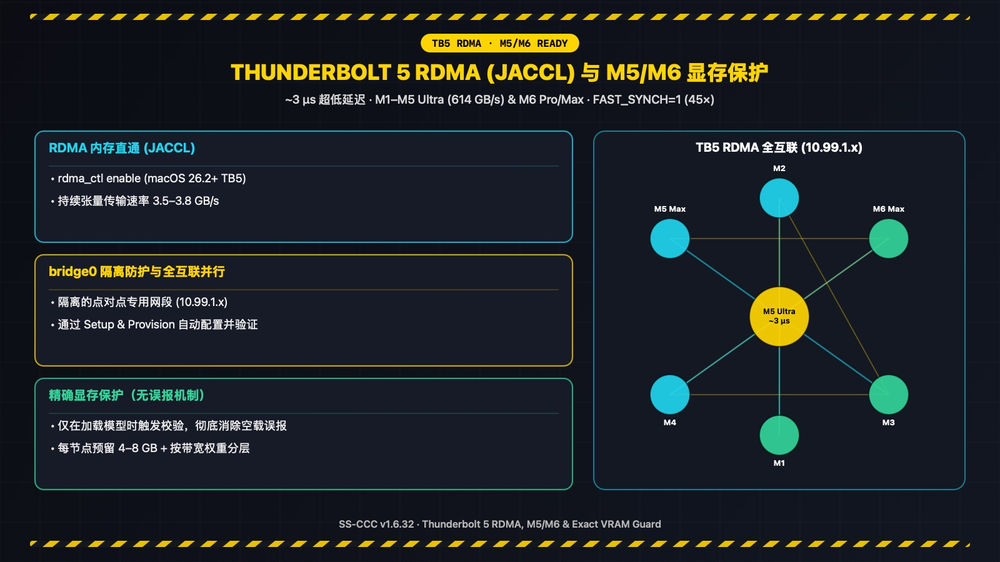

完整 **12 章交互式图文用户手册**（支持 17 种语言与点击展开图解）已内置于应用的 **帮助与手册** 标签页中。

---

## 🔄 GitHub 托管更新与自动版本控制

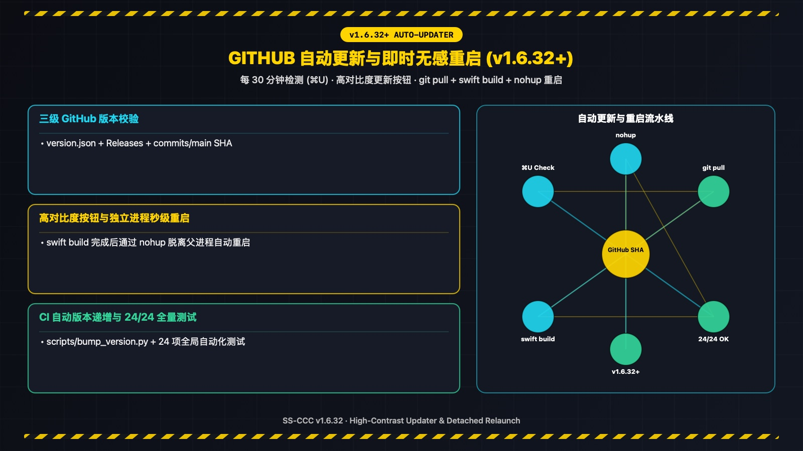

- **每 30 分钟自动检测：** 比对 `version.json`、GitHub Releases 与 `main` 分支提交 SHA。
- **一键更新：** 应用内直接执行 `git pull` + `swift build` + 一键重启。
- **CI Auto-Bump：** 推送至 `main` 时由 GitHub Actions 自动递增构建号。

---

---

## 🧠 Multi-Model-Mode (MMM) — 多模型编排、算力聚合与多 IDE 共享调用

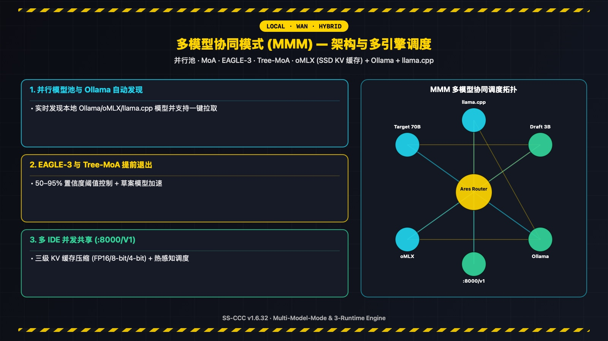

**Multi-Model-Mode (MMM)**（位于左侧边栏**第 6 个菜单项**）将**本地 Thunderbolt/RDMA 集群**、**互联网 WAN 集群**或**混合集群（本地 + 互联网）**的计算能力与统一内存汇聚为一个统一的编排层。无需在每个节点上仅运行单一巨型模型，多个专业模型和副本可以**并行、级联或共识**运行，并通过共享端点 `:8000/v1` 同时服务于**多个 IDE 和 Agent Harness**。

### 🎛️ 4 种核心编排策略

1. **Ensemble / Consensus（多模型共识投票）**
   - 将同一提示词同时发送至多个分布式模型（例如：本地 TB5 节点上的 `Qwen3-Coder-30B` + WAN 伙伴节点上的 `DeepSeek-R1-Distill` + 混合分片中的 `Llama-3.3-70B`），综合生成经过交叉验证的共识结果。
   - 非常适用于关键代码审计、架构决策和幻觉检测。

2. **Pipeline / Cascade（分阶段专家级联）**
   - 将不同规模与特长的模型串联为流水线：高速本地模型负责初步分类与规划，将复杂子任务路由至混合网络中的大型推理或编程模型，最后交由轻量模型完成校验与格式化输出。
   - 在保持深度推理质量的同时大幅降低首字延迟（**TTFT**）。

3. **Specialist Router（按任务类型智能路由）**
   - 自动识别来自 IDE / Harness 的请求类型（`code_edit`、`refactor`、`test_gen`、`reasoning`、`vision`、`docs`），并将其路由至集群中最快、最匹配的模型。
   - 延迟与吞吐量收益会实时采集并直接送入 **🔬 科研与性能（Roofline 模型）**。

4. **Parallel Fan-Out（多流并行扇出与多副本加速）**
   - 将大型文件集、测试套件或并行智能体工作流同时分发至多个本地与 WAN 节点执行，最大化集群总吞吐量（汇总 `tok/s`）。

### ⚙️ 一键自动配置与后期实时编辑器

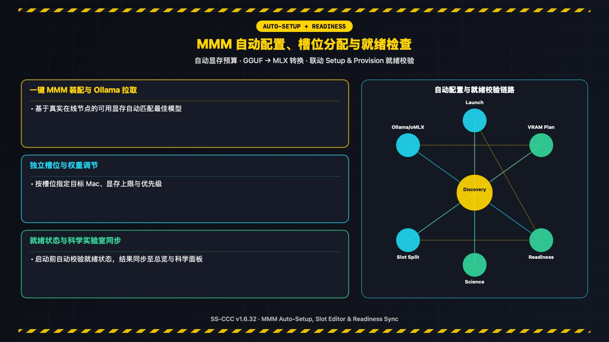

在集群中部署多模型变得极简高效，且部署后随时可自由调整：
- **一键自动配置预设**：提供 **Coding & IDE 蜂群**、**共识与审计**、**Turbo（Draft + Target）** 与 **分阶段流水线** 四种预设，自动扫描可用节点、安全显存池（`iogpu.wired_limit_mb`）与已加载模型并智能分配。
- **全面支持后期调整与修改**：随时上/下移动流水线顺序、一键复制副本至其他节点、独立开关任意槽位，或展开**行内槽位编辑器**修改显示名称、模型 ID、端点 URL（`:8000/v1`、`:11434/v1`）与 VRAM 限额。
- **VRAM-Fit 自动优化与 JSON 持久化**：拓扑变化时一键自动适配显存上限，并支持本地持久化保存与 JSON 配置导出。

### 🔌 多 IDE 与 Agent Harness 共享消费 (`:8000/v1`)

- **单集群多端共享**：**MMM** 在 `:8000/v1` 暴露 OpenAI 兼容代理，使 **Xcode、VS Code、Cursor、Antigravity、Claude Code、Codex CLI、Goose** 以及自定义脚本能够同时并发访问同一模型池。
- **VRAM 安全保护与内存上限 (`iogpu.wired_limit_mb`)**：在同时加载多个模型前，MMM 会校验每个节点的 macOS 系统保留内存（4–8 GB），防止本地、WAN 或混合拓扑发生 OOM 崩溃。
- **科研级遥测直连**：每次 MMM 运行都会将单模型及汇总指标（TTFT、`tok/s`、RDMA/WAN 总线利用率、并行效率与编排开销）直接导出至 **🔬 科研与性能** 面板，用于 Roofline 分析与 CSV/Markdown 导出。

### 💡 Multi-Model-Mode (MMM) 典型应用场景

1. **多 IDE 并发智能体开发蜂群**
   - 开发者在 **Xcode** 中进行低延迟 Swift 代码补全（由本地 Mac Studio 响应），同时在 **Cursor / VS Code** 中运行安全审计，并在终端通过 **Claude Code** 批量生成单元测试——全部共享同一个混合 MMM 集群且互不阻塞。
2. **多模型共识代码审查与架构把关（Ensemble）**
   - 涉及核心基础设施或加密逻辑的变更由 3 个异构模型（`Qwen3-Coder`、`DeepSeek-R1`、`Mistral-Large`）并行评审；MMM 自动比对分歧并在提交前标出潜在风险。
3. **“本地 + 互联网”混合大规模仓库重构**
   - 本地 **Thunderbolt 5** 集群以低于 50 ms 的延迟负责实时补全与文件索引，而 **WAN** 伙伴集群承担数百个文件的深度规划与跨模块重构，避免本地节点过载。
4. **实时科研基准测试与量化模型 A/B 对比**
   - 研究人员使用 Fan-Out 模式将同一批测试集同时发送给 4 个不同量化精度模型（`4-bit MLX`、`8-bit MLX`、`Q4_K_M`、`FP16`）；**🔬 科研与性能** 面板自动对比 Roofline 曲线、每瓦特 `tok/s` 与输出质量。
5. **多模态开发流水线（Vision + Code + Docs）**
   - UI 智能体将界面截图发送给工作节点上的视觉语言模型（VLM），将修复规划交给推理模型，再由代码专精模型生成 SwiftUI/HTML 补丁——全流程在单一 MMM 流水线中无缝完成。
6. **分布式团队动态负载均衡（Dev-Mesh）**
   - 团队成员通过 **互联网 WAN 集群** 互联各自的 Mac；MMM 的 **Specialist Router** 自动将各成员 IDE 的请求分配给当前可用显存最充裕、温度负载最低的节点。

---

## 🎙️ 集群 Audio-Party 语音派对与实时 WAN 协作

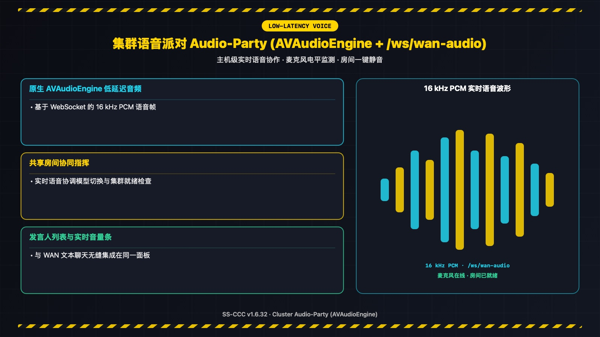

内置基于 `AVAudioEngine 16 kHz PCM16 · /ws/wan-audio` 的主机风格语音派对。

---

## 📊 科学实验室 (6 个标签页) 与历史记录

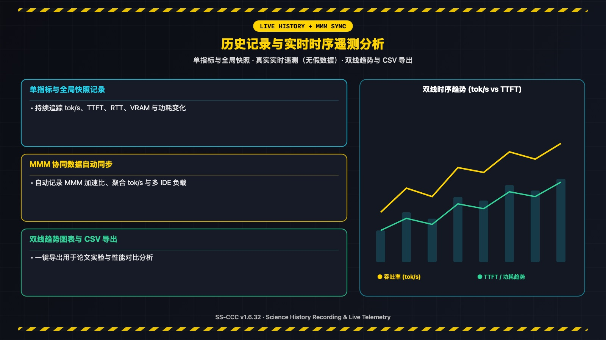

支持按单指标或全局自动/手动录制，并导出 `CSV / JSON / LaTeX / BibTeX`。

---

## 🏆 世界纪录挑战：本地 + 全球混合超级集群

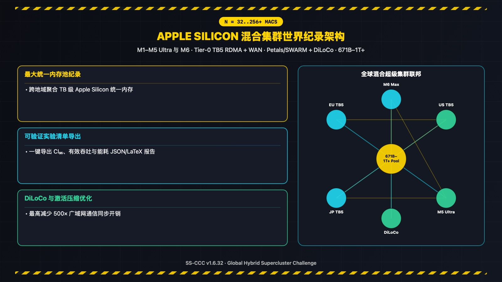

**由分散在全球各地的 Apple Silicon Mac 组成的去中心化联盟，能否媲美数据中心超级计算机？**  
我们诚挚邀请全球高校、AI 研究实验室、开发者社区与 Apple Silicon 爱好者共同组织官方 **SS-CCC 混合超级集群世界纪录挑战** —— 利用 SS-CCC 的 **混合桥接（本地 + 互联网耦合）**、**Cluster Audio-Party** 与 **6 标签页科学实验室**，同时联合尽可能多的 **本地 Thunderbolt 3/4/5/RDMA 集群** 与 **互联网 WAN Mac**。

### 🔬 科学原理与数学扩展模型

1. **两级分层拓扑（Tier-0 本地 TB/RDMA 集群岛 + Tier-1 WAN 骨干网）：**
   - 扁平化的互联网集群会在每一层边界都跨越广域网高延迟链路 ($H_{\text{WAN}} = N - 1$)，导致吞吐急剧下降。
   - 通过 **SS-CCC 混合桥接**，连续的 Transformer 层保留在高速本地 Thunderbolt 集群岛内（`~0.07 ms` 延迟，`30–110 Gbps`），将跨网通信严格限制在少数 **岛间 Rank 0 网关交接** ($H_{\text{WAN}} \ll N_{\text{total}}$)。
2. **通过临界微批次 ($B^*$) 与激活压缩隐藏 WAN RTT：**
   - 流水线效率遵循 GPipe 气泡公式：
     $$\Phi_{\text{bubble}} = \frac{N - 1}{M + N - 1}, \qquad B^* = \left\lceil \frac{T_{\text{RTT,WAN}} + T_{\text{tx}}}{T_{\text{comp}}(B=1)} \right\rceil$$
   - 将微批次深度 $M$ 提升至 $B^*$ 可在并发流水线执行中掩盖跨洲际往返延迟，同时 **FP8 / INT4 / Top-K 激活压缩** (*Petals / SWARM*) 将每跳通信负载压低至常规 WAN 上行带宽的 $1\%$ 以下。
3. **标准化可复现纪录协议 ($T = 0.0$)：**
   1. **组建 Tier-0 本地岛：** 通过 Thunderbolt 3/4/5 连接本地 M1–M9+ Mac（启用 `MLX_METAL_FAST_SYNCH=1`）。
   2. **桥接与协同：** 启用 **混合桥接**，分享 `SSCCC-WAN-…` 房间号，并加入 **Cluster Audio-Party**（`Opus 16 kbps`，WAN 占用 $<0.02\%$）同步层划分。
   3. **执行测试：** 在 **科学与 Roofline** 中切换至 **Internet-WAN**，运行 `N = 20` 次试验（丢弃 `1` 次预热，`T = 0.0`），验证目标 SLO（`TTFT ≤ 2500 ms`，`TPOT ≤ 100 ms/tok`）。
   4. **归档验证：** 导出并公开包含 `hardware_fingerprint`、`TTFT/TPOT (p50/p95/p99 ± CI₉₅)`、`CV%`、`Goodput%`、`J/tok`、`EDP` 与 `gCO₂eq/1M tok` 的 **JSON 可复现清单**、**CSV 日志** 与 **LaTeX (`booktabs`) 表格**。


### 🥇 官方纪录类别
- **最大统一内存池：** 本地与 WAN 耦合后可支配的最大总可用 VRAM (`GB` / `TB`)。
- **最多同时耦合 Mac 数量 ($N$)：** 成功完成有效 `N = 20` 试验的最大活跃网格（`32–256+` 节点）。
- **最高跨洲混合 Goodput：** 横跨 $\ge 2$ 个大洲且满足交互式 SLO 的最高 `tokens/s`。
- **最佳集群能效：** `70B+` 参数规模模型下的最低 `Joules/token` 与 `EDP (J·s)`。

---

## 🎯 应用场景与目标用户

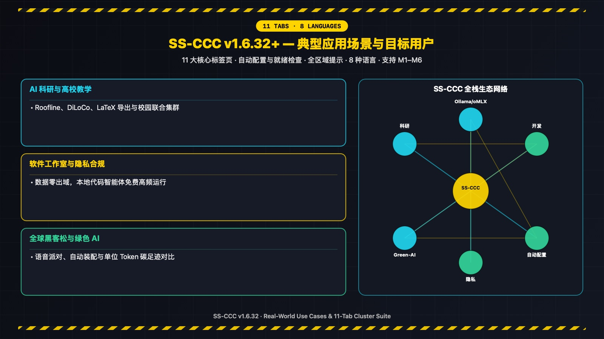

| 用户群体 | SS-CCC 实际应用场景 |
| :--- | :--- |
| **AI 系统与 ML 研究人员** | 对比本地与 WAN 的 Roofline 极限 ($P = \min(\beta \cdot I, \pi_{\text{eff}})$)、*Petals/SWARM* 压缩、*DiLoCo* 与 DDP 通信开销，并将 `CI₉₅` + `LaTeX`/`BibTeX` 直接导出至论文。 |
| **高校与教学科研实验室** | 跨校园局域网与家庭宽带聚合学生 MacBook 与实验室 Mac mini，通过 **Audio-Party** 协作组建共享 `70B–405B+` 教学集群。 |
| **软件工作室与智能体团队** | 在现有办公 Mac 上零云端费用运行私有编程大模型，直接驱动 **OpenCode**、**Hermes Agent**、**Antigravity**、**Cursor**、**VS Code** 与 **Xcode**。 |
| **隐私优先的医疗、法律与研发** | 敏感文档严格留在本地内网或加密 **WireGuard / Tailscale** 隧道中，杜绝任何第三方 API 遥测或数据外泄。 |
| **全球开源计算群与黑客松** | 数分钟内跨国组建临时超级集群，通过主机风格语音派对协调分工并冲击社区规模纪录。 |
| **绿色 AI 与可持续能效审计** | 对比不同电网碳强度（挪威水电 vs 欧美电网）下的 `J/token`、`EDP` 与 `gCO₂eq/1M tokens`，全面对标数据中心 GPU API。 |

---

## 🚀 2026 SOTA 架构升级（第 11 阶段）

- **TB5 RDMA 张量并行与 QUIC / Iroh WAN：** 支持在 **Pipeline Ring** 与 **JACCL Full-Mesh TP**（`ClusterMeshTopology`）间切换，提供 `rdma_ctl enable` + `bridge0` 防护预检、`mlx.distributed_config` JSON 导出，以及消除 TCP 队头阻塞的 **QUIC / Iroh P2P（0-RTT 多路复用）**。
- **分离式 Prefill/Decode（ANE-Split）与三层 KV-Cache / CacheGen：** 将提示词预填充卸载至 Apple 神经网络引擎（ANE），解码保留在 MLX GPU（`EDP ×1.42`，功耗降低 `-31.5%`），并支持 **RAM → NVMe SSD → Peer CacheGen**（`3.6×` 压缩）及前缀命中 TTFT 遥测。
- **下一代 MMM（EAGLE-3、Tree-MoA Early-Exit 与自适应置信度路由）：** 在多模型模式中集成 **EAGLE-3** 多层特征融合、**Tree-MoA Early-Exit** 置信度阈值（`50–95%`）与 **Adaptive Confidence Escalation (Ares)**。
- **现代智能体与网关标准：** 实时预览并导出 **OpenAI `/v1/responses` + MCP**、**MCP Server Registry JSON** 以及 **A2A Agent Card**（`/.well-known/agent.json`）。
- **热感知与碳感知调度：** 自动降级 `.serious`/`.critical` 热状态节点并优先调度高能效节点。
- **第 12 阶段 — 集群自动配置（`安装与自动配置`）、就绪检查与全局 Shorttips：** 新增第 11 个侧边栏分类，自动发现并配置本地/WAN/混合集群，在概览与设置页报告 **就绪 / 未就绪 / 配置不完整 / 未配置**，并支持全界面 17 语言悬停 Shorttips、点击展开图文帮助及真实实时数据。

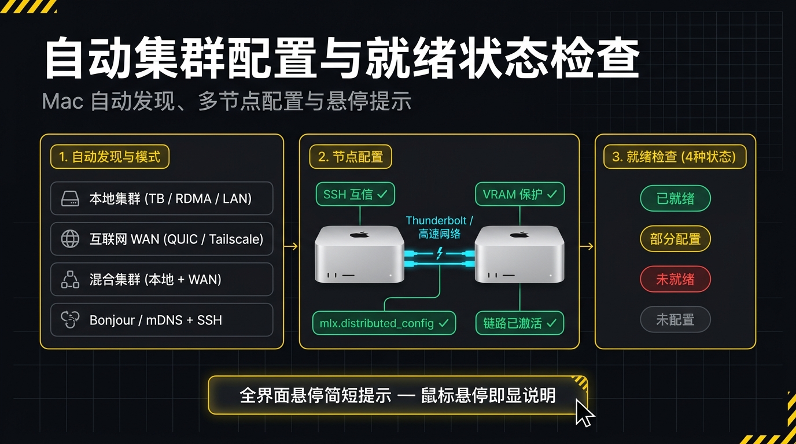

---

## 📁 仓库结构

```text
├── app/Sources/
│   ├── SSCCCApp.swift              # 主窗口、顶部更新胶囊与 UpdatePromptSheet
│   ├── Models/
│   │   ├── ClusterModels.swift     # M1–M12+ 芯片推断、WAN/科学/历史与版本模型
│   │   └── Localization.swift      # 完整 17 种语言界面与帮助词典 (EN/DE/FR/ES/PT/RU/JA/ZH/NL/AF/PL/CS/SK/HU/KO/HI/TA/NL/AF/PL/CS/SK/HU/KO/HI/TA)
│   ├── ViewModels/
│   │   └── ClusterViewModel.swift  # 硬件探测、模型发现、WAN/Audio-Party 与 GitHub 更新器
│   └── Views/                      # 12 个模块化 SwiftUI 视图 + Theme.swift（11 侧边栏、Setup、交互式帮助、警示条与发光高亮）
├── core/                           # Python FastAPI 网关、WebSocket WAN/音频中继与 MLX 分片
├── scripts/
│   ├── run_ssccc.sh                # 编译并启动 macOS 应用
│   ├── bump_version.py             # 将 version.json 与 ClusterModels.swift 同步至 Git
│   ├── setup_tb_network.sh         # 配置 10.99.1.x Thunderbolt 桥接网络
│   └── setup_wired_limit.sh        # 应用安全的 iogpu.wired_limit_mb 内存上限
├── tests/                          # 25 项全局自动化测试套件 (Swift + Python)
├── .github/workflows/              # 自动 CI 版本控制与打标
└── version.json                    # 托管于 GitHub 的更新控制清单
```

### 🛰️ 最小化至顶部菜单栏模式（Agents 与 IDE 后台服务，`⌘⇧M`）

- **无缝移入 macOS 顶部菜单栏：** 点击窗口黄色最小化按钮、按下 **`⌘⇧M`** 或点击顶部 **移至菜单栏** 按钮，主窗口即刻隐藏，SS-CCC 将作为 `.accessory` 后台服务静默驻留在 **Ollama** 等托盘图标旁。
- **直观的菜单栏实时指标：** 弹窗即刻展示 **就绪状态**、**聚合与可用内存 (GB)**、**在线节点数**、**已加载模型与层分配**、**运行时** 及 **MMM 槽位**。
- **1 键复制端点与已接入 IDE：** 直接复制 **`http://127.0.0.1:8000/v1`** 或 **`http://127.0.0.1:11434`** 供 Cursor、OpenCode、Hermes Agent、Antigravity、VS Code 和 Xcode 使用。
- **随时秒速还原：** 随时从菜单栏（`⌘⇧M`）或程序坞恢复完整 Studio 主窗口。

---

## 🚧 开发状态与诚邀参与

> [!IMPORTANT]
> **SS-CCC (v1.6+) 已可完整编译运行并通过全部 `25/25` 项自动化测试；异构多节点长时间稳定性压测仍在持续推进。**
> **已实现并验证：** 英文默认启动与全 **17 种语言** (`EN/DE/FR/ES/PT/RU/JA/ZH/NL/AF/PL/CS/SK/HU/KO/HI/TA/NL/AF/PL/CS/SK/HU/KO/HI/TA`) 覆盖 **全部 11 个界面、子菜单、按钮、表格与深度帮助卡片的完整本地化 (`L10n.tr`)**、本地 Mac 节点卡片的 **CPU、GPU 与神经网络引擎 (ANE) 核心数**显示、**11 项侧边栏模块**（含 **安装与自动配置**）、**3 标签页集群概览**、**黄黑斜纹工业警示条**与 **Solaris 发光高亮**、开放式 M1–M12+ 硬件探测（含 M5 Max/Ultra 与 M6）、真实实时遥测数据（关闭模拟即无虚假数据）、实时模型发现 (oMLX / Ollama / llama.cpp / GGUF)、6 标签页科学实验室、本地 ↔ 互联网 WAN 混合耦合、`AVAudioEngine` 集群 Audio-Party、**12 章交互式图文帮助中心**、**全界面 17 语言悬停 Shorttips** 以及由 GitHub + CI 驱动的自动更新机制。

我们热忱邀请开发者、研究人员与 Apple Silicon 爱好者 **共同参与并推动 SS-CCC 不断完善**：
- **在您的硬件上实测：** 在 M1–M12+ Mac 上运行 SS-CCC，并分享吞吐量、显存占用及 RDMA/JACCL 稳定性数据。
- **加入混合世界纪录挑战：** 将本地 Thunderbolt 集群与 WAN 节点联合，发布导出的 JSON / CSV / LaTeX 验证清单。
- **提交 Pull Request：** 无论是 SwiftUI 界面优化、Python/MLX 分片策略、Thunderbolt 脚本还是多语言翻译改进，我们都非常欢迎！

---

## 📄 许可证

基于 [MIT 许可证](LICENSE.md) 发布。
