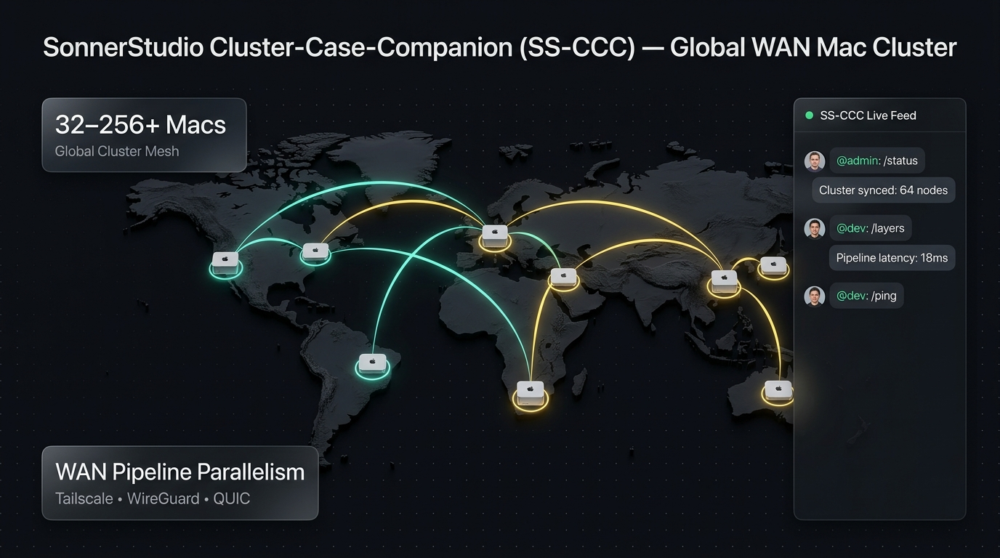

# Press Release: SonnerStudio Cluster-Case-Companion (SS-CCC) Expands into a Global Apple Silicon Cluster with a 5-Tab Research Lab

**November 14, 2026 — SonnerStudio** announces a major development milestone for **SonnerStudio Cluster-Case-Companion (SS-CCC)**. Built natively in SwiftUI for macOS, the open-source companion now extends beyond local Thunderbolt 3/4/5 interconnects to support **global Internet WAN Mac clusters with built-in participant chat** alongside a **5-tab scientific research laboratory** tailored for systems researchers and AI engineers.


---

### Key Development Highlights

1. **Universal Apple Silicon Clustering Across M1–M9+ Generations**
   SS-CCC removes fixed hardware pairings and supports any **Mac mini, MacBook Air, MacBook Pro, iMac, Mac Studio, or Mac Pro** spanning **M1 through M6** as well as open-ended future **M7, M8, and M9+** processors. The node with the highest Unified Memory bandwidth automatically serves as **Rank 0 (Coordinator)**, protected by `iogpu.wired_limit_mb` macOS memory guards.

2. **Global Internet WAN Cluster & Real-Time Participant Chat (`/ws/wan/{room_id}`)**
   Through the new **Internet Cluster & Chat** sidebar module, Apple Silicon Macs worldwide can form encrypted distributed clusters over **Tailscale / WireGuard**, **libp2p / DERP P2P relays**, or manual endpoints — scaling from small private teams to **32–256+ Mac research swarms**. An integrated WebSocket room chat enables participants to share room codes, live telemetry, and proportional layer assignments in real time.

   

3. **5-Tab Scientific Research Lab for Local & Internet-WAN Clusters**
   The **Science & Roofline** module has been massively expanded into a 5-tab workbench with an instant scope switcher (**Local TB/RDMA**, **Internet WAN**, and **Side-by-Side Comparison**):
   - **Roofline & Bottleneck:** Interactive log-log Roofline plot $P(I) = \min(\beta \cdot I, \pi_{\text{eff}})$ featuring an effective WAN/interconnect ceiling, automatic bottleneck classification, and critical batch size $B^*$ computation.
   - **WAN Topology & Scaling:** Stacked per-step latency decomposition, *Petals / SWARM* activation compression (`FP16`, `FP8/INT8`, `INT4`, `Top-K`), straggler and tail-jitter simulation, multi-regime scaling curves ($N = 1 \dots 128$ nodes), and **DiLoCo vs. naive DDP** communication analysis for WAN fine-tuning.
   - **Memory & KV Analysis:** Exact Transformer memory equation tracking weights, activations, `iogpu.wired_limit_mb` headroom, and maximum context length $S_{\max}$ across `FP16 / 8-bit / 4-bit` KV quantization.
   - **Energy, CO₂ & Cost:** *TokenPowerBench* evaluation (`J/token`, Energy-Delay Product `EDP`), regional carbon intensity profiles (`gCO₂eq/kWh`), electricity cost per 1M tokens, and datacenter Cloud API TCO comparison.
   - **Trials, Stats & Export:** Reproducible `T = 0.0` trials ($N \in \{5, 10, 20\}$) reporting `p50/p95/p99`, **95% Confidence Intervals (`CI₉₅`)**, `CV%`, **Goodput (`SLO pass %`)**, per-trial telemetry tables, and one-click **CSV**, **JSON Manifest**, **LaTeX (`booktabs`)**, and **8-paper BibTeX** export.

   

4. **Live Model Discovery, Full Hardware Telemetry & Global Test Suite**
   Model Studio discovers real models directly from **oMLX**, **Ollama**, **llama.cpp**, local `.gguf` files, and `~/.cache/huggingface/hub`, replacing empty mock profiles with live runtime readiness checks. Hardware telemetry reads CPU P/E cores, GPU cores, Neural Engine cores, NVMe SSD capacity, thermal state, and power draw. A comprehensive `tests/` suite verifies the full Swift build, open-ended `M1–M9+` scaling, and 5-language localization (**English, German, French, Spanish, Portuguese**).

---

### Repository & Availability

The complete source code, 5-language documentation, scientific research lab, and test suite are available on GitHub:

- **GitHub Repository:** https://github.com/SonnerStudio/SonnerStudio-Cluster-Case-Companion
- **Quick Start on Apple Silicon (macOS 14.0+):**
  ```bash
  git clone https://github.com/SonnerStudio/SonnerStudio-Cluster-Case-Companion.git
  cd SonnerStudio-Cluster-Case-Companion
  chmod +x scripts/run_ssccc.sh && ./scripts/run_ssccc.sh
  ```

*(Note: The repository ships the Swift source code; `./scripts/run_ssccc.sh` compiles the native macOS application locally on your Mac.)*
